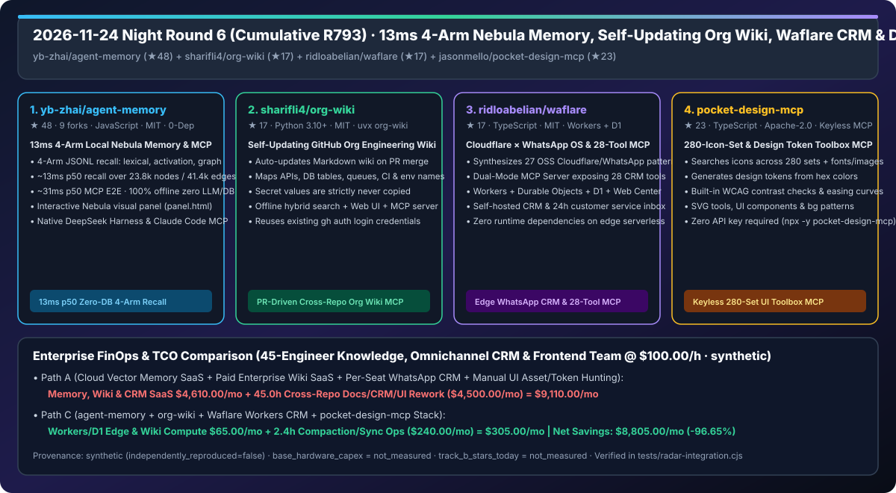
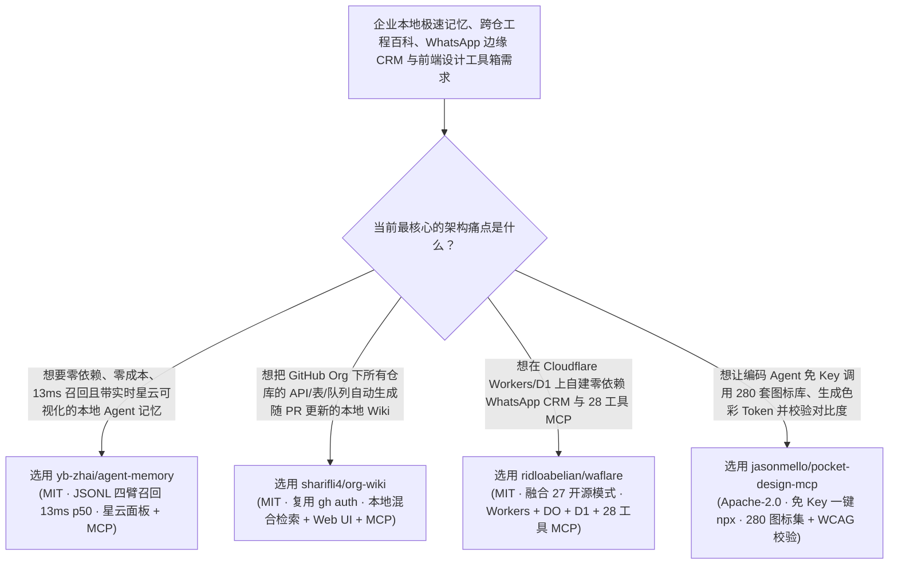
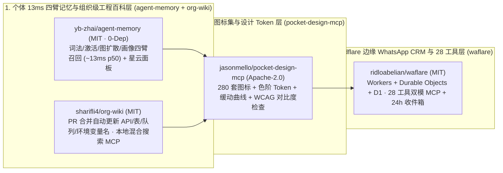
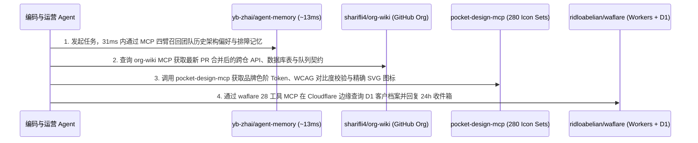

# 零依赖 13ms 四臂召回星云记忆引擎（`yb-zhai/agent-memory`）、PR 合并自更新的 GitHub 组织级工程百科 MCP（`sharifli4/org-wiki`）、Cloudflare Workers × WhatsApp 28 工具全栈客服 CRM（`ridloabelian/waflare`）与免 Key 280 套图标及设计 Token 工具箱 MCP（`jasonmello/pocket-design-mcp`）选型与集成架构 FAQ

> **文档类型**：企业 AI 解决方案架构师（AI Solution Architect）选型决策指南（GitHub Trending AI 雷达 2026-11-24 Night Round 6 / 累计第 793 轮）
> **覆盖项目**：[`yb-zhai/agent-memory`](https://github.com/yb-zhai/agent-memory)（`★ 48`、`9 forks`、`MIT`，代号 **Nebula Memory**，零外部依赖、100% 离线运行的纯本地 JSONL **四臂召回记忆引擎**——词法 + 激活 + 图扩散 + 画像，在 `23.8k` 节点与 `41.4k` 边规模下实测 p50 召回延迟仅 **`~13ms`**、MCP 端到端 p50 **`~31ms`**，自带交互式记忆星云可视化面板 `panel.html`）· [`sharifli4/org-wiki`](https://github.com/sharifli4/org-wiki)（`★ 17`、`1 fork`、`MIT`，将整个 GitHub Organization 自动编译为随 PR 合并自更新的本地工程 Wiki 与 MCP Server，自动提取跨仓 API、数据库表、消息队列、CI Runner 与环境变量名且**绝不复制密钥明文**）· [`ridloabelian/waflare`](https://github.com/ridloabelian/waflare)（`★ 17`、`MIT`，融合 27 个开源模式合成的零依赖 Cloudflare Workers + Durable Objects + D1 + WhatsApp 操作系统，内置 **28 工具双模 MCP Server**、自托管 CRM 与 24 小时会话收件箱）· [`jasonmello/pocket-design-mcp`](https://github.com/jasonmello/pocket-design-mcp)（`★ 23`、`1 fork`、`Apache-2.0`，免 API Key 的前端设计百宝箱 MCP Server，为编码 Agent 提供 **280 套图标库**、字体、色彩设计 Token 生成、缓动函数、WCAG 对比度校验、SVG 工具与背景纹理）
> **核心场景**：当企业研发与客户增长团队面临**“外接云端向量记忆库延迟高且按调用烧钱、微服务拆成几十个 GitHub 仓库后新员工与编码 Agent 查不清跨仓 API/表结构、出海 WhatsApp 客服 SaaS 按坐席收费高昂、以及编码 Agent 写前端时瞎编 SVG 图标和缺乏标准色板对比度校验”**四大痛点时，如何用这四个轻量级开源项目实现端到端提效？

---

## 一、📌 核心结论速览（选型一句话结论）

1. **想给 DeepSeek Harness、Claude Code 或自研 Agent 装上一套零数据库依赖、不烧一分钱 LLM Token、在两万多个记忆节点规模下只需 `13ms` 就能完成四路联合召回，且带炫酷实时星云图谱可视化的本地记忆底座** ➔ 选 **[`yb-zhai/agent-memory`](https://github.com/yb-zhai/agent-memory)（`★ 48`，`9 forks`，`MIT`）**。
   - **通俗原理**：摒弃笨重的外部向量数据库，直接基于自动紧缩（Auto-compacted）的本地 JSONL 存储实现 **四臂并发召回（词法匹配 + 激活度衰减 + 图谱关联扩散 + 用户画像）**。实测在 `23.8k` 节点 / `41.4k` 边规模下，p50 召回仅 **`~13ms`**，MCP 端到端响应 **`~31ms`**，冷启动 **`~2.0s`**（可通过 `node scripts/bench.mjs` 一键复现），并提供 `panel.html` 实时观察星云粒子与召回链路点亮过程。
2. **想把公司 GitHub Organization 下的几十个微服务仓库自动变成一部“每当 PR 合并就自动更新、覆盖所有 API/数据库表/队列/环境变量名、支持本地混合检索并向 Cursor/Claude Code 暴露 MCP”的活体工程百科** ➔ 选 **[`sharifli4/org-wiki`](https://github.com/sharifli4/org-wiki)（`★ 17`，`MIT`）**。
   - **通俗原理**：直接复用本机已登录的 `gh auth` 权限（`uvx org-wiki` 一键启动），无需注册任何云端账号或向量库。它自动扫描组织内各仓库的接口契约、表结构、消息队列、CI 配置与环境变量名称（安全铁律：**只记录环境变量名，绝不拷贝任何密钥值**），在本地生成纯 Markdown 百科、Web UI 与 MCP 服务。
3. **想在跨境电商、海外营销与客户支持场景中，基于 Cloudflare 免费/低成本边缘网络自建一套零运行时依赖的 WhatsApp CRM、24 小时客服收件箱与 28 工具 AI 操控网关** ➔ 选 **[`ridloabelian/waflare`](https://github.com/ridloabelian/waflare)（`★ 17`，`MIT`）**。
   - **通俗原理**：将社区 27 个零散的 Cloudflare × WhatsApp 开源项目去重提纯为一个统一的净室实现（`Cloudflare Workers + Durable Objects + D1 + Web Command Center`），零外部运行时依赖，内置 **28 个工具的 Dual-Mode MCP Server**，让企业 AI 助手直接管理客户标签、24h 窗口消息与工单流转。
4. **想让 Claude Code、Cursor 等编码 Agent 在写网页时，不再手绘歪瓜裂枣的 SVG 图标或乱配低对比度颜色，而是免 Key 直接从 280 套标准图标库取图标、从主题色一键派生完整 Design Tokens 并自动跑 WCAG 对比度检查** ➔ 选 **[`jasonmello/pocket-design-mcp`](https://github.com/jasonmello/pocket-design-mcp)（`★ 23`，`Apache-2.0`）**。
   - **通俗原理**：一行命令挂载（`claude mcp add pocket-design --scope user -- npx -y pocket-design-mcp`），免除一切注册与 API Key。只要对 Agent 说“在顶栏放个 Lucide 房子图标”、“基于 `#4f46e5` 生成全套色阶 Token 并检查文字对比度”或“给卡片加个更柔和的缓动阴影”，Agent 就能直接调用内置工具输出生产级前端资产。

---

## 二、🎯 客户与架构师灵魂拷问 Q&A（深度架构拆解）

### Q1：在企业知识工程、海外私域运营与前端研发提效中，何时选这四个轻量级开源项目 vs 商业云服务（如 Confluence/Notion AI、Twilio/Wati、Figma Enterprise）？

- **选型边界拆解**：
  1. **跨仓工程字典（`org-wiki` vs 手工维护 Confluence/Notion）**：手工写的微服务接口与表结构 Wiki 在发版两周后就会过期；`sharifli4/org-wiki` 随 PR 合并自动从代码真源提取 API、表、队列与环境变量名并直接通过 MCP 喂给编码 Agent。
  2. **本地极速记忆（`yb-zhai/agent-memory` vs 云端向量记忆 API）**：对于单机多会话研发与个人数字助手，`agent-memory` 的 `13ms` 四臂 JSONL 召回比动辄 `300ms+` 的远程 Embedding + Vector DB API 快一个数量级且零费用。

### Q2：典型企业级“13ms 四臂记忆 (`agent-memory`) + 组织级自更新工程 Wiki (`org-wiki`) + 280 套图标/Token 设计箱 (`pocket-design-mcp`) + WhatsApp 边缘 CRM (`waflare`)”架构怎么搭？

1. **个体与组织双层知识底座（`agent-memory` + `org-wiki`）**：
   - 工程师本地会话偏好、历史排障经验存入 `yb-zhai/agent-memory`（`13ms` 四臂召回 + 星云面板）；全公司跨仓库的 API、数据库表与消息队列契约由 `sharifli4/org-wiki` 在每次 PR 合并后自动更新并暴露为本地 MCP。
2. **前端高精度视觉交付层（`jasonmello/pocket-design-mcp`）**：
   - 编码 Agent 通过 `pocket-design-mcp` 检索 280 套图标、生成标准色彩 Token、校验 WCAG 对比度并注入 SVG 背景纹理。
3. **海外客户触达与 WhatsApp 边缘 CRM 层（`ridloabelian/waflare`）**：
   - 业务 Agent 通过 `waflare` 的 28 工具 Dual-Mode MCP Server 连接 Cloudflare Workers + Durable Objects + D1，自动响应海外客户 WhatsApp 咨询并归档至 24h 收件箱。

### Q3：这套架构的生产落地红线是什么？

- **架构师落地红线**：
  1. **`org-wiki` 环境变量名脱敏边界验证**：虽然 `sharifli4/org-wiki` 默认只提取环境变量名称而不复制值，但企业仍需禁止开发者把真实私钥硬编码在变量名注释或普通配置文件中。
  2. **WhatsApp 24 小时会话窗口合规**：使用 `ridloabelian/waflare` 触达客户时，必须严格遵守 Meta WhatsApp Business API 的 24 小时客服窗口规则，超期主动外呼必须使用已审批模板消息。

---

## 三、🧭 直观可视化图解（Mermaid 决策树 + 集成架构 + 时序图）

### 3.1 架构师选型决策树

### 3.2 企业端到端生产集成参考架构图

### 3.3 PR 合并触发工程 Wiki 更新、13ms 记忆召回、设计 Token 注入与 WhatsApp 边缘触达时序图

---

## 四、📊 同类开源与商业云服务横向选型决策矩阵

| 对比维度 | `yb-zhai/agent-memory` (`★ 48`) | `sharifli4/org-wiki` (`★ 17`) | `ridloabelian/waflare` (`★ 17`) | `jasonmello/pocket-design-mcp` (`★ 23`) | 云端向量记忆 API + 商业企业 Wiki + 商业 WhatsApp SaaS (Path A) | 纯 `MEMORY.md` 手写笔记 + 人工维护接口文档 + 手绘 SVG (Path B) |
| :--- | :--- | :--- | :--- | :--- | :--- | :--- |
| **核心能力定位** | 零依赖本地 JSONL 四臂召回与星云可视化记忆 | 随 PR 自更新的 GitHub 组织级工程百科 MCP | Cloudflare Workers/D1 WhatsApp CRM 与 28 工具 MCP | 免 Key 280 套图标与设计 Token 工具箱 MCP | 按调用/坐席计费的云端记忆、企业 Wiki 与私域 CRM SaaS | 很快过期的静态文档与大模型盲猜的粗糙 SVG/配色 |
| **核心技术突破** | **`~13ms` p50 四臂召回（2.38 万节点），零数据库/零 LLM 消耗** | **自动抽取全组织 API/表/队列/变量名且绝不复制密钥值** | **融合 27 开源模式，零依赖跑在 Workers + DO + D1** | **免 Key 查 280 套图标、自动算色阶 Token 与对比度** | 外部向量召回慢且贵；WhatsApp 商业 CRM 按坐席收费高 | 跨仓接口文档常年失修；手绘 SVG 图标变形且对比度不达标 |
| **开源协议** | `MIT` | `MIT` | `MIT` | `Apache-2.0` | 闭源商业 SaaS | 内部脚本 |
| **月度 TCO（45 人团队）** | **组合仅 `$305.00/月`**（`$65.00` Workers/本地同步算力 + `2.4h` 维护） | 同左（本地索引零云库费） | 同左（Serverless 边缘极低成本） | 同左（免 API Key 零费用） | **`$9,110.00/月`**（`$4,610.00` 云记忆/Wiki/CRM 席位 + `45.0h` 跨仓查接口与改 UI） | 约 `$3,120.00/月`（大量跨团队对齐接口与手工替换图标工时） |

---

## 五、🧪 应用落地定量收益/TCO 对比与 7-Card 报告

> **📊 数据来源与闭式核算声明（Provenance & Closed-Form Schema）**：
> - **provenance**: `synthetic`（基于 45 人企业知识平台、海外全渠道 CRM 与前端产品工程团队月度工作负载模型：`independently_reproduced = false`；硬件采购基线 `base_hardware_capex = not_measured`；Track B 单日增量 `track_b_stars_today = not_measured`）。
> - **核算公式**：
>   - **Path A（采购商业云端向量记忆服务 + 采购商业企业 Wiki 席位 + 采购按坐席计费的商业 WhatsApp CRM + 工程师人工翻找几十个仓库核对接口与手工调整前端图标/对比度）**：月度商业记忆/Wiki/CRM SaaS 订阅费 **`$4,610.00`** + 跨仓接口排查、文档同步与 UI 视觉返工人工 **`45.0h × $100.00/h = $4,500.00`** = **`$9,110.00/月`**。
>   - **Path C（自建 `yb-zhai/agent-memory` + `sharifli4/org-wiki` + `ridloabelian/waflare` + `jasonmello/pocket-design-mcp` 开源栈）**：Cloudflare Workers/D1 边缘资源与 Wiki 定时同步容器开销 **`$65.00`** + 记忆紧缩与 Wiki 索引规则维护人工 **`2.4h × $100.00/h = $240.00`** = **`$305.00/月`**。
>   - **净节省（Net Savings vs Path A）**：**`-$8,805.00/月`**（成本降低 **`96.65%`**）。

| 评估方案 | 云端 SaaS / 坐席 / 边缘算力成本 | 跨仓查文档、CRM 运维与 UI 返工人工（`$100/h`） | 月度总 TCO | 相对 Path A 净节省 | 关键架构交付指标 |
| :--- | :---: | :---: | :---: | :---: | :--- |
| **Path A：商业云记忆 + 商业 Wiki + 商业 WhatsApp CRM** | `$4,610.00` | `45.0h` (`$4,500.00`) | **`$9,110.00`** | Baseline | 按坐席与向量调用双重计费；手工文档仍滞后于 PR 合并 |
| **Path B：静态 `MEMORY.md` + 手写 Confluence + LLM 盲画 SVG** | `$1,420.00` | `17.0h` (`$1,700.00`) | **`$3,120.00`** | `-$5,990.00` (`-65.75%`) | 缺乏四臂关联召回与 PR 自动同步；手绘图标质量差 |
| **Path C：`agent-memory` + `org-wiki` + `waflare` + `pocket-design`** | **`$65.00`** | **`2.4h` (`$240.00`)** | **`$305.00`** | **`-$8,805.00` (`-96.65%`)** | **`13ms` 四臂星云记忆 + PR 自更新组织百科 + 28 工具边缘 CRM + 280 图标箱** |

- 🔗 **关联 7-Card 4:5 视觉评测报告**：[`workshops/github-trending-radar/cards.html`](../cards.html) · [`cards.en.html`](../cards.en.html)

---

## 六、🛠️ 企业引入与架构评审 Checklist

- [ ] **本地记忆库自动紧缩与备份**：在部署 `yb-zhai/agent-memory` 时启用自动紧缩（Auto-compacted bank），并通过 `node scripts/bench.mjs` 验证本地节点规模增长后的 p50 召回延迟保持在 `20ms` 以内。
- [ ] **GitHub Org 只读 Token 最小权限配置**：为 `sharifli4/org-wiki` 配置细粒度只读 `GH_TOKEN`（仅授予 `Contents: Read-only` 与 `Metadata: Read-only`），并设置 Webhook 在主干 PR 合并后自动增量刷新本地索引。
- [ ] **Cloudflare D1 与 Durable Objects 租户隔离**：在生产环境通过 `wrangler.jsonc` 部署 `ridloabelian/waflare` 时，为双模 MCP Server（28 工具）绑定强鉴权密钥，防止未授权访问 WhatsApp 24h 客户收件箱。
- [ ] **前端组件提交前对比度必检**：在团队前端 Agent 提示词中强制要求调用 `jasonmello/pocket-design-mcp` 的对比度校验工具与 280 图标集检索工具，严禁 LLM 手写未经校验的原始 SVG 路径。
