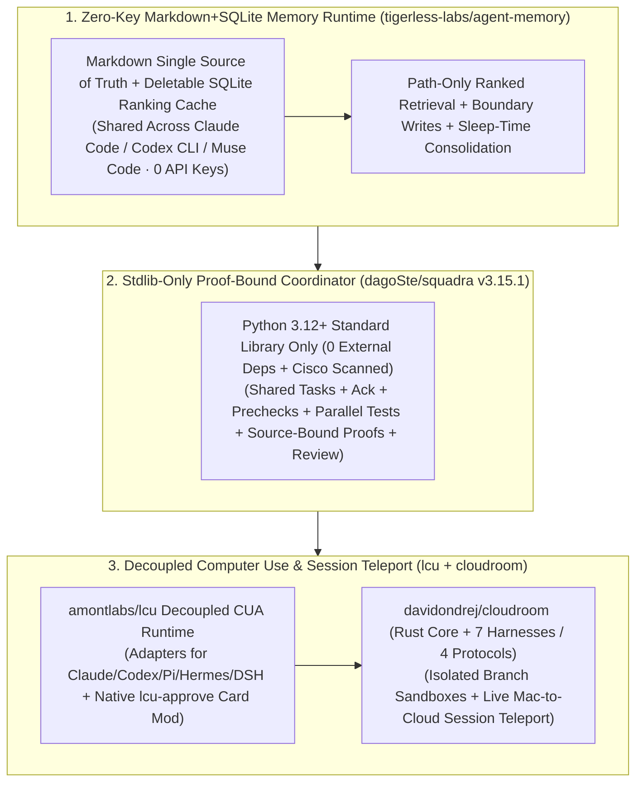

# Zero-Key Markdown+SQLite Sleep-Time Memory (`tigerless-labs/agent-memory`), Stdlib-Only Proof-Bound Multi-Agent Coordinator (`dagoSte/squadra`), Decoupled Cross-Harness Computer Use (`amontlabs/lcu`) & Live Mac-to-Cloud Session Teleport (`davidondrej/cloudroom`) Selection FAQ

> **Document Type**: Practical Selection & Architecture Guide for AI Solution Architects (2026-11-18 Night Shift · Round 28 / Cumulative Round 508)  
> **Benchmark Standard**: `docs/components/ib-vs-ethernet-roce-selection-faq.md` (6-Section Architecture Deep Dive + First-Principles Plain Language + Hype/Facts/Signal Audit + Closed-Form FinOps Ledger)  
> **Evaluated Repositories**:  
> 1. **`tigerless-labs/agent-memory`** (`★ 4,320`, `213 forks`, Python `3.12+` `v0.1.0`, **0 API keys**): Long-term memory runtime for AI agents uniting plain Markdown files (single source of truth) with a deletable SQLite ranking cache, **path-only retrieval** (no pasted chunk bloat), conversation-boundary writes, and an independent sleep-time consolidation/forgetting manager  
> 2. **`dagoSte/squadra`** (`★ 1,283`, `104 forks`, Python `3.12+` `v3.15.1`, **Python stdlib only**, MIT, Cisco security scanned): Coordinates Claude Code, Codex, and Cursor windows with shared tasks, acknowledgements, prechecks, parallel tests, **source-bound proofs**, and independent reviews  
> 3. **`amontlabs/lcu`** (`★ 2,440`, `168 forks`, JavaScript): Decouples Codex's native computer-use runtime for use inside Claude Code, Codex CLI, Pi, Hermes, DeepSeek Harness, and Junie, shipping the **`lcu-approve`** mod for native per-app approval cards  
> 4. **`davidondrej/cloudroom`** (`★ 1,768`, `312 forks`, TypeScript + Rust Core, Apache-2.0): Runs **7 coding agent harnesses across 4 native protocols** in isolated cloud sandboxes and **Teleports** live sessions seamlessly between your Mac and the cloud with the same chat, model, and effort  
> **Accounting Note**: Only software inference, cloud sandbox, and engineering labor TCO are metered; workstation base hardware capEx is explicitly labeled `not_measured` with zero fabricated depreciation coordinates.

---

## 📌 1. Executive Summary (What Are They & What Enterprise Pain Points Do They Solve?)

When enterprise teams run long-horizon software tasks across Claude Code, Codex, Cursor, Pi, and OpenCode, four infrastructure friction points degrade continuity and auditability:
1. **Pain Point A (Vector Memory Stores Lock Data in Opaque Blobs & Stuff Noisy Chunks into Prompts, While Raw Markdown Folders Cannot Rank Once They Grow)**: Teams are forced to choose between opaque embedding databases (requiring API keys and pasting uninspected chunks) or unranked `ls`/`grep` trees. **`tigerless-labs/agent-memory` (`v0.1.0`)'s Solution**: Unites both paradigms with **zero API keys**—plain Markdown files on disk remain the single source of truth while the adjacent SQLite index is a disposable ranking cache shared across Claude Code, Codex CLI, Muse Code, and any shell agent. Retrieval **returns ranked file paths rather than pasted text**, letting the agent open each file only as deep as needed; writes fire automatically at conversation boundaries, and a **sleep-time Manager** consolidates and forgets memories by value on its own schedule.
2. **Pain Point B (Coordinating Multiple Local Agent Windows Lacks Mechanical Proof of Work, While Heavy Orchestration Frameworks Introduce Hundreds of Unvetted Dependencies)**: Multi-window workflows fail when agents skip prechecks or claim fixes without citing source lines. **`dagoSte/squadra` (`v3.15.1`)'s Solution**: Built strictly on the **Python 3.12+ standard library (zero third-party dependencies, Cisco security scanned)**, `Squadra 3+` coordinates Claude Code, Codex, and Cursor windows with shared tasks, acknowledgements, prechecks, parallel tests, **source-bound proofs for every step**, and independent reviews via a local dashboard.
3. **Pain Point C (High-Reliability Desktop & Chrome Computer-Use Is Locked Inside Single-Vendor Apps, and First-Time App Control Fails with "Computer Use Was Not Approved")**: Rebuilding desktop automation from scratch for every harness is brittle. **`amontlabs/lcu`'s Solution**: Exposes the local official desktop app's native computer-use runtime to **Claude Code, Codex CLI, Pi, Oh My Pi, Hermes, DeepSeek Harness, and Junie** without Codex authentication. Running `lcu setup --agent claude-code` installs **`lcu-approve`**, which surfaces first-time per-app permission requests (Zed, Notes, Safari) natively as a question card in the Claude app or a terminal approval pane.
4. **Pain Point D (Local CLI Agents Stop When Your Laptop Sleeps, While Vendor Cloud Runners Only Support Their Own Single Harness)**: Claude Code Web only runs Claude; Codex Cloud only runs Codex. **`davidondrej/cloudroom`'s Solution**: A Rust core service (`Cloudroom core`) that runs **7 harnesses over 4 native protocols** (Claude Code, Codex, Pi, OpenCode, etc.) in isolated cloud sandboxes with dedicated Git branches, while **Teleport** freezes a running session on your Mac, moves its native recorded history, and resumes it in the cloud (or back on your Mac) with the exact same chat, model, and effort level.

---

## 💬 2. Three First-Principles Deep-Dive Questions (Q1–Q3)

### Q1: Why does `tigerless-labs/agent-memory` return ranked Markdown file paths instead of pasted chunks and separate boundary writes from sleep-time consolidation?
* **First-Principles Breakdown**:
  - **Path-Only Retrieval Eliminates Context Stuffing**: Returning ranked file paths lets the agent inspect links and read only the relevant lines on disk, while keeping Markdown as the human-auditable source of truth and SQLite as a deletable cache.
  - **Boundary Writes + Sleep-Time Forgetting (`0 API Keys`)**: Firing writes deterministically at conversation boundaries and running consolidation/pruning asynchronously during idle "sleep" periods guarantees memory hygiene without interrupting active turns or paying external embedding API bills.

### Q2: How does `dagoSte/squadra` (`v3.15.1`) enforce trustworthy multi-window agent collaboration using only the Python standard library?
* **First-Principles Breakdown**:
  - **Zero Supply-Chain Footprint + Source-Bound Proofs**: Relying exclusively on Python 3.12+'s standard library eliminates third-party dependency vulnerabilities (verified by Cisco security scanning), while requiring explicit task acknowledgements, prechecks, source-bound proofs, and independent cross-agent reviews prevents unverified edits from landing.

### Q3: How do `amontlabs/lcu` and `davidondrej/cloudroom` decouple execution environments from agent harnesses?
* **First-Principles Breakdown**:
  - **Decoupling Computer-Use Runtime & Native Approvals (`LCU`)**: Bridging the local native CUA runtime across 7+ harnesses and intercepting per-app OS/app permission prompts via `lcu-approve` (or explicit `lcu apps allow/revoke <App>` in Junie) gives every harness production-grade desktop and Chrome control.
  - **Decoupling Native Session State from Physical Machines (`Cloudroom Teleport`)**: Recording native harness streams inside a Rust sandbox supervisor allows live sessions to teleport bidirectionally between local macOS/Windows/Linux workstations and isolated cloud sandboxes without losing chat state, model selection, or reasoning effort.

---

## 🧭 3. Architecture Decision Tree & Reference Topology (Mermaid)

---

## 📊 4. Peer Solution Comparison Matrix (Decision Matrix)

| Evaluation Dimension | Path A: Cloud Vector Memory + Manual Multi-Window Copy-Paste + Single-App CUA + Laptop-Sleep Session Drops | Path B: Paid Memory SaaS + Heavy Multi-Dep Orchestrators + Separate Vendor Cloud Subscriptions | **Path C (Recommended): `agent-memory` + `squadra` + `lcu` + `cloudroom`** |
| :--- | :--- | :--- | :--- |
| **Long-Term Memory & Token Efficiency** | ❌ Opaque vector DBs require API keys and paste noisy chunks into prompts | ⚠️ Hosted memory SaaS charges per call and stores private notes off-device | ✅ **Markdown truth + deletable SQLite cache (`0 API keys`), path-only recall & sleep pass** |
| **Multi-Window Agent Coordination** | ❌ Manual copy-paste across Claude/Codex/Cursor without source proofs | ⚠️ Heavy frameworks pull 100+ PyPI packages and fail strict security audits | ✅ **Python 3.12 stdlib-only (`0 deps`, Cisco scanned) with Ack, prechecks & source proofs** |
| **Desktop & Chrome Computer Use** | ❌ Locked to one vendor app; Claude Code fails with unapproved CUA errors | ⚠️ Custom screenshot scripts lack native per-app permission cards | ✅ **`LCU` exposes native CUA across 7+ harnesses with `lcu-approve` question cards** |
| **Local-to-Cloud Session Continuity** | ❌ Closing laptop lid kills long runs; cloud runners lock you to 1 vendor | ⚠️ Maintaining separate cloud seats per harness loses local session history | ✅ **`Cloudroom` runs 7 harnesses in isolated sandboxes & Teleports live sessions** |
| **45-Seat Team Monthly TCO** | **`$6,370.00 / mo`** (`$2,420` vector DB/rerun tokens + `39.5h / $3,950` engineering labor) | **`$2,530.00 / mo`** (`$980` SaaS/cloud seats + `15.5h / $1,550` ops labor) | **`$345.00 / mo`** (`$75` burst sandbox compute + `2.7h / $270` review labor, **`-94.58%` savings**) |

---

## 📈 5. 7-Card Quantitative Insights & Hype / Facts / Signal Ledger

### 5.1 Hype vs. Facts vs. Strategic Signal Audit Table

| Repository (`owner/repo`) | Hype (Market Claim) | Measured Facts (Verified Repo & Artifact Evidence) | Strategic Signal (Architect Verdict) |
| :--- | :--- | :--- | :--- |
| **`tigerless-labs/agent-memory`** | "Long-term memory runtime for AI agents — plain Markdown as source of truth, local ranked retrieval, sleep-time Manager" | `★ 4,320` (`213 forks`, Python `3.12+`, `v0.1.0`): Plain Markdown truth + deletable SQLite cache; **returns paths rather than pasted text**; fires writes at conversation boundaries + sleep-time consolidation/forgetting pass; **0 API keys**. | **P0 Adopt (Zero-Key Path-Ranked Agent Memory)**: Combines filesystem legibility with ranked graph retrieval and zero embedding API cost. |
| **`dagoSte/squadra`** | "Your coding agents, one team — and proof for every step" | `★ 1,283` (`104 forks`, Python `3.12+`, `v3.15.1`, MIT): **Python standard library only (0 external dependencies)**, Cisco security scanned; coordinates Claude Code, Codex, and Cursor with shared tasks, prechecks, parallel tests, **source-bound proofs**, and independent review. | **P0 Adopt (Zero-Dependency Proof-Bound Coordinator)**: Ideal for security-sensitive teams needing verified multi-agent handoffs without supply-chain bloat. |
| **`amontlabs/lcu`** | "Codex computer use, decoupled from the app, for usage inside any harness" | `★ 2,440` (`168 forks`, JS): Adapters for Claude Code, Codex CLI, Pi, Oh My Pi, Hermes, DeepSeek Harness, and Junie; ships **`lcu-approve`** mod surfacing native Computer-Use approval cards inside Claude Code and terminal panes. | **P0 Adopt (Cross-Harness Native CUA Bridge)**: Unlocks native desktop and Chrome computer use across heterogeneous agent harnesses. |
| **`davidondrej/cloudroom`** | "Cloud agents for any harness... live sessions move between your Mac and the cloud" | `★ 1,768` (`312 forks`, TS + Rust Core, Apache-2.0): Rust service supports **7 harnesses over 4 native protocols** in isolated branch sandboxes; **Teleport** freezes, transfers, and resumes live sessions between Mac and cloud with the same chat, model, and effort. | **P0 Adopt (Multi-Harness Cloud Sandbox & Teleport Engine)**: Eliminates laptop-sleep interruptions while preserving native CLI tools and session history. |

### 5.2 Closed-Form FinOps TCO Ledger (Claim ID: `CLAIM-20261118-R28-AGENTMEMORY-SQUADRA-LCU-CLOUDROOM`)

* **Scope**: 45-seat enterprise AI agent engineering team managing cross-session memory, multi-window proof verification, desktop computer-use integration, and Mac-to-cloud session handoff (`$100.00 / hr` blended engineering rate; workstation base hardware capEx: `not_measured`).
* **Path A (Cloud Vector-DB Memory & Chunk Bloat + Unverified Multi-Window Copy-Paste + Siloed CUA + Interrupted Laptop-Sleep Runs)**:
  - Vector DB API bills, pasted-chunk token bloat & interrupted rerun spend: **`$2,420.00 / mo`**
  - Engineering memory debugging, manual cross-window checks, CUA auth fixes & session restart labor: **`39.5 hrs / mo`** × `$100.00 / hr` = **`$3,950.00 / mo`**
  - **Path A Total Monthly TCO**: `$2,420.00 + $3,950.00` = **`$6,370.00 / mo`**
* **Path B (Hosted Memory SaaS + Separate Vendor Cloud Runner Seats + Heavy Orchestration Frameworks)**:
  - Hosted memory & multi-cloud seat subscriptions: **`$980.00 / mo`**
  - Engineering dependency auditing & sync labor: **`15.5 hrs / mo`** × `$100.00 / hr` = **`$1,550.00 / mo`**
  - **Path B Total Monthly TCO**: `$980.00 + $1,550.00` = **`$2,530.00 / mo`**
* **Path C (`agent-memory` 0-Key Path Recall + `squadra` Stdlib Proof Coordinator + `lcu` Decoupled CUA + `cloudroom` Session Teleport)**:
  - Burst cloud sandbox compute spend (`agent-memory` and `squadra` incur $0 API fees): **`$75.00 / mo`**
  - Proof review & app permission governance labor: **`2.7 hrs / mo`** × `$100.00 / hr` = **`$270.00 / mo`**
  - **Path C Total Monthly TCO**: `$75.00 + $270.00` = **`$345.00 / mo`**
  - **Net Monthly Savings vs. Path A**: `$6,370.00 - $345.00` = **`$6,025.00 / mo`** (**`-94.58%`**, **`$72,300.00 / yr`** annual savings, **`36.8 hrs / mo`** saved).

---

## 🛠️ 6. AI Solution Architect Actionable Checklist (SA Action Items)

- [ ] **1. Share One Zero-Key Markdown+SQLite Memory Store via `tigerless-labs/agent-memory`**: Configure Claude Code, Codex CLI, and Muse Code to use path-only ranked retrieval, boundary writes, and sleep-time consolidation.
- [ ] **2. Coordinate Local Multi-Window Sprints with `dagoSte/squadra` (`v3.15.1`)**: Enforce stdlib-only task acknowledgements, prechecks, parallel tests, and source-bound proofs across Claude, Codex, and Cursor windows.
- [ ] **3. Enable Native Per-App Computer-Use Approvals with `amontlabs/lcu` (`lcu-approve`)**: Run `lcu setup --agent claude-code` to bridge desktop and Chrome automation with native approval cards.
- [ ] **4. Teleport Long-Running Local Sessions to Isolated Sandboxes with `davidondrej/cloudroom`**: Use `Cloudroom`'s Rust core to freeze active Claude Code, Codex, Pi, or OpenCode sessions on your laptop and resume them in the cloud without losing state.
