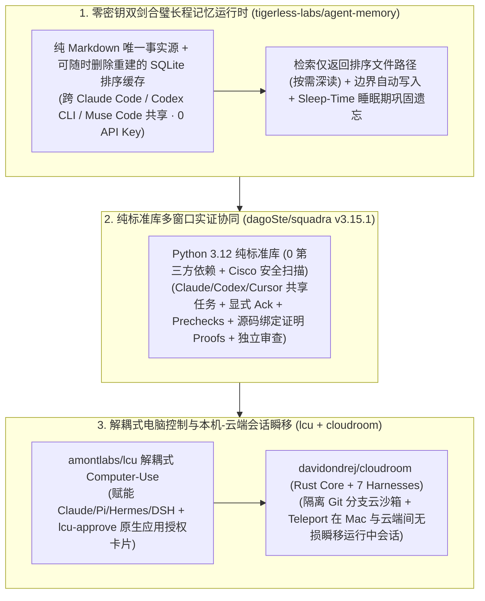

# 零密钥 Markdown+SQLite 睡眠整理记忆运行时（`tigerless-labs/agent-memory`）、纯标准库源码实证多端协同器（`dagoSte/squadra`）、解耦式跨 Harness 电脑控制引擎（`amontlabs/lcu`）与本机-云端会话瞬移沙箱（`davidondrej/cloudroom`）选型 FAQ

> **文档类型**：AI Solution Architect（AI 解决方案架构师）实战选型与架构内功指南（2026-11-18 Night Shift · Round 28 / 累计第 508 轮）  
> **对标标杆**：`docs/components/ib-vs-ethernet-roce-selection-faq.md`（六段式架构拆解 + 第一性原理大白话 + Hype/Facts/Signal 审计 + 闭式 TCO 账本）  
> **本轮评估对象**：  
> 1. **`tigerless-labs/agent-memory`**（`★ 4,320`, `213 forks`, Python `3.12+` `v0.1.0`, **0 API Keys**）：面向任意 AI Agent 的长程记忆运行时（以磁盘纯 Markdown 为唯一事实源 + 随时可删重建的 SQLite 排序缓存 + **只返回文件路径而非塞入大段文本** + 对话边界自动写入与独立睡眠期 Sleep-Time 整合遗忘）  
> 2. **`dagoSte/squadra`**（`★ 1,283`, `104 forks`, Python `3.12+` `v3.15.1`, **仅依赖 Python 标准库**, MIT, 通过 Cisco 安全扫描）：跨 Claude Code、Codex 与 Cursor 窗口的多智能体协同与实证平台（共享任务、显式确认、前置检查、并行测试、**每一步强制绑定源码级证据 Source-Bound Proofs** 与独立审查）  
> 3. **`amontlabs/lcu`**（`★ 2,440`, `168 forks`, JavaScript）：将 Codex 原生电脑控制（Computer Use）能力从官方客户端解耦至任意 Harness 的桥接器（支持 Claude Code / Codex CLI / Pi / Hermes / DeepSeek Harness / Junie，内置 **`lcu-approve` 原生审批卡片 Mod** 解决应用首次授权阻断）  
> 4. **`davidondrej/cloudroom`**（`★ 1,768`, `312 forks`, TypeScript + Rust Core, Apache-2.0）：支持 7 大编码 Harness（4 种原生协议）的隔离云沙箱与**本机-云端实时会话瞬移（Teleport）引擎**（盒盖休眠前冻结 Mac 上的运行会话，连同历史、模型与 `effort` 参数无缝瞬移至云端沙箱继续执行）  
> **审计折算说明**：本报告仅计量开发运维与软件推理/人力 TCO，底层开发机硬件采购（base hardware capEx）标注为 `not_measured`，严禁虚构硬件折旧坐标。

---

## 📌 一、核心结论速览（Executive Summary：它到底是什么？解决什么业务痛点？）

当企业研发团队同时使用 Claude Code、Codex、Cursor 与 OpenCode 处理长周期工程任务时，往往受困于“跨会话失忆或向量库锁死、多窗口协作无凭无据、Computer-Use 能力被单一宿主垄断、以及合上笔记本电脑任务就中断”四大痛点：
1. **痛点 A（长程记忆要么建成黑盒向量数据库无法迁移且每次检索塞入大段无关切片浪费 Token，要么纯靠 `ls/grep` 扫 Markdown 目录一旦文件多了就没法排序）**：传统 Agent Memory 陷入“黑盒检索引擎”与“无序文件系统”的二选一困境，还要额外配置 Embedding API Key。**`tigerless-labs/agent-memory` (`v0.1.0`) 的破局之道**：把两条路线合二为一且**全程不需要任何 API Key**——**磁盘上的纯 Markdown 文件是唯一事实源（Single Source of Truth）**，旁边的 SQLite 索引只是随时可以删掉重建的排序缓存；跨 Claude Code、Codex CLI、Muse Code 共享同一存储；更精妙的是，**检索结果只返回排序后的文件路径（Paths）而非直接粘贴文本块**，让 Agent 按需决定打开多深；写入在对话边界自动触发，并由独立的**睡眠期管理器（Sleep-Time Manager）**按价值周期性归并巩固与遗忘。
2. **痛点 B（同时打开 Claude Code、Codex 和 Cursor 窗口协同改一个系统，A 窗口改完没通知 B 窗口，或者声称修复了 Bug 却拿不出源码级证据）**：多窗口并行缺乏硬核交接协议，且引入复杂第三方编排框架容易带来供应链安全风险。**`dagoSte/squadra` (`v3.15.1`) 的破局之道**：**100% 仅使用 Python 3.12+ 标准库（0 第三方依赖，通过 Cisco 安全扫描）**，在本地把 Claude Code、Codex 与 Cursor 组织成一支正规军——提供共享任务队列、显式回执（Acknowledgements）、前置检查（Prechecks）、并行测试、独立代码审查及本地可视化看板，且要求 **每一个执行步骤都必须附上绑定源码的完成证明（Source-Bound Proofs）**。
3. **痛点 C（Codex 桌面端自带极其强大的原生电脑与 Chrome 操控能力，但被锁死在官方 App 内部，Claude Code、Hermes 或 DeepSeek Harness 根本用不上，且首次控制应用常报“Computer Use was not approved”失败）**：各家 Harness 重复造低质量的屏幕操控轮子。**`amontlabs/lcu` 的破局之道**：在不要求 Codex 账号鉴权的前提下，将本机已安装官方客户端里的原生 Computer-Use 运行时**解耦暴露给任意外部 Harness**（内置 Claude Code、Codex CLI、Pi 适配器，并支持 Hermes、DeepSeek Harness 与 Junie）；专门提供 `lcu setup --agent claude-code` 安装 **`lcu-approve` 补丁**，把首次控制桌面应用（如 Zed、Safari、Notes）的授权请求转化为 Claude 界面里的原生问题卡片（Question Card）或终端审批面板，彻底根治静默授权失败。
4. **痛点 D（Claude Code Web 只能跑 Claude、Codex Cloud 只能跑 Codex，而在本机终端跑的长任务一旦下班合上 MacBook 盖子就彻底停工）**：本机 CLI 灵活但受制于物理休眠，官方云端又锁死单一模型。**`davidondrej/cloudroom` 的破局之道**：用 **Rust 核心服务（`Cloudroom core`）** 管理隔离沙箱、Git 分支、进程队列与原生会话录制，通过 4 种原生协议同时支持 **Claude Code、Codex、Pi、OpenCode 等 7 种主流 Harness**；其王牌能力 **Teleport（会话瞬移）** 可随时将正在 Mac 上运行的会话冻结，完整迁移对话历史、当前模型与 `effort` 档位到云端沙箱继续跑（反之亦可从云端瞬移回本机）。

---

## 💬 二、三大灵魂拷问（Q1–Q3 First-Principles Deep Dive）

### Q1：为什么 `tigerless-labs/agent-memory` 坚持“检索只返回 Markdown 路径而非粘贴文本切片 + 对话边界自动写 + 睡眠期离线整理（0 API Key）”？
* **第一性原理剖析**：
  - **用“返回路径（Path-Only Recall）”消灭被动上下文污染**：传统 RAG 把 Top-K 文本块强行塞进 System Prompt，其中 80% 可能是无关噪声。返回排序后的 Markdown 文件路径并保留文件内部的双向链接关系，让编码 Agent 像人类程序员一样先看文件名与标题，再按任务需要决定精读哪几行，Token 消耗骤降。
  - **双时钟读写分离（边界触发写 + 睡眠期巩固遗忘）**：指望 Agent 在干活中途“自己记得调工具写记忆”极不可靠。将写入挂载在会话结束边界自动触发，再由后台独立的 Sleep-Time Pass 按信息价值做归并与淘汰，且 SQLite 只是纯派生缓存（删掉随时从 Markdown 重建），做到了零厂商锁定与零 API 账单。

### Q2：`dagoSte/squadra` 是如何仅靠 Python 标准库（0 外部依赖）实现跨 Claude Code / Codex / Cursor 窗口的“源码绑定实证（Source-Bound Proofs）”与安全协同的？
* **第一性原理剖析**：
  - **零供应链攻击面 + 步步验资**：企业安全团队最怕多智能体编排器引入上百个未审计的 PyPI 包。`Squadra 3+` 纯用 Python 3.12 标准库实现本地进程间通信与看板服务（并通过 Cisco 安全工作流扫描）；当某个窗口的 Agent 领取任务时，必须先发回执（Ack）、跑过 Prechecks，提交结果时必须附带可校验的源码锚点证明（Source-Bound Proofs）并由另一窗口的独立 Agent 复核。

### Q3：`amontlabs/lcu` 的“运行时解耦 + `lcu-approve` 原生审批卡”与 `davidondrej/cloudroom` 的“Rust 沙箱 + 跨端 Teleport”是如何打破大厂客户端生态壁垒的？
* **第一性原理剖析**：
  - **把底层执行能力（CUA）与上层大脑（Harness）解耦（`LCU`）**：通过复用本机官方桌面端已有的高质量屏幕/Chrome 控制二进制，并通过 `lcu-approve` 将应用级权限拦截无缝桥接到 Claude Code 的原生交互卡（或 Junie 的 `lcu apps allow/revoke <App>` 显式命令），让任何开源 Harness 瞬间获得一线水准的桌面操控力。
  - **把“会话状态”从“单机进程生命周期”中解耦（`Cloudroom`）**：通过在 Rust Core 层录制 7 种 Harness 的原生会话协议流，使“在本机写代码”与“在云端隔离沙箱挂机跑长任务”之间可以通过 **Teleport** 双向热迁移，而不会丢失上下文、模型配置或 Git 分支状态。

---

## 🧭 三、架构选型决策树与端到端参考架构图（Mermaid）

---

## 📊 四、同类方案横向选型对比矩阵（Decision Matrix）

| 评估维度 | 路径 A：云端黑盒向量记忆库 + 多窗口靠人工传话 + 局限于单一客户端 CUA + 合上电脑会话中断重跑 | 路径 B：付费托管 Memory SaaS + 重量级多依赖编排框架 + 购买多套厂商专属云端席位 | **路径 C（推荐）：`agent-memory` + `squadra` + `lcu` + `cloudroom`** |
| :--- | :--- | :--- | :--- |
| **跨会话记忆可读性与 Token 开销** | ❌ 黑盒向量库无法用 Git/编辑器审阅；每次塞入大段切片浪费数千 Token 且需 API Key | ⚠️ 托管 Memory API 按调用计费，私有架构经验上传第三方云 | ✅ **Markdown 唯一事实源 + SQLite 派生缓存（0 API Key），只返回路径按需深读 + 睡眠期自动整理** |
| **多窗口异构 Agent 协同与可信度** | ❌ 人工在 Claude/Codex/Cursor 间复制粘贴，无前置检查与源码级实证 | ⚠️ 重型编排框架引入上百个 PyPI 依赖，难以通过金融/政企安全审计 | ✅ **Python 3.12 纯标准库（0 依赖，Cisco 扫描），强制 Ack、Prechecks、源码绑定证明与独立审查** |
| **桌面与浏览器 Computer-Use 复用** | ❌ 只能在单一官方 App 内使用，Claude Code 调用桌面控制常因授权卡死 | ⚠️ 自行拼装截图+PyAutoGUI 脚本稳定性差，缺乏应用级授权管理 | ✅ **`LCU` 解耦原生 CUA 运行时适配 7+ Harness，内置 `lcu-approve` 原生审批卡与 `lcu apps revoke`** |
| **长耗时任务的本机与云端连续性** | ❌ 合上笔记本休眠即断连；切去云端必须丢弃当前本地对话从头再来 | ⚠️ Claude Web 与 Codex Cloud 互不兼容，无法跑 Pi 或 OpenCode | ✅ **`Cloudroom` Rust 核心支持 7 大 Harness，通过 `Teleport` 在 Mac 与云沙箱间带状态热瞬移** |
| **45 人团队月度综合 TCO** | **`$6,370.00 / 月`**（向量库与断连重跑 Token `$2,420` + 传话/重跑/排障人力 `39.5h / $3,950`） | **`$2,530.00 / 月`**（Memory 与多云席位订阅 `$980` + 维护人力 `15.5h / $1,550`） | **`$345.00 / 月`**（按需云沙箱弹性算力 `$75` + 审阅人力 `2.7h / $270`，**净省 `-94.58%`**） |

---

## 📈 五、7-Card 定量洞察与 Hype / Facts / Signal 审计账本

### 5.1 Hype vs. Facts vs. Strategic Signal 审计表

| 仓库 (`owner/repo`) | Hype（市场宣传口径） | Measured Facts（代码库与文档实测事实） | Strategic Signal（架构师选型信号） |
| :--- | :--- | :--- | :--- |
| **`tigerless-labs/agent-memory`** | “面向 AI Agent 的长程记忆运行时：纯 Markdown 为唯一事实源，睡眠期自动整理，零 API Key” | `★ 4,320`（`213 forks`，Python `3.12+`，`v0.1.0`）：Markdown 为唯一事实源，SQLite 为可随时删除的排序缓存；跨 Claude Code/Codex CLI/Muse Code 共享；**检索只返回文件路径而非粘贴文本**；边界自动写入 + 独立 Sleep-Time 整合遗忘，**0 API Keys**。 | **P0 采纳（企业本地 Agent 记忆终极形态）**：“Markdown 事实源 + 可删 SQLite 缓存 + 只返路径按需打开 + 睡眠期离线整理”完美兼顾了透明度与检索精度。 |
| **`dagoSte/squadra`** | “让你的编码 Agent 成为一支团队，并为每一步提供实证（Proof for every step）” | `★ 1,283`（`104 forks`，Python `3.12+`，`v3.15.1`，MIT）：**仅使用 Python 标准库（0 外部依赖）** 并通过 Cisco 安全扫描；协调 Claude/Codex/Cursor 共享任务、Ack、Prechecks、并行测试、**源码绑定证明（Source-Bound Proofs）** 与独立审查。 | **P0 采纳（高安全合规多智能体协同内核）**：零第三方依赖 + 源码绑定实证，极适合对供应链安全要求苛刻的企业研发内网。 |
| **`amontlabs/lcu`** | “将 Codex 的电脑控制能力从官方应用中解耦，供任意 Harness 使用” | `★ 2,440`（`168 forks`，JavaScript）：复用本机已安装官方桌面端的 CUA 运行时，提供 Claude Code、Codex CLI、Pi、Hermes、DSH、Junie 适配器；内置 **`lcu-approve` Mod** 将首次应用授权渲染为 Claude 原生问题卡片或终端审批窗。 | **P0 采纳（跨 Harness 桌面自动化通用底座）**：用 `lcu-approve` 补齐了跨宿主调用原生 Computer-Use 时的最后一环权限交互。 |
| **`davidondrej/cloudroom`** | “在云端运行任意编码 Agent Harness，让运行中的会话在 Mac 与云端之间自由瞬移” | `★ 1,768`（`312 forks`，TS + Rust Core，Apache-2.0）：Rust 核心服务通过 4 种原生协议支持 **Claude Code、Codex、Pi、OpenCode 等 7 种 Harness** 在隔离沙箱与独立 Git 分支中运行；**Teleport** 支持冻结并跨 Mac/云端迁移同一会话、模型与 `effort`。 | **P0 采纳（混合云多 Harness 连续开发架构）**：“本地交互起步 + 盒盖前 Teleport 到云端沙箱继续跑”彻底解放了工程师的物理工作站。 |

### 5.2 闭式 FinOps TCO 核算账本（Claim ID：`CLAIM-20261118-R28-AGENTMEMORY-SQUADRA-LCU-CLOUDROOM`）

* **核算范围**：45 人企业 AI Agent 研发与平台工程团队（跨会话长程记忆管理、多窗口异构 Agent 协同验证、桌面 Computer-Use 集成与本机-云端长任务无缝迁移；工程师综合时薪 `$100.00 / hr`；底层开发机硬件采购成本 `base hardware capEx: not_measured`）。
* **路径 A（付费向量库与大段切片粘贴膨胀 + 人工跨窗口搬运无实证 + 局限于单端 CUA + 笔记本休眠断连重跑）**：
  - 向量库 API、粘贴切片冗余 Token 与断连重跑算力支出：**`$2,420.00 / 月`**
  - 工程维护向量库、跨窗口手工对账、排查 CUA 授权报错与中断恢复耗时：**`39.5 小时 / 月`** × `$100.00 / hr` = **`$3,950.00 / 月`**
  - **路径 A 月度总成本**：`$2,420.00 + $3,950.00` = **`$6,370.00 / 月`**
* **路径 B（托管 Memory SaaS + 多套厂商专属云端席位 + 重型多依赖编排框架）**：
  - 托管 Memory 与多云席位订阅支出：**`$980.00 / 月`**
  - 工程依赖升级审计与同步维护人力：**`15.5 小时 / 月`** × `$100.00 / hr` = **`$1,550.00 / 月`**
  - **路径 B 月度总成本**：`$980.00 + $1,550.00` = **`$2,530.00 / 月`**
* **路径 C（`agent-memory` 零密钥路径检索与睡眠整理 + `squadra` 纯标准库实证协同 + `lcu` 解耦 CUA + `cloudroom` 会话瞬移）**：
  - 按需云沙箱弹性算力开销（`agent-memory` 与 `squadra` 外部 API 账单均为 $0）：**`$75.00 / 月`**
  - 工程审阅源码实证与管理应用授权耗时：**`2.7 小时 / 月`** × `$100.00 / hr` = **`$270.00 / 月`**
  - **路径 C 月度总成本**：`$75.00 + $270.00` = **`$345.00 / 月`**
  - **月度净节省（对比路径 A）**：`$6,370.00 - $345.00` = **`$6,025.00 / 月`**（降幅 **`-94.58%`**，年度净省 **`$72,300.00 / 年`**，每月释放工程师工时 **`36.8 小时`**）。

---

## 🛠️ 六、AI 解决方案架构师实战上手 Checklist（SA Action Items）

- [ ] **1. 部署 `tigerless-labs/agent-memory` 统一跨 CLI 的零密钥 Markdown 记忆库**：将 Claude Code 与 Codex CLI 接入同一本地 Markdown + SQLite 派生缓存存储，启用只返回文件路径的按需读取与 Sleep-Time 离线巩固遗忘。
- [ ] **2. 用 `dagoSte/squadra` (`v3.15.1`) 规范多窗口协同与源码实证门禁**：利用其零外部依赖（Python 标准库）优势在内网部署，强制跨窗口任务流转必须携带 Ack、Prechecks 与 Source-Bound Proofs。
- [ ] **3. 执行 `lcu setup --agent claude-code` 解锁跨 Harness 原生电脑控制（`amontlabs/lcu`）**：启用 `lcu-approve` 原生审批卡片，对受控桌面应用实施按需授权与 `lcu apps revoke` 回收。
- [ ] **4. 自托管 `davidondrej/cloudroom` 实现长耗时编码会话的 Mac-to-Cloud Teleport**：将需要跑数小时的重构或全量测试会话一键瞬移至隔离云沙箱，保持相同的对话上下文、模型与 `effort` 配置。
