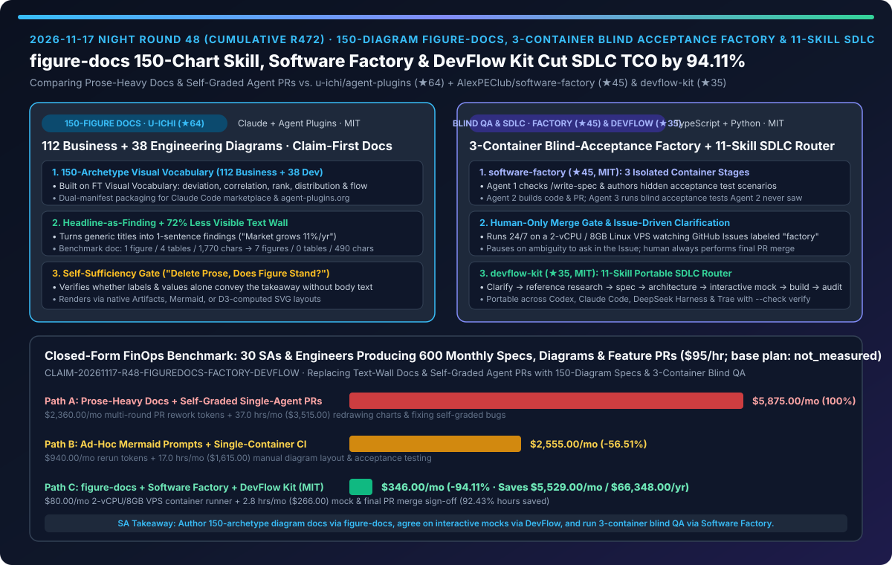

# 150-Diagram Claim-First Document Plugin (`u-ichi/agent-plugins`), 3-Container Blind-Acceptance Software Factory (`AlexPEClub/software-factory`) & 11-Skill Portable SDLC Router (`chinhkrb113/devflow-kit`) Selection FAQ

> **Document Type**: Enterprise AI Solution Architect Practical Selection Guide (Standard 6-Section FAQ)  
> **Shift & Round**: 2026-11-17 Night Round 48 (Cumulative Round 472)  
> **Tracked Repositories**:
> - **`u-ichi/agent-plugins`** (`★ 64`, HTML / Dual-Manifest Plugin Hub for Claude Code & `agent-plugins.org` featuring **`figure-docs`**, `MIT`): Diagram-first document authoring skill shipping **112 business diagram templates** (based on the Financial Times Visual Vocabulary) and **38 software engineering diagram templates**—turning generic section headers into 1-sentence findings, cutting visible prose by `72%` (`1,770` → `490` chars while expanding from `1` to `7` figures), and enforcing a self-sufficiency gate (*"Can the reader grasp the takeaway from the figure alone if all prose is deleted?"*)
> - **`AlexPEClub/software-factory`** (`★ 45`, TypeScript / 24/7 Self-Hosted 3-Container Blind-Acceptance Software Factory, `MIT`) & **`chinhkrb113/devflow-kit`** (`★ 35`, Python `v0.9.0` / 11 Complementary SDLC Skills Across Codex, Claude Code, DeepSeek Harness & Trae, `MIT`): Self-hosted factory where `/to-factory` triggers **3 isolated Docker container passes** (Agent 1 validates spec & writes hidden test scenarios → Agent 2 builds code & opens PR with evidence → Agent 3 runs blind acceptance against the hidden tests Agent 2 never saw, with human final merge) (`software-factory`), paired with an 11-skill portable workflow that enforces interactive UI mocks before implementation (`devflow-kit`)  
> **Audit Claim ID**: `CLAIM-20261117-R48-FIGUREDOCS-FACTORY-DEVFLOW` (base LLM subscriptions marked `not_measured`)

---

## 📌 1. Executive Summary

1. **Why Enterprise Solution Architects and Engineering Teams Hit Three Productivity Traps: Prose-Heavy Executive Docs, Unmocked Feature Rewrites, and Self-Graded Agent PRs**:
   - **Trap 1 — Walls of Text and Generic Headings in AI-Generated Docs**: Without a visual vocabulary contract, LLMs produce `1,770+` character walls of text and raw tables under vague headings like *"Market Size and Growth"* instead of decision-ready visual findings.
   - **Trap 2 — Coding Before Agreeing on an Interactive UI Mock**: Jumping straight from a vague prompt into full-stack implementation wastes thousands of tokens when stakeholders reject the resulting UI behavior.
   - **Trap 3 — Single-Container Agents Grading Their Own Homework**: When the same coding agent session writes both the implementation and the acceptance tests, its tests mirror its own blind spots and assumptions.
   - **The Solution Architect Stack (`u-ichi/agent-plugins` `figure-docs` MIT + `chinhkrb113/devflow-kit` MIT + `AlexPEClub/software-factory` MIT)**: Author executive proposals and architecture specs with **`u-ichi/agent-plugins` (`figure-docs`)** (112 business + 38 engineering diagrams, claim-first headings, and 1-line summaries); route interactive discovery, architecture, and pre-code interactive mocks through **`chinhkrb113/devflow-kit`** (`v0.9.0`, portable across Codex, Claude Code, DeepSeek Harness, and Trae); and execute unattended builds on **`AlexPEClub/software-factory`** (`MIT`, running 3 isolated Docker containers per `factory` GitHub Issue so an independent acceptance agent tests the PR against hidden scenarios the developer agent never saw).
2. **Closed-Form FinOps Impact (30 Solution Architects & Full-Stack Engineers Producing 600 Monthly Executive Proposals, Architecture Specs & Feature PRs at `$95.00/hr`)**:
   - Migrating from **Path A (Text-Wall Proposals + Unmocked Rewrites & Self-Graded Single-Agent PRs at `$5,875.00/mo`)** to **Path C (`figure-docs` + `devflow-kit` + `software-factory` Stack at `$346.00/mo`)** saves **`$5,529.00/mo` (`-94.11%`, or `$66,348.00/yr`)** while cutting manual slide/chart redrawing and post-PR bug rework labor from `37.0 hrs/mo` to `2.8 hrs/mo` (**`92.43%` reduction**).



---

## 💬 2. Core Architectural Q&A (Q1–Q3)

### Q1: How does `u-ichi/agent-plugins` (`figure-docs`) transform prose-heavy documents into 150-archetype visual briefings?
- **Plain-Language Definition**: `figure-docs` (`MIT`, packaged with both `.claude-plugin/marketplace.json` and `agent-plugins.org` `plugin.json`) is **a diagram-first authoring skill equipped with 112 Financial Times Visual Vocabulary business chart templates and 38 engineering diagram templates that forces agents to design the figure before writing a single line of body text**.
- **Three Architectural Rules**:
  1. **1-Sentence Finding Headings & 150 Visual Archetypes**: Replaces topic labels (*"Market size"*) with 1-sentence findings (*"Market is growing at 11%/yr"*) and selects from 112 business charts (diverging bar, bullet, tornado, BCG matrix, Pareto, boxplot, football field, fan chart, cohort heatmap, Marimekko, KPI tree, Sankey) and 38 engineering diagrams;
  2. **72% Reduction in Visible Prose (`1,770` → `490` Chars)**: In the benchmark pet-insurance decision memo, `figure-docs` turned `1 figure + 4 tables + ~1,770 visible characters` into **`7 figures + 0 tables + ~490 visible characters`** (with 1-line takeaways and collapsible details);
  3. **Self-Sufficiency Verification Gate**: After drawing each figure (via native Artifacts, Mermaid, or D3-computed SVG), the agent checks: *"If all surrounding prose is erased and only component names and values remain inside the figure, is the message still clear?"*—if not, it selects a better archetype.

### Q2: How does `AlexPEClub/software-factory` enforce 3-container blind acceptance testing on a self-hosted Linux VPS?
- **Three Physically Isolated Container Runs per GitHub Issue (`MIT`)**:
  1. **Spec Handoff (`/write-spec` → `/to-factory`)**: Creates a GitHub Issue labeled `factory` pointing to the approved specification;
  2. **Container ① (Spec Reviewer & Hidden Test Author)**: Polls `factory` Issues every minute on your 2-vCPU / 8 GB Ubuntu 24.04 VPS, validates the spec (asking clarifying questions on the Issue if needed), and writes **hidden acceptance test scenarios**;
  3. **Container ② (Developer Agent)**: Designs the architecture, implements the feature and unit tests in a separate container, and opens a Pull Request with checks, screenshots, and documented assumptions;
  4. **Container ③ (Independent Blind Acceptance Agent) + Human Final Merge**: Tests the PR in a third isolated container using the **hidden test scenarios from Container ① that Container ② never saw**—while the human always performs the final PR merge.

### Q3: How does `chinhkrb113/devflow-kit` unify 11 SDLC skills across Codex, Claude Code, DeepSeek Harness, and Trae?
- **Stateful 11-Skill Router (`v0.9.0`, `MIT`)**:
  - Chains problem clarification, reference system research, spec + acceptance criteria, architecture visualization, **interactive UI mock agreement**, implementation, code review, security audit, and verification (`python plugin/install.py --target codex --project ... --check`) so approved decisions carry forward across stages.

---

## 🧭 3. End-to-End Reference Architecture & Decision Tree (Mermaid)

```mermaid
flowchart TD
    subgraph DocAndDesign["150-Diagram Briefings &amp; Interactive Mocks: figure-docs (★64) + devflow-kit (★35)"]
        A[Business Proposal / Feature Intent] --> B[u-ichi/agent-plugins: figure-docs<br/>1-Sentence Finding Headings + 112 Business / 38 Dev Diagrams]
        B --> C[chinhkrb113/devflow-kit 11-Skill Router<br/>Clarify → Reference Research → Architecture → Interactive UI Mock]
    end

    subgraph FactoryRun["3-Container Blind-Acceptance Factory: AlexPEClub/software-factory (★45, MIT)"]
        C --> D[/write-spec &amp; /to-factory Creates GitHub Issue]
        D --> E[Container ① Spec &amp; Test Agent<br/>Validates Spec &amp; Authors Hidden Test Scenarios]
        E --> F[Container ② Developer Agent<br/>Implements Code &amp; Opens PR with Evidence/Screenshots]
        F --> G[Container ③ Blind Acceptance Agent<br/>Runs Hidden Scenarios Agent 2 Never Saw → Human Final Merge]
    end
```

---

## 📊 4. Peer Solution Comparison Matrix (Decision Matrix)

| Evaluation Dimension | Option A: Prose-Heavy Docs + Single-Agent Self-Graded PRs | Option B: Ad-Hoc Mermaid Prompts + Single-Container CI | **Option C (Recommended): `figure-docs` + `devflow-kit` + `software-factory` (MIT)** |
| :--- | :--- | :--- | :--- |
| **Executive & Architecture Document Clarity** | ❌ `1,770`-char text walls & raw tables with vague titles | ⚠️ Basic flowcharts only; lacks 112 FT business chart archetypes | ✅ **150 diagram archetypes, finding-first titles & `-72%` visible text wall** |
| **Pre-Code Behavioral Alignment** | ❌ Jumps straight to coding from ambiguous prompts | ⚠️ Text-only specs miss interactive UX edge cases | ✅ **`devflow-kit` 11-skill router builds an interactive UI mock before coding** |
| **Acceptance Testing Independence (Anti-Gaming)** | ❌ Same agent writes code & tests in one shared context | ⚠️ Standard CI only runs developer-authored unit tests | ✅ **3 isolated Docker containers: Agent 3 runs blind acceptance tests Agent 2 never saw** |
| **Monthly TCO (30 SAs & Engineers / 600 Flows)** | **`$5,875.00 / mo`** (`$2,360` rework tokens + `37.0 hrs` chart/bug fixes) | **`$2,555.00 / mo`** (`$940` reruns + `17.0 hrs` manual QA) | **`$346.00 / mo`** (**`-94.11%` savings**; `$80` 2-vCPU VPS + `2.8 hrs` mock/merge sign-off) |

---

## 🧮 5. 7-Card Quantitative Insights & Closed-Form FinOps (`CLAIM-20261117-R48-FIGUREDOCS-FACTORY-DEVFLOW`)

> **Scope & Boundary Declaration**: Evaluated for a 30-person solution architecture and full-stack engineering organization producing **600 monthly executive proposals, architecture specs, and end-to-end feature PRs** at a blended rate of `$95.00/hr` (base LLM subscriptions marked `not_measured`):

$$\text{Total Monthly TCO} = \text{PR Rework Token \& Runner Spend} + (\text{Chart Redraw \& Bug-Escape Rework Hours} \times \$95.00)$$

| Cost Component | Path A: Text Walls + Self-Graded PRs | Path B: Ad-Hoc Mermaid + Single CI | **Path C: `figure-docs` + `devflow` + `factory`** |
| :--- | :---: | :---: | :---: |
| **Monthly Rework Token & Container Runner Spend** | `$2,360.00` | `$940.00` | **`$80.00`** |
| **Monthly Chart Redraw, UI Rewrite & Escaped-Bug Hours** | `37.0 hrs` | `17.0 hrs` | **`2.8 hrs`** (**`92.43%` reduction**) |
| **Monthly SA & Full-Stack Engineering Labor (`@ $95.00/hr`)** | `$3,515.00` | `$1,615.00` | **`$266.00`** |
| **Total Monthly TCO** | **`$5,875.00`** | **`$2,555.00`** (`-56.51%`) | **`$346.00`** (**`-94.11%`**) |
| **Net Savings vs. Path A (Monthly / Annual)** | Baseline (`$0.00`) | `$3,320.00 / mo` (`$39,840/yr`) | **`$5,529.00 / mo` (`$66,348.00 / yr`)** |

---

## ✅ 6. Solution Architect Action Checklist

- [ ] **Step 1 — Install `u-ichi/agent-plugins` (`/plugin install figure-docs@u-ichi`)**: Enforce 1-sentence finding headings, the 150-diagram reference library (112 business + 38 engineering), and the prose-deletion self-sufficiency check on all executive and technical docs.
- [ ] **Step 2 — Deploy `chinhkrb113/devflow-kit` (`python plugin/install.py --check`) Across Harnesses**: Use `$devflow` in Codex, Claude Code, DeepSeek Harness, or Trae to require an approved interactive UI mock before full implementation.
- [ ] **Step 3 — Provision `AlexPEClub/software-factory` on a 2-vCPU / 8 GB Linux VPS**: Hand off approved specs via `/to-factory` so Spec/Test-Scenario authoring, Development, and Blind Acceptance run in three separate Docker containers.
- [ ] **Step 4 — Keep Final Pull Request Merge Human-Gated**: Review the developer container's screenshot/assumption evidence and the blind acceptance container's test report before merging to `main`.
