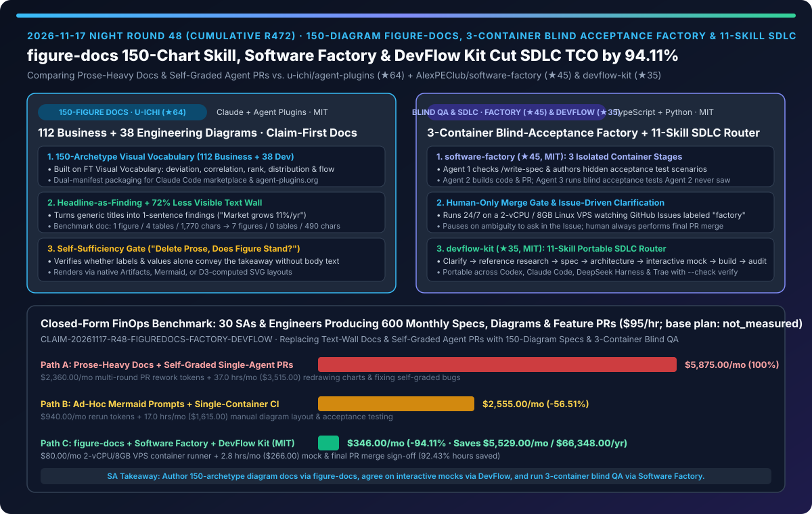

# 150 图谱结论先行文档插件（`u-ichi/agent-plugins` `figure-docs`）与三容器盲测验收软件工厂及 11 技能全流程研发套件（`software-factory` & `devflow-kit`）架构选型 FAQ

> **文档类型**：AI Solution Architect（AI 解决方案架构师）实战选型指南（六段式标准 FAQ）  
> **所属轮次**：2026-11-17 Night Round 48（Cumulative Round 472）  
> **追踪目标**：
> - **`u-ichi/agent-plugins`**（`★ 64`，HTML / 同时兼容 Claude Code Marketplace 与 `agent-plugins.org` 的双 Manifest 插件仓，核心插件 **`figure-docs`**，`MIT`）：内置 **112 种商业分析图谱（基于 Financial Times Visual Vocabulary）+ 38 种软件工程研发图谱**，强制 Agent 按“先定 1 句话核心结论标题 → 选图谱画图 → 正文压至 1 行要点并将细节折叠（实测可见文字从 `1,770` 字精简至 `490` 字、图表从 `1` 张增至 `7` 张）→ 执行‘删掉正文只看图能否秒懂’自检门禁”生成决策报告与设计书
> - **`AlexPEClub/software-factory`**（`★ 45`，TypeScript / 自建 Linux VPS 三容器盲测验收软件工厂，`MIT`）& **`chinhkrb113/devflow-kit`**（`★ 35`，Python `v0.9.0` / 跨 Codex, Claude Code, DeepSeek Harness, Trae 的 11 技能工程路由器，`MIT`）：通过 `/to-factory` 触发 **“容器 ① 审规格写隐藏验收用例 → 容器 ② 写代码提 PR → 容器 ③ 用开发者从未见过的隐藏用例执行独立盲测验收”** 的 `software-factory`，配合强制在写代码前先交付交互式 Mock 达成一致的 11 技能套件 `devflow-kit`  
> **计量审计 ID**：`CLAIM-20261117-R48-FIGUREDOCS-FACTORY-DEVFLOW`（底层大模型基础订阅标记为 `not_measured`）

---

## 📌 一、核心结论速览（Executive Summary）

1. **为什么企业解决方案架构师与研发团队在用 AI 产出“高管立项汇报/系统设计文档”与“全自动 Issue 到 PR 交付流水线”时，常遭遇“AI 写出来的报告全是密密麻麻的废话表格、高管 10 秒钟抓不到重点”、“没先对齐交互原型就直接写代码导致整套前端推倒重来”、以及“同一个写代码的 Agent 自己写单测自己验收（既当运动员又当裁判）导致线上漏出低级 Bug”三大顽疾？**
   - **顽疾一：文字墙与表格堆砌式报告**：默认情况下让大模型写市场分析或架构方案，它会吐出近两千字的平铺直叙文字和 4 张枯燥表格，章节标题全是“市场规模与增长”这类没有信息量的空话。
   - **顽疾二：跳过交互式原型（Interactive Mock）直接盲写业务代码**：需求还没澄清、页面交互还没对齐就让 Agent 写几千行代码，返工成本极高。
   - **顽疾三：单容器“自写自测”的同源盲区**：如果写业务代码的 Agent 和写验收测试的 Agent 共享同一个上下文，它会天然围绕自己写的代码逻辑编造必过的测试。
   - **架构师黄金组合（`u-ichi/agent-plugins` `figure-docs` MIT + `chinhkrb113/devflow-kit` MIT + `AlexPEClub/software-factory` MIT）**：在方案汇报与架构文档层安装 **`u-ichi/agent-plugins` (`figure-docs`)**（112 种商业图 + 38 种工程图，强制“标题即结论”与“删掉正文只看图也能懂”自检，可见文字直降 `72%`）；在需求澄清与原型对齐层使用 **`chinhkrb113/devflow-kit`**（11 大便携技能串联“需求澄清 → 标杆调研 → 规格与验收标准 → 架构图 → **交互式 Mock 确认** → 实现 → 安全审计”）；在 7×24 小时无人值守研发执行层部署 **`AlexPEClub/software-factory`**（在自有 2核8G Linux VPS 上按每个 `factory` Issue 启动 **3 个物理隔离 Docker 容器**，由第 3 个独立验收 Agent 拿开发者从未见过的隐藏测试集盲测把关，最终由人类一键 Merge）。
2. **闭式 FinOps 量化收益（30 名解决方案架构师与全栈工程师，每月产出 600 份高管架构提案与端到端特性 PR 交付，综合时薪 `$95.00/hr`）**：
   - 从 **Path A（文字墙报告手工重画图表 + 单 Agent 自写自测返工，`$5,875.00/月`）** 切换至 **Path C（`figure-docs` 150 图谱方案 + `devflow-kit` 原型路由 + `software-factory` 三容器盲测，`$346.00/月`）**，每月净省 **`$5,529.00/月`（降幅 `-94.11%`，年化节省 `$66,348.00/年`）**，手工改 PPT 图表、需求错位重写与漏测 Bug 修复工时从 `37.0 小时/月` 降至 `2.8 小时/月`（节省 **`92.43%`**）。



---

## 💬 二、灵魂拷问 Q1–Q3（大白话拆解应用场景与架构本质）

### Q1：`u-ichi/agent-plugins` 中的 `figure-docs` 是如何把一份“1,770 字 + 4 张表”的枯燥报告变成“490 字 + 7 张精准专业图表”的？
- **大白话本质定义**：`figure-docs`（`MIT`，同时提供 Claude Code 与 `agent-plugins.org` 双格式 Manifest）是**“内置 112 种商业图谱（FT Visual Vocabulary）与 38 种研发图谱、逼着 AI 先想清楚每一节的一句话结论、选对图、画完图再把正文压成 1 行要点的视觉化文档总编”**。
- **五步强制出图工作流与自检门禁**：
  1. **标题即结论（Headline-as-Finding）**：严禁写“市场规模与增长”这种目录式废话标题，必须写成**“市场正以每年 11% 的速度增长”**的一句话结论；
  2. **150 种图谱分类选型（112 种商业图 + 38 种开发图）**：商业图涵盖偏差（龙卷风图、子弹图）、相关性（散点、BCG 矩阵）、排名（帕累托、斜率图）、分布（箱线图、Football Field）、时间趋势（扇形预测图、留存热力图、S 曲线）、拆解（瀑布图、Marimekko、KPI 树）等；开发图涵盖架构、时序、状态机与迁移路径（自动优先选 Artifact / Mermaid / D3 计算 SVG）；
  3. **“把正文全删掉只看图能懂吗？”闭环自检**：每画完一张图，强制将每节正文压缩为 1 行要点（其余细节放进可折叠块），并执行自检——如果擦掉正文只看图里的名称和数值看不懂结论，必须推倒重选图型！

### Q2：`AlexPEClub/software-factory` 的“三容器独立盲测（3-Container Blind Acceptance）”为什么能治好 AI 写代码的“自嗨式通过”？
- **三阶段物理隔离容器流水线（运行在自有 2 CPU / 8 GB Ubuntu 24.04 VPS 上，`MIT`）**：
  1. **本地写规格 + `/to-factory` 投递**：你在本地用 `/write-spec` 写好功能规格并敲 `/to-factory`，自动创建带 `factory` 标签的 GitHub Issue；
  2. **容器 ①（规格审查与隐藏测试设计 Agent）**：服务器 Runner 每分钟轮询 Issue，拉起第 1 个独立容器审核规格是否清晰（不清楚直接在 Issue 留言追问你），并编写**对开发者保密的验收测试场景（Hidden Test Scenarios）**；
  3. **容器 ②（架构与开发 Agent）**：拉起第 2 个独立容器完成代码实现、自测并提交附带检查结果、截图与假设说明的 Pull Request；
  4. **容器 ③（独立盲测验收 Agent）+ 人类最终 Merge 铁律**：拉起第 3 个独立容器，用**容器 ② 开发者从未见过的隐藏测试场景**对 PR 进行严苛盲测验收；通过后进入 `Review` 状态，**最终点击 Merge 永远由人类本人完成**！

### Q3：`chinhkrb113/devflow-kit` 如何补齐跨工具（Codex / Claude Code / DeepSeek / Trae）的交互式原型与安全验证闭环？
- **11 大互补技能与有状态路由器（`$devflow`，`MIT`）**：
  - 将“问题澄清 → 标杆系统调研 → 规格与验收标准编写 → 架构可视化 → **交互式 UI Mock 确认行为** → 代码实现 → 代码审查 → 安全审计 → 真实运行验证报告”串成可从任意阶段切入的便携工作流，通过 `python plugin/install.py --target codex --project ... --check` 一键部署校验。

---

## 🧭 三、端到端集成参考架构与选型决策树（Mermaid）

```mermaid
flowchart TD
    subgraph DocAndDesign["150图谱结论文档与交互式原型：figure-docs (★64) + devflow-kit (★35)"]
        A[业务立项 / 架构设计需求] --> B[u-ichi/agent-plugins: figure-docs<br/>1句话结论标题 + 112商业图/38工程图 + 删正文自检]
        B --> C[chinhkrb113/devflow-kit 11技能路由<br/>需求澄清 → 架构图 → 交互式 UI Mock 达成一致]
    end

    subgraph FactoryRun["三容器盲测软件工厂：AlexPEClub/software-factory (★45, MIT)"]
        C --> D[/write-spec &amp; /to-factory 创建 factory Issue]
        D --> E[容器 ① Spec 审查 Agent<br/>校验规格并编写隐藏验收测试场景]
        E --> F[容器 ② 开发 Agent<br/>实现代码/测试并提交带截图证据的 PR]
        F --> G[容器 ③ 独立验收 Agent<br/>用开发者未见过的隐藏测试盲测 → 人类最终 Merge]
    end
```

---

## 📊 四、同赛道方案横向选型对比矩阵（Decision Matrix）

| 评估维度 | 方案 A：默认长文表格报告 + 单 Agent 自写自测提 PR | 方案 B：手工写 Mermaid 提示词 + 单容器 CI 脚本 | **方案 C（推荐）：`figure-docs` + `devflow-kit` + `software-factory` (MIT)** |
| :--- | :--- | :--- | :--- |
| **高管汇报与架构设计文档的可读性** | ❌ 1,770 字长文配 4 张枯燥表格，标题无结论 | ⚠️ 仅能画简单流程图，缺乏 112 种专业商业分析图谱 | ✅ **150 种标准图谱、标题即结论、可见文字降 `72%` 且强制“删正文只看图自检”** |
| **写代码前的需求与交互对齐机制** | ❌ 直接按模糊一句话需求写几千行代码，做完发现全错 | ⚠️ 只有纯文字 Spec，业务方看不出真实交互手感 | ✅ **`devflow-kit` 11 技能强制先生成可交互 UI Mock 对齐行为再进开发** |
| **自动化 PR 交付的验收独立性（防作弊）** | ❌ 同一个 Agent 既写代码又写测试，自己给自己放水 | ⚠️ 传统 CI 只跑已有旧测试，测不出新功能边界漏测 | ✅ **三容器物理隔离：容器 ③ 用容器 ② 从未见过的隐藏测试场景独立盲测 + 人类 Merge** |
| **月度总拥有成本（TCO，30 人 / 600 次提案与 PR）** | **`$5,875.00 / 月`**（含 `$2,360` 返工 Token + `37.0h` 重画图/修漏测） | **`$2,555.00 / 月`**（含 `$940` 重跑费 + `17.0h` 手工验收） | **`$346.00 / 月`**（**净省 `-94.11%`**，仅 `$80` 轻量 VPS 容器与 `2.8h` Mock/Merge 签批） |

---

## 🧮 五、7-Card 定量洞察与闭式 FinOps 核算（`CLAIM-20261117-R48-FIGUREDOCS-FACTORY-DEVFLOW`）

> **核算范围与边界声明**：面向 30 名解决方案架构师与全栈工程师团队，每月产出 **600 份高管业务/架构提案与端到端特性 PR 交付**（综合时薪 `$95.00/hr`；底层大模型基础订阅标记为 `not_measured`）：

$$\text{Total Monthly TCO} = \text{PR Rework Token \& Runner Spend} + (\text{Chart Redraw \& Bug-Escape Rework Hours} \times \$95.00)$$

| 成本构成项 | Path A：长文表格 + 单 Agent 自评 PR | Path B：手写 Mermaid + 单容器 CI | **Path C：`figure-docs` + `devflow` + `factory`** |
| :--- | :---: | :---: | :---: |
| **月度需求返工 Token 与容器运行算力开销** | `$2,360.00` | `$940.00` | **`$80.00`** |
| **月度手工重画汇报图表、需求推倒重来与修漏测工时** | `37.0 hrs` | `17.0 hrs` | **`2.8 hrs`**（直降 **`92.43%`**） |
| **月度架构师与全栈工程师人工成本（`@ $95.00/hr`）** | `$3,515.00` | `$1,615.00` | **`$266.00`** |
| **月度总拥有成本（Monthly TCO）** | **`$5,875.00`** | **`$2,555.00`**（`-56.51%`） | **`$346.00`**（**`-94.11%`**） |
| **相对 Path A 净节省（月度 / 年化）** | 基线（`$0.00`） | `$3,320.00 / 月`（`$39,840/年`） | **`$5,529.00 / 月`（`$66,348.00 / 年`）** |

---

## ✅ 六、AI 解决方案架构师实战上手 Checklist（SA Action Checklist）

- [ ] **Step 1 — 安装 `u-ichi/agent-plugins`（`/plugin install figure-docs@u-ichi`）统一视觉化文档标准**：要求所有高管立项书、市场分析与系统设计文档采用“一句话结论标题 + 150 图谱优先 + 折叠细节”范式。
- [ ] **Step 2 — 部署 `chinhkrb113/devflow-kit`（`python plugin/install.py --check`）跨工具统一研发流**：在 Codex、Claude Code、DeepSeek Harness 与 Trae 中启用 `$devflow` 11 技能路由，强制在编码前完成交互式 UI Mock 确认。
- [ ] **Step 3 — 在 2核8G Linux VPS 上搭建 `AlexPEClub/software-factory` 三容器盲测流水线**：使用 `/write-spec` 与 `/to-factory` 投递任务，确保容器 ① 的验收测试场景对容器 ② 严格保密。
- [ ] **Step 4 — 坚守“独立盲测通过 + 人类最终 Merge”生产铁律**：审阅容器 ② 提交的截图/假设证据与容器 ③ 的独立验收报告后，由人类架构师执行最终 PR 合入。
