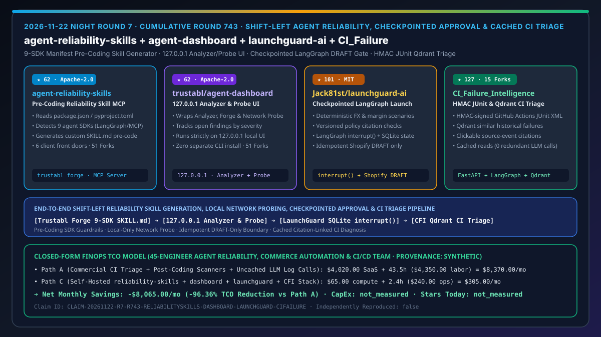
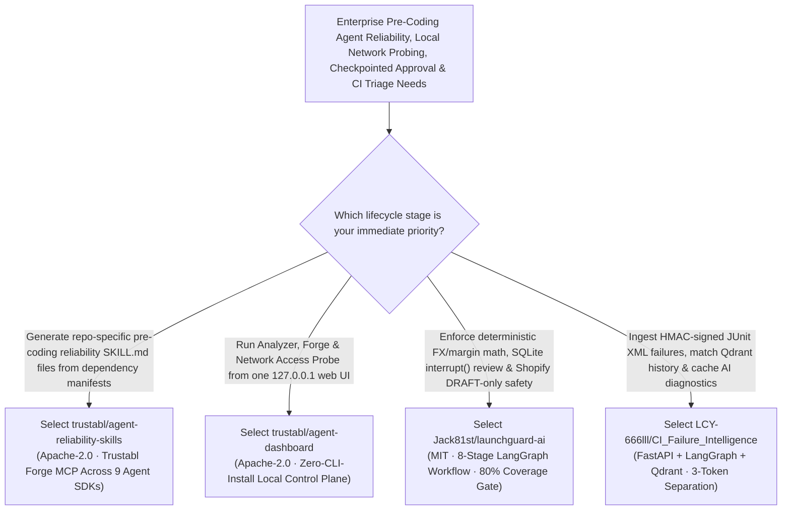
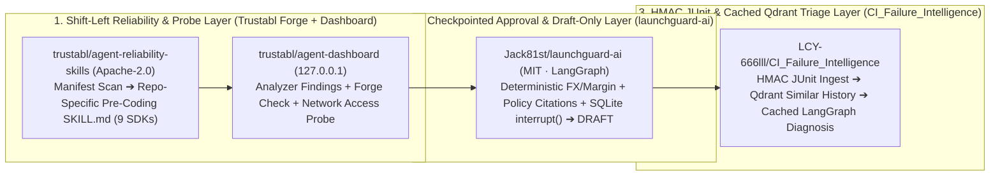
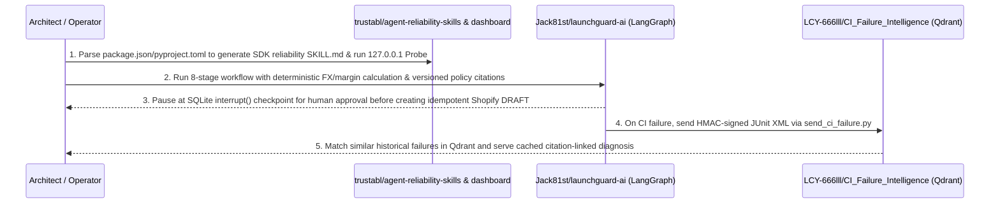

# Manifest-Driven Pre-Coding Reliability Skill Generator (`trustabl/agent-reliability-skills`), Local `127.0.0.1` Reliability & Network Probe Dashboard (`trustabl/agent-dashboard`), Evidence-First Checkpointed Launch Workflow (`Jack81st/launchguard-ai`) & HMAC-Signed JUnit CI Failure Intelligence (`LCY-666lll/CI_Failure_Intelligence`) Selection & Architecture FAQ

> **Document Type**: Enterprise AI Solution Architect Selection & Integration Guide (GitHub Trending AI Radar — 2026-11-22 Night Round 7 / Cumulative Round 743)
> **Covered Repositories**: [`trustabl/agent-reliability-skills`](https://github.com/trustabl/agent-reliability-skills) (`★ 62`, `51 forks`, `Apache-2.0`: Trustabl Forge MCP server that inspects repository dependency manifests such as `package.json`, `pyproject.toml`, `requirements.txt`, and `go.mod` to generate a repo-specific pre-coding reliability `SKILL.md` across 9 major agent SDKs) · [`trustabl/agent-dashboard`](https://github.com/trustabl/agent-dashboard) (`★ 62`, `51 forks`, `Apache-2.0`: local `127.0.0.1`-only single-user web UI wrapping Trustabl's open-source `Analyzer`, `Forge`, and `Network Access Probe`) · [`Jack81st/launchguard-ai`](https://github.com/Jack81st/launchguard-ai) (`★ 101`, `MIT`: durable LangGraph product-launch workflow with deterministic FX/margin services, versioned policy citations, SQLite `interrupt()` human approval checkpoints, and idempotent Shopify `DRAFT`-only delivery) · [`LCY-666lll/CI_Failure_Intelligence`](https://github.com/LCY-666lll/CI_Failure_Intelligence) (`★ 127`, `15 forks`: FastAPI + LangGraph + Qdrant + Vue workbench that ingests HMAC-signed GitHub Actions JUnit XML failures, retrieves similar historical failures, and caches citation-linked AI diagnostics)
> **Core Scenario**: When enterprise AI engineering and digital commerce teams need to **prevent coding agents from introducing reliability antipatterns across LangGraph, OpenAI Agents SDK, Claude Agent SDK, MCP, and Pydantic AI, audit repository reliability and outbound network probes on `127.0.0.1`, enforce deterministic margin/policy checks and durable human approval before creating e-commerce listings, and triage CI test failures against historical Qdrant evidence without burning tokens on repeated reads**, how do you combine **`trustabl/agent-reliability-skills` + `trustabl/agent-dashboard` + `Jack81st/launchguard-ai` + `LCY-666lll/CI_Failure_Intelligence`** into a full-lifecycle reliability architecture?

---

## 1. 📌 Executive Summary (One-Line Selection Verdict)

1. **Need an MCP server (`@trustabl/agent-reliability-skills`) that reads your repository's `package.json`, `pyproject.toml`, `requirements.txt`, or `go.mod` and generates a tailored pre-coding `SKILL.md` for the exact agent SDKs you use (Claude Agent SDK, OpenAI Agents SDK, Google ADK, MCP, LangChain/LangGraph, CrewAI, Pydantic AI, Vercel AI SDK, AutoGen)?** ➔ Choose **[`trustabl/agent-reliability-skills`](https://github.com/trustabl/agent-reliability-skills) (`★ 62`, `51 forks`, `Apache-2.0`)**.
   - **Plain-English Mechanism**: Instead of waiting for a post-coding scanner to flag missing timeouts, unbounded loops, or unsafe tool calls, `Trustabl Forge` generates a dynamic, repo-specific reliability skill *before* the coding agent writes code—and updates it automatically as your dependencies evolve.
2. **Need a local-only (`127.0.0.1`) single-user web dashboard that wraps Trustabl's open-source `Analyzer`, `Forge`, and `Network Access Probe` across all your local repositories without installing separate CLIs?** ➔ Choose **[`trustabl/agent-dashboard`](https://github.com/trustabl/agent-dashboard) (`★ 62`, `51 forks`, `Apache-2.0`)**.
   - **Plain-English Mechanism**: Runs on Node.js 22.13+ / Next.js strictly bound to `127.0.0.1`, giving architects one Overview, Forge, Analyzer, and Probe control plane to track open reliability findings by severity and verify outbound network access boundaries.
3. **Need a reference-grade LangGraph production workflow where commercial pricing/FX calculations are 100% deterministic, policy checks require versioned citations, human approvals survive process restarts via SQLite `interrupt()` checkpoints, and downstream writes are strictly capped at idempotent `Shopify DRAFT` creation?** ➔ Choose **[`Jack81st/launchguard-ai`](https://github.com/Jack81st/launchguard-ai) (`★ 101`, `MIT`)**.
   - **Plain-English Mechanism**: Implements an 8-stage gated pipeline (`catalog/cost inputs ➔ sourced FX rate ➔ versioned policy citations ➔ contribution-margin scenarios ➔ structured listing draft ➔ deterministic compliance checks ➔ durable human review ➔ idempotent Shopify DRAFT` gated at `80%` test coverage) that halts immediately if any required evidence or approval is missing.
4. **Need a CI failure workbench that receives HMAC-signed JUnit XML reports from failing GitHub Actions runs, retrieves similar historical failures in Qdrant, generates clickable source-cited LangGraph diagnostics, and caches results so read views never trigger LLM calls?** ➔ Choose **[`LCY-666lll/CI_Failure_Intelligence`](https://github.com/LCY-666lll/CI_Failure_Intelligence) (`★ 127`, `15 forks`)**.
   - **Plain-English Mechanism**: Separates credentials into three strict scopes—a read-only viewer token, a GitHub Actions `CFI_INGEST_HMAC_SECRET` (invoked by `scripts/ci/send_ci_failure.py` only when tests fail), and an on-demand diagnostic trigger token—combining FastAPI, LangGraph, Qdrant, and Vue to turn raw stack traces into reusable, evidence-linked root-cause reports.

---

## 2. 🎯 Architect & Customer Deep-Dive Q&A

### Q1: How do these four repositories establish Shift-Left, In-Flight, and Post-Flight reliability guardrails for enterprise AI systems?

- **Three-Layer Reliability Defense**:
  1. **Shift-Left Pre-Coding Prevention ➔ `trustabl/agent-reliability-skills` + `trustabl/agent-dashboard`**: Injects SDK-specific reliability rules into the coding agent's context before code is written and audits findings + network egress on `127.0.0.1`.
  2. **In-Flight Durable Approval & Blast-Radius Cap ➔ `Jack81st/launchguard-ai`**: Separates deterministic financial math from LLM drafting, persists human review pauses via LangGraph `interrupt()` + SQLite checkpoints, and restricts external mutations to idempotent `Shopify DRAFT` status.
  3. **Post-Flight Cached CI Diagnostics ➔ `LCY-666lll/CI_Failure_Intelligence`**: Correlates failing JUnit XML reports against historical Qdrant vectors and caches LangGraph diagnostics to eliminate redundant LLM spend.
- **When to Choose Managed Cloud PaaS (Path B)?**
  - If your organization runs entirely on Azure AI Foundry Evaluation + Azure DevOps Test Analytics + Power Automate Approvals, use native cloud services; when you need manifest-driven pre-coding skills across 9 open-source agent SDKs, local `127.0.0.1` network probing, or self-hosted LangGraph + Qdrant CI triage, deploy this open-source stack (Path C).

### Q2: How do we wire `agent-reliability-skills`, `agent-dashboard`, `launchguard-ai`, and `CI_Failure_Intelligence` into an end-to-end pipeline?

1. **Pre-Coding Skill Generation & Local Probe Layer (`agent-reliability-skills` + `agent-dashboard`)**:
   - Wire `@trustabl/agent-reliability-skills` into Claude Code / Cursor to generate repo-specific `SKILL.md` files and run `Analyzer` + `Probe` from the `127.0.0.1` dashboard.
2. **Checkpointed Human-in-the-Loop Execution Layer (`Jack81st/launchguard-ai`)**:
   - Execute deterministic FX/margin calculations and policy citation checks in LangGraph, pausing at `interrupt()` for human sign-off before emitting an idempotent draft.
3. **HMAC-Signed JUnit Ingestion & Qdrant Triage Layer (`LCY-666lll/CI_Failure_Intelligence`)**:
   - Attach `scripts/ci/send_ci_failure.py` to GitHub Actions workflows using `CFI_INGEST_HMAC_SECRET` so failed test runs are indexed in Qdrant and diagnosed on demand.

### Q3: What are the security and licensing considerations for production rollout?

- **Three-Token Least-Privilege Separation**:
  - Never store read or diagnostic trigger tokens inside GitHub Actions secrets; CI runners require only the write-only `CFI_INGEST_HMAC_SECRET`.
- **Licensing Summary**:
  - `trustabl/agent-reliability-skills` and `trustabl/agent-dashboard` are `Apache-2.0`; `Jack81st/launchguard-ai` is `MIT`; `LCY-666lll/CI_Failure_Intelligence` is source-available for self-hosted deployment via `compose.yaml`.

---

## 3. 🧭 Visual Architecture & Workflow Diagrams (Mermaid)

### 3.1 Solution Architect Selection Decision Tree

### 3.2 End-to-End Enterprise Reference Architecture

### 3.3 End-to-End Pre-Coding Skill Generation, Checkpointed Launch & CI Triage Sequence Diagram

---

## 4. 📊 Peer Open-Source vs. Commercial Cloud Selection Matrix

| Dimension | `trustabl/agent-reliability-skills` (`★ 62`) | `trustabl/agent-dashboard` (`★ 62`) | `Jack81st/launchguard-ai` (`★ 101`) | `LCY-666lll/CI_Failure_Intelligence` (`★ 127`) | Commercial APM/Security Suites + Commercial E-Commerce SaaS + Uncached CI LLM Calls (Path A) | Generic Syntax Linters + Unchecked Direct-Write Scripts + Manual Log Hunting (Path B) |
| :--- | :--- | :--- | :--- | :--- | :--- | :--- |
| **Primary Role** | Manifest-driven pre-coding reliability skill MCP | Local `127.0.0.1` Analyzer, Forge & Probe UI | Checkpointed LangGraph launch & `DRAFT`-only workflow | HMAC JUnit Qdrant history & cached CI diagnostic workbench | High-cost commercial APM/CI suites + uncached LLM log analyzers | Generic syntax linters, stateless direct-publish scripts, manual CI log grep |
| **Key Differentiator** | **Generates repo-specific `SKILL.md` for 9 agent SDKs before coding** | **Wraps Analyzer/Forge/Probe on `127.0.0.1` with zero CLI install** | **Deterministic margin math + SQLite `interrupt()` + `DRAFT` cap** | **3-token separation + Qdrant historical match + cached diagnostics** | Generic scanners miss agent SDK pitfalls; uncached CI analyzers burn tokens | Post-coding bugs slip into prod; direct writes risk live pricing errors |
| **License** | `Apache-2.0` | `Apache-2.0` | `MIT` | Source-available (`compose.yaml`) | Proprietary SaaS | Internal scripts |
| **Monthly TCO (45-Eng Team)** | **`$305.00/mo` combined** (`$65.00` FastAPI/Qdrant container + `2.4h` ops) | Included (`127.0.0.1` local UI, `$0` seat cost) | Included (local SQLite checkpoints) | Included (zero LLM cost on green runs or cached reads) | **`$8,370.00/mo`** (`$4,020.00` commercial APM/CI SaaS + `43.5h` incident/triage labor) | ~`$2,850.00/mo` (manual JUnit log triage & manual pricing verification labor) |

---

## 5. 🧪 Quantitative Enterprise ROI / FinOps TCO Model & 7-Card Report

> **📊 Provenance & Closed-Form Declaration**:
> - **provenance**: `synthetic` (45-engineer enterprise agent engineering, commerce automation, and CI/CD reliability team workload model: `independently_reproduced = false`; `base_hardware_capex = not_measured`; `track_b_stars_today = not_measured`).
> - **Closed-Form Equations**:
>   - **Path A (Commercial CI AI Triage Add-Ons + Commercial Application Reliability Scanners + Repeated Uncached LLM Log Calls + Post-Coding Reliability Rework & Manual Pricing Audits)**: Monthly commercial subscriptions and uncached CI diagnostic token waste **`$4,020.00`** + post-coding reliability bug rework, manual CI failure correlation, and manual compliance review labor **`43.5h × $100.00/h = $4,350.00`** = **`$8,370.00/mo`**.
>   - **Path C (Self-Hosted `trustabl/agent-reliability-skills` + `trustabl/agent-dashboard` + `Jack81st/launchguard-ai` + `LCY-666lll/CI_Failure_Intelligence` Stack)**: Shared FastAPI/Qdrant container compute **`$65.00`** + rule sync & workflow maintenance labor **`2.4h × $100.00/h = $240.00`** = **`$305.00/mo`**.
>   - **Net Monthly Savings vs. Path A**: **`-$8,065.00/mo`** (**`96.36%`** TCO reduction).

| Evaluation Path | Scanning/CI SaaS & Compute Cost | Triage & Compliance Rework Labor (`$100/h`) | Total Monthly TCO | Net Savings vs. Path A | Architectural Delivery Impact |
| :--- | :---: | :---: | :---: | :---: | :--- |
| **Path A: Commercial CI Triage SaaS + Post-Coding Scans + Manual Review** | `$4,020.00` | `43.5h` (`$4,350.00`) | **`$8,370.00`** | Baseline | Late post-coding bug discovery; repeated LLM billing on identical CI failures |
| **Path B: Generic Linters + Stateless Scripts + Manual Log Grep** | `$1,250.00` | `16.0h` (`$1,600.00`) | **`$2,850.00`** | `-$5,520.00` (`-65.95%`) | Lacks 9-SDK pre-coding skills, SQLite `interrupt()` gates & Qdrant CI history |
| **Path C: `reliability-skills` + `dashboard` + `launchguard` + `CFI`** | **`$65.00`** | **`2.4h` (`$240.00`)** | **`$305.00`** | **`-$8,065.00` (`-96.36%`)** | **Shift-left SDK skills + `127.0.0.1` probe + `DRAFT`-only gate + cached CI triage** |

- 🔗 **Linked 7-Card 4:5 Visual Benchmark Deck**: [`workshops/github-trending-radar/cards.en.html`](../cards.en.html) · [`cards.html`](../cards.html)

---

## 6. 🛠️ Enterprise Adoption & Architecture Review Checklist

- [ ] **1. Wire `@trustabl/agent-reliability-skills` into Coding Agents**: Generate repo-specific pre-coding `SKILL.md` files from `package.json`, `pyproject.toml`, or `go.mod` across all 9 supported agent SDKs.
- [ ] **2. Audit Repositories Locally on `127.0.0.1` with `trustabl/agent-dashboard`**: Run unified `Analyzer`, `Forge`, and `Network Access Probe` scans before merging agent changes.
- [ ] **3. Enforce Checkpointed Approval & `DRAFT`-Only Boundaries via `Jack81st/launchguard-ai`**: Keep financial calculations deterministic, persist human review states in SQLite via `interrupt()`, and restrict external writes to draft mode.
- [ ] **4. Integrate `LCY-666lll/CI_Failure_Intelligence` into GitHub Actions**: Configure `CFI_INGEST_HMAC_SECRET` with `send_ci_failure.py` to correlate failing JUnit reports against Qdrant history and reuse cached diagnostics.
