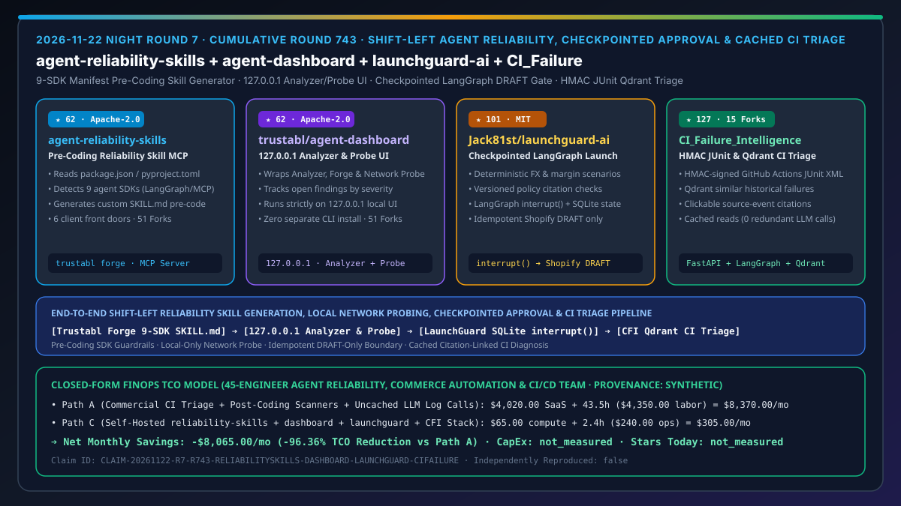
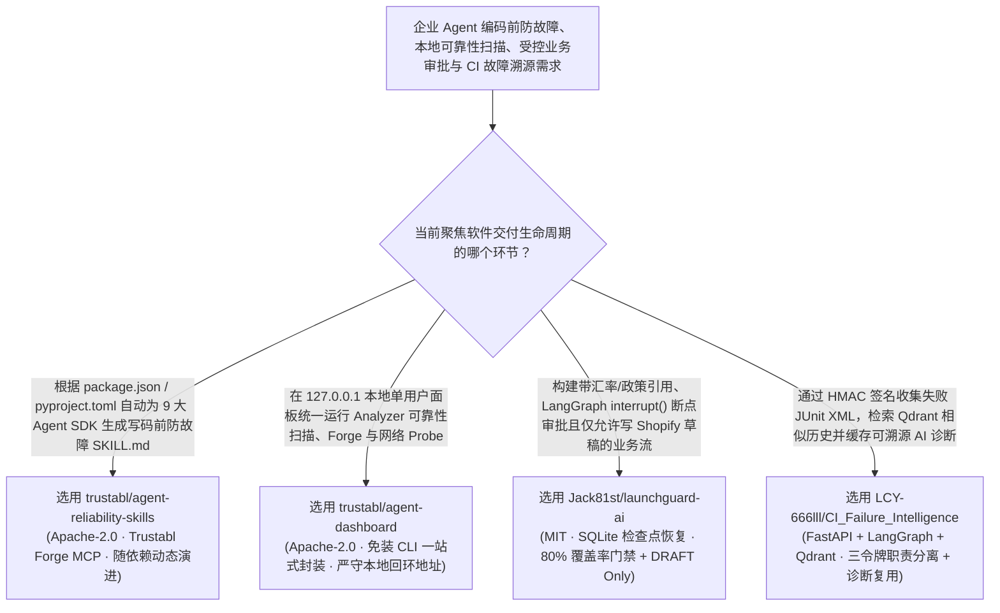
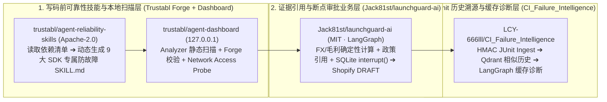
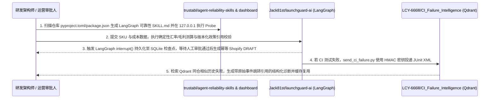

# 依赖清单驱动编码前 Agent 可靠性技能生成 MCP（`trustabl/agent-reliability-skills`）、本地 127.0.0.1 可靠性与网络探测仪表盘（`trustabl/agent-dashboard`）、LangGraph 证据引用与断点审批电商上新工作流（`Jack81st/launchguard-ai`）及 HMAC 验签 JUnit 历史溯源 CI 排障工作台（`LCY-666lll/CI_Failure_Intelligence`）选型与集成架构 FAQ

> **文档类型**：企业 AI 解决方案架构师（AI Solution Architect）选型决策指南（GitHub Trending AI 雷达 2026-11-22 Night Round 7 / 累计第 743 轮）
> **覆盖项目**：[`trustabl/agent-reliability-skills`](https://github.com/trustabl/agent-reliability-skills)（`★ 62`、`51 forks`、`Apache-2.0`，Trustabl Forge 官方 MCP，自动读取仓库 `package.json`/`pyproject.toml`/`go.mod` 识别所使用的 9 大 Agent SDK，在写代码前按仓动态生成防故障 `SKILL.md`）· [`trustabl/agent-dashboard`](https://github.com/trustabl/agent-dashboard)（`★ 62`、`51 forks`、`Apache-2.0`，仅监听 `127.0.0.1` 的本地单用户 Web 控制台，一站式封装 `Analyzer`、`Forge` 与 `Network Access Probe`）· [`Jack81st/launchguard-ai`](https://github.com/Jack81st/launchguard-ai)（`★ 101`、`MIT`，基于 LangGraph `interrupt()` + SQLite 检查点的 8 步商品合规上新流水线，覆盖汇率溯源、版本化政策引用、毛利测算、人工断点审批与幂等仅写 Shopify `DRAFT` 安全边界）· [`LCY-666lll/CI_Failure_Intelligence`](https://github.com/LCY-666lll/CI_Failure_Intelligence)（`★ 127`、`15 forks`，基于 FastAPI + LangGraph + Qdrant + Vue 的 GitHub Actions JUnit 失败证据检索与诊断缓存工作台，采用三令牌职责分离架构）
> **核心场景**：当企业研发与电商运营团队在将 AI Agent 投入生产时，面临**“编码 Agent 写出的 LangGraph/OpenAI SDK/MCP 代码缺乏超时重试与循环保护、缺乏本地可视化面板统一扫描 Agent 仓库可靠性与外网越权、电商 AI 自动上架商品算错汇率毛利或未经审批直接发布上线、以及 CI 单测挂掉后每次都重复调大模型分析且找不到历史同类失败”**四大痛点时，如何组合**`trustabl/agent-reliability-skills` + `trustabl/agent-dashboard` + `Jack81st/launchguard-ai` + `LCY-666lll/CI_Failure_Intelligence`** 打造“事前防故障、事中强审批、事后可溯源”的工程可靠性体系？

---

## 一、📌 核心结论速览（选型一句话结论）

1. **想让 Claude Code、Cursor 或 Pydantic AI 在写 Agent 代码之前，先根据当前仓库实际安装的 SDK（如 LangGraph、OpenAI Agents SDK、Claude Agent SDK、Google ADK、MCP、CrewAI、Vercel AI SDK、AutoGen）自动生成一份定制化的防故障可靠性技能（Pre-Coding Reliability Skill）** ➔ 选 **[`trustabl/agent-reliability-skills`](https://github.com/trustabl/agent-reliability-skills)（`★ 62`，`51 forks`，`Apache-2.0`）**。
   - **通俗原理**：绝大多数学术扫描器都是“等代码写完上线前才报错”，而 `Trustabl Forge` 把防线前移到写第一行代码之前——它自动解析仓库的 `package.json`、`pyproject.toml`、`requirements.txt` 或 `go.mod`，识别出你正在用哪几款 Agent 框架，从检测规则库中精准抽取对应框架的可靠性准则生成专属 `SKILL.md`，让编码 Agent 边写边遵守。
2. **想在本机 `127.0.0.1` 启动一个零外传 Web 仪表盘，一键对本地多个 AI 仓库运行可靠性静态分析（Analyzer）、技能同步（Forge）与外网访问边界探测（Probe）** ➔ 选 **[`trustabl/agent-dashboard`](https://github.com/trustabl/agent-dashboard)（`★ 62`，`51 forks`，`Apache-2.0`）**。
   - **通俗原理**：无需分别手工安装多个 CLI，直接通过单用户 Next.js 本地界面查看各仓库按严重度分级的可靠性隐患清单、核验 `SKILL.md` 是否随依赖变更保持最新，并探测 Agent 进程的真实网络外连行为。
3. **想构建一套用于跨境电商或零售商品上新的 LangGraph 生产工作流，要求汇率、成本、合规政策必须带版本化引用，进程重启后人工审批不丢失，且 AI 永远只能创建幂等的 Shopify 草稿（`DRAFT` only）而绝不能直接上架售卖** ➔ 选 **[`Jack81st/launchguard-ai`](https://github.com/Jack81st/launchguard-ai)（`★ 101`，`MIT`）**。
   - **通俗原理**：这是企业级“受控业务 Agent”的教科书范本——利用 **LangGraph `interrupt()` + SQLite Checkpoints + 固定 Thread ID** 实现跨进程重启不丢失的人工断点审批；将确定性业务逻辑（汇率换算、贡献毛利多档测算、合规校验）与大模型文案生成严格解耦；一旦缺少证据或人工未批准立即停机，最终交付侧强制锁定为幂等 `Shopify DRAFT` 模式（单元测试覆盖率门禁 `>= 80%`）。
4. **想在 GitHub Actions 测试失败时自动收集 JUnit XML 报告，结合 Qdrant 检索同仓库历史相似故障并生成带可点击原事件引用的 LangGraph 结构化诊断，且读取已有诊断绝不重复消耗大模型 Token** ➔ 选 **[`LCY-666lll/CI_Failure_Intelligence`](https://github.com/LCY-666lll/CI_Failure_Intelligence)（`★ 127`，`15 forks`）**。
   - **通俗原理**：采用严密的**三凭据职责分离设计**——① `CFI_INGEST_HMAC_SECRET`（GitHub Actions 仅在测试失败时签名投递 JUnit XML，全绿零开销）；② 读取令牌（浏览证据与复用已缓存的诊断结果，零模型调用）；③ 诊断触发令牌（仅在需要时按需触发 LangGraph + Qdrant 历史对比诊断）。

---

## 二、🎯 客户与架构师灵魂拷问 Q&A（深度架构拆解）

### Q1：为什么企业 Agent 项目常陷入“写码时埋雷、上线后越权、CI 挂了瞎猜”的恶性循环？这四个项目如何建立三道工程防线？

- **三道工程防线拆解**：
  1. **事前防线（Shift-Left Reliability）➔ `trustabl/agent-reliability-skills` + `trustabl/agent-dashboard`**：在写代码前根据依赖清单动态生成針對 9 大 Agent SDK 的防故障 `SKILL.md`，并在 `127.0.0.1` 面板持续扫描可靠性漏洞与网络越权探测。
  2. **事中防线（Durable HITL & Draft-Only Boundary）➔ `Jack81st/launchguard-ai`**：用确定性服务算钱算毛利、用版本化政策做引用、用 LangGraph `interrupt()` 挂起等待人工审批、用 `Shopify DRAFT only` 锁死高危写操作上限。
  3. **事后防线（Evidence-Cached CI Triage）➔ `LCY-666lll/CI_Failure_Intelligence`**：将每次 CI 失败的 JUnit 堆栈与 Qdrant 历史相似故障关联，生成可点击核对原始事件的诊断并缓存复用。
- **何时直接用云厂商托管方案（Path B）？**
  - 若企业完全使用 Azure AI Foundry Evaluation + Azure DevOps Test Analytics + Power Automate Approvals，可优先采用云端原生套件；若需针对 9 大开源 Agent SDK 自动生成编码前可靠性技能、或自建 LangGraph 电商草稿审批与 JUnit 向量溯源台，则采用本轮组合（Path C）。

### Q2：典型企业级“编码前可靠性技能生成 (`Forge`) + 本地探针大盘 (`Dashboard`) + 断点审批业务流 (`LaunchGuard`) + CI 故障向量溯源 (`CFI`)”架构怎么搭？

1. **编码前可靠性技能注入与本地扫描层（`agent-reliability-skills` + `agent-dashboard`）**：
   - 在 Claude Code / Cursor 中挂载 `@trustabl/agent-reliability-skills`，读取仓库 `pyproject.toml`/`package.json` 生成专属 `SKILL.md`，并通过 `127.0.0.1` `agent-dashboard` 執行 `Analyzer` 与 `Probe` 检查。
2. **带检查点审批与只写草稿护栏的业务执行层（`Jack81st/launchguard-ai`）**：
   - 运行 8 阶段 LangGraph 流水线，执行确定性汇率/毛利核算与政策引用核验，在 `interrupt()` 节点暂停等待运营负责人审批后写入幂等 `Shopify DRAFT`。
3. **CI 失败 JUnit 签名摄取与历史相似诊断层（`LCY-666lll/CI_Failure_Intelligence`）**：
   - 在 GitHub Actions 测试 Job 后挂载 `scripts/ci/send_ci_failure.py`（通过 `CFI_INGEST_HMAC_SECRET` 验签），将失败报告送入 FastAPI + Qdrant + LangGraph 工作台。

### Q3：这套架构在生产落地时的安全与许可注意事项是什么？

- **三令牌最小权限原则**：
  - 在配置 `CI_Failure_Intelligence` 时，切勿将“网页读取令牌”或“诊断触发令牌”混填到 GitHub Actions Secrets 中，GitHub 仓库只需配置只写投递用的 `CFI_INGEST_HMAC_SECRET`。
- **许可证核验**：
  - `trustabl/agent-reliability-skills` 与 `trustabl/agent-dashboard` 为 `Apache-2.0`；`Jack81st/launchguard-ai` 为 `MIT`；`LCY-666lll/CI_Failure_Intelligence` 仓库未附独立 LICENSE 文件（用于内部自建参考时建议遵循源码自托管规范）。

---

## 三、🧭 直观可视化图解（Mermaid 决策树 + 集成架构 + 时序图）

### 3.1 架构师选型决策树

### 3.2 企业端到端生产集成参考架构图

### 3.3 依赖解析生成可靠性技能、本地探针扫描、LangGraph 断点审批上新与 CI 失败历史溯源时序图

---

## 四、📊 同类开源与商业云服务横向选型决策矩阵

| 对比维度 | `trustabl/agent-reliability-skills` (`★ 62`) | `trustabl/agent-dashboard` (`★ 62`) | `Jack81st/launchguard-ai` (`★ 101`) | `LCY-666lll/CI_Failure_Intelligence` (`★ 127`) | 商业应用安全/APM 平台 + 商业电商 ERP 自动化 + 每次失败裸调大模型 (Path A) | 通用静态 Linter + 无状态脚本直写生产 API + 人工翻 CI 日志 (Path B) |
| :--- | :--- | :--- | :--- | :--- | :--- | :--- |
| **核心能力定位** | 依赖感知编码前 Agent 可靠性技能生成 MCP | 本地 `127.0.0.1` 可靠性与网络探测控制台 | LangGraph 证据引用、断点审批与草稿安全工作流 | HMAC 签名 JUnit 向量历史溯源与缓存诊断台 | 按席位/事件量高价计费的商业 APM 与自动化 SaaS | 传统语法 Linter、无审批直写脚本与人肉搜 Actions 日志 |
| **核心技术突破** | **解析真实依赖清单针对 9 大 Agent SDK 动态生成规则** | **零外传 `127.0.0.1` 一站式封装 Analyzer/Forge/Probe** | **SQLite `interrupt()` 断点恢复 + 确定性算毛利 + `DRAFT` 锁死** | **三令牌隔离 + Qdrant 历史相似故障溯源 + 诊断结果缓存** | 商业 APM 不懂 Agent 循环与工具调用缺陷；每次看 CI 都调模型烧钱 | 事后才发现 Agent 死循环；脚本直写生产库极易酿成价格事故 |
| **开源协议** | `Apache-2.0` | `Apache-2.0` | `MIT` | 源码自托管 | 闭源商业 SaaS | 内部零散脚本 |
| **月度 TCO（45 人团队）** | **组合仅 `$305.00/月`**（`$65.00` 自托管 Qdrant/FastAPI 容器 + `2.4h` 维护） | 同左（本地 `127.0.0.1` 运行 `$0` 费用） | 同左（SQLite 本地检查点零数据库月费） | 同左（测试全绿不投递、已生成诊断直接缓存复用） | **`$8,370.00/月`**（`$4,020.00` 商业 APM/CI 诊断订阅 + `43.5h` 事故回滚与日志排查） | 约 `$2,850.00/月`（大量人工翻阅 JUnit 堆栈与手工核对商品毛利工时） |

---

## 五、🧪 应用落地定量收益/TCO 对比与 7-Card 报告

> **📊 数据来源与闭式核算声明（Provenance & Closed-Form Schema）**：
> - **provenance**: `synthetic`（基于 45 人企业智能体研发、电商业务自动化与效能工程团队月度工作负载模型：`independently_reproduced = false`；硬件采购基线 `base_hardware_capex = not_measured`；Track B 单日增量 `track_b_stars_today = not_measured`）。
> - **核算公式**：
>   - **Path A（采购商业 CI 智能分析附加包 + 商业应用可靠性扫描席位 + 每次查看 CI 报错重复触发大模型调用 + 工程师事后返工修复 Agent 可靠性漏洞与人工核对商品定价政策）**：月度商业工具订阅与重复诊断 Token 浪费 **`$4,020.00`** + 事后缺陷返工、CI 历史排障与人工政策核对人工 **`43.5h × $100.00/h = $4,350.00`** = **`$8,370.00/月`**。
>   - **Path C（自建 `trustabl/agent-reliability-skills` + `trustabl/agent-dashboard` + `Jack81st/launchguard-ai` + `LCY-666lll/CI_Failure_Intelligence` 开源可靠性与工程诊断栈）**：共享 FastAPI/Qdrant 容器算力开销 **`$65.00`** + 规则更新与流水线维护人工 **`2.4h × $100.00/h = $240.00`** = **`$305.00/月`**。
>   - **净节省（Net Savings vs Path A）**：**`-$8,065.00/月`**（成本降低 **`96.36%`**）。

| 评估方案 | 扫描/CI SaaS 与算力成本 | 故障排查与合规返工人工（`$100/h`） | 月度总 TCO | 相对 Path A 净节省 | 关键架构交付指标 |
| :--- | :---: | :---: | :---: | :---: | :--- |
| **Path A：商业 CI 智能分析 + 事后安全扫描 + 人工核对上架** | `$4,020.00` | `43.5h` (`$4,350.00`) | **`$8,370.00`** | Baseline | 事后扫描返工成本高；重复查看 CI 失败反复消耗 Token |
| **Path B：传统语法 Linter + 无状态脚本 + 人工翻 GitHub 日志** | `$1,250.00` | `16.0h` (`$1,600.00`) | **`$2,850.00`** | `-$5,520.00` (`-65.95%`) | 缺少 9 大 Agent SDK 专属规则、`interrupt()` 检查点与历史向量对比 |
| **Path C：`reliability-skills` + `dashboard` + `launchguard` + `CFI`** | **`$65.00`** | **`2.4h` (`$240.00`)** | **`$305.00`** | **`-$8,065.00` (`-96.36%`)** | **写码前防故障技能 + 127.0.0.1 探针 + 草稿强门禁 + JUnit 缓存诊断** |

- 🔗 **关联 7-Card 4:5 视觉评测报告**：[`workshops/github-trending-radar/cards.html`](../cards.html) · [`cards.en.html`](../cards.en.html)

---

## 六、🛠️ 企业引入与架构评审 Checklist

- [ ] **1. 在编码终端配置 `@trustabl/agent-reliability-skills`**：让 Agent 在动笔前先读取根据当前仓库 `package.json`/`pyproject.toml` 动态生成的 SDK 可靠性 `SKILL.md`。
- [ ] **2. 在本机 `127.0.0.1` 运行 `trustabl/agent-dashboard`**：定期执行 `Analyzer`、`Forge check` 与 `Network Access Probe` 审计各仓库的严重隐患。
- [ ] **3. 参考 `Jack81st/launchguard-ai` 设计高风险业务 Agent 架构**：将金额/毛利计算抽离为确定性服务，启用 LangGraph `interrupt()` 持久化审批，并将下游写权限限制在幂等草稿（`DRAFT` only）状态。
- [ ] **4. 在 GitHub Actions 接入 `LCY-666lll/CI_Failure_Intelligence`**：配置只写 `CFI_INGEST_HMAC_SECRET` 仅在测试失败时上传 JUnit XML，利用 Qdrant 相似历史与诊断缓存加速排障。
