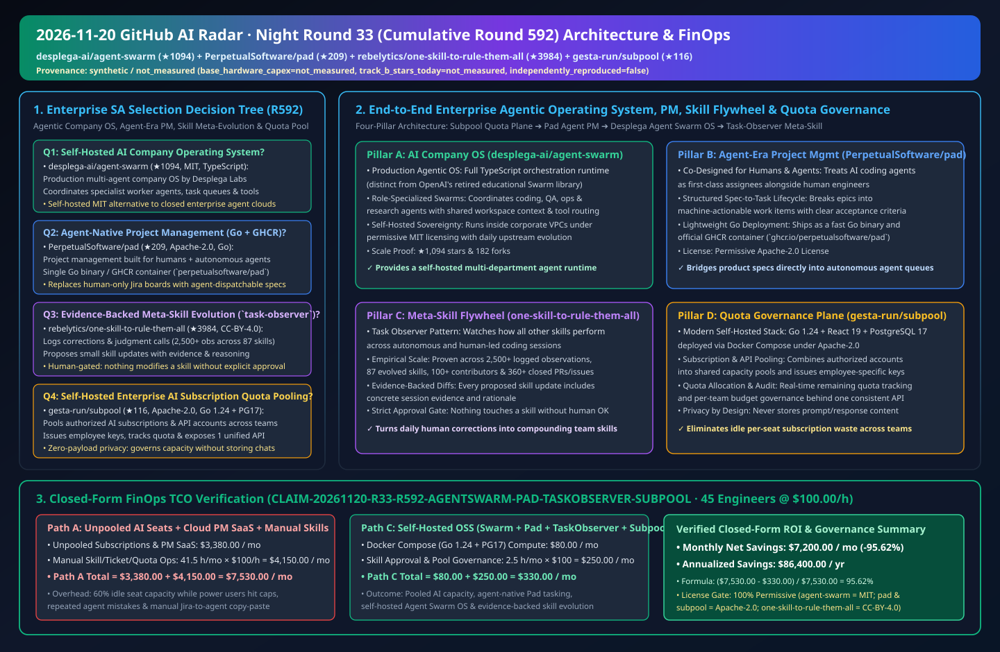
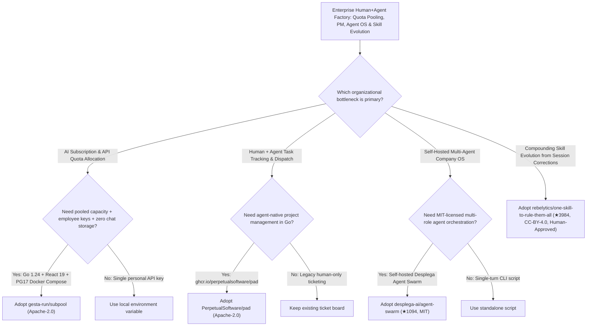
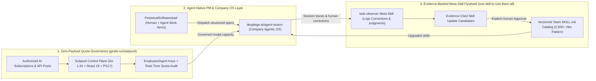

# Self-Hosted AI Company OS (`desplega-ai/agent-swarm`), Agent-Era Project Management (`PerpetualSoftware/pad`), Evidence-Backed Meta-Skill Evolution (`rebelytics/one-skill-to-rule-them-all`) & Self-Hosted AI Subscription Quota Pool (`gesta-run/subpool`) Selection & Integration FAQ (2026-11-20 Night Round 33 · Cumulative Round 592)

> **Cross-File Navigation**: [Back to 2026-11-20 Daily Digest (`daily/2026-11-20.en.md`)](../daily/2026-11-20.en.md) · [中文版 (`agent-swarm-pad-one-skill-to-rule-them-all-subpool-selection-faq.md`)](agent-swarm-pad-one-skill-to-rule-them-all-subpool-selection-faq.md) · [7-Card 4:5 Visual Report (`cards.en.html`)](../cards.en.html) · [Column Index (`README.en.md`)](../README.en.md)  
> **Architecture Diagram**: [`assets/github-ai-radar-2026-11-20-r33-r592-agentswarm-pad-taskobserver-subpool.svg`](../../../assets/github-ai-radar-2026-11-20-r33-r592-agentswarm-pad-taskobserver-subpool.svg)  
> **Provenance & Synthetic Disclaimer**: Repository metadata (stars, forks, licenses, observation counts, and architectural specifications) is verified from live GitHub API data (`measured`). The 45-engineer FinOps TCO figures represent a parameterized Solution Architect model (`provenance: synthetic`, `independently_reproduced: false`, `base_hardware_capex: not_measured`, `track_b_stars_today: not_measured`, claim ID `CLAIM-20261120-R33-R592-AGENTSWARM-PAD-TASKOBSERVER-SUBPOOL`).



---

## ① 📌 Executive Summary

> **One-Sentence Selection Verdict**: For Enterprise AI Solution Architects building a **company-wide Human + Agent software factory** across four organizational bottlenecks—(1) **idle per-seat AI subscription waste where light users leave 70% of capacity unused while power engineers hit rate limits**; (2) **legacy project trackers (Jira/Linear) built only for human clicks rather than dispatching structured work items to autonomous agents**; (3) **lack of a self-hosted, multi-role agentic operating system to coordinate specialist worker agents**; and (4) **repeated human corrections inside coding sessions that evaporate instead of compounding into improved team skills**—combine four **100% permissive (`MIT` / `Apache-2.0` / `CC-BY-4.0`)** repositories: **`desplega-ai/agent-swarm`** (`★ 1,094`, MIT self-hosted AI company operating system by Desplega Labs), **`PerpetualSoftware/pad`** (`★ 209`, Apache-2.0 Go project management platform built for the agent era), **`rebelytics/one-skill-to-rule-them-all`** (`★ 3,984`, CC-BY-4.0 `task-observer` meta-skill with `2,500+` logged observations across `87` skills that turns session corrections into human-approved skill updates), and **`gesta-run/subpool`** (`★ 116`, Apache-2.0 self-hosted Go 1.24 + React 19 + PostgreSQL 17 AI subscription quota pool that governs capacity without storing conversation payloads). Across a 45-engineer engineering organization, this stack reduces monthly TCO from **`$7,530.00/mo`** to **`$330.00/mo`**, saving **`$7,200.00/mo` (`-95.62%`, or `$86,400.00/yr`)**.

| Evaluation Dimension | Path A: Unpooled Per-Seat AI Subscriptions + Legacy Jira + Manual Skill Updates | Path B: Closed Commercial Agent Cloud Platforms | Path C (Recommended): `agent-swarm` + `pad` + `one-skill-to-rule-them-all` + `subpool` |
| :--- | :--- | :--- | :--- |
| **Enterprise AI Subscription & Quota Utilization** | 60%+ idle capacity on light seats while power users hit rate caps | Cloud proxies log sensitive conversation payloads externally | **`gesta-run/subpool` pools authorized accounts, issues employee keys & tracks quota with zero chat storage** |
| **Human + Agent Project Management** | Manual copy-paste from Jira tickets into terminal agent prompts | Locked to proprietary SaaS trackers without self-hosted containers | **`PerpetualSoftware/pad` (Go + GHCR container) manages humans & autonomous agents on one board** |
| **Multi-Role Company Agent Operating System** | Disconnected single-agent scripts without shared task queues | High annual platform licensing & vendor lock-in | **`desplega-ai/agent-swarm` (`★ 1,094`, MIT) self-hosted AI company operating system** |
| **Continuous Team Skill Evolution** | Engineers repeat the same corrections every session; skills go stale | Unsupervised auto-prompting corrupts working skills | **`one-skill-to-rule-them-all` (`★ 3,984`) proposes evidence-backed skill diffs gated by human approval** |
| **45-Engineer Monthly Total TCO** | **`$7,530.00 / mo`** (`$3,380.00` idle seats/SaaS + `41.5h × $100` labor) | **`$2,380.00 / mo`** (`$880.00` platform fees + `15.0h × $100` ops) | **`$330.00 / mo`** (`$80.00` self-hosted compute + `2.5h × $100` review, **`-95.62%` savings**) |

---

## ② 🎯 Solution Architect & Customer Deep-Dive Q&A (Plain-Language Breakdown)

### Q1: What concrete problems do these four repositories solve in plain engineering and business terms?

1. **`desplega-ai/agent-swarm` (`★ 1,094`, `182 forks`, TypeScript, MIT) — Plain-Language View: An open-source, self-hosted AI company operating system (`swar.am`) for coordinating specialist agent teams**:
   - **Pain Point Solved**: Unlike OpenAI's retired educational Swarm snippet, `desplega-ai/agent-swarm` is a full-featured, actively evolving TypeScript operating system for running coordinated fleets of specialist AI agents across engineering, QA, research, and operations inside your own infrastructure under the MIT license.
2. **`PerpetualSoftware/pad` (`★ 209`, `26 forks`, Go, Apache-2.0) — Plain-Language View: Project management built from the ground up for the agent era**:
   - **Pain Point Solved**: Traditional issue trackers assume every assignee is a human clicking a web UI. Shipped as a fast Go binary and official GHCR container (`ghcr.io/perpetualsoftware/pad`), `pad` structures project specs, tasks, and status transitions so humans and autonomous coding agents collaborate as first-class peers.
3. **`rebelytics/one-skill-to-rule-them-all` (`★ 3,984`, `396 forks`, Markdown, CC-BY-4.0) — Plain-Language View: The `task-observer` meta-skill (`2,500+` logged observations across `87` skills) that turns your session corrections into approved skill upgrades**:
   - **Pain Point Solved**: Agent skills quickly stagnate unless someone manually edits `SKILL.md` files after every tough debugging session. `task-observer` watches how your skills perform across autonomous and human-led sessions, captures corrections, judgment calls, and repeated workflows, and proposes small skill updates or new skill candidates—each backed by concrete session evidence and reasoning. Crucially, **nothing modifies a skill until a human explicitly approves it**.
4. **`gesta-run/subpool` (`★ 116`, `13 forks`, Go 1.24 + React 19 + PostgreSQL 17, Apache-2.0) — Plain-Language View: A self-hosted control plane that pools enterprise AI subscriptions and API capacity across teams without storing conversation content**:
   - **Pain Point Solved**: Buying isolated per-seat subscriptions leaves massive unused capacity on light users while power users get throttled. Deployed via Docker Compose (`Go 1.24`, `React 19`, `PostgreSQL 17`), `subpool` lets administrators combine authorized subscription and API accounts into shared pools, issue employee-specific keys, monitor remaining quota in real time, and expose one consistent API without storing prompts or responses.

---

### Q2: How do these four components wire together into an enterprise Human + Agent software factory?

1. **Capacity Pooling & Quota Governance (`gesta-run/subpool`)**: Deploy `subpool` via Docker Compose to aggregate authorized AI accounts into team pools and issue budgeted API keys to both engineers and background agents.
2. **Agent-Native Work Planning (`PerpetualSoftware/pad`)**: Product and engineering leads break epics into structured work items in `pad`, assigning well-scoped tasks directly to autonomous agent queues.
3. **Multi-Agent Execution Runtime (`desplega-ai/agent-swarm`)**: `agent-swarm` workers pick up assigned tasks from `pad`, consume model quota through `subpool`, and execute implementation and verification workflows.
4. **Compounding Skill Flywheel (`rebelytics/one-skill-to-rule-them-all`)**: `task-observer` monitors human interventions and code review feedback during `agent-swarm` runs, generating evidence-backed `SKILL.md` improvement PRs for weekly lead approval.

---

### Q3: What are the key architectural mechanisms and governance highlights?

1. **Key Mechanisms**:
   - **Human-Gated Augmented Expertise (`one-skill-to-rule-them-all`)**: Prevents prompt drift and self-reinforcing hallucinations by requiring explicit human approval on every evidence-cited skill diff.
   - **Zero-Payload Quota Accounting (`subpool`)**: Separates token/quota metering in PostgreSQL 17 from raw conversation payloads so security teams can audit spend without creating a sensitive data honeypot.
2. **Licensing & Governance Highlights**:
   - **100% Permissive Licensing**: `agent-swarm` is **MIT**, `pad` and `subpool` are **Apache-2.0**, and `one-skill-to-rule-them-all` is **CC-BY-4.0**.

---

## ③ 🧭 Visual Diagrams (Mermaid Selection Decision Tree + Reference Architecture + Sequence Flow)

### 3.1 Selection Decision Tree



### 3.2 Enterprise Integration Reference Architecture



### 3.3 End-to-End Sequence Flow

```mermaid
sequenceDiagram
    autonumber
    actor Lead as Solution Architect / Tech Lead
    participant Subpool as gesta-run/subpool (Quota Pool)
    participant Pad as PerpetualSoftware/pad (Agent PM)
    participant Swarm as desplega-ai/agent-swarm (Agentic OS)
    participant Observer as one-skill-to-rule-them-all (task-observer)

    Lead->>Subpool: Pool authorized AI accounts & issue employee/swarm keys with quota caps
    Lead->>Pad: Create structured feature spec & assign tasks to Agent Swarm
    Pad->>Swarm: Trigger multi-agent execution routed through Subpool unified API
    Lead->>Swarm: Provide correction on edge-case handling during review
    Observer-->>Lead: Propose small SKILL.md update citing exact session correction evidence
    Lead->>Observer: Approve update; upgraded skill is immediately available to all Swarm agents
```

---

## ④ 📊 Comparative Selection Matrix (OSS vs. Unpooled SaaS & Manual Workflows)

| Dimension | `desplega-ai/agent-swarm` (`★ 1094`) | `PerpetualSoftware/pad` (`★ 209`) | `rebelytics/one-skill-to-rule-them-all` (`★ 3984`) | `gesta-run/subpool` (`★ 116`) | Unpooled AI Seats + Legacy Jira + Manual Skill Edits |
| :--- | :--- | :--- | :--- | :--- | :--- |
| **Primary Role** | Self-hosted AI company operating system | Agent-era project management platform in Go | `task-observer` meta-skill that evolves all other skills | Self-hosted AI subscription quota allocation & governance plane | Fixed per-seat SaaS + manual ticket & prompt maintenance |
| **Sweet-Spot Use Case** | Multi-role autonomous agent collaboration inside enterprise VPCs | Coordinating human engineers and coding agents on shared backlogs | Turning session corrections into human-approved skill updates | Pooling authorized AI capacity across teams with zero chat storage | Tiny teams without seat waste or shared skill libraries |
| **Key Architectural Metric** | **`★ 1,094` stars** + TypeScript multi-agent company OS | **Go binary + GHCR container** (`perpetualsoftware/pad`) | **`2,500+` observations across `87` skills** + `100+` contributors | **Go 1.24 + React 19 + PG17** + zero conversation storage | 60%+ idle seat waste; repeated agent mistakes across sessions |
| **Integration Effort** | Low (Self-hosted Node/TS stack) | Very Low (`docker pull ghcr.io/perpetualsoftware/pad`) | Very Low (Pure Markdown meta-skill drop-in) | Low (Docker Compose deployment) | High (manual seat reallocation & copy-pasting Jira specs) |
| **License** | **MIT License** | **Apache-2.0** | **CC-BY-4.0** | **Apache-2.0** | Proprietary SaaS |

---

## ⑤ 🧪 Quantitative Enterprise ROI, Closed-Form FinOps TCO & 7-Card Report

### 5.1 45-Engineer Closed-Form FinOps TCO Model (`CLAIM-20261120-R33-R592-AGENTSWARM-PAD-TASKOBSERVER-SUBPOOL`)

- **Model Assumptions (`provenance: synthetic`, `independently_reproduced: false`, `base_hardware_capex: not_measured`, `track_b_stars_today: not_measured`)**:
  - Team size: **45 software engineers and technical leads** at a loaded engineering rate of **`$100.00 / hour`**.
  - **Path A (Unpooled Per-Seat AI Subscriptions + Commercial Agent PM SaaS + Manual Ticket Sync & Repeated Agent Corrections)**:
    - Unpooled subscription seat waste & commercial PM SaaS fees: **`$3,380.00 / mo`**
    - Manual engineering rework labor (repeating identical corrections across sessions, manually rewriting `SKILL.md` files, copying specs from Jira to agents): `41.5 h/mo × $100.00/h = $4,150.00 / mo`
    - **Path A Monthly Total**: `$3,380.00 + $4,150.00 = $7,530.00 / mo`
  - **Path C (Self-Hosted OSS Stack: `agent-swarm` + `pad` + `one-skill-to-rule-them-all` + `subpool`)**:
    - Self-hosted Docker Compose (`Go 1.24` + `PostgreSQL 17` + Node) compute: **`$80.00 / mo`**
    - Weekly `task-observer` skill diff approval & `subpool` quota review labor: `2.5 h/mo × $100.00/h = $250.00 / mo`
    - **Path C Monthly Total**: `$80.00 + $250.00 = $330.00 / mo`
  - **Closed-Form Savings Verification**:
    $$\text{Monthly Net Savings} = \$7,530.00 - \$330.00 = \$7,200.00\text{ / mo}\quad(\text{Annualized: }\$86,400.00\text{ / yr})$$
    $$\text{Percentage Savings} = \frac{\$7,530.00 - \$330.00}{\$7,530.00} = \frac{\$7,200.00}{\$7,530.00} = 95.62\%$$

| Cost Component | Path A (Unpooled Seats & Manual Skill Maintenance) | Path C (R592 Self-Hosted OSS Stack) | Closed-Form Delta / ROI |
| :--- | :--- | :--- | :--- |
| **Unpooled Seat Waste / Compute Fees** | `$3,380.00 / mo` | **`$80.00 / 月` (`$80.00 / mo`)** | `- $3,300.00 / mo` |
| **Engineering & Lead Labor (`@ $100.00/h`)** | `41.5 h × $100.00 = $4,150.00 / mo` | **`2.5 h × $100.00 = $250.00 / mo`** | `- $3,900.00 / mo` (`39.0 h/mo` saved) |
| **Monthly Total TCO** | **`$7,530.00 / mo`** | **`$330.00 / mo`** | **`$7,200.00 / mo` saved (`-95.62%`)** |
| **Annualized Total TCO** | `$90,360.00 / yr` | **`$3,960.00 / yr`** | **`$86,400.00 / yr` saved** |

---

## ⑥ 🛠️ Enterprise Adoption & Architecture Review Checklist

- [ ] **1. `gesta-run/subpool` Quota Pool & Zero-Payload Audit**: Deploy `subpool` (`Go 1.24` + `React 19` + `PostgreSQL 17`) via Docker Compose, pool authorized enterprise AI accounts, issue employee-scoped keys, and verify zero conversation payload storage.
- [ ] **2. `PerpetualSoftware/pad` Agent-Assignable Backlog Rollout**: Deploy `ghcr.io/perpetualsoftware/pad` to manage shared human and autonomous agent work items with machine-verifiable acceptance criteria.
- [ ] **3. `desplega-ai/agent-swarm` VPC Deployment**: Self-host `agent-swarm` connected to `subpool` and `pad` to orchestrate specialist coding, QA, and documentation subagents.
- [ ] **4. `rebelytics/one-skill-to-rule-them-all` Human-Approved Skill PR Gate**: Enable `task-observer` across team coding sessions and require Tech Lead PR approval on all evidence-cited `SKILL.md` updates before merging.
