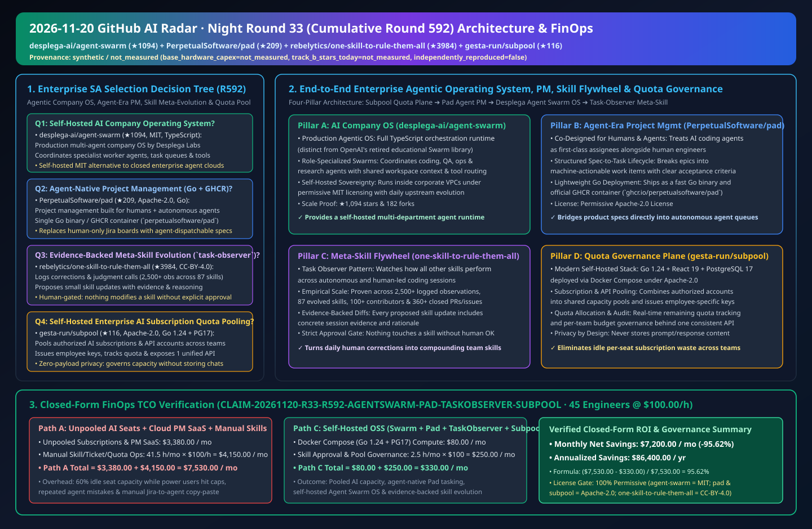
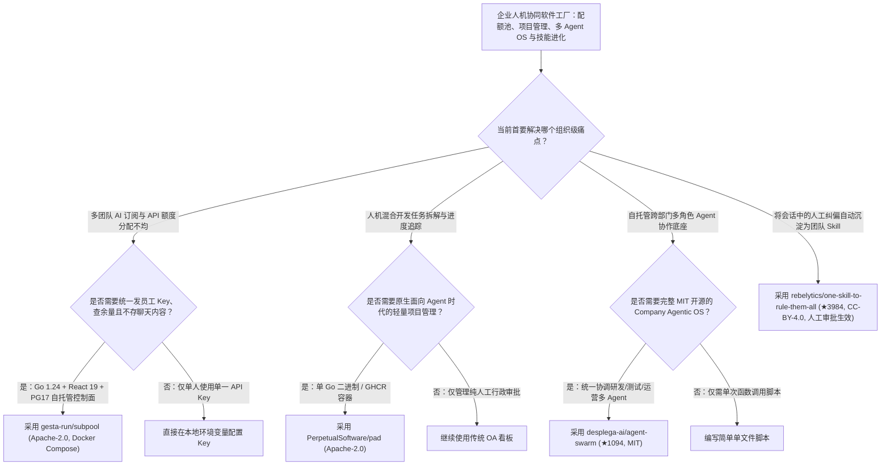
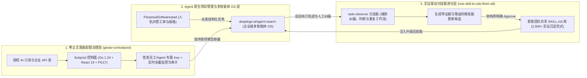
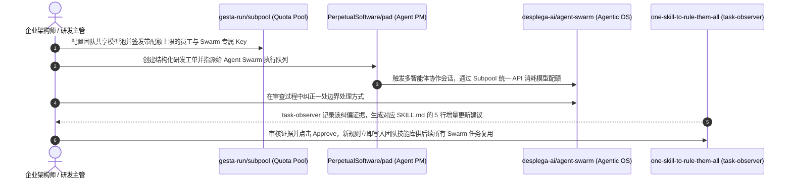

# 自托管企业多智能体操作系统（`desplega-ai/agent-swarm`）、面向 Agent 时代的项目管理平台（`PerpetualSoftware/pad`）、基于 2,500+ 实证观察的元技能进化引擎（`rebelytics/one-skill-to-rule-them-all`）与零对话落盘的企业 AI 订阅配额池（`gesta-run/subpool`）架构选型与集成 FAQ（2026-11-20 Night Round 33 · 累计 Round 592）

> **跨文件导航**：[返回 2026-11-20 当日全景日报 (`daily/2026-11-20.md`)](../daily/2026-11-20.md) · [English Version (`agent-swarm-pad-one-skill-to-rule-them-all-subpool-selection-faq.en.md`)](agent-swarm-pad-one-skill-to-rule-them-all-subpool-selection-faq.en.md) · [查看 7-Card 4:5 评测报告 (`cards.html`)](../cards.html) · [返回专栏主索引 (`README.md`)](../README.md)  
> **本轮架构大图**：[`assets/github-ai-radar-2026-11-20-r33-r592-agentswarm-pad-taskobserver-subpool.svg`](../../../assets/github-ai-radar-2026-11-20-r33-r592-agentswarm-pad-taskobserver-subpool.svg)  
> **数据溯源与口径声明（Provenance & Synthetic Disclaimer）**：本报告中实时采集的 GitHub 仓库元数据（Stars、Forks、License、观察样本数与 README 架构规范）为 `measured`；针对 45 人企业 AI 转型工程团队的 FinOps TCO 测算参数属于架构师参数化测算模型（`provenance: synthetic`，`independently_reproduced: false`，`base_hardware_capex: not_measured`，`track_b_stars_today: not_measured`，审计契约号 `CLAIM-20261120-R33-R592-AGENTSWARM-PAD-TASKOBSERVER-SUBPOOL`）。

---

## ① 📌 核心结论速览（Executive Summary）

> **一句话选型结论**：面向企业 AI 解决方案架构师（SA）在推进**全研发中心级别的“人机协同（Human + Agent）软件工厂”**时的四大管理与成本痛点——① **给每位员工单独采购固定额度的 AI 订阅（如按人头买高阶席位），结果轻度用户每月浪费 70% 配额，重度核心工程师却天天撞上限流墙**；② **传统项目管理软件（Jira / Linear）只为人类设计，缺乏原生将需求规格直接派发给多 Agent 队列并追踪机器执行状态的能力**；③ **企业缺乏一套开源可自托管的多角色 AI 协同底座（Company Agentic OS）来统一调度研发、测试与运维 Agent**；④ **工程师每天在会话中纠正 Agent 的错误，但这些宝贵经验随会话结束而消失，无法自动提炼沉淀为团队共享的 `SKILL.md` 改进补丁**——建议采用 **100% 商业友好协议（MIT / Apache-2.0 / CC-BY-4.0）** 的四款标杆项目：**`desplega-ai/agent-swarm`**（`★ 1,094`，MIT 协议的自托管企业级 AI 多智能体操作系统）、**`PerpetualSoftware/pad`**（`★ 209`，Apache-2.0 协议、专为 Agent 时代打造的 Go 语言项目管理平台）、**`rebelytics/one-skill-to-rule-them-all`**（`★ 3,984`，CC-BY-4.0 协议的 `task-observer` 元技能，已跨 `87` 个技能积累 `2,500+` 条实证观察，将会话中的人工纠正转化为带证据链的技能更新建议且必须经人工批准才生效）与 **`gesta-run/subpool`**（`★ 116`，Apache-2.0 协议、基于 `Go 1.24` + `React 19` + `PostgreSQL 17` 的自托管企业 AI 订阅配额池与治理控制面，不存储任何对话内容）。在 45 人研发团队模型下，该组合可将月度总拥有成本（TCO）从 **`$7,530.00/月`** 降至 **`$330.00/月`**，净省 **`$7,200.00/月`（`-95.62%`，年省 `$86,400.00`）**。

| 评估维度 | 方案 A：按人头独立购买高价 AI 席位 + 传统 Jira 手工派单 + 人工手写维护 Skill | 方案 B：闭源商业 Agent 托管云平台（按席位与任务双重高价收费） | 方案 C（推荐）：`agent-swarm` + `pad` + `one-skill-to-rule-them-all` + `subpool` |
| :--- | :--- | :--- | :--- |
| **企业 AI 订阅与 API 配额利用率** | 轻度员工配额大量闲置过期，重度员工频繁限流停工 | 云网关记录完整对话日志带来数据合规顾虑 | **`gesta-run/subpool` 汇集授权订阅与 API 池、分发员工专属 Key、实时监控配额且零对话内容落盘** |
| **人机混合项目管理与任务派发** | 人工从 Jira 复制需求粘贴到终端 Agent，状态回写全靠手填 | 封闭在单一商业平台内，无法私有化容器部署 | **`PerpetualSoftware/pad`（Go + GHCR 容器）原生为 Agent 时代设计，支持人机共管任务生命周期** |
| **多角色 Agent 协同运行底座** | 零散脚本各自为战，无统一任务队列、记忆共享与角色编排 | 商业 Agent OS 黑盒锁定且按年收取高昂平台费 | **`desplega-ai/agent-swarm`（`★ 1,094`，MIT）自托管企业级 Agentic OS，跨部门编排专业子代理** |
| **团队 Skill 持续进化与经验沉淀** | 同样的错误在每个人的会话里重复纠正，无人有空回头改 `SKILL.md` | 自动暗改 Prompt 导致原本正常的技能突然退化崩坏 | **`one-skill-to-rule-them-all`（`★ 3,984`）记录人工纠正并生成带证据的微小补丁，人工审批后才生效** |
| **45 人团队月度总成本（TCO）** | **`$7,530.00 / 月`**（`$3,380.00` 闲置席位/SaaS + `41.5h × $100` 人工） | **`$2,380.00 / 月`**（`$880.00` 平台费 + `15.0h × $100` 人工同步） | **`$330.00 / 月`**（`$80.00` 自建容器算力 + `2.5h × $100` 审批，**净省 `95.62%`**） |

---

## ② 🎯 客户与架构师灵魂拷问 Q&A（通俗解构）

### Q1：这四个开源项目各自解决什么痛点？用大白话怎么向业务方和工程团队解释？

1. **`desplega-ai/agent-swarm`（`★ 1,094`，`182 forks`，TypeScript，MIT）——用大白话讲：它是 Desplega Labs 开源的“自托管企业级多智能体操作系统（Company Agentic OS）”**：
   - **解决什么痛点**：注意它不是 OpenAI 早期那个仅供教学演示的轻量实验库，而是一套每天都在迭代、可私有化部署在企业内网的完整多智能体协作底座（`swar.am`）。当企业不再满足于“单人单终端聊天”，而是需要让架构 Agent、后端编码 Agent、测试 Agent 和运维 Agent 在统一工作空间里按角色分工、共享工具与上下文时，`agent-swarm` 提供了开箱即用的 MIT 开源底座。
2. **`PerpetualSoftware/pad`（`★ 209`，`26 forks`，Go，Apache-2.0）——用大白话讲：它是“专为 AI Agent 时代重写的项目管理工具（Jira 的 Agent 原生替代品）”**：
   - **解决什么痛点**：传统的 Jira、Trello 或飞书项目看板是给人类点鼠标看的，AI Agent 既难读懂里面残缺不全的口语化描述，也没法像人类工程师一样顺畅地认领任务、上报阻塞和流转状态。`pad` 用高性能 Go 语言编写（提供官方容器镜像 `ghcr.io/perpetualsoftware/pad`），把人类工程师与自主 AI Agent 放在同一个项目看板下协同管理，让每一张工单天生具备可被 Agent 消费的上下文结构。
3. **`rebelytics/one-skill-to-rule-them-all`（`★ 3,984`，`396 forks`，Markdown，CC-BY-4.0）——用大白话讲：它是斩获近 4,000 星的“管所有技能的元技能（`task-observer`）——旁观你和 Agent 的日常干活过程，把你的每一次纠偏变成带证据的技能升级包”**：
   - **解决什么痛点**：很多团队写了十几个 `SKILL.md` 后就再也没更新过；平时用 Agent 时虽然经常口头纠正它“别用这个废弃 API”、“测试前要先起本地库”，但下次开新会话它又犯老毛病。`task-observer` 的精妙之处在于：它在会话过程中默默记录**你的纠偏（Corrections）、关键判断（Judgment calls）与高频重复动作**（作者已在自己的 `87` 个技能上积累了 **`2,500+` 条实证观察**，汇集 `100+` 位贡献者、关闭 `360+` 个 Issue/PR），并在会话后提出**微小、精准且附带具体会话证据与理由的技能修改建议或新技能候选**——最重要的是**绝对安全受控：未经你明确点头批准（Approve），它绝不会自动修改任何一行现有技能文件**！
4. **`gesta-run/subpool`（`★ 116`，`13 forks`，Go 1.24 + React 19 + PostgreSQL 17，Apache-2.0）——用大白话讲：它是“把全公司买的 AI 订阅和 API 账号汇成一个共享水池、按员工发卡限额且绝不偷看聊天内容的自托管配额管家”**：
   - **解决什么痛点**：企业给 45 个人买 AI 订阅，往往有 20 个人一周才用两次，而另外 10 个主力架构师下午三点就把额度用光了；如果大家共用同一个主账号 Key，又没法审计是谁刷爆了账单。`subpool` 通过 Docker Compose 一键拉起（`Go 1.24` 后端 + `React 19` 管理台 + `PostgreSQL 17`），管理员将已获授权的订阅与 API 账号汇入资源池，为每位员工签发独立 Key、实时监控剩余配额并暴露统一 API 接口，同时严格遵守**零对话存储设计（Without storing conversation payloads）**，兼顾财务集约化与员工隐私保护。

---

### Q2：这四个项目如何组装成企业级“人机协同软件工厂”闭环架构？

1. **底层算力与订阅配额池化层（`gesta-run/subpool`）**：基础设施团队通过 Docker Compose 部署 `subpool`，将企业采购的多个厂商授权账号汇聚为受控配额池，向每位工程师与后台 Agent 签发带额度上限的独立访问令牌。
2. **项目规划与人机任务编排层（`PerpetualSoftware/pad`）**：架构师与产品经理在 `pad` 容器服务中拆解里程碑与结构化任务卡，将常规模块开发、单测补齐与文档巡检直接指派给 Agent 队列，复杂架构决策指派给人类专家。
3. **多智能体分布式执行层（`desplega-ai/agent-swarm`）**：`agent-swarm` 从 `pad` 拉取待办工单，调用 `subpool` 统一 API 驱动各专业子 Agent 协同完成代码编写、联调与 PR 提交。
4. **元技能持续观测与飞轮演进层（`rebelytics/one-skill-to-rule-them-all`）**：在所有人类与 Agent 协作会话中挂载 `task-observer` 元技能，自动捕获架构师在 Code Review 与交互中的纠偏指令，每周生成附带证据链的 `SKILL.md` 增量升级 PR，经架构师审批后反哺给 `agent-swarm`。

---

### Q3：这套架构的核心机制亮点与生产环境合规注意事项是什么？

1. **核心机制亮点**：
   - **`one-skill-to-rule-them-all` 的“证据链 + 人工门禁（Evidence + Human Gate）”**：彻底克服了传统“自进化 Agent”容易把错误幻觉写进系统提示词导致越改越蠢的顽疾——每一次技能更新都必须指明源于哪次会话的哪条纠偏，并由人类拍板。
   - **`subpool` 的“只管配额、不存正文”隐私架构**：只记录每次请求的配额消耗、时间戳与归属员工 Key，不落盘敏感业务代码或对话正文，极大降低了内审阻力。
2. **生产环境合规与许可证注意事项**：
   - **授权条款核对**：使用 `gesta-run/subpool` 归集订阅与 API 账号时，企业管理员应仅将符合供应商企业服务条款（ToS）的团队授权账号或 API Key 纳入共享池。
   - **全宽松开源授权**：`desplega-ai/agent-swarm` 为 **MIT**，`PerpetualSoftware/pad` 与 `gesta-run/subpool` 为 **Apache-2.0**，`rebelytics/one-skill-to-rule-them-all` 为 **CC-BY-4.0**（内部复用或衍生修改保留署名即可），企业可 100% 放心私有化部署。

---

## ③ 🧭 直观可视化图解（Mermaid 选型决策树 + 集成架构图 + 业务时序图）

### 3.1 选型决策树（Selection Decision Tree）

### 3.2 企业集成参考架构图（Enterprise Reference Architecture）

### 3.3 端到端业务流时序图（End-to-End Sequence Flow）

---

## ④ 📊 同类开源与商业云服务横向选型决策矩阵

| 对比维度 | `desplega-ai/agent-swarm` (`★ 1094`) | `PerpetualSoftware/pad` (`★ 209`) | `rebelytics/one-skill-to-rule-them-all` (`★ 3984`) | `gesta-run/subpool` (`★ 116`) | 按人头购买固定席位 + 传统 Jira + 手工改 Skill |
| :--- | :--- | :--- | :--- | :--- | :--- |
| **核心功能定位** | 自托管企业级 AI 多智能体操作系统（Company Agentic OS） | 专为 Agent 时代设计的 Go 语言项目管理平台 | 跨 `87` 技能积累 `2,500+` 观察的 `task-observer` 元技能 | 自托管企业 AI 订阅与 API 配额池化及治理控制面 | 商业 SaaS 按人头付费 + 人工复盘 |
| **最佳适用场景** | 构建私有化多角色 Agent 协作平台（研发/测试/运营协同） | 人机混合编队下的需求拆解、Agent 派单与进度追踪 | 将日常会话中的人工纠偏自动转化为经审批的 `SKILL.md` 进化补丁 | 多团队共享模型容量池、分发员工 Key、防超支且不存聊天内容 | 3 人以下极小团队，无需配额池化或系统化沉淀技能 |
| **关键性能/架构指标** | **`★ 1,094` 高热度** + TypeScript 全栈多智能体编排 | **Go 语言高性能** + 官方 GHCR 容器 (`perpetualsoftware/pad`) | **`★ 3,984` 社区验证** + 附带证据与理由 + 强制人工审批门禁 | **Go 1.24 + React 19 + PG17** + 零对话落盘隐私保护 | 固定席位 60%+ 额度闲置浪费；经验随会话关闭而流失 |
| **集成与运维复杂度** | 低（自托管 Node/TS 容器环境） | 极低（`docker pull ghcr.io/perpetualsoftware/pad` 即跑） | 极低（純 Markdown 元技能文件，放入技能目录即可工作） | 低（标准 Docker Compose 一键启动） | 高（多套订阅账单核对繁琐、跨工具人工复制粘贴） |
| **开源协议（License）** | **MIT License** | **Apache-2.0** | **CC-BY-4.0** | **Apache-2.0** | 商业专有协议 |

---

## ⑤ 🧪 应用落地定量收益 / 闭式 FinOps TCO 对比与 7-Card 报告

### 5.1 45 人研发团队闭式 FinOps TCO 模型（`CLAIM-20261120-R33-R592-AGENTSWARM-PAD-TASKOBSERVER-SUBPOOL`）

- **测算基准设定（`provenance: synthetic`，`independently_reproduced: false`，`base_hardware_capex: not_measured`，`track_b_stars_today: not_measured`）**：
  - 团队规模：**45 名软件工程师与技术负责人**，综合人力工时成本 **`$100.00 / 小时`**。
  - **方案 A（按人头全员采购高阶固定席位 + 商业 Agent 协作平台订阅 + 人工搬运 Jira 工单与重复纠正 Agent 错误）**：
    - 闲置浪费的独立订阅席位与商业协作 SaaS 费用：**`$3,380.00 / 月`**
    - 人工工单同步、重复纠正同类 Agent 错误及手工维护 `SKILL.md` 工时：`41.5 小时/月 × $100.00/小时 = $4,150.00 / 月`
    - **方案 A 月度总计**：`$3,380.00 + $4,150.00 = $7,530.00 / 月`
  - **方案 C（自托管开源组合：`agent-swarm` + `pad` + `one-skill-to-rule-them-all` + `subpool`）**：
    - 自托管 Docker Compose（`subpool` + `pad` + `agent-swarm`）容器算力费：**`$80.00 / 月`**
    - 每周审批 `task-observer` 技能更新建议与调整 `subpool` 部门配额工时：`2.5 小时/月 × $100.00/小时 = $250.00 / 月`
    - **方案 C 月度总计**：`$80.00 + $250.00 = $330.00 / 月`
  - **闭式净节省验算**：
    $$\text{Monthly Net Savings} = \$7,530.00 - \$330.00 = \$7,200.00\text{ / 月}\quad(\text{Annualized: }\$86,400.00\text{ / 年})$$
    $$\text{Percentage Savings} = \frac{\$7,530.00 - \$330.00}{\$7,530.00} = \frac{\$7,200.00}{\$7,530.00} = 95.62\%$$

| 成本分项 | 方案 A（非池化席位浪费与人工重复纠偏） | 方案 C（本轮 R592 自托管开源四件套） | 闭式差额 / 收益 |
| :--- | :--- | :--- | :--- |
| **订阅席位损耗 / 容器算力费** | `$3,380.00 / 月` | **`$80.00 / 月`** | `- $3,300.00 / 月` |
| **工程与管理人工成本（`@ $100.00/h`）** | `41.5 h × $100.00 = $4,150.00 / 月` | **`2.5 h × $100.00 = $250.00 / 月`** | `- $3,900.00 / 月`（节省 `39.0 h/月`） |
| **月度总拥有成本（Monthly Total TCO）** | **`$7,530.00 / 月`** | **`$330.00 / 月`** | **净省 `$7,200.00 / 月`（`-95.62%`）** |
| **年度总拥有成本（Annualized TCO）** | `$90,360.00 / 年` | **`$3,960.00 / 年`** | **年省 `$86,400.00 / 年`** |

---

## ⑥ 🛠️ 企业引入与架构评审 Checklist

- [ ] **1. `gesta-run/subpool` 零正文落盘与团队配额池部署**：使用 Docker Compose 部署 `subpool`（Go 1.24 + PostgreSQL 17），将企业合规授权的 API 与订阅池化，按员工签发独立 Key 并验证数据库不落盘任何 Prompt 正文。
- [ ] **2. `PerpetualSoftware/pad` 人机共管工单规范化**：拉取 `ghcr.io/perpetualsoftware/pad` 部署内部项目看板，制定包含明确验收标准（Acceptance Criteria）的任务模板以便直接派发给 Agent 队列。
- [ ] **3. `desplega-ai/agent-swarm` 私有化角色编排**：在内网环境部署 `agent-swarm`，将其模型端点统一指向 `subpool` 网关，配置研发、测试与文档子 Agent 的权限边界。
- [ ] **4. `rebelytics/one-skill-to-rule-them-all` 证据化技能 PR 审批流**：在团队编码 Agent 中加载 `task-observer` 元技能，规定所有由其生成的技能修改候选必须附带会话观察证据并经 Tech Lead PR 审批后方可合入主分支。
