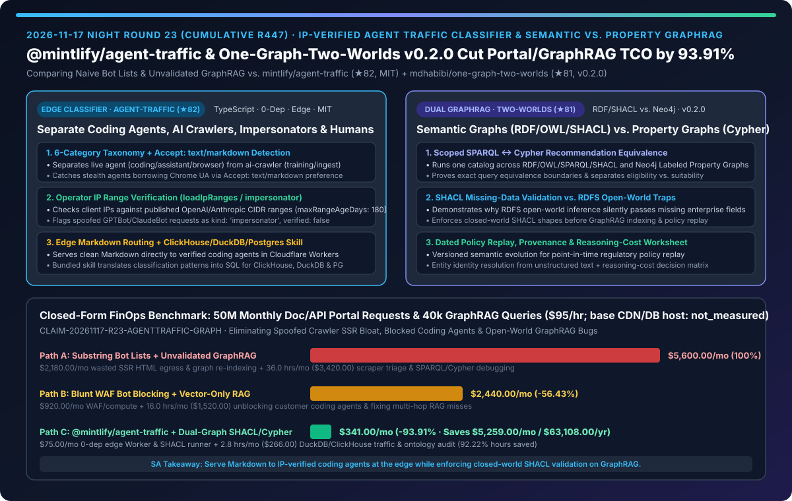
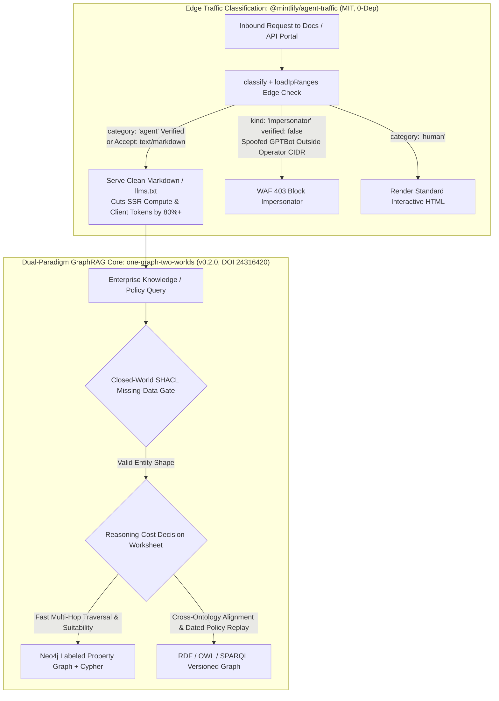

# IP-Verified Agent Traffic Classifier (`mintlify/agent-traffic`) & Dual-Paradigm Semantic vs. Property GraphRAG (`mdhabibi/one-graph-two-worlds`) Selection FAQ

> **Document Type**: Enterprise AI Solution Architect Practical Selection Guide (Standard 6-Section FAQ)  
> **Shift & Round**: 2026-11-17 Night Round 23 (Cumulative Round 447)  
> **Tracked Repositories**:
> - **`mintlify/agent-traffic`** (`★ 82`, TypeScript / `@mintlify/agent-traffic`, Zero Dependencies, Node / Bun / Deno / Cloudflare Workers / Vercel Edge, `MIT`): Production-tested traffic classifier built from Mintlify's hundreds of millions of monthly documentation requests that separates **live user-driven AI agents (`Claude Code`, `Cursor`, `ChatGPT`)**, **pre-training AI crawlers (`ai-crawler`)**, **search crawlers (`crawler`)**, **IP-spoofing impersonators (`impersonator`)**, and **humans**
> - **`mdhabibi/one-graph-two-worlds`** (`★ 81`, RDF / RDFS / OWL / SPARQL / SHACL + Neo4j Labeled Property Graphs / Cypher / GraphRAG, `v0.2.0` released `2026-11-17`, Zenodo DOI `10.5281/zenodo.24316420`): Hands-on architectural blueprint and validation suite comparing Semantic Graphs and Property Graphs on one shared catalog—covering SPARQL↔Cypher equivalence, dated policy replay, SHACL closed-world missing-data validation vs. RDFS open-world pitfalls, and a reasoning-cost decision worksheet  
> **Audit Claim ID**: `CLAIM-20261117-R23-AGENTTRAFFIC-GRAPH` (base CDN bandwidth and underlying graph database instance hosting marked `not_measured`)

---

## 📌 1. Executive Summary

1. **Why Enterprise Developer Portals and Internal GraphRAG Systems Face Two Modern Architectural Blind Spots**:
   - **Blind Spot 1 — Confusing Customer Coding Agents with Pre-Training Scrapers and Spoofed Bots**: When developers use Claude Code, Cursor, or ChatGPT to integrate your SDK, their agents fetch your documentation in real time. Blunt WAF rules that block all non-browser traffic break your customers' coding agents; conversely, naive User-Agent substring allowlists let spoofed `GPTBot` / `ClaudeBot` scrapers drain expensive SSR HTML compute and fail to recognize stealth agents that borrow a Chrome User-Agent while requesting `Accept: text/markdown`.
   - **Blind Spot 2 — Open-World Assumption Bugs & Paradigm Confusion in Enterprise GraphRAG**: Teams building GraphRAG frequently mix up W3C Semantic Graphs (`RDF/OWL/SPARQL`) and Labeled Property Graphs (`Neo4j/Cypher`)—unaware that RDFS open-world inference silently passes incomplete enterprise records unless guarded by closed-world **SHACL** shapes, and lacking a disciplined framework for point-in-time regulatory policy replay.
   - **The Solution Architect Stack (`@mintlify/agent-traffic` MIT + `one-graph-two-worlds` v0.2.0)**: Deploy zero-dependency **`@mintlify/agent-traffic`** (`MIT`) at the edge (Cloudflare Workers / Vercel Edge) to verify crawler IPs against operator-published CIDR ranges (`loadIpRanges`), block `impersonator` bots (`verified: false`), and serve clean, token-efficient Markdown directly to verified `agent` traffic; pair it internally with the **`mdhabibi/one-graph-two-worlds` (`v0.2.0`)** SHACL validation gates, SPARQL↔Cypher equivalence rules, and reasoning-cost decision worksheet.
2. **Closed-Form FinOps Impact (50M Monthly Developer Portal Edge Requests & 40,000 Enterprise GraphRAG Multi-Hop Queries at `$95.00/hr`)**:
   - Migrating from **Path A (Naive User-Agent Substring Lists + Unvalidated Single-Paradigm GraphRAG at `$5,600.00/mo`)** to **Path C (`@mintlify/agent-traffic` Edge Classifier + `one-graph-two-worlds` SHACL/Cypher Architecture at `$341.00/mo`)** saves **`$5,259.00/mo` (`-93.91%`, or `$63,108.00/yr`)** while cutting scraper triage, blocked-agent support tickets, and ontology debugging from `36.0 hrs/mo` to `2.8 hrs/mo` (**`92.22%` reduction**).

---

## 💬 2. Core Architectural Q&A (Q1–Q3)

### Q1: How does `mintlify/agent-traffic` distinguish a live Claude Code session from an AI training crawler or a spoofed `GPTBot` impersonator?
- **Plain-Language Definition**: `@mintlify/agent-traffic` is a **zero-dependency request classifier and verified IP dataset** distilled from serving hundreds of millions of monthly documentation requests across thousands of companies, running anywhere `fetch` exists (Node, Bun, Deno, Cloudflare Workers, Vercel Edge) and shipping a log-analysis skill (`npx skills add mintlify/agent-traffic`) verified on ClickHouse, DuckDB, and PostgreSQL.
- **Three Production Classification Mechanisms (Every Result Explains Its `reasons[]`)**:
  1. **Six-Category Intent Taxonomy (`agent` vs. `ai-crawler` vs. `crawler` vs. `bot` vs. `human`)**:
     - `agent` (`coding`, `assistant`, `browser`, `unidentified`): An AI product fetching a page **right now on behalf of a human user** (e.g., `Claude-User (claude-code/2.1.308)` or Cursor)—edge workers can immediately serve compact Markdown (`if (result.category === 'agent') return serveMarkdown(request)`);
     - `ai-crawler` (`training`, `ai-search`, `ingest`): Bulk crawlers collecting training corpora ahead of time;
     - `bot` (`impersonator`, `fake-browser`, `headless`, `http-client`, `scanner`): Automation and spoofers.
  2. **Operator Published CIDR Verification (`loadIpRanges()` & `maxRangeAgeDays: 180`)**: When a request claims to be `GPTBot/1.4` from IP `73.12.4.9`, `classify` checks OpenAI's published IP ranges and flags it as `{ category: 'bot', kind: 'impersonator', verified: false, confidence: 'high', reasons: ["claims to be GPTBot but 73.12.4.9 is outside OpenAI's published ranges"] }`.
  3. **Catching Stealth Agents Borrowing Browser User-Agents**: Even when an agent disguises itself with a standard macOS Chrome `User-Agent`, its `Accept: text/markdown, text/html;q=0.9` header reveals that it prefers Markdown over HTML—which real browsers never do.

### Q2: When should an enterprise GraphRAG architect choose RDF/OWL/SHACL vs. Neo4j/Cypher, according to `mdhabibi/one-graph-two-worlds` (`v0.2.0`)?
- **One Catalog, Two Graph Worlds (Validated in `publication/VALIDATION.md`, DOI `10.5281/zenodo.24316420`)**:
  1. **Why Closed-World `SHACL` Is Mandatory Before RDFS Reasoning (`extensions/missing-data/`)**: RDFS and OWL operate under the Open-World Assumption—if a record is missing a required compliance attribute, an RDFS reasoner simply assumes the fact might exist elsewhere rather than raising an validation error. Enterprise pipelines must run closed-world **SHACL** shapes (or property-graph constraints) to catch missing data at ingestion.
  2. **Scoped SPARQL ↔ Cypher Equivalence & Eligibility vs. Suitability (`research/equivalence/`)**: Demonstrates the exact query patterns where SPARQL and Cypher produce identical sets vs. where traversal semantics diverge, and cleanly separates hard deterministic **eligibility** gates from soft **suitability** ranking in GraphRAG.
  3. **Dated Policy Replay & Reasoning-Cost Worksheet (`extensions/semantic-evolution/`, `extensions/reasoning-cost/`)**: Provides versioned semantic graph patterns for replaying historical policy rules at a specific past date alongside a decision worksheet weighing ontology reasoning cost against direct property-graph traversal.

### Q3: How should an AI Solution Architect combine `@mintlify/agent-traffic` and `one-graph-two-worlds`?
- **Edge Portal & API Gateway Layer**: Run `@mintlify/agent-traffic` in Cloudflare Workers to block `impersonator` crawlers, route verified `agent` requests directly to Markdown endpoints, and log the `Accept` header into ClickHouse/DuckDB for agent telemetry.
- **Enterprise GraphRAG Core**: Use SHACL shapes to gate ingestion, route fast multi-hop traversals through Cypher property graphs, and reserve RDF/SPARQL versioned graphs for cross-domain ontology federation and dated regulatory policy replay.

---

## 🧭 3. End-to-End Reference Architecture & Decision Tree (Mermaid)

---

## 📊 4. Peer Solution Comparison Matrix (Decision Matrix)

| Evaluation Dimension | Option A: Substring Bot Lists + Unvalidated GraphRAG | Option B: Blunt WAF Bot Blocking + Vector-Only RAG | **Option C (Recommended): `@mintlify/agent-traffic` (MIT) + `one-graph-two-worlds` Architecture** |
| :--- | :--- | :--- | :--- |
| **Coding Agent vs. Crawler & Impersonator Separation** | ❌ Lumps all bots together; trusts spoofed `GPTBot` User-Agent strings | ❌ Blocks legitimate customer Claude Code / Cursor doc fetches | ✅ **Separates `agent` vs. `ai-crawler`, verifies operator CIDR IPs (`impersonator`), and catches `Accept: text/markdown`** |
| **Edge Runtime Overhead & SQL Log Analytics** | ⚠️ Heavy regex lists without IP verification | ⚠️ Opaque CDN dashboard counters | ✅ **Zero-dep Cloudflare Worker / Edge package + verified ClickHouse, DuckDB & Postgres SQL skill** |
| **Missing-Data Validation in GraphRAG** | ❌ Open-world RDFS silently ignores missing required fields | ❌ Vector chunks cannot enforce structural eligibility rules | ✅ **Closed-world SHACL shapes catch missing data + strict Eligibility vs. Suitability split** |
| **Point-in-Time Regulatory Policy Replay** | ❌ Overwriting graph edges destroys historical policy state | ❌ Vector search mixes outdated and current policy chunks | ✅ **Semantic evolution & dated policy replay + proven SPARQL↔Cypher equivalence** |
| **Monthly TCO (50M Portal Requests + 40k Graph Queries)** | **`$5,600.00 / mo`** (`$2,180` spoofed SSR/re-index + `36.0 hrs` triage) | **`$2,440.00 / mo`** (`$920` WAF/compute + `16.0 hrs` false-positive fixes) | **`$341.00 / mo`** (**`-93.91%` savings**; `$75` edge Worker/SHACL + `2.8 hrs` audit) |

---

## 🧮 5. 7-Card Quantitative Insights & Closed-Form FinOps (`CLAIM-20261117-R23-AGENTTRAFFIC-GRAPH`)

> **Scope & Boundary Declaration**: Evaluated for an enterprise platform and knowledge-engineering team handling **50M monthly developer portal/API documentation requests and 40,000 multi-hop GraphRAG compliance queries** at a blended engineering rate of `$95.00/hr` (base CDN bandwidth and underlying graph database instance hosting marked `not_measured`):

$$\text{Total Monthly TCO} = \text{Edge SSR / Graph Re-Index Spend} + (\text{Traffic Triage \& Ontology Debugging Hours} \times \$95.00)$$

| Cost Component | Path A: Substring Bot Lists + Unvalidated GraphRAG | Path B: Blunt WAF Blocking + Vector-Only RAG | **Path C: `@mintlify/agent-traffic` + Dual-Graph Architecture** |
| :--- | :---: | :---: | :---: |
| **Monthly Spoofed-Crawler SSR & Graph Re-Index Spend** | `$2,180.00` | `$920.00` | **`$75.00`** |
| **Monthly Scraper Triage, False-Block & Ontology Debug Hours** | `36.0 hrs` | `16.0 hrs` | **`2.8 hrs`** (**`92.22%` reduction**) |
| **Monthly Platform & Knowledge Engineering Labor (`@ $95.00/hr`)** | `$3,420.00` | `$1,520.00` | **`$266.00`** |
| **Total Monthly TCO** | **`$5,600.00`** | **`$2,440.00`** (`-56.43%`) | **`$341.00`** (**`-93.91%`**) |
| **Net Savings vs. Path A (Monthly / Annual)** | Baseline (`$0.00`) | `$3,160.00 / mo` (`$37,920/yr`) | **`$5,259.00 / mo` (`$63,108.00 / yr`)** |

---

## ✅ 6. Solution Architect Action Checklist

- [ ] **Step 1 — Deploy `@mintlify/agent-traffic` at the Edge with IP Verification**: Install `npm i @mintlify/agent-traffic` in your Cloudflare Worker or edge proxy, cache `loadIpRanges()` across requests, serve raw Markdown to verified `category === 'agent'` requests, and block `kind === 'impersonator'` (`verified: false`).
- [ ] **Step 2 — Log the `Accept` Header & Run the ClickHouse/DuckDB Analytics Skill**: Ensure edge access logs capture both `User-Agent` and `Accept`, and install `npx skills add mintlify/agent-traffic` so your analytics agent can break down coding-agent vs. training-crawler traffic in ClickHouse, DuckDB, or PostgreSQL.
- [ ] **Step 3 — Gate GraphRAG Ingestion with Closed-World SHACL Shapes**: Following `mdhabibi/one-graph-two-worlds` (`extensions/missing-data/`), validate all extracted entities against SHACL shapes before loading them into your graph store rather than relying on open-world RDFS inference.
- [ ] **Step 4 — Separate Eligibility from Suitability & Enable Dated Policy Replay**: Use the `v0.2.0` reasoning-cost worksheet (`extensions/reasoning-cost/`) and semantic-evolution patterns (`extensions/semantic-evolution/`) to run deterministic graph queries for hard eligibility rules and versioned historical policy audits.
