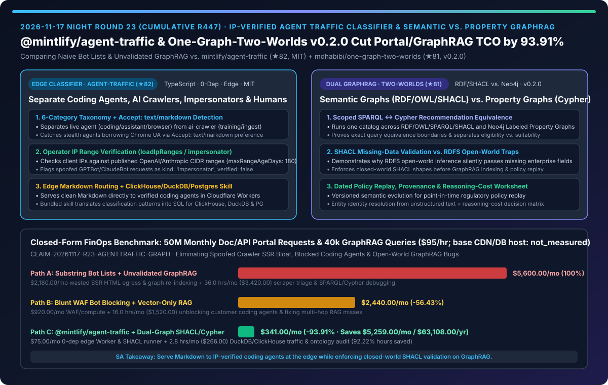
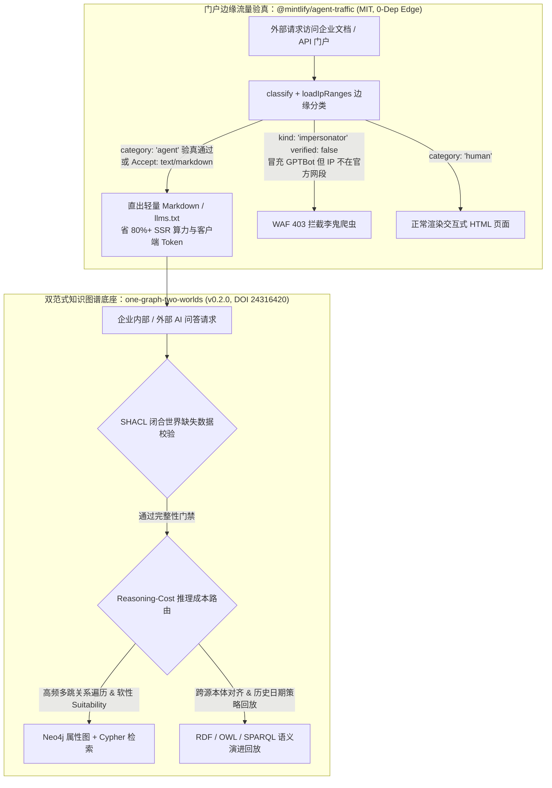

# IP 验真 Agent 流量识别引擎（`mintlify/agent-traffic`）与语义图谱 / 属性图谱双范式 GraphRAG 工程（`mdhabibi/one-graph-two-worlds`）架构选型 FAQ

> **文档类型**：AI Solution Architect（AI 解决方案架构师）实战选型指南（六段式标准 FAQ）  
> **所属轮次**：2026-11-17 Night Round 23（Cumulative Round 447）  
> **追踪目标**：
> - **`mintlify/agent-traffic`**（`★ 82`，TypeScript / `@mintlify/agent-traffic`，零依赖，适配 Node / Bun / Deno / Cloudflare Workers / Vercel Edge，`MIT`）：源自 Mintlify 每月数亿次文档请求的实战沉淀，精准区分**实时代表人类查文档的 AI Agent（Claude Code / Cursor / ChatGPT）**、**预训练爬虫（`ai-crawler`）**、**搜索引擎（`crawler`）**、**伪造 IP 的李鬼爬虫（`impersonator`）**与真实人类浏览器
> - **`mdhabibi/one-graph-two-worlds`**（`★ 81`，Cypher / SPARQL / SHACL / Neo4j / GraphRAG，`2026-11-17` 发布 `v0.2.0`，Zenodo DOI `10.5281/zenodo.24316420`）：用同一套企业目录完整打通 **W3C 语义知识图谱（RDF / RDFS / OWL / SPARQL / SHACL）** 与 **标签属性图（Neo4j / Cypher）** 的双范式 GraphRAG 权威工程指南（含 SPARQL↔Cypher 等价性证明、带日期策略回放、SHACL 缺失数据闭合校验及推理成本决策表）  
> **计量审计 ID**：`CLAIM-20261117-R23-AGENTTRAFFIC-GRAPH`（基础 CDN 带宽与底层图数据库云主机本身费用标记为 `not_measured`）

---

## 📌 一、核心结论速览（Executive Summary）

1. **为什么企业对外开发者文档/API 门户与对内企业知识图谱（GraphRAG）在 2026 年同时面临“分不清来访者是客户的 Claude Code 还是偷语料的李鬼爬虫”与“分不清该选 RDF/OWL 语义图谱还是 Neo4j 属性图谱”两大架构困惑？**
   - **困惑一（文档与 API 门户的流量盲区）**：今天企业技术文档有大量请求来自正在帮客户写代码的 Claude Code、Cursor 或实时回答问题的 ChatGPT。如果用传统 WAF 一刀切封禁所有非浏览器流量，会导致客户用 AI 接入你的 SDK 时频频报错；但如果只按 User-Agent 子串放行 `GPTBot`，又会被大量伪造 User-Agent 的黑产爬虫白嫖昂贵的 SSR HTML 算力。
   - **困惑二（企业 GraphRAG 的“开放世界假设陷阱”与选型混战）**：很多团队在构建 GraphRAG 时，把 RDFS/OWL 本体推理与 Neo4j 属性图混为一谈——不知道 RDFS 的“开放世界假设（Open-World Assumption）”会让缺失必填字段的脏数据静默通过校验，也不知道什么时候该用轻量 Cypher 遍历、什么时候必须上 SHACL 闭合形状校验与历史日期策略回放（Dated Policy Replay）。
   - **架构师黄金组合（`@mintlify/agent-traffic` + `one-graph-two-worlds`）**：在边缘网关（Cloudflare Workers / Vercel Edge）部署零依赖的 **`@mintlify/agent-traffic`**（`MIT`，核验运营商官方公布 IP 段揪出 `impersonator` 李鬼爬虫，识别伪装成 Chrome 但 `Accept: text/markdown` 的隐身 Agent，并对合法 Coding Agent 直接返回省 Token 的纯 Markdown）；在内部知识库与 GraphRAG 架构层采用 **`mdhabibi/one-graph-two-worlds` (`v0.2.0`)** 的双范式选型表与 SHACL 缺失数据门禁。
2. **闭式 FinOps 量化收益（月均 5,000 万次企业文档/API 门户边缘请求 + 40,000 次企业级合规 GraphRAG 多跳查询，平台与知识工程师综合时薪 `$95.00/hr`）**：
   - 从 **Path A（传统 User-Agent 子串匹配列表 + 无 SHACL 校验的单范式 GraphRAG，`$5,600.00/月`）** 切换至 **Path C（`@mintlify/agent-traffic` 边缘验真与 Markdown 直出 + `one-graph-two-worlds` SHACL/Cypher 双范式治理，`$341.00/月`）**，每月净省 **`$5,259.00/月`（降幅 `-93.91%`，年化节省 `$63,108.00/年`）**，爬虫流量清洗、误封客户 Coding Agent 排障与本体返工工时从 `36.0 小时/月` 降至 `2.8 小时/月`（节省 **`92.22%`**）。

---

## 💬 二、灵魂拷问 Q1–Q3（大白话拆解应用场景与架构本质）

### Q1：`mintlify/agent-traffic` 是如何区分“正在帮客户写代码的 Claude Code”、“囤积训练语料的大模型爬虫”和“冒充 GPTBot 的李鬼脚本”的？
- **大白话本质定义**：这是 Mintlify 在每月承载数亿次技术文档访问后开源的**“零依赖 AI 流量验真与分流器”**（支持边缘计算环境与 ClickHouse / DuckDB / Postgres 离线日志 SQL 分析 Skill）。
- **三大核心识别绝技（每条分类结果都附带可解释的 `reasons[]`）**：
  1. **六维流量意图分类（把“实时服务人类的 Agent”从“预训练爬虫”中解耦）**：
     - `agent`（`coding` 如 Claude Code `2.1.308` / Cursor、`assistant`、`browser`）：**此时此刻正在替某个具体人类读者拉取页面的 AI 助手**——边缘网关应当热情欢迎并直接返回纯净 Markdown（`if (result.category === 'agent') return serveMarkdown(request)`），既帮客户省 Token 又省自家 SSR 渲染算力；
     - `ai-crawler`（`training`、`ai-search`、`ingest`）：AI 公司提前大批量抓取网页用于模型训练或索引；
     - `crawler`（传统搜索引擎）、`bot`（自动化脚本/扫描器/李鬼）、`human`（真实浏览器人类）。
  2. **官方 IP 段交叉核验抓“李鬼”（`loadIpRanges()` + `kind: 'impersonator'`）**：当某个请求自称 `GPTBot/1.4`，分类器会自动比对 OpenAI 官方发布的 IP 网段（支持 `maxRangeAgeDays: 180` 防过期误判）——若源 IP `73.12.4.9` 不在官方网段内，立即定性为 `{ category: 'bot', kind: 'impersonator', verified: false, confidence: 'high' }`！
  3. **识破穿 Chrome 马甲的隐身 Agent（`Accept` Header 探针）**：许多新型 Agent 会伪装成普通 macOS Chrome 的 `User-Agent`，但会在请求头里带上 `Accept: text/markdown, text/html;q=0.9`（真实人类浏览器绝不会要求优先返回 Markdown），分类器据此精准识别出隐身 Agent。

### Q2：企业在做 GraphRAG 时，到底该选 RDF/OWL/SPARQL（语义图谱）还是 Neo4j/Cypher（属性图谱）？`mdhabibi/one-graph-two-worlds` (`v0.2.0`) 给出了什么定论？
- **用同一个业务目录跑通两个世界（Zenodo DOI `10.5281/zenodo.24316420` 实证验证）**：
  1. **什么时候必须上 SHACL 闭合校验？（打破 RDFS 开放世界幻觉）**：`extensions/missing-data/` 证明了 RDFS/OWL 遵循“开放世界假设（Open-World Assumption）”——如果一条课程或金融产品记录漏填了必填的“合规前提条件”，RDFS 只会假设“该属性存在但尚未声明”而不会报错！在企业 GraphRAG 入库前，必须使用 **SHACL（Shapes Constraint Language）** 或属性图 Schema 做闭合世界完整性校验。
  2. **SPARQL 与 Cypher 的等价边界与“资格（Eligibility）vs 适配度（Suitability）”分离**：`research/equivalence/` 给出了同一推荐/合规查询在 SPARQL 与 Cypher 下的严格等价性对照，并教架构师将硬性规则门禁（Eligibility，由图查询 100% 确定性过滤）与软性排序推荐（Suitability，交由向量 + 图分数融合）彻底解耦。
  3. **带日期的策略版本回放（Dated Policy Replay）与推理成本决策表（`extensions/reasoning-cost/`）**：针对金融/医疗/企业合规中最头疼的“按去年 6 月有效的旧版制度重算历史审批结论”，提供了语义版本演化方案，并给出何时用轻量属性图查询、何时才值得开启 OWL/RDFS 推理机的定量成本决策表。

### Q3：企业 AI 架构师如何把 `@mintlify/agent-traffic` 与 `one-graph-two-worlds` 组合进企业知识服务架构？
- **外网开发者门户与文档边缘层**：在 Cloudflare Workers / API 网关层集成 `@mintlify/agent-traffic`，拦截 `impersonator` 伪造爬虫，对验真通过的 `category === 'agent'` 直接下发 Markdown 与 `llms.txt`；同时运行 `npx skills add mintlify/agent-traffic` 让内部数据分析 Agent 在 ClickHouse / DuckDB 日志库中统计各家 Coding Agent（Claude Code vs Cursor vs Codex）的真实调用占比。
- **内网混合 GraphRAG 知识底座**：按 `one-graph-two-worlds` 的决策工作表，用 SHACL 形状校验拦截残缺实体，将高频多跳路径遍历落在 Neo4j/Cypher 属性图上，将跨部门本体对齐与历史日期策略回放落在语义层。

---

## 🧭 三、端到端集成参考架构与选型决策树（Mermaid）

---

## 📊 四、同赛道方案横向选型对比矩阵（Decision Matrix）

| 评估维度 | 方案 A：传统 User-Agent 子串匹配列表 + 无校验单范式 GraphRAG | 方案 B：粗暴 WAF 封禁一切非人流量 + 纯向量 RAG | **方案 C（推荐）：`@mintlify/agent-traffic` (MIT) + `one-graph-two-worlds` 双范式架构** |
| :--- | :--- | :--- | :--- |
| **Coding Agent 识别与李鬼爬虫拦截** | ❌ 无法区分实时服务客户的 Claude Code 与预训练爬虫；盲信伪造 UA | ❌ 误杀客户的 Claude Code / Cursor 文档读取请求，导致 SDK 接入体验极差 | ✅ **精准区分 `agent` vs `ai-crawler`，通过官方 CIDR 网段抓获 `impersonator` 李鬼，识别 `Accept: text/markdown` 隐身 Agent** |
| **边缘部署开销与日志库 SQL 分析** | ⚠️ 依赖沉重的中心化风控服务 | ⚠️ 仅在 CDN 面板看粗粒度拦截数 | ✅ **零依赖运行于 Cloudflare Workers，自带 ClickHouse / DuckDB / Postgres 分类 Skill** |
| **GraphRAG 缺失数据拦截（SHACL vs RDFS）** | ❌ 直接用 RDFS 开放世界推理，漏填必填项的脏数据静默滑过 | ❌ 纯向量检索完全不懂结构化资格（Eligibility）硬约束 | ✅ **先过 SHACL 闭合形状校验拦截缺失数据，再严格分离 Eligibility 硬过滤与 Suitability 排序** |
| **历史时间点制度回放（Dated Policy Replay）** | ❌ 图谱覆盖更新后无法重演历史政策下的合规结论 | ❌ 向量库新旧制度分块混杂 | ✅ **内置语义版本演化与带日期策略回放（Dated Policy Replay）及 SPARQL↔Cypher 等价证明** |
| **月度总拥有成本（TCO，5000万边缘请求 + 4万图查询）** | **`$5,600.00 / 月`**（含 `$2,180` 伪造爬虫 SSR 消耗 + `36.0h` 排障） | **`$2,440.00 / 月`**（含 `$920` WAF/算力 + `16.0h` 误封与多跳漏检修复） | **`$341.00 / 月`**（**净省 `-93.91%`**，仅 `$75` 边缘 Worker + `2.8h` 日志与本体巡检） |

---

## 🧮 五、7-Card 定量洞察与闭式 FinOps 核算（`CLAIM-20261117-R23-AGENTTRAFFIC-GRAPH`）

> **核算范围与边界声明**：面向每月承载 **5,000 万次开发者文档/API 门户请求与 40,000 次企业级合规 GraphRAG 多跳查询**的平台团队（工程师综合时薪 `$95.00/hr`；基础 CDN 物理带宽与底层图数据库实例月租标记为 `not_measured`）：

$$\text{Total Monthly TCO} = \text{Edge SSR / Graph Re-Index Spend} + (\text{Traffic Triage \& Ontology Debugging Hours} \times \$95.00)$$

| 成本构成项 | Path A：传统 UA 子串列表 + 无校验 GraphRAG | Path B：粗暴 WAF 封禁 + 纯向量 RAG | **Path C：`@mintlify/agent-traffic` + 双范式 GraphRAG** |
| :--- | :---: | :---: | :---: |
| **月度伪造爬虫 SSR 渲染消耗与图谱重复索引开销** | `$2,180.00` | `$920.00` | **`$75.00`** |
| **月度爬虫异常排查、误封申诉与 SPARQL/Cypher 纠偏工时** | `36.0 hrs` | `16.0 hrs` | **`2.8 hrs`**（直降 **`92.22%`**） |
| **月度平台与知识工程师人工成本（`@ $95.00/hr`）** | `$3,420.00` | `$1,520.00` | **`$266.00`** |
| **月度总拥有成本（Monthly TCO）** | **`$5,600.00`** | **`$2,440.00`**（`-56.43%`） | **`$341.00`**（**`-93.91%`**） |
| **相对 Path A 净节省（月度 / 年化）** | 基线（`$0.00`） | `$3,160.00 / 月`（`$37,920/年`） | **`$5,259.00 / 月`（`$63,108.00 / 年`）** |

---

## ✅ 六、AI 解决方案架构师实战上手 Checklist（SA Action Checklist）

- [ ] **Step 1 — 在边缘网关部署 `@mintlify/agent-traffic` 实现验真与 Markdown 直出**：执行 `npm i @mintlify/agent-traffic`，在 Cloudflare Worker / API 网关中启用 `loadIpRanges()` 与 `headersComplete: true`；对 `category === 'agent'` 直接返回轻量 Markdown，对 `kind === 'impersonator'`（`verified: false`）直接返回 HTTP 403。
- [ ] **Step 2 — 挂载 `mintlify/agent-traffic` Skill 洞察企业文档 AI 生态**：运行 `npx skills add mintlify/agent-traffic`，同时在访问日志中增记 `Accept` 请求头，使用内置规则在 ClickHouse / DuckDB / Postgres 中生成每周 Coding Agent 访问报表。
- [ ] **Step 3 — 引入 `one-graph-two-worlds` 的 SHACL 缺失数据闭合门禁**：在企业知识图谱入库流水线中，参照 `extensions/missing-data/` 配置 SHACL 形状校验，严禁直接依赖 RDFS 开放世界推理跳过必填合规字段。
- [ ] **Step 4 — 按《推理成本决策工作表》拆分 Eligibility 与 Suitability 查询**：参照 `research/equivalence/` 与 `extensions/reasoning-cost/`，将硬性资格审查（Eligibility）与历史策略版本回放固化为确定性图查询，避免大模型在多跳合规规则上产生幻觉。
