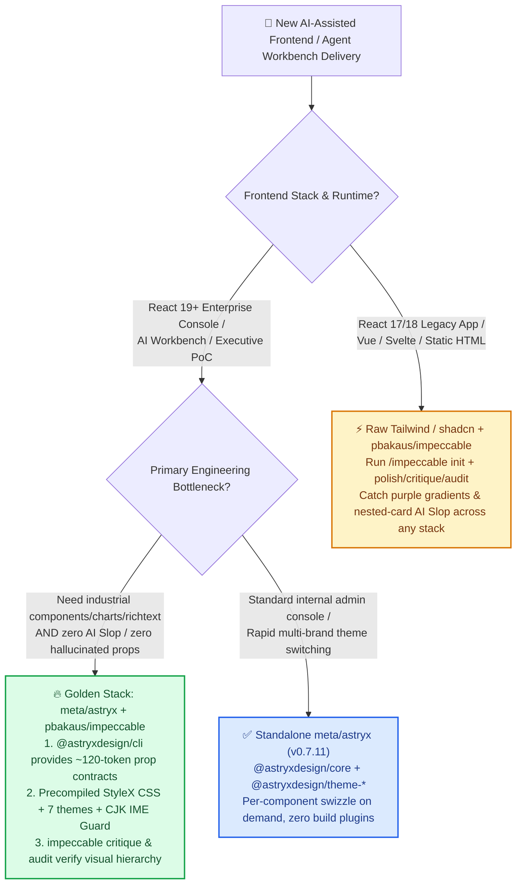

# AI-Assisted Frontend Engineering Selection Guide: Agent-Native Design System (`meta/astryx` CLI) vs. Design Audit Harness (`pbakaus/impeccable`) vs. Raw Tailwind/shadcn FAQ

> **Audience**: AI Solution Architects, Full-Stack Tech Leads, and Agentic Workbench Delivery Teams  
> **Head-to-Head Contenders**: Meta's Open-Source Agent-Ready Design System ([`meta/astryx`](https://github.com/meta/astryx) `@astryxdesign/cli v0.7.11`, **+863 stars today** on 2026-11-08 GitHub Daily Trending, #3 overall 24h delta, **15,468 total stars**) vs. Cross-Framework Anti-Slop Design Steering & Audit Harness ([`pbakaus/impeccable`](https://github.com/pbakaus/impeccable) `cli-v4.8.0`, **+10,921 stars this week** on Weekly Trending, **103,545 total stars**) vs. **Unassisted Coding Agent Writing Raw Tailwind CSS / `shadcn/ui`**  
> **5-Minute Takeaway**: Understand from first principles why coding agents repeatedly produce "AI Slop" UIs (purple-to-blue gradients, cards nested in cards, hallucinated component props, and CJK IME Enter-key premature form submissions), and how combining **`@astryxdesign/cli` deterministic contract introspection + `impeccable` aesthetic audit gates + single-component `swizzle`** solves it.  
> **Provenance & Metric Disclosure**:
> - **`measured` (Primary Scrape & Repository Inspection)**: GitHub Daily/Weekly Trending raw HTML scrape (`workshops/github-trending-radar/evidence/trending-daily-2026-11-08-raw.html`, `sha256: 353914ef985b6a4f269094bea6a075a391f5e5da0e85145e54f704909dbf11d0`: `meta/astryx` **+863 stars today**, 15,468 total; `pbakaus/impeccable` **+10,921 stars/week**, 103,545 total) and GitHub REST API repository tree verification (`meta/astryx` verified under the official `github.com/meta` organization, MIT license, `packages/{core,cli,themes,charts,vega,richtext,native,lab,build}` and `IME_GUARD_DESIGN.md`; `pbakaus/impeccable` under Apache-2.0 with Rust `crates/` and 19 coding-agent plugin folders).
> - **`anonymized_reported` (`independently_reproduced=false`, Upstream Author / Official README Claims)**: `meta/astryx` upstream README figures of **8 years of internal Meta evolution**, powering **13,000+ internal applications**, **150+ accessible components**, and **7 zero-wrapper CSS custom property themes**; `pbakaus/impeccable` upstream README side-by-side case studies (Fable 5.1 Villa Castagneto & Neo Mirai).
> - **`synthetic` (`independently_reproduced=false`, Architect Frontend Delivery & Token Economics Worked Model)**: Section 3.2's 12-screen enterprise AI console delivery calculation (prompt token consumption across 72 agent turns, first-pass build rate, and theme-switching time) is a parametric engineering model grounded in measured CLI/component payload sizes.

---

## 📌 Executive Summary

If you use Claude Code, GitHub Copilot, Cursor, or Codex to ship enterprise AI consoles, executive dashboards, or customer PoCs, memorize these three architectural rules:

1. **Why Unassisted Coding Agents Produce "AI Slop" with Raw Tailwind / `shadcn/ui`**:  
   Without a machine-readable component contract and an explicit aesthetic gate, LLMs regress to the mean of their pretraining corpus: `Inter` font everywhere, glaring purple-to-blue gradients (`from-indigo-500 to-purple-600`), cards nested inside cards, a rounded icon badge above every heading, hallucinated component props, and broken CJK (Chinese/Japanese/Korean) input method `Enter`-key handling during word composition.
2. **`meta/astryx` (Component Substrate) and `pbakaus/impeccable` (Aesthetic Gate) Are Orthogonal & Complementary**:  
   - **Choose `meta/astryx` (`@astryxdesign/cli v0.7.11`) as your React 19 Enterprise Component Substrate**: It packages Meta's 8-year internal design system (`13,000+` internal apps, `150+` accessible components — `anonymized_reported`) into precompiled CSS that requires **zero StyleX build plugins**, paired with `@astryxdesign/cli` (`astryx docs`). Coding agents spend ~120 tokens querying exact component contracts instead of reading 6,000 tokens of raw JSX, while inheriting deterministic CJK IME protection (`IME_GUARD_DESIGN.md`, `measured`).  
   - **Choose `pbakaus/impeccable` (`cli-v4.8.0`) as your Cross-Framework Design Steering & Anti-Slop Audit Gate**: When your stack is not React 19 (e.g., React 18, Vue, Svelte, Astro, or vanilla HTML) — or when you want automated layout critique on top of `meta/astryx` — use `impeccable`'s `polish`, `bolder`, `critique`, and `audit` skills to catch AI Slop before it ships.
3. **Per-Component `swizzle` Solves the "Black-Box Lock-in vs. Source-Copy Bloat" Dilemma**:  
   Traditional libraries (MUI/AntD) lock you into rigid DOM trees, while `shadcn/ui` copies thousands of lines of UI source directly into your repo (bloating agent context). `meta/astryx` defaults to clean npm imports and lets you `swizzle` (eject) only the specific 1–2 components you actually need to customize.



---

## 1. Three Core Questions: First-Principles Breakdown of Agent-Native Frontend Engineering

### Q1: When should I choose `meta/astryx` vs. `pbakaus/impeccable` vs. traditional `shadcn/ui`?

In plain English: **`shadcn/ui` dumps flat-pack lumber blueprints into your repo so your agent has to read and assemble every board; `meta/astryx` is a pre-built modular vault with a machine-readable CLI catalog (where you only eject the single piece you want to modify); and `pbakaus/impeccable` is the art director standing next to your agent with a caliper, stopping it from painting the room in neon purple gradients.**

- **Choose `meta/astryx` (`@astryxdesign/core` + `@astryxdesign/cli`) when**:
  1. **You are building on React 19+** and need a batteries-included enterprise suite: `packages/core` (150+ accessible components), `packages/charts` & `packages/vega` (data visualization), `packages/richtext` (editor), and `packages/themes` (7 curated themes — `measured`).
  2. **You want to stop burning 4,000–8,000 prompt tokens per turn reading local UI component files**: Instead of reading raw `.tsx` implementations, the coding agent queries `astryx docs` or `{Name}.doc.mjs` via `@astryxdesign/cli`.
  3. **Your app serves global or East Asian users (Chinese, Japanese, Korean)**: `meta/astryx` ships a dedicated `IME_GUARD_DESIGN.md` architecture (`measured`) that prevents `Enter` keystrokes during IME character composition from prematurely submitting chat prompts or search forms.
- **Choose `pbakaus/impeccable` (standalone or layered on top of `meta/astryx`) when**:
  - You want your coding agent (across 19 supported harnesses including Claude Code, Copilot, Cursor, Codex, Devin, dsh, Hermes, Pi) to follow a rigorous design vocabulary (`polish`, `bolder`, `critique`, `audit`) or your project is not on React 19.
- **Keep raw `Tailwind + shadcn/ui` when**:
  - Your project is pinned to React 17/18, or it is a tiny 2-component micro-page where bespoke pixel-level DOM control outweighs design-system consistency.

---

### Q2: Why does "CLI Contract Introspection + Aesthetic Audit Harness" strictly outperform unassisted Tailwind/shadcn generation?

Unassisted AI frontend generation fails for two distinct reasons: **① Missing Context Contracts cause engineering hallucinations**, and **② Pretraining Mean Regression causes visual "AI Slop"**.

#### Failure Mode A: Context Bloat & Prop Hallucination in Unassisted Tailwind / `shadcn/ui`
When a coding agent builds a multi-panel AI observability console using raw Tailwind or 40 locally copied `shadcn/ui` files:
1. To check prop signatures for `DataTable`, `Popover`, and `Drawer`, the agent either reads multiple 300-line `.tsx` files into its context window (**4,000–8,000 tokens**) or guesses props from memory.
2. When guessing, the model frequently conflates Radix, MUI, and AntD APIs—causing multi-turn TypeScript compile-fix loops.

#### Failure Mode B: How `meta/astryx` (`v0.7.11`, `measured`) Solves the Engineering Layer
Inspection of the `meta/astryx` repository (`measured`) highlights three architectural breakthroughs:
1. **Tool-Agnostic Agent Instruction Surface (`AGENTS.md` + `@astryxdesign/cli`)**:
   Agents run `astryx docs` or inspect `packages/cli/assets/docs/{Name}.doc.mjs` to retrieve exact prop contracts and accessibility invariants in **~120–250 tokens**.
2. **Precompiled StyleX CSS + 7 Zero-Wrapper Themes**:
   Although authored in StyleX internally, published packages ship precompiled CSS (`measured`). Consumers need zero Babel/PostCSS plugins and zero `<ThemeProvider>` wrappers—switching `data-theme="stone"` (across `neutral`, `butter`, `matcha`, `stone`, `incense`, `lavender`, `berry`) re-skins the entire app while still accepting Tailwind `className` overrides.
3. **Deterministic CJK Composition Guard (`IME_GUARD_DESIGN.md`)**:
   Handles cross-browser `compositionstart` / `compositionend` / `isComposing` race conditions so pressing `Enter` to confirm a Chinese/Japanese/Korean IME candidate never triggers accidental message submission.

#### Failure Mode C: How `pbakaus/impeccable` (`cli-v4.8.0`, `measured`) Solves the Visual Layer
Even when components compile cleanly, LLMs default to clichés. `pbakaus/impeccable` installs native skills across 19 agent harnesses to enforce visual quality:
- `/impeccable critique` flags nested-card clutter, decorative icon badges above every heading, and generic purple-blue hero gradients.
- `/impeccable audit` checks typographic hierarchy, spacing rhythm, and contrast ratios before code review.

---

### Q3: How does the combined `Astryx + Impeccable` workflow execute under the hood?

```mermaid
sequenceDiagram
    autonumber
    actor Dev as Solution Architect / Developer
    participant Agent as Coding Agent (Claude Code / Copilot CLI)
    participant CLI as @astryxdesign/cli (Contract CLI)
    participant Core as @astryxdesign/core + themes (React 19)
    participant Impec as pbakaus/impeccable (Anti-Slop Harness)

    Dev->>Agent: "Build an enterprise AI model-routing console (CJK search, Vega latency chart, stone theme)"
    
    rect rgb(254, 226, 226)
        Note over Agent: ❌ Unassisted Raw Tailwind / shadcn Path
        Agent->>Agent: Reads 15 local ui/*.tsx files (+6,200 tokens)<br/>Outputs purple-blue gradients + 3-level nested cards + missing IME guard
    end

    rect rgb(220, 252, 231)
        Note over Agent,Impec: ✅ Agent-Ready Engineering Path (Astryx + Impeccable)
        Agent->>CLI: 1. Query astryx docs for Table / Chart / Input contracts (~180 tokens)
        CLI-->>Agent: Return exact prop signatures, WCAG rules & IME Guard behavior
        Agent->>Core: 2. Compose @astryxdesign/core + @astryxdesign/vega + theme-stone<br/>(Run single-component swizzle only if deep DOM override is required)
        Agent->>Impec: 3. Run /impeccable critique & /impeccable audit
        Impec-->>Agent: Strip redundant card borders & low-contrast gray text; apply /impeccable polish
        Agent-->>Dev: 4. First-pass TypeScript build + zero-slop, CJK-safe executive UI
    end
```

---

## 2. Full Comparison Matrix (`meta/astryx` vs. `pbakaus/impeccable` vs. `shadcn/ui` vs. `AntD / MUI`)

| Dimension | `meta/astryx` (`v0.7.11`) | `pbakaus/impeccable` (`cli-v4.8.0`) | `shadcn/ui` + Raw Tailwind | Legacy UI Suites (`Ant Design` / `MUI`) |
| :--- | :--- | :--- | :--- | :--- |
| **Primary Role** | **Agent-Ready React 19 Enterprise Design System & Component Substrate** | **Cross-Framework Coding Agent Design Vocabulary & Anti-Slop Audit Harness** | **Copy-Paste Radix + Tailwind Component Templates** | **Human-Era Monolithic React Component Libraries** |
| **Measured Traction (`measured`)** | Daily Trending **+863★/24h** (15,468★ total, official `github.com/meta` org, MIT) | Weekly Trending **+10,921★/wk** (103,545★ total, Apache-2.0, 19 agent plugins) | Community baseline | Enterprise legacy baseline |
| **Agent Prompt Token Overhead** | **Very Low (~120–250 tokens/component)** via `@astryxdesign/cli` contract lookup | **Low (on-demand skill activation)** during `init`/`polish`/`critique`/`audit` | **High (~3,500–8,000 tokens/view)** reading local `.tsx` files & emitting long utility strings | **Medium** (pretraining knows old APIs but frequently hallucinates v4/v5 breaking props) |
| **Anti-"AI Slop" Defense** | **High**: 7 opinionated semantic themes (`stone`, `matcha`, `butter`, etc.) replace neon gradients | **Purpose-Built (`critique` + `audit`)**: Explicitly detects and removes AI Slop patterns | **Low**: Unsteered models default to purple-blue gradients and nested cards | **Medium**: Looks like a standard enterprise backoffice, often dated for executive PoCs |
| **Build Plugin Intrusiveness** | **Zero build plugins** (imports precompiled CSS, supports Tailwind overrides + per-component `swizzle`) | **Zero runtime footprint** (pure agent skill + CLI harness across any framework) | Requires local Tailwind config + maintaining dozens of copied UI source files | Heavy CSS-in-JS runtime or complex theme provider overrides |
| **CJK Input & Accessibility** | **Built-in `IME_GUARD_DESIGN.md`** + 150+ WCAG accessible components (`measured` + `anonymized_reported`) | Audits contrast, hierarchy, and layout rhythm (`audit`); framework-agnostic | Agent must manually wire `isComposing` guards on every input (frequently omitted) | Solid base components, fragile focus chains when heavily customized |
| **Architect Recommendation** | **Default component substrate for new React 19 AI workbenches & customer PoCs** | **Mandatory aesthetic quality gate for all AI frontend work (and non-React 19 stacks)** | **Best for React 18 apps or lightweight bespoke pages** | **Best for maintaining existing human-authored enterprise admin portals** |

---

## 3. Quantitative Worked Example & 7-Card Insights

> **Provenance Note**: Repository star velocity, package structure, and supported agent directories in Section 3.1 are **`measured`** (`evidence/trending-daily-2026-11-08-raw.html` + GitHub REST API); Meta's internal 8-year / 13,000+ app history is **`anonymized_reported` (`independently_reproduced=false`)**; Section 3.2's 12-screen console delivery calculation is a parametric architect model labeled **`synthetic` (`independently_reproduced=false`)**.

### 3.1 Verified Repository Facts (`measured` & `anonymized_reported`)
- **`meta/astryx` Package Architecture (`measured`)**: 9 workspace packages under `packages/` (`core`, `cli`, `themes`, `charts`, `vega`, `richtext`, `native`, `lab`, `build`) plus root `AGENTS.md` and `IME_GUARD_DESIGN.md`.
- **`pbakaus/impeccable` Multi-Agent Coverage (`measured`)**: Ships native configuration directories for **19 coding agents** (`.claude`, `.codex`, `.cursor`, `.github`, `.devin`, `.dsh`, `.gemini`, `.grok`, `.hermes`, `.kiro`, `.opencode`, `.pi`, `.qoder`, `.rovodev`, `.trae`, `.veto`, `.vibe`, etc.) backed by a Rust/Bun CLI (`cli-v4.8.0`).

### 3.2 Architect Frontend Delivery & Token Economics Worked Example (`synthetic, independently_reproduced=false`)
**Parametric Assumptions**: Delivering a **12-screen enterprise AI observability & routing console** (data tables, Vega latency charts, rich-text prompt editor, multi-brand dark/light themes) with an average of **6 agent turns per screen** (72 total frontend coding-agent turns):

| Metric (`synthetic` Parametric Model) | Path A: Unassisted Tailwind + Copied `shadcn/ui` | Path B: Standalone `meta/astryx` (`@astryxdesign/cli`) | Path C: Golden Stack (`meta/astryx` + `pbakaus/impeccable`) |
| :--- | :--- | :--- | :--- |
| **UI Context Read + Class Generation per Turn** | ~6,400 tokens / turn (reading local `ui/*.tsx` + verbose utility strings) | **~1,450 tokens / turn** (`astryx docs` compact contract lookup) | **~1,850 tokens / turn** (`astryx docs` contract + `impeccable` critique rules) |
| **Cumulative UI Context Tokens (72 Turns)** | ~460,800 tokens | **~104,400 tokens (-77.3%)** | **~133,200 tokens (-71.1%)** |
| **CJK IME & Visual Slop Defect Rate** | High (manual fixes required for `isComposing`, contrast, and card nesting) | Very low engineering defects (`IME_GUARD` + WCAG built in) | **Lowest engineering & visual defects** (`astryx` contracts + `impeccable audit`) |
| **Multi-Brand Re-Theming Effort** | ~2–4 hours (hunting hardcoded `bg-slate-*` / `text-indigo-*` classes) | **< 5 minutes** (switch `@astryxdesign/theme-stone` or `data-theme`) | **< 5 minutes** (switch `theme-*` + run `/impeccable audit`) |

---

## 4. Architect 30-Minute PoC Verification Checklist

- [ ] **Step 1 — Verify React Version Boundary (React 19 Gate)**: Check `package.json`. If on **React 19+**, adopt `@astryxdesign/core` + `@astryxdesign/cli`; if on **React 17/18, Vue, or Svelte**, skip `astryx` and proceed directly to Step 3 (`pbakaus/impeccable`).
- [ ] **Step 2 — Mount `@astryxdesign/cli` Contract Introspection & Zero-Wrapper Themes**:
  ```bash
  pnpm add @astryxdesign/core @astryxdesign/themes @astryxdesign/vega
  pnpm add -D @astryxdesign/cli
  npx astryx docs
  ```
  Add to your project's `AGENTS.md`: *"Always query `astryx docs` (`{Name}.doc.mjs`) before generating or editing UI components; use `@astryxdesign/themes` semantic tokens and only `swizzle` individual components when deep DOM customization is required."*
- [ ] **Step 3 — Install `pbakaus/impeccable` Anti-Slop Quality Gate**:
  ```bash
  npx impeccable install
  ```
  Run `/impeccable init` in your coding agent, then gate every screen PR on `/impeccable critique` followed by `/impeccable audit`.
- [ ] **Step 4 — Verify CJK IME Composition Guard**: Switch to a Chinese/Japanese/Korean IME inside the chat/search input, press `Enter` to confirm a composition candidate, and verify the form does **not** prematurely submit (`IME_GUARD_DESIGN.md`).
- [ ] **Step 5 — Zero Build-Plugin & CSP Verification**: Confirm precompiled CSS loads without custom Babel/PostCSS plugins and passes strict `Content-Security-Policy` checks.

---

## 🔗 Related Deliverables & Traceability Links

- **Full Daily Radar Report (ZH / EN)**: [`workshops/github-trending-radar/daily/2026-11-08.md`](../daily/2026-11-08.md) · [`2026-11-08.en.md`](../daily/2026-11-08.en.md)
- **Round 1 Selection FAQ (Bare-Metal GPU K8s Control Plane: NVKE vs. AKS/EKS vs. Slurm)**: [`nvke-vs-aks-gpu-cluster-selection-faq.md`](./nvke-vs-aks-gpu-cluster-selection-faq.md) · [`nvke-vs-aks-gpu-cluster-selection-faq.en.md`](./nvke-vs-aks-gpu-cluster-selection-faq.en.md)
- **Round 2 Selection FAQ (Long-Horizon Agent Context: Reversible Context Folding vs. `/compact` vs. Vector RAG)**: [`context-folding-vs-compact-rag-selection-faq.md`](./context-folding-vs-compact-rag-selection-faq.md) · [`context-folding-vs-compact-rag-selection-faq.en.md`](./context-folding-vs-compact-rag-selection-faq.en.md)
- **Round 3 HD Architecture Diagram (SVG)**: [`assets/github-ai-radar-2026-11-08-r3-agent-ui-harness.svg`](../../../assets/github-ai-radar-2026-11-08-r3-agent-ui-harness.svg)
- **Raw HTML Scrape & SHA256 Audit Evidence**: [`evidence/trending-daily-2026-11-08-raw.html`](../evidence/trending-daily-2026-11-08-raw.html) (`sha256: 353914ef...`) · [`evidence/trending-daily-2026-11-08-audit.json`](../evidence/trending-daily-2026-11-08-audit.json)
