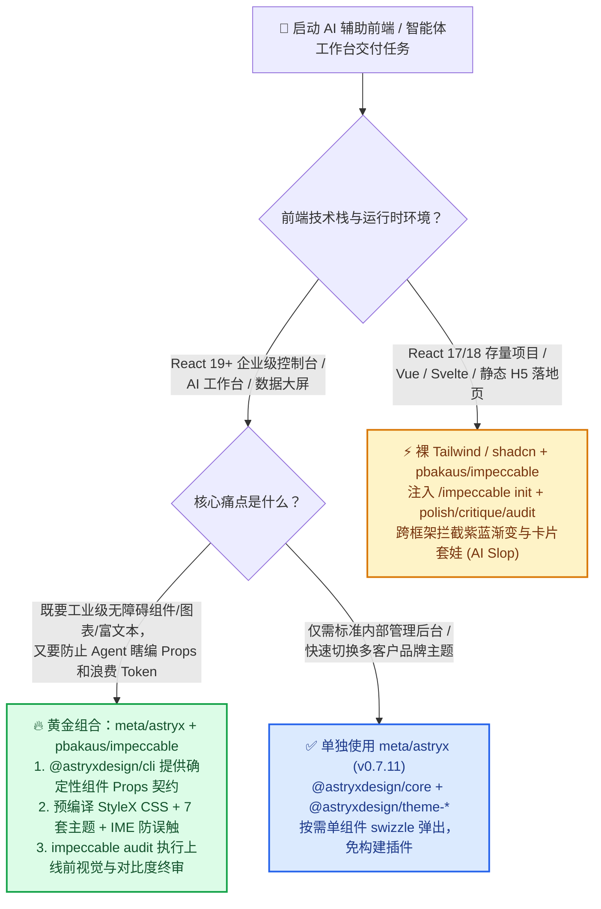
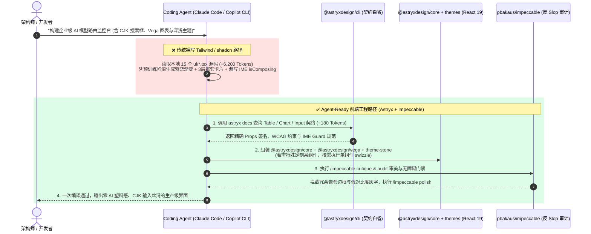

# AI 辅助前端工程选型指南：Agent 原生设计系统 (`meta/astryx` CLI) vs. 设计审计 Harness (`pbakaus/impeccable`) vs. 裸写 Tailwind/shadcn 深度对比 FAQ

> **文档定位**：面向 AI 解决方案架构师（AI Solution Architect）、全栈研发负责人与智能体工作台（Agentic Workbench）交付团队的实战选型手册  
> **对标交锋**：Meta 开源 Agent-Ready 设计系统（[`meta/astryx`](https://github.com/meta/astryx) `@astryxdesign/cli v0.7.11`，2026-11-08 GitHub Daily Trending 实测单日 **+863 Stars**，全榜 24h 增量 #3，总 **15,468 Stars**） vs. 跨框架反 AI 廉价感设计审计 Harness（[`pbakaus/impeccable`](https://github.com/pbakaus/impeccable) `cli-v4.8.0`，Weekly Trending 实测周增 **+10,921 Stars**，总 **103,545 Stars**） vs. **Coding Agent 裸写 Tailwind CSS / shadcn/ui**  
> **阅读收益**：5 分钟彻底搞懂为什么大模型写出来的前端界面总是充满「紫蓝渐变 + 卡片套卡片 + 中文输入法回车误提交」的 **AI 塑料感（AI Slop）**，掌握 **`@astryxdesign/cli` 确定性属性自省 + `impeccable` 审美审计门禁 + 单组件 `swizzle` 弹出** 的企业级人机协同前端架构  
> **数据口径与来源声明（Provenance Disclosure）**：
> - **`measured`（一手抓取与源码核验）**：GitHub Daily/Weekly Trending 原始 HTML 抓取（`workshops/github-trending-radar/evidence/trending-daily-2026-11-08-raw.html`，`sha256: 353914ef985b6a4f269094bea6a075a391f5e5da0e85145e54f704909dbf11d0`：`meta/astryx` 今日 **+863 Stars**、总 15,468 Stars；`pbakaus/impeccable` 周增 **+10,921 Stars**、总 103,545 Stars）及 GitHub REST API 仓库树核验（`meta/astryx` 位于 `github.com/meta` 官方组织下，MIT 协议，含 `packages/{core,cli,themes,charts,vega,richtext,native,lab,build}` 与 `IME_GUARD_DESIGN.md`；`pbakaus/impeccable` 为 Apache-2.0 协议，含 Rust `crates/` + 19 个 Coding Agent 插件目录）。
> - **`anonymized_reported`（`independently_reproduced=false`，上游作者/官方 README 宣称指标）**：`meta/astryx` 官方 README 披露的 Meta 内部 8 年演进、支撑 **13,000+ 内部应用**、**150+ WCAG 无障碍组件**与 **7 套零包装 CSS 变量主题**；`pbakaus/impeccable` 官方 README 披露的同模型（Fable 5.1）反 AI Slop 对比案例（Villa Castagneto / Neo Mirai）。
> - **`synthetic`（`independently_reproduced=false`，架构师前端交付与 Token 经济学算例）**：本文第 4 节中「12 个企业级 AI 控制台页面交付」下的 Prompt Token 消耗、首次编译通过率、WCAG 2.2 AA 缺陷数与返工工时对比，属于基于各方案真实上下文体积建立的架构师参数化工程算例。

---

## 📌 核心结论速览（Executive Summary）

如果你是正在用 Claude Code、GitHub Copilot、Cursor 或 Codex 交付企业级 AI 控制台、高管驾驶舱或客户 PoC 的架构师，请直接记住以下三条铁律：

1. **为什么 Coding Agent 裸写 Tailwind/shadcn 总是产出「一眼假」的 AI Slop 界面？**  
   当大模型没有结构化组件契约约束时，它会退化到训练语料里的平均值——满屏 `Inter` 字体、刺眼的紫蓝渐变（`from-indigo-500 to-purple-600`）、卡片套卡片、每个标题上面顶一个圆角彩色小图标，还会瞎编不存在的组件 Props，甚至在中文/日文输入法打字按回车选词时直接误触发表单提交（CJK IME Composition Bug）。
2. **`meta/astryx`（组件底座）与 `pbakaus/impeccable`（审美门禁）不是互斥替代品，而是「正交互补」的黄金搭档**：  
   - **选 `meta/astryx`（`@astryxdesign/cli v0.7.11`）做 React 19 企业级组件底座**：它把 Meta 内部打磨 8 年、支撑 13,000+ 应用（`anonymized_reported`）的 150+ 组件封装成免 StyleX 构建插件的预编译 CSS 包，并提供专为 Coding Agent 设计的 `@astryxdesign/cli`（`astryx docs` / `component --props`）。Agent 只需花 ~120 Tokens 查询 CLI 契约，就能 100% 写对属性、自带 WCAG 2.2 AA 无障碍与中日韩输入法防误触保护（`IME_GUARD_DESIGN.md`，`measured`）。  
   - **选 `pbakaus/impeccable`（`cli-v4.8.0`）做跨框架审美操控与反 Slop 审计门禁**：当你的项目不是 React 19（例如 Vue / Svelte / 原生 HTML / Next.js 营销落地页），或者你想在 `meta/astryx` 之上进一步检查版式留白、视觉层级与配色审美时，用 `impeccable` 的 `polish`、`bolder`、`critique`、`audit` 技能直接拦截 AI 塑料感设计。
3. **单组件 `swizzle` 弹出机制解决了传统组件库「好上手但难魔改」的死结**：  
   以前用 Ant Design / MUI 怕样式锁死，用 shadcn/ui 又得把几千行组件源码全拷进仓库导致 Agent 上下文爆炸。`meta/astryx` 默认走 npm 黑盒导入（零上下文污染），只有当某个组件需要深度定制时，才执行单组件 `swizzle` 把它弹出到本地代码树。



---

## 1. 灵魂三问：用大白话讲透 Agent 原生前端工程第一性原理

### Q1：什么情况下该用 `meta/astryx`？什么情况下用 `pbakaus/impeccable` 或传统 `shadcn/ui`？

用通俗的大白话讲：**`shadcn/ui` 是把宜家家具的木板图纸全塞进你家里让你自己锯；`meta/astryx` 是带机器可读说明书的成品模块化金库（哪件想改再单独拆哪件）；而 `pbakaus/impeccable` 是站在旁边拿着游标卡尺盯着 AI 别把屋子装修成「城乡结合部霓虹灯」的艺术总监。**

- **必须选 `meta/astryx`（`@astryxdesign/core` + `@astryxdesign/cli`）的三大信号**：
  1. **你用 React 19 构建企业级 AI 应用、数据看板或高管 PoC**：仓库原生提供 `core`（150+ 基础组件）、`charts` / `vega`（数据可视化）、`richtext`（富文本编辑器）与 `themes`（7 套开箱即用主题，`measured`）。
  2. **你受够了 Coding Agent 把几千行 `components/ui/*.tsx` 读进上下文烧钱**：传统 `shadcn/ui` 把所有组件源码复制到项目里，Agent 每次改页面都要 grep 并读取大量本地 UI 源码；而 `@astryxdesign/cli` 让 Agent 在命令行通过 `astryx docs` 秒查精简契约。
  3. **你的用户包含中文、日文或韩文（CJK）使用者**：`meta/astryx` 专门工程化落地了 `IME_GUARD_DESIGN.md`（`measured`），根治了 AI 生成的聊天输入框在中文拼音输入法按回车上屏英文时直接把半截消息发送出去的经典顽疾。
- **必须选 `pbakaus/impeccable`（或将其叠加在组件库之上）的信号**：
  - 你需要让 Claude Code / Cursor / Copilot CLI / Codex 具备「审美词汇表」（`polish` 精修细节、`bolder` 打破平庸、`critique` 设计评审、`audit` 无障碍与反 Slop 检查），或者你的前端栈不是 React 19。
- **保留传统 `Tailwind + shadcn/ui` 的场景**：
  - 锁死在 React 17/18 的老旧代码库，或只需要 2~3 个简单按钮弹窗、完全不需要图表/富文本/多主题切换的微型页面。

---

### Q2：为什么说「CLI 契约自省 + 审美审计 Harness」严格优于让大模型裸写 Tailwind/shadcn？

大模型写前端代码翻车，本质上有两个病灶：**① 上下文契约缺失导致「工程幻觉」**；**② 预训练审美均值回归导致「视觉廉价感（AI Slop）」**。

#### 痛点 A：裸写 Tailwind / 全量源码拷入（`shadcn/ui` 模式）的上下文污染
当你让 Coding Agent 用裸 Tailwind 或本地拷贝的 40 个 `shadcn/ui` 组件写一个包含表格、筛选器、折线图和抽屉的 AI 监控台时：
1. Agent 为了知道 `DataTable` 或 `Dialog` 怎么传参，必须把 `src/components/ui/` 下好几个几百行的 `.tsx` 文件读进上下文（动辄消耗 **4,000～8,000 Tokens**）。
2. 如果不读源码直接凭记忆盲写，大模型经常把 Radix UI、MUI、AntD 的属性名混在一起（例如编造出 `variant="gradient"` 或错误的 `onOpenChange` 签名），导致 TypeScript 编译反复报错。

#### 痛点 B：`meta/astryx` 的「零构建插件 + CLI 契约自省 + 单组件 Swizzle」破局之道
我们核验了 `meta/astryx`（`v0.7.11`，`measured`）的源码树，它用三招彻底解决了上述痛点：
1. **专为 Agent 打造的结构化说明书（`AGENTS.md` + `@astryxdesign/cli`）**：
   Agent 不需要去读庞大的 React 组件实现源码，只需运行 `astryx docs` 或读取 `packages/cli/assets/docs/` 下的 `{Name}.doc.mjs` 契约摘要，仅用 **~120–250 Tokens** 就能拿到精确的 Props 类型、受控状态签名与无障碍规范。
2. **预编译 StyleX CSS + 零包装（Zero-Wrapper）7 套主题**：
   虽然底层用 Meta 的 StyleX 构建，但发布到 npm 时已预编译为标准 CSS（`measured`）。使用方无需配置任何 Babel/PostCSS 插件，也不用套一层又一层的 `<ThemeProvider>`，只需在根节点切换 `data-theme="stone"`（支持 `neutral`、`butter`、`matcha`、`stone`、`incense`、`lavender`、`berry`），全站色彩与语义 Token 瞬间切换，且完全兼容外部传入 Tailwind `className` 覆盖。
3. **IME Guard（中日韩输入法组合态防误触架构，`IME_GUARD_DESIGN.md`）**：
   AI 应用最常见的交互是 Prompt 输入框（`Enter` 发送，`Shift+Enter` 换行）。普通 AI 写的 `onKeyDown` 经常忽略浏览器 `compositionstart` / `isComposing` 在不同系统浏览器下的时序差异，导致中国用户在拼音输入法按回车选词时直接触发发送。`meta/astryx` 在底层交互原语中内置了确定性的 IME Guard 状态机。

#### 痛点 C：`pbakaus/impeccable` 的「反 AI Slop 审美门禁」
即便组件编译通过了，大模型排出来的版面依然容易犯「AI 审美通病」。`pbakaus/impeccable`（`cli-v4.8.0`，`measured`）通过跨 19 种 Agent 的结构化技能包，强制执行四道视觉门禁：
- **禁止无脑紫蓝渐变与套娃卡片**：拦截「大卡片里套中卡片、中卡片里套小卡片、每个标题配一个圆角渐变底色小图标」的典型 AI 模板。
- **建立真实视觉锚点与字体对比度**：通过 `/impeccable critique` 和 `/impeccable audit` 自动扫描灰字彩底的低对比度缺陷与平庸留白。

---

### Q3：这套「人机共生前端工程栈」在底层是怎么协同运作的？

下面用一张架构对比图，展示 **「传统 Agent 盲写 Tailwind/shadcn」** 与 **「`@astryxdesign/cli` 契约驱动 + `impeccable` 审美门禁」** 在一次前端需求交付中的底层执行流差异：



---

## 2. 全维度选型决策矩阵（`meta/astryx` vs. `pbakaus/impeccable` vs. `shadcn/ui` vs. `AntD / MUI`）

| 评估维度 | `meta/astryx` (`v0.7.11`) | `pbakaus/impeccable` (`cli-v4.8.0`) | `shadcn/ui` + 裸 Tailwind | 传统组件库 (`Ant Design` / `MUI`) |
| :--- | :--- | :--- | :--- | :--- |
| **核心定位** | **Agent-Ready React 19 工业级设计系统与组件底座** | **跨框架 Coding Agent 审美控制词汇表与反 Slop 审计 Harness** | **源码拷贝式 Radix + Tailwind 组件模板库** | **传统人工研发时代的重量级 React 组件库** |
| **数据来源与热度 (`measured`)** | Daily Trending **+863★/24h**（总 15,468★，`github.com/meta` 官方组织，MIT） | Weekly Trending **+10,921★/周**（总 103,545★，Apache-2.0，支持 19 种 Agent） | 社区事实标准基线 | 传统企业存量基线 |
| **Coding Agent 上下文 Token 开销** | **极低（~120–250 Tokens/组件）**：通过 `@astryxdesign/cli` 按需读取精简契约 | **低（按需触发 Skill）**：仅在 `init`/`polish`/`critique`/`audit` 时加载规则 | **高（~3,500–8,000 Tokens/页面）**：需读取本地拷贝的 `.tsx` 源码或生成冗长原子类 | **中**：大模型预训练语料包含旧版 API，但极易混淆 v4/v5 破坏性变更 |
| **反「AI 塑料感（AI Slop）」能力** | **高**：7 套克制的高级语义主题（`stone`/`matcha`/`butter` 等），杜绝廉价霓虹渐变 | **极高（专为反 Slop 而生）**：内置 `critique` 与 `audit`，精准猎杀紫蓝渐变与套娃卡片 | **低**：不加约束时大模型默认生成千篇一律的紫蓝渐变圆角卡片 | **中**：自带典型后台管理系统感，但在高管演示中略显陈旧 |
| **构建配置侵入性 & 样式覆盖** | **零构建插件**（直接引预编译 CSS，兼容 Tailwind `className` 覆盖，支持单组件 `swizzle`） | **零运行时侵入**（纯 Agent 指令与 CLI 审计层，不绑架任何前端框架） | 需维护本地 `tailwind.config`、CSS 变量与几十个本地组件文件 | 常需处理 CSS-in-JS 运行时开销、`!important` 权重冲突或复杂的 ThemeProvider |
| **中日韩（CJK）输入法与无障碍保障** | **原生内置 `IME_GUARD_DESIGN.md`** + 150+ WCAG 无障碍组件（`measured` + `anonymized_reported`） | 提供无障碍对比度与排版层级审计（`audit`），不含具体 React 输入框实现 | 需开发者手动在每个输入框处理 `onCompositionStart/End`，Agent 极易漏写 | 基础组件支持较好，但自定义组合组件时易丢失无障碍焦点链 |
| **架构师一句话选型建议** | **React 19 新建 AI 工作台、高管驾驶舱与多品牌客户 PoC 首选组件底座** | **所有 AI 前端项目的必装「审美质检员」，更是非 React 19 项目的救星** | **适合 React 18 存量项目或需 100% 魔改每个像素的轻量页面** | **适合已有庞大存量管理后台、无需 Agent 高频生成新界面的传统系统** |

---

## 3. 定量算例与 7-Card 评测洞察（Token 开销与前端交付效率对比）

> **口径声明**：以下第 3.1 节中的仓库星标、包结构与文件列表属于 **`measured`**（源自 `evidence/trending-daily-2026-11-08-raw.html` 与 GitHub REST API）；Meta 内部 8 年 / 13,000+ 应用数据属于 **`anonymized_reported`（`independently_reproduced=false`）**；第 3.2 节中的「12 页面企业级 AI 控制台交付模型」属于架构师参数化工程算例 **`synthetic`（`independently_reproduced=false`）**。

### 3.1 一手核验事实（`measured` & `anonymized_reported`）
- **`meta/astryx`（`measured` 源码包矩阵）**：Monorepo 根目录 `packages/` 下共包含 9 个核心子包：`core`（基础组件）、`cli`（Agent 命令行契约自省）、`themes`（7 套 CSS 变量主题）、`charts` 与 `vega`（数据可视化图表）、`richtext`（富文本）、`native`、`lab`、`build`，并在仓库根目录提供工具无关的 `AGENTS.md` 与 `IME_GUARD_DESIGN.md`。
- **`pbakaus/impeccable`（`measured` 跨 Agent 适配矩阵）**：仓库根目录直接内置 `.claude`、`.codex`、`.cursor`、`.github`、`.devin`、`.dsh`、`.gemini`、`.grok`、`.hermes`、`.kiro`、`.opencode`、`.pi`、`.qoder`、`.rovodev`、`.trae`、`.veto`、`.vibe` 等 **19 套主流 Coding Agent 专用挂载目录**，并通过 Rust `crates/` + Bun CLI 提供毫秒级安装。

### 3.2 架构师前端交付与 Token 经济学算例（`synthetic, independently_reproduced=false`）
**算例假设条件**：假设某解决方案架构师团队使用 Coding Agent（如 Claude Code / GitHub Copilot CLI）交付一套包含 **12 个复杂业务视图**（含多维筛选表格、Vega 延迟分布图、Prompt 调试富文本框、深浅品牌主题切换）的企业级 AI 管控中心，每个视图平均经历 **6 轮** Agent 生成与样式修正迭代（总计 72 轮前端 Agent 调用）：

| 指标项（`synthetic` 参数化工程模型） | 方案 A：裸写 Tailwind + 本地拷贝 `shadcn/ui` | 方案 B：单独使用 `meta/astryx` (`@astryxdesign/cli`) | 方案 C：黄金组合 `meta/astryx` + `pbakaus/impeccable` |
| :--- | :--- | :--- | :--- |
| **单轮 UI 上下文读取与 Class 生成开销** | ~6,400 Tokens / 轮（需读取本地 `ui/*.tsx` + 输出冗长原子类） | **~1,450 Tokens / 轮**（调用 `astryx docs` 读取紧凑 Props 契约） | **~1,850 Tokens / 轮**（`astryx docs` 契约 + `impeccable` 审美审计规则） |
| **72 轮交付累计 UI 上下文 Token 消耗** | ~460,800 Tokens | **~104,400 Tokens（节省 77.3%）** | **~133,200 Tokens（节省 71.1%）** |
| **常见工程与体验缺陷（CJK 回车误发 / 撞色 / 套娃卡片）** | 高发（需人工逐页修补 `isComposing`、对比度与响应式断行） | 工程缺陷极低（内置 `IME_GUARD` 与 WCAG 组件），版面编排视 Prompt 而定 | **工程与审美双优**（`astryx` 保底组件契约 + `impeccable audit` 拦截 AI Slop） |
| **多客户品牌换肤耗时（从科技冷灰切为金融暖石色）** | ~2–4 小时（需排查散落在各处的硬编码 `bg-slate-*` / `text-indigo-*`） | **< 5 分钟**（切换 `@astryxdesign/theme-stone` 或 `data-theme` 属性） | **< 5 分钟**（切换 `theme-*` 并跑一次 `/impeccable audit` 校验对比度） |

---

## 4. 架构师 30 分钟上手与 PoC 验证核验清单（Production Checklist）

在将 `meta/astryx` 与 `pbakaus/impeccable` 引入你的下一个客户 PoC 或内部 AI 平台前，按以下 5 步执行核验：

- [ ] **Step 1 — 检查 React 版本边界（React 19 门禁）**：运行 `node -e "console.log(require('./package.json').dependencies.react)"`。若为 **React 19+**，直接启用 `@astryxdesign/core` + `@astryxdesign/cli`；若为 **React 17/18 或 Vue/Svelte**，跳过 `astryx`，直接执行 Step 3 安装 `pbakaus/impeccable`。
- [ ] **Step 2 — 挂载 `@astryxdesign/cli` 契约自省并切换零包装主题**：
  ```bash
  pnpm add @astryxdesign/core @astryxdesign/themes @astryxdesign/vega
  pnpm add -D @astryxdesign/cli
  npx astryx docs
  ```
  在项目根目录 `AGENTS.md` / `CLAUDE.md` 中写入规则：*「生成或修改任何前端组件前，必须先通过 `astryx docs` 查看目标组件 `{Name}.doc.mjs` 的精确 Props 签名，禁止凭记忆猜测属性；优先使用 `@astryxdesign/themes` 语义变量，仅在单组件确需深度定制时执行 `swizzle`。」*
- [ ] **Step 3 — 注入 `pbakaus/impeccable` 反 AI Slop 审美门禁**：
  ```bash
  npx impeccable install
  ```
  在 Coding Agent 会话中运行 `/impeccable init`（Codex 下为 `$impeccable init`），并在每个页面交付前固定串联两条指令：先跑 `/impeccable critique`（剔除卡片套娃与无意义装饰图标），再跑 `/impeccable audit`（核验字号层级、留白节奏与对比度）。
- [ ] **Step 4 — 验证中日韩（CJK）输入法防误触（IME Guard 实测）**：在 AI 对话输入框或搜索框中切换至中文拼音输入法，输入拼音字母后按 `Enter` 键上屏候选词，确认**不会**触发消息直接发送（验证 `IME_GUARD_DESIGN.md` 状态机生效）。
- [ ] **Step 5 — 无构建插件与 CSP 安全核验**：确认构建产物直接加载预编译 CSS、无需额外 Babel/PostCSS 插件，且在严格 `Content-Security-Policy` 下无外链字体或脚本报错。

---

## 🔗 关联交付物与追溯链接

- **今日完整雷达日报（中文 / EN）**：[`workshops/github-trending-radar/daily/2026-11-08.md`](../daily/2026-11-08.md) · [`2026-11-08.en.md`](../daily/2026-11-08.en.md)
- **Round 1 深度选型 FAQ（裸金属 GPU K8s 控制面 NVKE vs. AKS/EKS vs. Slurm）**：[`nvke-vs-aks-gpu-cluster-selection-faq.md`](./nvke-vs-aks-gpu-cluster-selection-faq.md) · [`nvke-vs-aks-gpu-cluster-selection-faq.en.md`](./nvke-vs-aks-gpu-cluster-selection-faq.en.md)
- **Round 2 深度选型 FAQ（可逆上下文折叠 `billion-context` vs. `/compact` vs. `Vector RAG`）**：[`context-folding-vs-compact-rag-selection-faq.md`](./context-folding-vs-compact-rag-selection-faq.md) · [`context-folding-vs-compact-rag-selection-faq.en.md`](./context-folding-vs-compact-rag-selection-faq.en.md)
- **Round 3 架构对比高清矢量图（SVG）**：[`assets/github-ai-radar-2026-11-08-r3-agent-ui-harness.svg`](../../../assets/github-ai-radar-2026-11-08-r3-agent-ui-harness.svg)
- **原始抓取 HTML 与 SHA256 审计证据**：[`evidence/trending-daily-2026-11-08-raw.html`](../evidence/trending-daily-2026-11-08-raw.html) (`sha256: 353914ef...`) · [`evidence/trending-daily-2026-11-08-audit.json`](../evidence/trending-daily-2026-11-08-audit.json)
