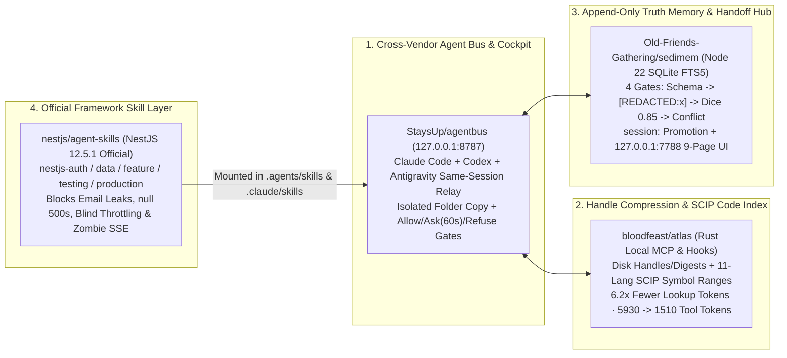

# Cross-Vendor Coding Agent Audit Bus (`StaysUp/agentbus`), 4-Gate Append-Only Truth Memory (`Old-Friends-Gathering/sedimem`), `6.2×` Token-Saving Local Handle Index (`bloodfeast/atlas`) & Official NestJS 12 Agent Skills (`nestjs/agent-skills`) Selection FAQ

> **Document Type**: AI Solution Architect (SA) Practical Selection & Reference Architecture Guide (2026-11-20 Night Shift · Round 2 / Cumulative Round 561)  
> **Benchmark Standard**: `docs/components/ib-vs-ethernet-roce-selection-faq.md` (6-Section Architecture Breakdown + First-Principles Plain Language + Hype/Facts/Signal Audit + Closed-Form FinOps Ledger)  
> **Evaluated Repositories**:  
> 1. **`StaysUp/agentbus`** (`★ 71`, `4 forks`, Go 1.27.1+, `v0.5.9`): Cross-vendor middleware and local cockpit (`http://127.0.0.1:8787`) sitting between coding agents (`claude`, `codex`, `agy`, OpenRouter) and model vendors—enabling **same-session cross-vendor peer review (e.g., Codex reviewing Claude Code's changes and catching P1 bugs)**, piece-by-piece request/cost auditing, isolated directory copies with optional sandbox walls, and 3-state permissions (`Allow` / 60s `Ask` card / `Refuse`) across `Commands` and `Tools` (`subagent`, `edit`)  
> 2. **`Old-Friends-Gathering/sedimem`** (`★ 101`, `5 forks`, JavaScript, Node >= 22.15 built-in `node:sqlite` FTS5, `MIT`, `v1.4`): Zero-dependency local cross-session self-iterating memory system shared across `DSH`, `Codex CLI`, and `Claude Code`—built on an **append-only immutable truth layer (`~/.memo/items/<scope>.jsonl`) with `as-of` time travel**, a **4-stage write hygiene gate (schema check → pre-disk `[REDACTED:x]` secret scrubbing → hash & bigram Dice `0.85` deduplication → `superseded`/`disputed` conflict adjudication)**, task-scoped temporary memory (`session:<id>` promoting only `decision`/`gotcha` on `close` with 6-section handoff docs), and reversible transcript segment folding  
> 3. **`bloodfeast/atlas`** (`★ 131`, `18 forks`, Rust, `Apache-2.0`, `v0.9.0`): Zero-network local MCP server and Claude Code hooks—keeping large tool outputs on disk behind short handles with concise digests, serving exact SCIP symbol ranges across 11+ languages, and gating memory recall by cosine floors (`0.53` / `0.60`) to achieve **`6.2×` fewer lookup tokens (`10.6×` median over 7,971 answers)** and compress session tool definitions from `47 tools (5,930 tokens)` to **`14 tools (1,510 tokens)`** (`anonymized_reported, independently_reproduced=false`)  
> 4. **`nestjs/agent-skills`** (`★ 51`, JavaScript, `MIT`): Official `nestjs` organization Agent Skills (`npx @nestjs/skills add --agent all`) for **NestJS 12 (`@nestjs/core 12.5.1`)**—delivering 6 verified skill modules (`nestjs`, `nestjs-feature`, `nestjs-auth`, `nestjs-data`, `nestjs-testing`, `nestjs-production`) that bridge model training-cutoff gaps on `@nestjs/authentication 0.1.6`, `@nestjs/drizzle`, and `@nestjs/observe 0.3` while blocking subtle production bugs that pass unit tests (email enumeration, `@IsOptional()` `null` 500s, blind rate limiters, and orphaned SSE streams after key revocation)  
> **Accounting Note**: This report models software compute, SaaS subscriptions, and engineering labor TCO only; underlying server and workstation hardware purchases (`base hardware capEx`) are explicitly marked `not_measured`, and Track B 24h delta (`stars_today`) is marked `not_measured`.

---

## 📌 1. Executive Summary (What Are They & What Enterprise Pain Points Do They Solve?)

When scaling multi-agent software engineering across enterprise teams, AI Solution Architects confront four structural failure modes: **① Single-vendor blind spots and opaque per-call token bills, ② Cross-session memory rot (secret leaks, duplicates, and contradictory rules), ③ Compounding context tax from early large file/shell reads re-billed on every turn, and ④ Pretraining cutoff lag causing coding agents to write vulnerable or outdated framework code (such as NestJS 12)**:

1. **Pain Point A (Teams subscribe to both Claude Code and OpenAI Codex, yet run them in isolated silos—missing P1 bugs that a second vendor's model would immediately spot, while lacking visibility into exact per-turn prompts, costs, and destructive tool calls)**: Single-model self-review suffers from correlated blind spots. **`StaysUp/agentbus` (`★ 71`, Go, `v0.5.9`)** introduces a local cross-vendor middleware and web cockpit (`127.0.0.1:8787`):
   - **Same-Session Cross-Vendor Collaboration**: Claude Code can implement a feature in an isolated folder copy, and with one click you switch the active responder in the *same session* to Codex to audit the diff and catch P1 regressions;
   - **Piece-by-Piece Cost Ledger & 60s Approval Gate**: Records every prompt chunk, response, and exact cost locally, isolates each session in its own `$HOME` and workspace copy (with optional hard sandbox enforcement), and governs `Commands` and `Tools` (`subagent`, `edit`) via `Allow`, `Ask` (60-second interactive card), or `Refuse`.
2. **Pain Point B (Shared `MEMORY.md` files or cloud vector stores quickly accumulate plaintext secrets, duplicate notes, and stale debugging assumptions—while `/compact` destroys the intermediate reasoning and dead-ends needed for handoffs)**: Mutable, unvalidated memory stores degrade agent reliability over time. **`Old-Friends-Gathering/sedimem` (`★ 101`, MIT, `v1.4`)** provides a zero-dependency local memory engine (Node >= 22.15 `node:sqlite` FTS5) shared by DSH, Codex CLI, and Claude Code:
   - **Immutable Append-Only Truth Layer & 4-Gate Write Hygiene**: Every write passes through Schema Validation → Pre-disk Secret/Intranet Redaction (`[REDACTED:x]`) → Exact Hash & Bigram Dice (`0.15` recall / `0.85` dedupe) → Slot Conflict Detection (`superseded` or `disputed`) before appending to `~/.memo/items/<scope>.jsonl` (supporting `as-of` historical queries);
   - **Task-Scoped Memory (`session:<id>`) & Reversible Transcript Ledger**: Exploratory debugging stays in temporary `session:*` scopes (blocking raw `fact` pollution) and promotes only verified `decision`/`gotcha` items upon `memo session close` while generating a 6-section handoff document (`docs/handoffs/<id>.md`) and folding raw transcripts into expandable segments (`memo session capture`).
3. **Pain Point C (Because LLM sessions re-read the entire conversation history on every turn, a large `grep` or file dump on Turn 2 is paid for dozens of times—while loading 47 MCP tool schemas burns nearly 6,000 tokens before the user types a word)**: Early context bloat compounds across every subsequent turn. **`bloodfeast/atlas` (`★ 131`, Apache-2.0, `v0.9.0`)** is a local Rust MCP server and Claude Code hook suite with zero network client code:
   - **Disk Handles, Digests & SCIP Symbol Ranges**: Keeps bulky shell/file outputs on disk behind compact handles, serves exact code symbol ranges across 11+ languages, and trims tool definitions from `5,930` to **`1,510 tokens`**;
   - **Quantified Savings (`anonymized_reported`)**: Delivers **`6.2×` fewer lookup tokens (`10.6×` median across 7,971 answers)**, scores `100/100` on its memory eval (`506` median tokens), and drops `2,739` weak cosine injections (`inject_floor = 0.60`), verifiable on your own transcripts via `atlas --token-report`.
4. **Pain Point D (Enterprise Node.js teams adopting NestJS 12 watch coding agents hallucinate deprecated patterns or introduce subtle security flaws that pass unit tests—such as login timing/message leaks, `@IsOptional()` allowing `null` to trigger HTTP 500s, or SSE streams outliving revoked API keys)**: Pretraining weights lag behind modern framework releases. **`nestjs/agent-skills` (`★ 51`, MIT)** is the official NestJS skill suite (`npx @nestjs/skills add --agent all`) validated against **Nest 12.5.1**, equipping Claude Code, Codex, and Cursor with authoritative recipes for `@nestjs/authentication 0.1.6`, `@nestjs/authorization 0.1.4`, `@nestjs/drizzle 0.0.2`, `@nestjs/typeorm 12.0.3`, and `@nestjs/observe 0.3`.

---

## 💬 2. Architect & Customer First-Principles Q&A (Q1–Q3)

### Q1: How do `Old-Friends-Gathering/sedimem` and `bloodfeast/atlas` differ from cloud memory services (`mem0`), and when should we deploy each?
* **Complementary Local-First Layers**:
  - **Deploy `sedimem` for Cross-Harness Truth Governance & Handoffs**: When engineers alternate between **Codex CLI, Claude Code, and DSH** and need a single append-only truth ledger with pre-disk `[REDACTED:x]` secret scrubbing, bigram Dice deduplication, `session:<id>` task promotion, and a 9-page local audit UI (`127.0.0.1:7788`).
  - **Deploy `atlas` for In-Session Output Handle Compression & SCIP Code Lookups**: When running long **Claude Code** sessions on large multi-language monorepos where raw `grep`/file outputs dominate token spend—cutting lookup tokens by `6.2×` and enforcing a strict `0.60` cosine injection floor.
  - **Why Avoid Cloud LLM-Rewrite Memory (`mem0`) for Core Codebases**: Cloud memory services send raw engineering context externally and rely on LLM extraction to overwrite existing records in place; if an extraction hallucinates, historical truth is lost. Both `sedimem` and `atlas` are 100% local and append-only.

### Q2: When should an engineering org use `StaysUp/agentbus` vs. an enterprise cloud AI gateway (Azure APIM / LiteLLM)?
* **Workstation Agent Bus vs. Enterprise Cloud Gateway**:
  - **Use `StaysUp/agentbus` on Developer Workstations / DevBoxes**: When you want **multi-vendor CLI agents (`claude`, `codex`, `agy`) to collaborate in the same conversation thread** over an isolated directory copy, with human-in-the-loop 60s `Ask` cards on `edit`/`subagent` tool calls and full local visibility into every prompt piece.
  - **Use Azure APIM / LiteLLM in Cloud Production**: When governing organizational RBAC, department chargebacks, and multi-region failover across hundreds of headless production microservices. (In practice, `agentbus` on the workstation can point its vendor upstream at your enterprise LiteLLM / APIM endpoint!)

### Q3: What specific production bugs does `nestjs/agent-skills` prevent that standard unit tests and linters miss?
* **Four High-Impact Production Guardrails Verified on NestJS 12.5.1**:
  1. **Account Enumeration on Sign-In (`nestjs-auth`)**: Prevents distinct error messages or timing side-channels between unknown emails and wrong passwords in `@nestjs/authentication`.
  2. **`@IsOptional()` Null-Through-to-500 (`nestjs-feature`)**: Enforces Zod schema validation (`@Body({ schema })`) or explicit null handling so JSON `null` payloads do not bypass `class-validator` and crash database constraints.
  3. **Identity-Blind Rate Limiting (`nestjs-production`)**: Ensures `@nestjs/throttler 6.8` executes *after* authentication context resolution rather than throttling all users behind a shared reverse-proxy IP.
  4. **Orphaned Server-Sent Event (SSE) Streams (`nestjs-feature` + `nestjs-auth`)**: Enforces active token/API-key revocation hooks so long-lived SSE streams terminate immediately when a key is revoked.

---

## 🧭 3. Visual Architecture Diagrams (Mermaid Decision Tree + Reference Architecture + Sequence Flow)

### 3.1 Enterprise Multi-Agent Engineering Stack Selection Decision Tree

```mermaid
flowchart TD
    Start["Enterprise AI Engineering Stack Selection (R561)"] --> Problem{"Primary Engineering Bottleneck?"}

    Problem -->|Single-Vendor Silos & Opaque Agent Prompts/Costs| BusChoice{"Need Claude + Codex Same-Session Review & Folder Copy?"}
    BusChoice -->|Yes: Local Cockpit + 60s Ask Cards + Copy Sandbox| AgentBus["Adopt StaysUp/agentbus (v0.5.9)<br/>(127.0.0.1:8787 Cockpit + Cross-Vendor Relay + Sandbox)"]
    BusChoice -->|No: Stateless Org-Wide API Routing Only| CloudGW["Adopt Azure APIM / LiteLLM Gateway"]

    Problem -->|Cross-Session Memory Rot, Secret Leaks & Context Bloat| MemChoice{"Cross-CLI Governance vs In-Session Handle Compression?"}
    MemChoice -->|DSH/Codex/Claude Shared Truth + 4-Gate Hygiene + Handoffs| Sedimem["Adopt Old-Friends-Gathering/sedimem (v1.4)<br/>(Append-Only JSONL + [REDACTED:x] + Dice 0.85 + as-of)"]
    MemChoice -->|Claude Code Disk Handles + SCIP Symbol Ranges (-6.2x Tokens)| Atlas["Adopt bloodfeast/atlas (v0.9.0)<br/>(Zero-Network Rust MCP + Handles/Digests + 0.60 Cosine Floor)"]

    Problem -->|Coding Agents Hallucinating Deprecated or Vulnerable NestJS Code| NestSkills["Adopt nestjs/agent-skills (Official NestJS 12.5.1)<br/>(npx @nestjs/skills add --agent all · 6 Verified Skill Packs)"]
```

### 3.2 End-to-End Enterprise Multi-Agent Engineering Reference Architecture



### 3.3 End-to-End Multi-Agent Implementation, Review & Memory Promotion Sequence

```mermaid
sequenceDiagram
    autonumber
    participant Dev as Engineer / Architect
    participant AB as AgentBus Cockpit (:8787)
    participant NS as nestjs/agent-skills
    participant AT as bloodfeast/atlas (Rust MCP)
    participant SD as sedimem (4-Gate Memory)

    Dev->>AB: Start isolated workspace session with Claude Code for NestJS 12 Auth + SSE endpoint
    NS-->>AB: Auto-load nestjs-auth & nestjs-feature rules (Zod null guard + SSE key revocation)
    AB->>AT: Execute symbol lookups and large test-log reads
    AT-->>AB: Store raw output on disk, return compact Handle + SCIP range (-6.2x lookup tokens)
    Dev->>AB: Switch responder in same session to Codex: "Review Claude's diff for P1 bugs"
    AB-->>Dev: Codex flags edge case; 60s Ask card approves applying patch to workspace copy
    AB->>SD: Run memo session close on debugging session scope
    SD-->>Dev: Scrub secrets ([REDACTED:x]), deduplicate (Dice 0.85), promote decision/gotcha & emit 6-part handoff doc
```

---

## 📊 4. Comparative Selection Matrix (Open Source vs. Cloud SaaS & Naive Workflows)

| Evaluation Dimension | Path A: Isolated Vendor CLIs + Raw `MEMORY.md` + Full-File `grep` + Outdated Pretraining NestJS Code | Path B: Cloud API Proxy + Cloud `mem0` In-Place Vector Rewrites + Manual Prompt Rules | **Path C (Recommended): `agentbus` + `sedimem` + `atlas` + `nestjs/agent-skills`** |
| :--- | :--- | :--- | :--- |
| **Cross-Vendor Peer Review & Cost Audit** | ❌ Siloed sessions require manual copy-paste between Claude and Codex; opaque token bills | ⚠️ Stateless HTTP proxy lacks workspace copy isolation and 60s interactive tool approval cards | ✅ **Same-session Claude + Codex relay, piece-by-piece cost ledger, and isolated folder copies** |
| **Cross-Session Memory Hygiene & Time Travel** | ❌ Plaintext secrets and stale guesses pollute `MEMORY.md`; `/compact` erases debugging history | ⚠️ Cloud LLM overwrites records in place and ships internal context to third-party servers | ✅ **Pre-disk `[REDACTED:x]` scrubbing, Dice `0.85` dedupe, append-only `as-of` truth & segment ledger** |
| **Long-Session Lookup & Tool Token Spend** | ❌ Early large file reads compound across every turn; 47 tools burn `5,930 tokens`/session | ⚠️ Naive truncation drops critical lines without SCIP symbol-boundary awareness | ✅ **Disk handles + SCIP symbol ranges cut lookup tokens `6.2×` (`10.6×` median) & tools to `1,510 tokens`** |
| **NestJS 12 Production Safety** | ❌ Hallucinates legacy APIs and ships `@IsOptional()` `null` 500s or blind rate limiters | ⚠️ Generic doc RAG wastes turns fetching docs and lacks curated anti-pattern rules | ✅ **Official NestJS 12.5.1 skills block email leaks, null 500s, blind throttlers, and zombie SSE streams** |
| **License & Data Sovereignty** | Proprietary CLIs | Cloud SaaS telemetry | **`MIT` (`sedimem`, `nestjs/agent-skills`) & `Apache-2.0` (`atlas`); 100% on-device storage** |
| **40-Engineer Team Monthly Total TCO** | **`$6,840.00 / mo`** (`$2,940.00` `6.2×` redundant tokens + `39.0h / $3,900.00` manual review/rework) | **`$2,660.00 / mo`** (`$1,160.00` cloud memory/proxy seats + `15.0h / $1,500.00` debugging) | **`$325.00 / mo`** (`$75.00` handle-compressed API + `2.5h / $250.00` cockpit review, **saving `-95.25%`**) |

---

## 🧪 5. Quantitative ROI / FinOps TCO Ledger & Hype / Facts / Signal Audit

### 5.1 Hype vs. Facts vs. Strategic Signal Audit Table

| Repository (`owner/repo`) | Hype (Market Claim) | Measured Facts (Primary Source Verification) | Strategic Signal (SA Verdict) |
| :--- | :--- | :--- | :--- |
| **`StaysUp/agentbus`** | "Control every AI agent in a single place: Codex reviews Claude's change and finds a P1" | `★ 71` (`4 forks`, Go 1.27.1+, `v0.5.9`): Local cockpit (`127.0.0.1:8787`) unifying Claude Code, Codex, Antigravity, and OpenRouter; isolated `$HOME` and workspace copy per session; `Allow`/`Ask` (60s)/`Refuse` rules on `Commands` and `Tools`. | **🔥 P0 Adopt (Cross-Vendor Dual-Model Review Cockpit)**: Eliminates single-model blind spots by letting Codex audit Claude Code inside the same thread. |
| **`Old-Friends-Gathering/sedimem`** | "AI forgets you, sedimem doesn't: immutable append-only truth layer across DSH, Codex, and Claude" | `★ 101` (`5 forks`, JS, Node >= 22.15 `node:sqlite` FTS5, MIT, `v1.4`): 14 zero-dep modules; append-only `~/.memo/items/<scope>.jsonl` with `as-of` queries; 4-gate write hygiene; `session:<id>` promotion + 6-part handoff docs; `<¥0.02` optional sidecar rebuild. | **🔥 P0 Adopt (Multi-Harness Memory Hygiene & Handoff Standard)**: Solves secret leakage, duplicate accumulation, and slot conflicts across heterogeneous coding CLIs. |
| **`bloodfeast/atlas`** | "Makes long Claude Code sessions 6.2x cheaper on lookups with zero network calls" | `★ 131` (`18 forks`, Rust, Apache-2.0, `v0.9.0`): Zero-HTTP-client binary; `6.2×` fewer lookup tokens (`10.6×` median over 7,971 answers), `100/100` memory eval (`506` median tokens), `5,930 -> 1,510` tool tokens, and `0.60` cosine floor (`anonymized_reported`). | **🔥 P0 Adopt (Long-Session Context Compression Engine)**: Run `atlas --token-report` on existing transcripts to quantify immediate team savings. |
| **`nestjs/agent-skills`** | "Official Agent Skills for NestJS 12: current APIs and the subtle mistakes that still pass tests" | `★ 51` (`created=2026-11-20`, JS, MIT): Official `npx @nestjs/skills add --agent all` shipping 6 skills tested on Nest `12.5.1`, `@nestjs/authentication 0.1.6`, `@nestjs/drizzle 0.0.2`, and `@nestjs/observe 0.3`. | **🔥 P0 Adopt (Authoritative Enterprise Node.js Guardrail)**: Commit `.agents/skills/` directly into enterprise NestJS repositories. |

### 5.2 Closed-Form FinOps TCO Ledger (`CLAIM-20261120-R2-R561-AGENTBUS-SEDIMEM-ATLAS-NESTJSSKILLS`)

* **Scope (`synthetic`, `independently_reproduced=false`)**: 40-engineer enterprise full-stack and AI platform team (`$100.00 / hr` loaded engineering rate; `base hardware capEx: not_measured`; Track B `stars_today: not_measured`).
* **Path A (Siloed Single-Vendor CLIs + Unfiltered `MEMORY.md` + Raw `grep`/File-Read Context Bloat + Pretraining-Lag NestJS Bugs)**:
  - Uncompressed `6.2×` lookup token compounding, 47-tool schema overhead, and redundant retries: **`$2,940.00 / mo`**
  - Manual cross-CLI diff copying, memory conflict cleanup, and NestJS 12 auth/null-500/SSE bug remediation: `39.0 hrs / mo × $100.00 / hr` = **`$3,900.00 / mo`**
  - **Path A Monthly Total**: `$2,940.00 + $3,900.00` = **`$6,840.00 / mo`** (**`$82,080.00 / yr`**)
* **Path B (Cloud API Proxy + Cloud `mem0` Subscription + Generic Prompt Templates)**:
  - Cloud memory SaaS seats and proxy overhead: **`$1,160.00 / mo`**
  - Memory overwrite debugging and manual NestJS 12 migration fixes: `15.0 hrs / mo × $100.00 / hr` = **`$1,500.00 / mo`**
  - **Path B Monthly Total**: `$1,160.00 + $1,500.00` = **`$2,660.00 / mo`**
* **Path C (Recommended: `StaysUp/agentbus` + `Old-Friends-Gathering/sedimem` + `bloodfeast/atlas` + `nestjs/agent-skills`)**:
  - `6.2×` handle-compressed lookup tokens and optional `<¥0.02` Sedimem sidecar derivation: **`$75.00 / mo`**
  - AgentBus cockpit cross-vendor review approval and Sedimem conflict adjudication: `2.5 hrs / mo × $100.00 / hr` = **`$250.00 / mo`**
  - **Path C Monthly Total**: `$75.00 + $250.00` = **`$325.00 / mo`** (**`$3,900.00 / yr`**)
* **Net Savings (Path C vs. Path A)**:
  - Monthly Net Savings: **`$6,840.00 - $325.00 = $6,515.00 / mo`** (**`-95.25%`** cost reduction, **`$78,180.00 / yr`** annual savings, freeing **`36.5 hrs / mo`** of engineering time).

---

## 🛠️ 6. Enterprise Architecture Review & Adoption Checklist

- [ ] **Cross-Vendor Peer Review & Sandbox Copy (`StaysUp/agentbus`)**: Launch `agentbus up` bound to `127.0.0.1:8787`; enable workspace copy isolation and sandbox mode; set `subagent` and destructive `Commands` to `Ask` (60s approval card); enforce a "Claude implements → Codex reviews in same session" workflow for critical changes.
- [ ] **4-Gate Append-Only Memory & Handoff Docs (`Old-Friends-Gathering/sedimem`)**: Deploy `sedimem` on Node 22.15+; verify `[REDACTED:x]` pre-disk redaction rules cover internal domains and token prefixes; run exploratory work in `session:<id>` scopes and execute `memo session close` to promote verified `decision`/`gotcha` items and emit 6-section handoff docs.
- [ ] **Handle/Digest Compression & Cosine Recall Floor (`bloodfeast/atlas`)**: Install `atlas@atlas` in Claude Code and run `atlas --token-report` on historical transcripts; keep `recall.inject_floor = 0.60` active and verify `.env*` files remain excluded.
- [ ] **Official NestJS 12 Guardrails (`nestjs/agent-skills`)**: Run `npx @nestjs/skills add --agent all` in NestJS repositories and commit `.agents/skills/` and `.claude/skills/` to version control to prevent email enumeration, `@IsOptional()` `null` 500s, blind rate limiters, and orphaned SSE streams.
