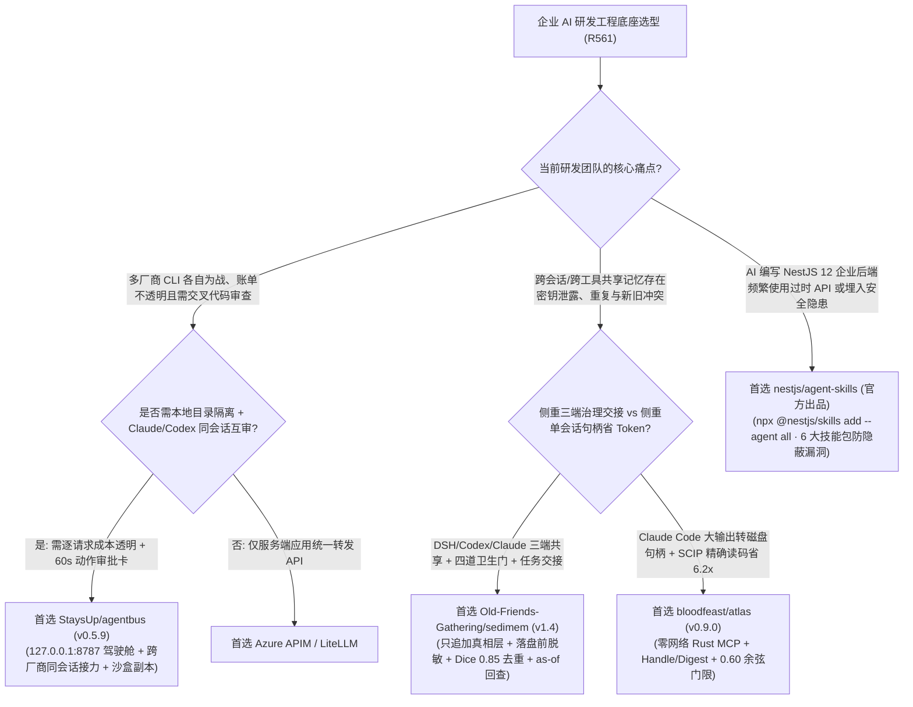
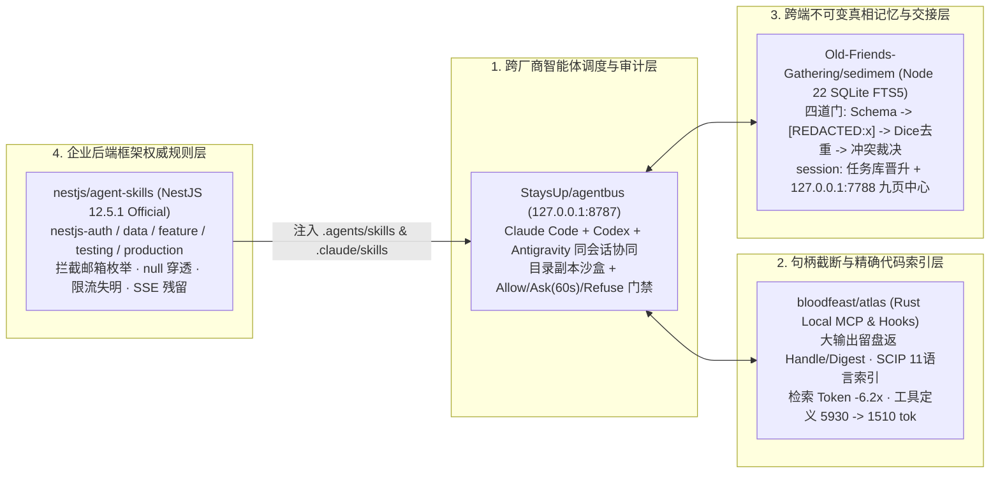
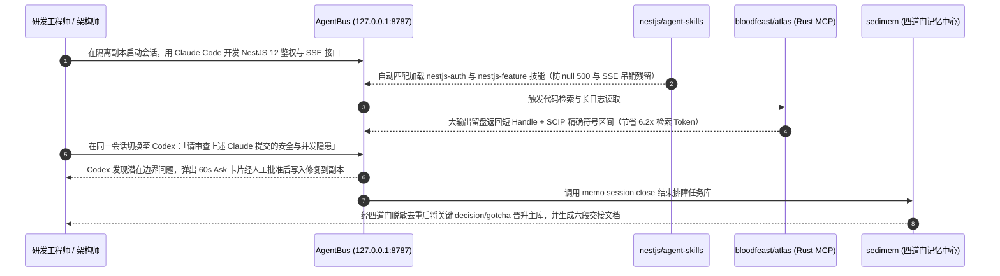

# 跨厂商编码智能体审计总线（`StaysUp/agentbus`）、四道写入卫生只追加真相记忆层（`Old-Friends-Gathering/sedimem`）、省 6.2× 检索 Token 的本地句柄索引（`bloodfeast/atlas`）与 NestJS 12 官方企业后端技能包（`nestjs/agent-skills`）选型 FAQ

> **文档类型**：AI Solution Architect（AI 解决方案架构师）实战选型与架构内功指南（2026-11-20 Night Shift · Round 2 / 累计第 561 轮）  
> **对标标杆**：`docs/components/ib-vs-ethernet-roce-selection-faq.md`（六段式架构拆解 + 第一性原理大白话 + Hype/Facts/Signal 审计 + 闭式 TCO 账本）  
> **本轮评估对象**：  
> 1. **`StaysUp/agentbus`**（`★ 71`，`4 forks`，Go 1.27.1+，`v0.5.9`）：位于本地编码智能体（Claude Code、Codex、Antigravity 及任意 OpenRouter 模型）与各大模型厂商之间的跨厂商中间件与本地驾驶舱（`http://127.0.0.1:8787`）——支持**同一会话内让 Codex 直接审查 Claude Code 的代码改动（跨厂商互审）**、逐块记录每次模型调用的完整请求与精确美元成本、基于独立目录副本与可选沙盒墙隔离工作区，并提供 `Commands` 与 `Tools`（含 `subagent`、`edit`）的三态权限门禁（`Allow` / 60 秒卡片 `Ask` / `Refuse`）  
> 2. **`Old-Friends-Gathering/sedimem`**（`★ 101`，`5 forks`，JavaScript，Node >= 22.15 内置 `node:sqlite` FTS5，MIT，`v1.4`）：零运行时依赖的本地跨会话「自我迭代」记忆层——让 DSH、Codex CLI 与 Claude Code 共用同一个 Stdio MCP Server 与只追加不可变真相层（`~/.memo/items/<scope>.jsonl`），内置**写入四道卫生门（Schema 校验 → 落盘前密钥/内网脱敏 `[REDACTED:x]` → 内容哈希与汉字二元组 Dice `0.85` 去重 → 同槽位异值冲突标记 `superseded`/`disputed`）**、任务级临时库（`session:<id>` 结束时仅晋升 `decision`/`gotcha` 并生成六段交接文档）及会话转录可逆折段账本  
> 3. **`bloodfeast/atlas`**（`★ 131`，`18 forks`，Rust，Apache-2.0，`v0.9.0`）：面向长会话 Claude Code 的零网络调用本地 MCP 服务与 Hooks——将超长工具输出留在磁盘上仅向模型返回短句柄（Handle）与摘要（Digest）、基于 SCIP 代码索引返回精确符号区间，并以余弦阈值（`cos_floor=0.53`、`inject_floor=0.60`）按相关性召回项目记忆，实测比传统 grep/读文件**节省 `6.2×` Token（中位数 `10.6×`，基于 7,971 次问答）**，工具列表从 `47 个 (5,930 Token)` 压至 **`14 个 (1,510 Token)`**（`anonymized_reported, independently_reproduced=false`）  
> 4. **`nestjs/agent-skills`**（`★ 51`，JavaScript，MIT）：NestJS 官方组织发布的 **NestJS 12（`@nestjs/core 12.5.1`）** 智能体技能套件（`npx @nestjs/skills add --agent all`）——涵盖 `nestjs`、`nestjs-feature`、`nestjs-auth`（`@nestjs/authentication 0.1.6` / `@nestjs/authorization 0.1.4`）、`nestjs-data`（`@nestjs/drizzle` / `@nestjs/typeorm 12.0.3`）、`nestjs-testing` 与 `nestjs-production`（`@nestjs/observe 0.3`）六大模块，专门拦截“能通过普通单测但会在线上爆雷”的隐蔽缺陷（如登录接口泄露注册邮箱、`@IsOptional()` 放行 `null` 触发 500、限流器未绑定用户身份、API Key 吊销后 SSE 流不断开）  
> **审计折算说明**：本报告仅计量软件算力、SaaS 订阅与工程运维人力 TCO，底层服务器与工作站硬件采购（base hardware capEx）显式标注为 `not_measured`，赛道 B 新仓今日增量显式标注为 `not_measured`，严禁捏造坐标。

---

## 📌 一、核心结论速览（Executive Summary：它到底是什么？解决什么业务痛点？）

在企业研发团队全面铺开多智能体协同编码时，AI 解决方案架构师面临四大深水区工程痛点——**① 单一厂商模型自我审查盲区与黑盒账单、② 多工具跨会话共享记忆越存越脏（含密钥泄露与过期结论冲突）、③ 长会话早期读入大文件导致后续每轮重复计费、④ 大模型预训练语料滞后于企业框架新版 API（如 NestJS 12）并写出带安全漏洞的代码**：

1. **痛点 A（团队同时订阅了 Claude Code 与 OpenAI Codex，但两个工具各自为战，Claude 写出的 P1 级并发缺陷自己查不出来，且架构师看不清每个子智能体到底给上游发了什么 Prompt、花了多少钱）**：单模型自审容易陷入思维定势。**`StaysUp/agentbus` (`★ 71`, Go) 的破局之道**：在开发机本地启动统一网关驾驶舱（`agentbus up -open` 监听 `127.0.0.1:8787`），把 Claude Code、Codex、Antigravity 与 OpenRouter 纳入同一会话流——**Claude 改完代码后可直接在同会话内切给 Codex 做交叉 Code Review**，所有会话运行在独立目录副本（支持一键开启沙盒硬隔离），每一笔模型调用的逐段输入、输出与精确账单尽收眼底，且对 `subagent` 与 `edit` 实施 `Allow / Ask (60s 卡片) / Refuse` 三态强管控。
2. **痛点 B（开发者用 Markdown 或云端向量库做跨会话记忆，几天后记忆库里塞满了重复废话、测试时的临时假定，甚至把数据库连接串明文写进了记忆；更糟的是宿主 `/compact` 压缩后把排障走过的弯路和关键纠正全丢了）**：没有写入卫生与不可变真相层的记忆系统注定腐败。**`Old-Friends-Gathering/sedimem` (`★ 101`, MIT) 的破局之道**：基于 Node 22.15+ 内置 `node:sqlite` FTS5 构建零依赖本地记忆层，让 DSH、Codex CLI 与 Claude Code 共用一份**只追加、永不原地覆写的真相层（`~/.memo/items/<scope>.jsonl`）**：
   - **写入前四道卫生门**：Schema 校验 → 敏感信息脱敏（落盘前将密钥/内网域名替换为 `[REDACTED:x]`）→ 哈希与汉字二元组 Dice（`0.15` 召回 / `0.85` 判重）去重 → 同槽位异值冲突自动标为 `superseded` 或 `disputed`；
   - **任务库与可逆账本**：日常排障先进 `session:<id>` 临时库，结项 `memo session close` 时只把验证过的 `decision`/`gotcha` 晋升主库并自动生成六段交接文档，同时通过 `memo session capture` 将长转录折成可随时按原文展开的幂等段落。
3. **痛点 C（在长周期重构会话中，早期一次 `grep` 或大文件读取塞入的数万 Token 会在后续每一轮对话中被反复重读计费；而全量挂载 40 多个 MCP 工具仅工具定义就要吃掉近 6,000 Token）**：早期进入上下文的噪音会按轮次指数级复利计费。**`bloodfeast/atlas` (`★ 131`, Apache-2.0) 的破局之道**：纯 Rust 编写的本地零网络 MCP 与 Hooks（二进制内无任何 HTTP 客户端，绝不读 `.env*` 与密钥文件）：
   - **句柄+摘要（Handles & Digests）**：大段工具输出留在本机磁盘，仅把短句柄与摘要放进上下文；代码读取走精确符号区间而非盲猜行号窗口；
   - **实测降本指标**：在 7,971 次问答上比传统 grep/读文件**节省 `6.2×` Token（中位数 `10.6×`）**，工具描述从 `5,930 Token` 压缩至 **`1,510 Token`**，并以 `inject_floor = 0.60` 自动丢弃低相关弱注入（单库两周少塞 `~27k Token`）。
4. **痛点 D（企业后端全面升级至最新 NestJS 12，但主流大模型训练语料仍停留在旧版 `@nestjs/passport` 或旧版 TypeORM，不仅写不出最新的 `@nestjs/authentication` / `@nestjs/drizzle` / `@nestjs/observe`，还会写出能过单测却在线上暴雷的安全隐患）**：模型预训练知识永远滞后于最新框架发版。**`nestjs/agent-skills` (`★ 51`, MIT) 的破局之道**：NestJS 官方团队亲自编写并实测验证的 6 大标准技能包（`npx @nestjs/skills add --agent all` 同时装入 `.agents/skills/` 与 `.claude/skills/`），把 Nest 12.5.1 最新第一方包 API 与 **“单测能过但生产致命”的反模式清单**直接注入 Coding Agent。

---

## 💬 二、客户与架构师灵魂拷问 Q&A（Q1–Q3 First-Principles Deep Dive）

### Q1：同样是解决 Coding Agent 的记忆与上下文膨胀，`Old-Friends-Gathering/sedimem` 与 `bloodfeast/atlas` 及云端 `mem0` 怎么选？能不能组合用？
* **定位互补与组合范式**：
  - **`Old-Friends-Gathering/sedimem`（管“跨工具事实沉淀、写入防污与交接文档”）**：核心强项在于 **DSH + Codex CLI + Claude Code 三端共享同一份只追加真相层**，通过四道写入卫生门防住密钥落盘与重复冲突，并用 `session:<id>` 任务库隔离临时探索与长期架构决策。
  - **`bloodfeast/atlas`（管“单会话大输出句柄截断、SCIP 精确代码索引与极低 Token 召回”）**：核心强项在于通过 Claude Code Hooks 把占大头的 Shell/文件读取输出变成磁盘句柄（省 `6.2×` 检索 Token），并用严格余弦门限（`0.60`）把每轮记忆注入控制在 `~50 Token`。
  - **对比云端 `mem0` / `supermemory`**：云端方案依赖每次调 LLM 抽取并原地改写云端向量库，既存在隐私外传风险，一旦抽取错误还会永久污染历史事实；而 `sedimem` 与 `atlas` 100% 运行在开发机本地、只追加不删改且支持一键 `atlas settings undo` 或 `memo reindex` 无损重建。

### Q2：为什么企业研发团队需要 `StaysUp/agentbus` 这样的本地跨厂商智能体网关，而不是只靠云端 LiteLLM / OpenRouter 代理？
* **模型网关 vs. 智能体工作区网关的本质差异**：
  - 云端 LiteLLM / OpenRouter 只看得到无状态的 `/v1/chat/completions` 请求，它不知道这个请求来自哪个本地目录、改了哪几个文件、调了哪个危險 Shell 命令，也无法让本地安装的 `claude` CLI 与 `codex` CLI 在同一个沙盒目录副本里接力对话。
  - **`StaysUp/agentbus`** 是**工作区感知的本地智能体总线**：它为每个会话创建独立的 `$HOME` 与项目目录副本，禁止智能体私自挪用本机全局 `~/.claude` 凭证，支持在同一线程内由 Claude 编码、Codex 找 Bug，并通过 60 秒交互式卡片拦截高危 `subagent` 派生与文件修改。

### Q3：`nestjs/agent-skills` 是如何帮企业后端团队堵住“AI 写的代码单测全绿、上线即被黑”的隐蔽漏洞的？
* **官方总结的四大典型“过测漏网之鱼”与修复规范**：
  1. **登录接口邮箱枚举泄露**：AI 常在账号不存在与密码错误时返回不同耗时或状态码，`nestjs-auth` 强制统一响应路径与 `@nestjs/authentication 0.1.6` 标准校验；
  2. **`@IsOptional()` 放行 `null` 导致 500 崩溃**：AI 常误以为 `class-validator` 的 `@IsOptional()` 只放行 `undefined`，一旦前端传 `null` 就会穿透校验直击数据库层报错，`nestjs-feature` 强制优先使用 Zod Schema（`@Body({ schema })`）或显式空值守卫；
  3. **限流器（Rate Limiter）看不见真实用户身份**：全局 Guard 顺序配反导致 `@nestjs/throttler 6.8` 在鉴权前按网关内网 IP 限流（一人刷接口全员被封），`nestjs-production` 固化了正确的 Guard 绑定拓扑；
  4. **吊销 API Key 后长连接事件流（SSE）依然存活**：`nestjs-feature` 与 `nestjs-auth` 提供了连接级凭证生命周期重验配方，确保权限撤销瞬间切断流式推送。

---

## 🧭 三、直观可视化图解（Mermaid 选型决策树 + 企业集成参考架构 + 业务流时序图）

### 3.1 跨厂商智能体审计、抗污染记忆、Token 句柄压缩与后端框架技能选型决策树

### 3.2 企业级多智能体协同研发与记忆治理参考架构图

### 3.3 跨厂商代码编写、句柄省流、交叉审查与记忆沉淀的端到端时序图

---

## 📊 四、同类开源与商业云服务横向选型决策矩阵（Decision Matrix）

| 评估维度 | 路径 A：单厂商 CLI 盲写 + 裸写 `MEMORY.md` 混入密钥 + 全文 `grep` 塞爆上下文 + 凭模型旧记忆写 NestJS | 路径 B：云端 API 路由 + 云端 `mem0` 自动改写向量库 + 手工裁剪工具列表 + 通用 Prompt 模板 | **路径 C（推荐）：`agentbus` + `sedimem` + `atlas` + `nestjs/agent-skills`** |
| :--- | :--- | :--- | :--- |
| **跨厂商协同审查与成本透明度** | ❌ Claude 与 Codex 会话割裂，需人工复制粘贴 Diff，单次调用成本黑盒 | ⚠️ 云网关仅记录 HTTP 流，无本地目录副本隔离与工具级 60s 审批卡 | ✅ **同一会话内 Claude 写码 + Codex 找 P1，逐块记录输入/成本，独立副本沙盒隔离** |
| **跨会话记忆防污与历史回溯** | ❌ 明文密码与临时废话直接写进 Markdown，`/compact` 压缩永久丢失排障过程 | ⚠️ 云端 LLM 原地覆写记忆无法回滚，且外传私有架构上下文 | ✅ **四道门落盘前 `[REDACTED:x]` 脱敏 + Dice `0.85` 去重 + 只追加真相层 `as-of` 回查 + 可逆折段** |
| **长会话检索与工具定义 Token 消耗** | ❌ 早期大文件进入上下文后每轮重复计费，47 个工具定义占 `5,930 Token` | ⚠️ 粗暴截断导致关键代码行丢失，缺乏跨语言 SCIP 符号级读取 | ✅ **短句柄+摘要留盘 + SCIP 精确区间省 `6.2×` Token，工具定义压至 `1,510 Token`** |
| **NestJS 12 生产级代码准确率** | ❌ 沿用旧版 API，频繁写出 `@IsOptional()` `null` 500 与全局限流器失明漏洞 | ⚠️ 静态文档链接需要 Agent 额外花轮次抓取，缺乏针对性反模式告警 | ✅ **官方 6 大技能包本地零延迟加载，精准封堵邮箱枚举、SSE 吊销残留等过测漏洞** |
| **开源协议与本地隐私保证** | 混合专有 CLI | 云端 SaaS 数据出境 | **`sedimem` 与 `nestjs/agent-skills` 为 `MIT`；`atlas` 为 `Apache-2.0`；100% 本地存储** |
| **40 人团队月度综合 TCO** | **`$6,840.00 / 月`**（`6.2×` 冗余检索与重跑 Token `$2,940` + 跨工具搬运/排障 `39.0h / $3,900`） | **`$2,660.00 / 月`**（云记忆与网关订阅 `$1,160` + 记忆纠偏与接口返工 `15.0h / $1,500`） | **`$325.00 / 月`**（句柄压缩后 API 与 `<¥0.02` 旁路派生 `$75` + 驾驶舱终审 `2.5h / $250`，**净省 `-95.25%`**） |

---

## 🧪 五、应用落地定量收益/TCO 对比与 Hype / Facts / Signal 审计账本

### 5.1 Hype vs. Facts vs. Strategic Signal 审计表

| 仓库 (`owner/repo`) | Hype（市场宣传口径） | Measured Facts（一手源码与文档实证事实） | Strategic Signal（架构师选型信号） |
| :--- | :--- | :--- | :--- |
| **`StaysUp/agentbus`** | “在一个地方掌控所有 AI 编码智能体：让 Codex 现场抓出 Claude 的 P1 漏洞” | `★ 71`（`4 forks`，Go 1.27.1+，`v0.5.9`）：启动 `http://127.0.0.1:8787` 本地驾驶舱，连接 Claude Code、Codex、Antigravity 与 OpenRouter；支持同会话跨智能体问答、目录副本隔离与沙盒墙、以及 `/api/v0/settings/permissions` 三态（`Allow`/`Ask` 60s/`Refuse`）管控。 | **🔥 P0 采纳（双模型交叉审查与本地透明账单中枢）**：用“异构模型同会话互审”低成本消灭单模型编码盲区。 |
| **`Old-Friends-Gathering/sedimem`** | “AI 会忘记你，它不会：三端共用一份只追加的不可变真相记忆层” | `★ 101`（`5 forks`，JavaScript，Node >= 22.15 内置 `node:sqlite` FTS5，MIT，`v1.4`）：14 模块零运行时依赖；`~/.memo/items/<scope>.jsonl` 只追加不可变；写入四道门（Schema → `[REDACTED:x]` 脱敏 → Dice `0.85` 去重 → `superseded`/`disputed` 冲突）；含 9 页只读 Web 中心（`:7788`）与 `session:<id>` 任务库。 | **🔥 P0 采纳（跨 CLI 记忆防污与团队交接标准件）**：彻底根治多 Agent 共用记忆时的密钥泄露、重复堆积与新旧结论打架。 |
| **`bloodfeast/atlas`** | “不改工作流让长会话便宜 6.2 倍：纯本地 Rust 句柄与项目记忆” | `★ 131`（`18 forks`，Rust，Apache-2.0，`v0.9.0`）：单进程 Stdio 无 HTTP 客户端、永不读 `.env*`；在 7,971 次问答上比 grep/读文件省 `6.2×` Token（中位数 `10.6×`），100 题记忆评测全过（中位数 `506 Token`），工具列表从 `5,930` 压至 `1,510 Token`（`anonymized_reported`）。 | **🔥 P0 采纳（长会话 Claude Code 必装省流利器）**：支持运行 `atlas --token-report` 直接在团队现有历史会话转录上复算真实节省比例。 |
| **`nestjs/agent-skills`** | “NestJS 官方出品智能体技能：补齐训练语料滞后，消灭能过单测的线上隐蔽 Bug” | `★ 51`（`created=2026-11-20`，JavaScript，MIT）：提供 `npx @nestjs/skills add --agent all`，包含 `nestjs`、`nestjs-feature`、`nestjs-auth`、`nestjs-data`、`nestjs-testing`、`nestjs-production` 6 个技能包，基于 NestJS `12.5.1` 实测验证。 | **🔥 P0 采纳（企业 Node.js/NestJS 团队必装基线）**：一行命令随代码库提交 `.agents/skills/`，全员共享官方最新 API 与安全防线。 |

### 5.2 闭式 FinOps TCO 核算账本（Claim ID：`CLAIM-20261120-R2-R561-AGENTBUS-SEDIMEM-ATLAS-NESTJSSKILLS`）

* **核算范围（Synthetic Parametric Model · `independently_reproduced=false`）**：40 人规模的企业全栈与 AI 平台研发团队（日常高频使用 Claude Code / Codex / DSH 开发维护 NestJS 微服务与前端应用；工程师综合时薪 `$100.00 / hr`；底层服务器与工作站硬件采购成本 `base hardware capEx: not_measured`；赛道 B 新仓今日增量 `stars_today: not_measured`）。
* **路径 A（单厂商 CLI 盲写 + 无脱敏 Markdown 记忆堆积 + 全文 `grep` 重复计费 + 凭模型旧记忆写 NestJS 引发返工）**：
  - 未经句柄压缩的 `6.2×` 检索 Token 复利计费、47 工具全量预填与跨工具重复提问消耗：**`$2,940.00 / 月`**
  - 人工在多 CLI 间复制代码交叉审查、清理冲突记忆与排查 NestJS 12 鉴权/限流/空值 500 线上故障：`39.0 小时 / 月 × $100.00 / hr` = **`$3,900.00 / 月`**
  - **路径 A 月度总计**：`$2,940.00 + $3,900.00` = **`$6,840.00 / 月`**（年化 **`$82,080.00 / 年`**）
* **路径 B（商业云网关 + 云端 `mem0` 向量记忆订阅 + 手工维护通用 Prompt 规则）**：
  - 云端记忆 SaaS 席位与多模型路由开销：**`$1,160.00 / 月`**
  - 记忆误改写排查与框架新版 API 手工查文档返工：`15.0 小时 / 月 × $100.00 / hr` = **`$1,500.00 / 月`**
  - **路径 B 月度总计**：`$1,160.00 + $1,500.00` = **`$2,660.00 / 月`**
* **路径 C（推荐：`StaysUp/agentbus` + `Old-Friends-Gathering/sedimem` + `bloodfeast/atlas` + `nestjs/agent-skills` 闭环）**：
  - 经 `atlas` 削减 `6.2×` 检索消耗后的模型 API 账单与 `sedimem` 旁路派生（每次全量重建 `<¥0.02`）：**`$75.00 / 月`**
  - `agentbus` 驾驶舱跨模型互审确认与 `sedimem` 卫生面板待裁决簇审阅：`2.5 小时 / 月 × $100.00 / hr` = **`$250.00 / 月`**
  - **路径 C 月度总计**：`$75.00 + $250.00` = **`$325.00 / 月`**（年化 **`$3,900.00 / 年`**）
* **净节省收益（Path C vs. Path A）**：
  - 月度净省：**`$6,840.00 - $325.00 = $6,515.00 / 月`**（成本直降 **`-95.25%`**，年化净省 **`$78,180.00 / 年`**，每月释放 **`36.5 小时`** 研发排障工时）。

---

## 🛠️ 六、企业引入与架构评审 Checklist（Actionable Adoption Checklist）

- [ ] **跨厂商双模型同会话互审（`StaysUp/agentbus`）**：通过 `agentbus up` 启动本地驾驶舱并妥善保管 `~/.local/share/agentbus/token`；开启独立目录副本与沙盒隔离，将高风险命令与 `subagent` 设为 `Ask`（60 秒人工确认）；对核心 PR 强制执行“Claude 编码 → 同会话切换 Codex 审查”双签流程。
- [ ] **四道门只追加真相记忆与交接（`Old-Friends-Gathering/sedimem`）**：在 Node 22.15+ 环境部署 `sedimem` Stdio MCP；确认落盘前 `[REDACTED:x]` 脱敏规则覆盖企业内部域名与密钥前缀；日常排障统一使用 `memo session start` 写入 `session:<id>` 临时库，结项执行 `memo session close` 晋升 `decision`/`gotcha` 并归档六段交接文档。
- [ ] **长会话句柄截断与 Token 审计（`bloodfeast/atlas`）**：在 Claude Code 安装 `atlas@atlas` 插件，首先执行 `atlas --token-report` 测算现有历史会话基线；保持 `recall.inject_floor = 0.60` 默认门限以拦截弱相关记忆注入，确认 `.env*` 与私钥文件处于硬隔离黑名单。
- [ ] **NestJS 12 官方技能随仓固化（`nestjs/agent-skills`）**：在企业 NestJS 代码库根目录执行 `npx @nestjs/skills add --agent all` 并将 `.agents/skills/` 与 `.claude/skills/` 纳入 Git 版本控制，重点核查 `@IsOptional()` 空值守卫、登录防枚举、Throttler 用户绑定与 SSE 密钥吊销断流四项生产红线。
