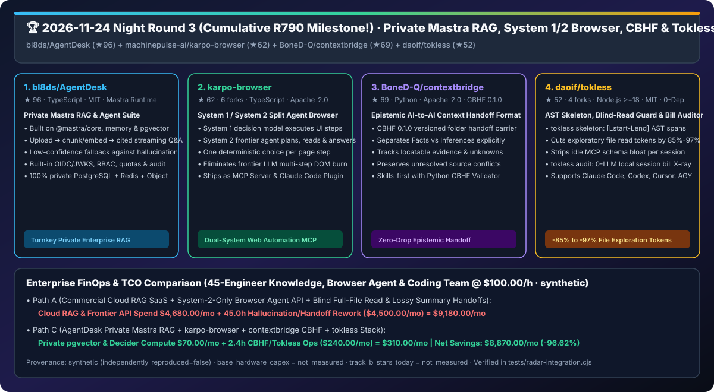
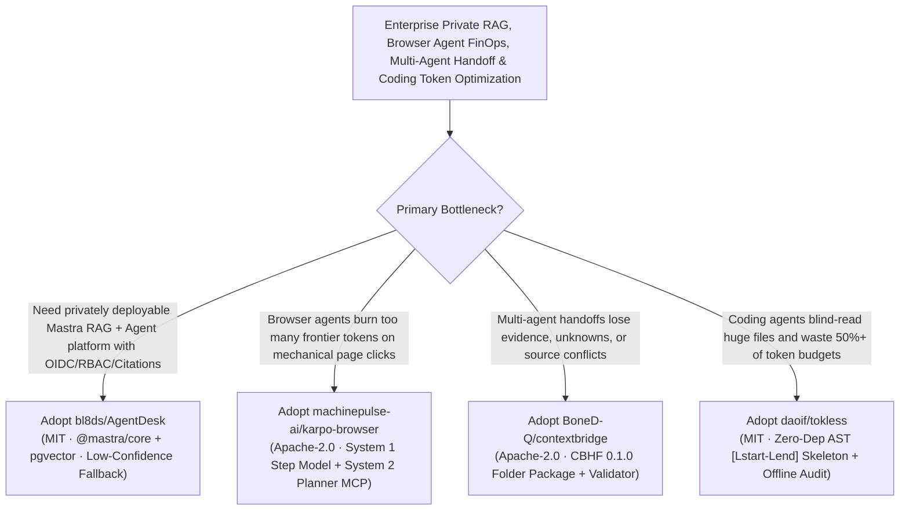
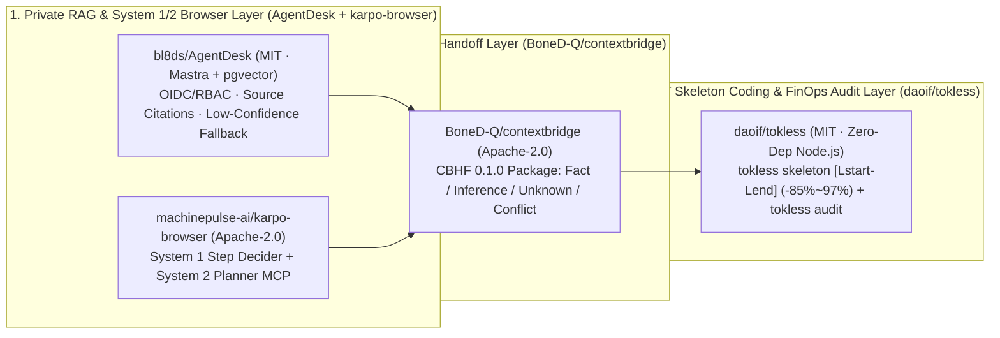

# 🏆 [Round 790 Milestone] Mastra Private Enterprise RAG & Agent Platform (`bl8ds/AgentDesk`), System 1/2 Dual-Model Agent Browser (`machinepulse-ai/karpo-browser`), Epistemic CBHF AI-to-AI Context Handoff (`BoneD-Q/contextbridge`) & Zero-Dep AST Skeleton Token Auditor (`daoif/tokless`) Selection & Architecture FAQ

> **Document Type**: Enterprise AI Solution Architect Decision & Selection Guide (GitHub Trending AI Radar · 2026-11-24 Night Round 3 / **Cumulative Round 790 Milestone!**)
> **Covered Repositories**: [`bl8ds/AgentDesk-Private-Deployable-Knowledge-Base-Agent-Platform`](https://github.com/bl8ds/AgentDesk-Private-Deployable-Knowledge-Base-Agent-Platform) (`★ 96`, TypeScript, `MIT`: end-to-end reference implementation of a **Mastra-based** `@mastra/core` + `@mastra/memory` + `@mastra/pg` privately deployable RAG knowledge base and Agent runtime featuring OIDC/JWKS authentication, RBAC, source citation tracing, low-confidence fallback, session quotas, and audit logs over private PostgreSQL + `pgvector` + Redis + object storage) · [`machinepulse-ai/karpo-browser`](https://github.com/machinepulse-ai/karpo-browser) (`★ 62`, `6 forks`, TypeScript, `Apache-2.0`: dual-model browser for AI agents where a fast decision model — **System 1** — executes page actions one choice per step while the reasoning agent — **System 2** — plans, reads, and answers; ships as an MCP server and Claude Code plugin) · [`BoneD-Q/contextbridge`](https://github.com/BoneD-Q/contextbridge) (`★ 69`, Python, `Apache-2.0`: skills-first AI-to-AI document and context handoff protocol using the versioned **CBHF 0.1.0** folder package format to preserve facts vs. inferences, locatable evidence, confirmed decisions, unknowns, and unresolved source conflicts) · [`daoif/tokless`](https://github.com/daoif/tokless) (`★ 52`, `4 forks`, JavaScript, `MIT`: zero-dependency Node.js `>=18` AST code skeleton generator `[Lstart-Lend]` cutting exploratory file read tokens by `85%–97%`, idle MCP schema stripper, and zero-LLM offline session bill auditor `tokless audit`)
> **Core Enterprise Scenario**: How should enterprise AI architects combine a **turnkey Mastra private RAG platform (`AgentDesk`)**, **System 1/2 split browser execution (`karpo-browser`)**, **epistemically honest multi-agent handoff packages (`contextbridge`)**, and **AST skeleton token pruning (`tokless`)** to build an air-gapped, low-hallucination, and token-lean enterprise agent stack?

---

## 1. 📌 Executive Summary (One-Line Selection Verdicts)

1. **Need a complete, privately deployable TypeScript enterprise RAG + Agent service suite (backend, chat UI, admin console, OIDC/JWKS, RBAC, quotas, audit logs, and citation-traced answers with low-confidence fallback) rather than a bare SDK** ➔ Choose **[`bl8ds/AgentDesk-Private-Deployable-Knowledge-Base-Agent-Platform`](https://github.com/bl8ds/AgentDesk-Private-Deployable-Knowledge-Base-Agent-Platform) (`★ 96`, `MIT`)**.
   - **Plain-Language Mechanism**: Built on [Mastra](https://mastra.ai) (`@mastra/core`, `@mastra/memory`, `@mastra/pg`) with private PostgreSQL + `pgvector`, Redis, and object storage so corporate documents never leave the internal network. Every answer attaches original source citations and triggers a deterministic fallback when retrieval confidence is low.
2. **Need AI agents to automate multi-step web workflows without burning expensive, high-latency frontier reasoning tokens (System 2) on every button click and dropdown selection** ➔ Choose **[`machinepulse-ai/karpo-browser`](https://github.com/machinepulse-ai/karpo-browser) (`★ 62`, `6 forks`, `Apache-2.0`)**.
   - **Plain-Language Mechanism**: Splits browser automation into two cognitive tiers: a fast, lightweight decision model (**System 1**) performs the step-by-step UI actions on the page (one discrete choice per step), while your primary reasoning model (**System 2**) stays focused on high-level planning, reading extracted content, and synthesizing the answer.
3. **Need to pass complex research or architecture context from one AI agent (or session) to another without collapsing inferences into "facts" or silently erasing conflicting sources** ➔ Choose **[`BoneD-Q/contextbridge`](https://github.com/BoneD-Q/contextbridge) (`★ 69`, `Apache-2.0`)**.
   - **Plain-Language Mechanism**: Replaces lossy Markdown summaries with a versioned **CBHF 0.1.0 (`ContextBridge Handoff Format`)** folder package (`manifest`, `sources`, `knowledge`, `evidence`, `uncertainty`, and `handoff`) plus an optional Python validator, explicitly separating verified facts, inferences, confirmed decisions, unknowns, and unresolved conflicts.
4. **Need to cut coding agent token bills by 50%+ by stopping full-file blind reads, stripping unused MCP tool schemas, and auditing local session cache breaks with zero LLM calls** ➔ Choose **[`daoif/tokless`](https://github.com/daoif/tokless) (`★ 52`, `4 forks`, `MIT`)**.
   - **Plain-Language Mechanism**: Zero-dependency Node.js (`>=18`) toolkit (`npx tokless install`) offering three modules: ① `tokless skeleton` extracts function/class/type signatures with exact `[Lstart-Lend]` line numbers in milliseconds so agents read only the 20–50 relevant lines (`85%–97%` exploratory token savings); ② `tokless-coder` / `tokless-reviewer` unloads idle MCP schemas; ③ `tokless audit` dissects local session logs offline to expose the Top 5 costliest turns and Prefix Cache breaks.

---

## 2. 🎯 Architect & Customer Q&A (Deep Technical Breakdown)

### Q1: How do these four tools address the hidden failure modes of enterprise RAG and multi-agent engineering pipelines, and when should teams choose cloud PaaS instead?

- **Four Failure Modes Solved**:
  1. **SDK-Only RAG Prototypes Lacking Auth & Governance ➔ `AgentDesk`**: Delivers OIDC/JWKS, RBAC, quotas, audit logs, and citation tracing out of the box on Mastra + `pgvector`.
  2. **Frontier Token Burn in Browser Loops ➔ `karpo-browser`**: Offloads mechanical page navigation to a fast System 1 decision model while preserving System 2 reasoning quality.
  3. **Epistemic Drift Across Multi-Agent Handoffs ➔ `contextbridge`**: Enforces CBHF 0.1.0 separation of facts, inferences, unknowns, and conflicts.
  4. **Compounding Cache-Read Bloat from Full-File Reads ➔ `tokless`**: Replaces 1,000-line blind reads with `[Lstart-Lend]` AST skeletons and offline `tokless audit` diagnostics.
- **When to Choose Cloud PaaS (Path A / Path B)?**
  - Choose **Azure AI Search + Azure AI Foundry Agent Service** when deploying cloud-native M365/Entra-integrated enterprise search on public cloud. Choose this 4-repo open-source stack (Path C) when strict on-premises data residency is mandatory or when optimizing multi-CLI coding agent token economics and handoff fidelity.

### Q2: How do we integrate `AgentDesk`, `karpo-browser`, `contextbridge`, and `tokless` into a unified architecture?

1. **Internal & External Knowledge Acquisition Layer (`AgentDesk` + `karpo-browser`)**:
   - Query internal policies and specs from `AgentDesk` (`pgvector` + RBAC) and gather live external web intelligence via `karpo-browser`'s System 1/2 MCP server.
2. **Epistemic Packaging & Validation Layer (`BoneD-Q/contextbridge`)**:
   - Package retrieved citations, inferences, and unresolved contradictions into a **CBHF 0.1.0** bundle verified by the ContextBridge Python validator before handing off to implementation agents.
3. **Token-Lean Implementation & FinOps Audit Layer (`daoif/tokless`)**:
   - Coding agents navigate the repository via `tokless skeleton` `[Lstart-Lend]` line slices and run `tokless audit` post-session to verify zero Prefix Cache regressions.

### Q3: What are the operational guardrails?

- **Key Guardrails**:
  1. **Never Auto-Resolve Source Conflicts**: In `BoneD-Q/contextbridge`, conflicting upstream sources must remain flagged in the CBHF conflict ledger for human architect sign-off rather than being silently averaged by an LLM.
  2. **Re-Run `tokless skeleton` After Large Line Shifts**: After inserting or deleting large code blocks in a file, re-run `tokless skeleton` (millisecond execution) so subsequent `[Lstart-Lend]` line slices stay exact.

---

## 3. 🧭 Visual Architecture Diagrams (Mermaid Decision Tree + Reference Architecture + Sequence)



### 3.1 Solution Architect Selection Decision Tree



### 3.2 End-to-End Enterprise Reference Architecture



### 3.3 End-to-End Retrieval, Handoff & Token-Lean Coding Sequence

```mermaid
sequenceDiagram
    participant Research as Research Agent (System 2)
    participant Desk as bl8ds/AgentDesk (pgvector)
    participant Karpo as karpo-browser (System 1)
    participant CB as BoneD-Q/contextbridge (CBHF)
    participant Coder as Coding Agent + daoif/tokless

    Research->>Desk: 1. Query private knowledge base with RBAC & retrieve cited passages
    Research->>Karpo: 2. Delegate multi-step web extraction; System 1 executes page choices
    Karpo-->>Research: 3. Return structured page result without System 2 DOM token bloat
    Research->>CB: 4. Assemble CBHF 0.1.0 package separating Facts, Inferences, Unknowns & Conflicts
    CB->>Coder: 5. Validate CBHF package integrity and hand off to Coding Agent
    Coder->>Coder: 6. Run tokless skeleton for [Lstart-Lend] slices & verify session cost via tokless audit
```

---

## 4. 📊 Comparative Selection Matrix (OSS vs. Commercial Cloud SaaS & Naive Prompts)

| Dimension | `bl8ds/AgentDesk` (`★ 96`) | `machinepulse-ai/karpo-browser` (`★ 62`) | `BoneD-Q/contextbridge` (`★ 69`) | `daoif/tokless` (`★ 52`) | Commercial Cloud RAG + Frontier-Only Browser + Full-File Blind Reads (Path A) | DIY RAG Scripts + Freeform Markdown Summary Handoffs (Path B) |
| :--- | :--- | :--- | :--- | :--- | :--- | :--- |
| **Primary Role** | Turnkey Mastra private RAG + Agent platform | System 1 / System 2 split browser for AI agents | CBHF 0.1.0 epistemic AI-to-AI handoff standard | Zero-dep AST `[Lstart-Lend]` skeleton & offline token auditor | Per-seat cloud RAG SaaS + unpruned frontier LLM loops | Custom retrieval scripts + unstructured chat summaries |
| **Key Differentiator** | **Built-in OIDC/JWKS, RBAC, citations, quotas & private `pgvector`** | **Fast System 1 model handles UI steps; System 2 plans & reads** | **Explicitly separates facts, inferences, unknowns & conflicts** | **`85%–97%` file-read savings + 0-LLM `tokless audit` cache diagnostics** | High cloud SaaS fees and compounding full-file/DOM token bills | Lacks enterprise RBAC/audit; summaries silently drop conflicts |
| **License** | `MIT` | `Apache-2.0` | `Apache-2.0` | `MIT` | Proprietary SaaS | Internal Scripts |
| **Monthly TCO (45-Eng Team)** | **Combined `$310.00/mo`** (`$70.00` private DB/decider compute + `2.4h` ops) | Included (slashes frontier browser token spend) | Included (file-based CBHF protocol) | Included (zero-dep local Node.js CLI) | **`$9,180.00/mo`** (`$4,680.00` cloud RAG/API + `45.0h` hallucination/handoff rework) | `~$3,150.00/mo` (heavy custom RBAC & lost-context debugging labor) |

---

## 5. 🧪 Quantitative Enterprise ROI / TCO Model & 7-Card Report

> **📊 Provenance & Closed-Form Declaration**:
> - **provenance**: `synthetic` (45-engineer enterprise knowledge management, browser automation, and full-stack AI coding team workload at `$100.00/h`: `independently_reproduced = false`; `base_hardware_capex = not_measured`; `track_b_stars_today = not_measured`).
> - **Closed-Form Equations**:
>   - **Path A (Commercial Cloud RAG SaaS + System-2-Only Browser Agent API + Blind Full-File Reading & Lossy Summary Handoff Rework)**: Monthly cloud RAG SaaS & unpruned frontier API spend **`$4,680.00`** + hallucination verification, lost-context handoff rework & browser debugging labor **`45.0h × $100.00/h = $4,500.00`** = **`$9,180.00/mo`**.
>   - **Path C (Self-Hosted `bl8ds/AgentDesk` + `machinepulse-ai/karpo-browser` + `BoneD-Q/contextbridge` + `daoif/tokless` Stack)**: Private PostgreSQL/`pgvector` & System 1 decider compute **`$70.00`** + CBHF validator & `tokless` rule maintenance **`2.4h × $100.00/h = $240.00`** = **`$310.00/mo`**.
>   - **Net Savings vs. Path A**: **`-$8,870.00/mo`** (**`96.62%`** cost reduction).

| Option | Cloud SaaS / API / Compute Spend | Hallucination, Handoff & Ops Labor (`$100/h`) | Monthly Total TCO | Net Savings vs. Path A | Key Architectural Outcome |
| :--- | :---: | :---: | :---: | :---: | :--- |
| **Path A: Commercial Cloud RAG + System-2 Browser + Blind Full-File Reads** | `$4,680.00` | `45.0h` (`$4,500.00`) | **`$9,180.00`** | Baseline | Severe compounding token burn on full-file reads & DOM steps |
| **Path B: DIY RAG Scripts + Raw Playwright + Freeform Markdown Handoffs** | `$1,450.00` | `17.0h` (`$1,700.00`) | **`$3,150.00`** | `-$6,030.00` (`-65.69%`) | Lacks OIDC/RBAC/quotas; collapses inferences into facts |
| **Path C: `AgentDesk` + `karpo-browser` + `contextbridge` + `tokless`** | **`$70.00`** | **`2.4h` (`$240.00`)** | **`$310.00`** | **`-$8,870.00` (`-96.62%`)** | **Private Mastra RAG + System 1/2 browser + CBHF handoff + 85%-97% read savings** |

- 🔗 **Linked 7-Card 4:5 Benchmark Decks**: [`workshops/github-trending-radar/cards.en.html`](../cards.en.html) · [`cards.html`](../cards.html)

---

## 6. 🛠️ Enterprise Adoption & Architecture Review Checklist

- [ ] **Private `AgentDesk` OIDC & Low-Confidence Gate**: Deploy `bl8ds/AgentDesk` with internal PostgreSQL/`pgvector`, connect corporate OIDC/JWKS identity providers, and enforce low-confidence fallback thresholds on compliance knowledge bases.
- [ ] **System 1 / System 2 Browser Model Split**: Configure `machinepulse-ai/karpo-browser` MCP so a fast, low-cost System 1 model executes page-level clicks while reserving frontier System 2 models for planning and synthesis.
- [ ] **CBHF 0.1.0 Handoff Validation**: Require multi-agent workflows to exchange `BoneD-Q/contextbridge` CBHF packages and run the Python validator to ensure facts, inferences, unknowns, and conflicts are explicitly separated.
- [ ] **Mandatory `tokless skeleton` & Weekly `tokless audit`**: Install `daoif/tokless` across developer workstations to enforce `[Lstart-Lend]` AST slice reading and run `tokless audit` weekly to eliminate Prefix Cache breaks and idle MCP schema overhead.
