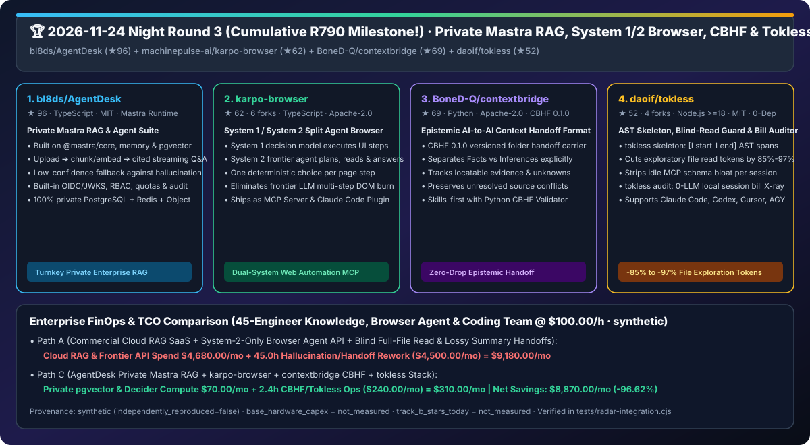
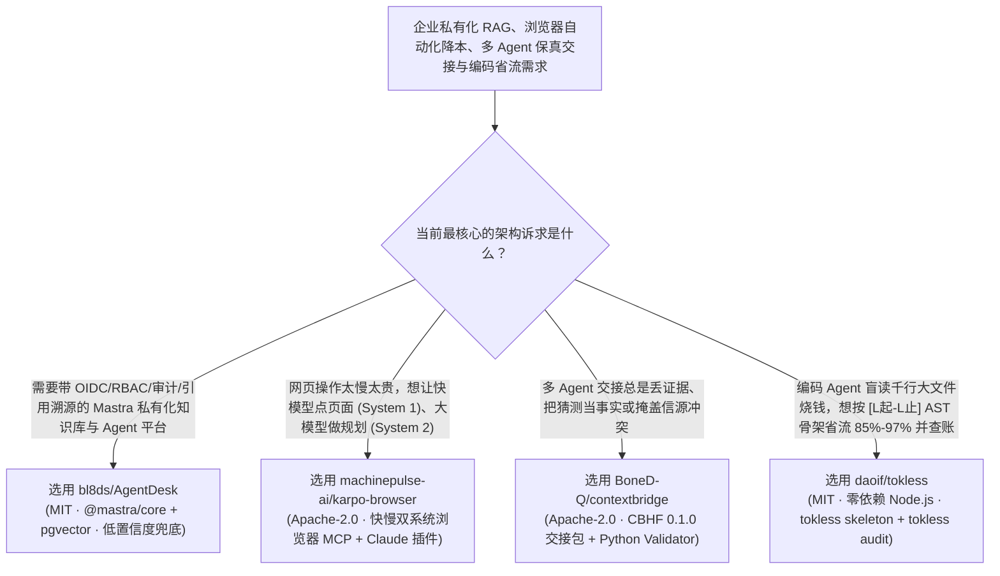
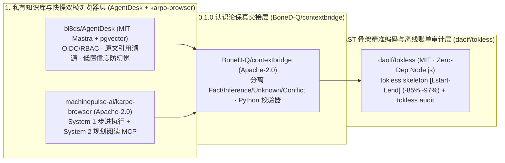
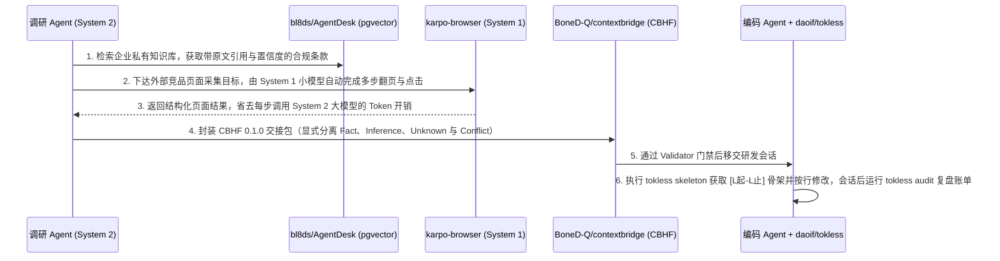

# 🏆【第 790 轮里程碑】基于 Mastra 的私有化企业知识库与 Agent 平台（`bl8ds/AgentDesk`）、System 1/2 双模型分工浏览器 Agent（`machinepulse-ai/karpo-browser`）、防证据丢失的 CBHF 跨 Agent 交接协议（`BoneD-Q/contextbridge`）与零依赖 AST 代码骨架省流审计器（`daoif/tokless`）选型与集成架构 FAQ

> **文档类型**：企业 AI 解决方案架构师（AI Solution Architect）选型决策指南（GitHub Trending AI 雷达 2026-11-24 Night Round 3 / **累计第 790 轮里程碑**）
> **覆盖项目**：[`bl8ds/AgentDesk-Private-Deployable-Knowledge-Base-Agent-Platform`](https://github.com/bl8ds/AgentDesk-Private-Deployable-Knowledge-Base-Agent-Platform)（`★ 96`、`MIT`，基于 TypeScript `@mastra/core` + `@mastra/memory` + `@mastra/pg` 构建的开箱即用企业私有化 RAG 知识库与 Agent 运行时平台，内置 OIDC/JWKS 单点登录、RBAC 权限、原文引用溯源、低置信度拒答兜底、配额与审计日志）· [`machinepulse-ai/karpo-browser`](https://github.com/machinepulse-ai/karpo-browser)（`★ 62`、`6 forks`、`Apache-2.0`，首创 **System 1 决策小模型点按页面 + System 2 主智能体规划与阅读** 双模型解耦架构的 AI 浏览器，支持 MCP Server 与 Claude Code 插件）· [`BoneD-Q/contextbridge`](https://github.com/BoneD-Q/contextbridge)（`★ 69`、`Apache-2.0`，基于版本化共享文件夹包格式 **CBHF 0.1.0** 的 Skills-First 跨 Agent 文档与上下文交接协议，严格区分事实 vs 推断、保留可定位证据、未解未知项与冲突源）· [`daoif/tokless`](https://github.com/daoif/tokless)（`★ 52`、`4 forks`、`MIT`，纯 Node.js `>=18` 零外部依赖的编码 Agent 防盲读省流与离线账单透视套件，通过 `tokless skeleton` 提取 `[L起-L止]` 行号骨架使探索期单文件省流 **85%–97%**，并提供 `tokless audit` 0-LLM 会话账单黑洞解剖）
> **核心场景**：当企业构建私有化知识问答与多智能体研发协同流水线时，如何同时解决**“散装 RAG SDK 缺少企业级 OIDC/RBAC/审计与低置信度防幻觉兜底、用昂贵前沿推理模型直接逐步点按网页既慢又烧钱、A 智能体把长篇总结传给 B 智能体时把‘猜测’当成‘事实’且丢掉冲突证据、以及编码 Agent 动辄盲读上千行大文件引发 Cache Read 复利爆表”**四大架构痛点？

---

## 一、📌 核心结论速览（选型一句话结论）

1. **想在内网私有化部署一套自带管理后台、终端对话界面、OIDC/JWKS 认证、RBAC、配额审计与低置信度防幻觉引用的 TypeScript 企业级 RAG + Agent 生产套件** ➔ 选 **[`bl8ds/AgentDesk-Private-Deployable-Knowledge-Base-Agent-Platform`](https://github.com/bl8ds/AgentDesk-Private-Deployable-Knowledge-Base-Agent-Platform)（`★ 96`，`MIT`）**。
   - **通俗原理**：不同于只给底层类的半成品 SDK，`AgentDesk` 基于成熟的 **Mastra** 框架（`@mastra/core`、`@mastra/memory`、`@mastra/pg`）提供了完整的五层工程交付（业务后端、用户端对话页、管理控制台、Agent 运行时与私有化编排）。底层 PostgreSQL + `pgvector`、Redis 与对象存储 100% 部署在企业内网；每条回答强制附带知识库原文引用，且在检索置信度过低时自动触发安全兜底而非胡编乱造。
2. **想让智能体操作网页完成多步表单流转与信息采集，但拒绝在每一次点击、滚动和等待上都消耗昂贵且缓慢的前沿推理大模型（System 2）** ➔ 选 **[`machinepulse-ai/karpo-browser`](https://github.com/machinepulse-ai/karpo-browser)（`★ 62`，`6 forks`，`Apache-2.0`）**。
   - **通俗原理**：借鉴认知科学的快慢双系统理论——把网页操作拆成两半：由极速轻量的决策模型（**System 1**）负责页面上的每一步单选执行（点哪里、填什么），而由主编码/业务智能体的大模型（**System 2**）只负责高层规划、阅读最终结果与回答问题。支持一键作为 MCP Server 或 Claude Code 插件接入。
3. **想在多智能体流水线（如“调研 Agent ➔ 架构设计 Agent ➔ 编码实现 Agent”）或跨天长会话交接时，杜绝普通 Markdown 摘要把“未证实的推测”洗白成“既定事实”或静默抹平冲突证据** ➔ 选 **[`BoneD-Q/contextbridge`](https://github.com/BoneD-Q/contextbridge)（`★ 69`，`Apache-2.0`）**。
   - **通俗原理**：定义了开放的 **CBHF 0.1.0（ContextBridge Handoff Format）** 文件夹交接包格式，内含 `manifest`、`sources`、`knowledge`、`evidence`、`uncertainty` 与 `handoff` 六类结构化资产，并配套可选 Python 校验器。强制上游 Agent 在交接时显式标注哪些是**有据可查的事实（Fact）**、哪些是**合理推断（Inference）**、哪些是**已确认决策**、哪些仍是**未知项（Unknown）**以及哪些信源**存在不可自动抹平的冲突（Conflict）**。
4. **想在不降低一行 Bug 排查与代码修复质量的前提下，把 Claude Code、Codex CLI、Cursor、Google Antigravity 等工具因“整文件盲读”和“空闲 MCP Schema 挂载”烧掉的 50%+ 冤枉 Token 砍掉** ➔ 选 **[`daoif/tokless`](https://github.com/daoif/tokless)（`★ 52`，`4 forks`，`MIT`）**。
   - **通俗原理**：纯 Node.js（`>=18`）零外部依赖工具（`npx tokless install`），提供三大杀手锏：① **`tokless skeleton`** 毫秒级提取源码的函数/类/类型定义与 `[L起-L止]` 精确行号骨架，引导 Agent 只按行号切片读取真正要改的几十行（探索期单文件省流 **`85%–97%`**）；② **`tokless-coder` / `tokless-reviewer`** 在纯写码/审码会话中卸载用不上的外部 MCP Schema；③ **`tokless audit`** 零模型离线解剖本地会话账单，精准抓出最烧钱的 Top 5 步骤与 Prefix Cache 断层原因。

---

## 二、🎯 客户与架构师灵魂拷问 Q&A（深度架构拆解）

### Q1：在构建企业级知识问答与多智能体研发体系时，这四个开源项目各自解决了什么架构顽疾？何时选它们 vs 云厂商托管 PaaS？

- **四大架构顽疾与精准解方**：
  1. **私有化 RAG 缺少企业级权限与防幻觉闭环 ➔ `AgentDesk`**：开箱自带 OIDC/JWKS、RBAC、配额与原文溯源。
  2. **浏览器自动化每步都调旗舰大模型导致慢且贵 ➔ `karpo-browser`**：用 System 1 决策小模型跑网页交互步，System 2 只管规划与综合。
  3. **多 Agent 串行交接出现“传话游戏失真” ➔ `contextbridge`**：用 CBHF 0.1.0 证据/不确定性/冲突分栏包替代笼统的文本摘要。
  4. **编码 Agent 盲读大文件导致上下文复利膨胀 ➔ `tokless`**：用 `[L起-L止]` AST 骨架先看目录再按行切片，并用 `tokless audit` 离线查账。
- **何时直接用云厂商托管方案（Path A / Path B）？**
  - 若企业完全运行在 Azure 公有云且数据允许上云，可直接使用 **Azure AI Search + Azure AI Foundry Agent Service**；若客户属于金融、政务或高端制造等强内网隔离环境，或需要跨多工具优化本地编码 Agent 的 Token 账单与交接质量，则采用本轮四合一开源栈（Path C）。

### Q2：典型企业级“私有化 Mastra 知识底座 (`AgentDesk`) + 快慢双模浏览器 (`karpo-browser`) + CBHF 保真交接 (`contextbridge`) + AST 骨架省流 (`tokless`)”架构怎么搭？

1. **内网私有知识与外部网页采集层（`AgentDesk` + `karpo-browser`）**：
   - 内部制度、架构规范与合同文档存入 `AgentDesk`（PostgreSQL + `pgvector` + OIDC/RBAC）；外部动态网页通过 `karpo-browser` 的 System 1 决策模型快速完成分页抓取并回传给 System 2 Agent。
2. **多智能体认识论保真交接层（`BoneD-Q/contextbridge`）**：
   - 调研 Agent 将内部 RAG 检索证据与外部网页采集结果打包为 **CBHF 0.1.0** 目录，经 Python Validator 校验事实/推断/冲突完整性后移交给研发 Agent。
3. **低 Token 精准编码与账单审计层（`daoif/tokless`）**：
   - 研发 Agent 通过 `tokless skeleton` 读取目标代码库 `[Lstart-Lend]` 骨架并按行精修，每日通过 `tokless audit` 生成团队 Prefix Cache 命中率与步骤成本复盘报告。

### Q3：这套架构的局限性与生产落地红线是什么？

- **架构师落地红线**：
  1. **CBHF 冲突严禁自动静默合并**：使用 `BoneD-Q/contextbridge` 时，若两份企业文档对同一业务指标定义存在冲突，必须保留在 `uncertainty/conflicts` 列表中交由人类架构师拍板，严禁下游 Agent 自行猜测覆盖。
  2. **动态生成代码的行号刷新**：使用 `daoif/tokless` 按 `[L起-L止]` 切片修改文件后，若同一文件发生了大段增删导致后续行号偏移，应重新运行毫秒级 `tokless skeleton` 刷新行号索引。

---

## 三、🧭 直观可视化图解（Mermaid 决策树 + 集成架构 + 时序图）

### 3.1 架构师选型决策树

### 3.2 企业端到端生产集成参考架构图

### 3.3 私有知识检索、System 1/2 网页采集、CBHF 保真交接与 AST 骨架编码时序图

---

## 四、📊 同类开源与商业云服务横向选型决策矩阵

| 对比维度 | `bl8ds/AgentDesk` (`★ 96`) | `machinepulse-ai/karpo-browser` (`★ 62`) | `BoneD-Q/contextbridge` (`★ 69`) | `daoif/tokless` (`★ 52`) | 商业云端 RAG SaaS + 纯旗舰模型浏览器 Agent + 全文件盲读 (Path A) | 裸写 LangChain 脚本 + 笼统 Markdown 摘要交接 (Path B) |
| :--- | :--- | :--- | :--- | :--- | :--- | :--- |
| **核心能力定位** | 基于 Mastra 的私有化企业 RAG 与 Agent 完整套件 | System 1 / System 2 快慢双模型分工浏览器 | CBHF 0.1.0 认识论保真跨 Agent 交接协议 | 零依赖 AST `[L起-L止]` 骨架提取与会话账单审计器 | 按席位/调用计费的公有云知识库与全量旗舰 Token 消耗 | 缺乏 OIDC/RBAC 的原型脚本与易失真的自由文本交接 |
| **核心技术突破** | **自带 OIDC/JWKS、RBAC、配额审计与低置信度防幻觉兜底** | **System 1 小模型跑页面步进，System 2 只管规划与阅读** | **强制区分事实/推断/未知/冲突并带校验器** | **探索期单文件省流 `85%–97%` + 0-LLM 离线解剖 Cache 断层** | 敏感文档需上传第三方云；每步网页点击都烧高价模型 Token | 自由文本摘要极易丢失证据链与冲突点；大文件盲读撑爆上下文 |
| **开源协议** | `MIT` | `Apache-2.0` | `Apache-2.0` | `MIT` | 闭源商业 SaaS | 内部脚本 |
| **月度 TCO（45 人团队）** | **组合仅 `$310.00/月`**（`$70.00` 私有库/小模型算力 + `2.4h` 维护） | 同左（大幅削减 System 2 浏览器 Token） | 同左（纯文件协议零运行费） | 同左（砍掉一半以上盲读与空载 Token） | **`$9,180.00/月`**（`$4,680.00` 云端 SaaS/API 账单 + `45.0h` 幻觉核查与返工） | 约 `$3,150.00/月`（大量自建权限后台与上下文丢失返工工时） |

---

## 五、🧪 应用落地定量收益/TCO 对比与 7-Card 报告

> **📊 数据来源与闭式核算声明（Provenance & Closed-Form Schema）**：
> - **provenance**: `synthetic`（基于 45 人企业知识管理、多智能体自动化与全栈研发团队月度工作负载模型：`independently_reproduced = false`；硬件采购基线 `base_hardware_capex = not_measured`；Track B 单日增量 `track_b_stars_today = not_measured`）。
> - **核算公式**：
>   - **Path A（采购商业云端知识库 SaaS 席位 + 全程用高价 System 2 旗舰模型跑浏览器自动化 + 编码 Agent 整文件盲读与无结构摘要交接引发的返工）**：月度商业 RAG SaaS 与未裁剪旗舰模型 API 账单 **`$4,680.00`** + 幻觉溯源核查、跨 Agent 上下文失真返工与慢速网页排障人工 **`45.0h × $100.00/h = $4,500.00`** = **`$9,180.00/月`**。
>   - **Path C（自建 `bl8ds/AgentDesk` + `machinepulse-ai/karpo-browser` + `BoneD-Q/contextbridge` + `daoif/tokless` 开源栈）**：内网 PostgreSQL/`pgvector` 与 System 1 小模型容器分摊开销 **`$70.00`** + CBHF 交接校验与 `tokless` 审计规则维护人工 **`2.4h × $100.00/h = $240.00`** = **`$310.00/月`**。
>   - **净节省（Net Savings vs Path A）**：**`-$8,870.00/月`**（成本降低 **`96.62%`**）。

| 评估方案 | 云端 SaaS / API / 容器成本 | 幻觉核查、交接返工与运维人工（`$100/h`） | 月度总 TCO | 相对 Path A 净节省 | 关键架构交付指标 |
| :--- | :---: | :---: | :---: | :---: | :--- |
| **Path A：商业云 RAG + 纯旗舰模型跑浏览器 + 大文件盲读** | `$4,680.00` | `45.0h` (`$4,500.00`) | **`$9,180.00`** | Baseline | 每次大文件盲读与网页点击均触发高额复利 Token 账单 |
| **Path B：裸写 RAG 原型 + 传统 Playwright + 自由文本摘要交接** | `$1,450.00` | `17.0h` (`$1,700.00`) | **`$3,150.00`** | `-$6,030.00` (`-65.69%`) | 缺少 OIDC/RBAC/审计底座；跨 Agent 交接易把推断当事实 |
| **Path C：`AgentDesk` + `karpo-browser` + `contextbridge` + `tokless`** | **`$70.00`** | **`2.4h` (`$240.00`)** | **`$310.00`** | **`-$8,870.00` (`-96.62%`)** | **私有 Mastra RAG + 快慢双模浏览器 + CBHF 保真交接 + 85%-97% 省流** |

- 🔗 **关联 7-Card 4:5 视觉评测报告**：[`workshops/github-trending-radar/cards.html`](../cards.html) · [`cards.en.html`](../cards.en.html)

---

## 六、🛠️ 企业引入与架构评审 Checklist

- [ ] **私有化 RAG 低置信度兜底阈值校准**：在部署 `bl8ds/AgentDesk` 时，配置企业内部 OIDC/JWKS 身份源与部门级 RBAC，并针对核心合规知识库设定严格的引用置信度下限，确保无依据问题自动走拒答或转人工流程。
- [ ] **System 1 / System 2 浏览器模型分层配对**：在 `machinepulse-ai/karpo-browser` 中将 System 1 绑定至低延迟高吞吐轻量模型处理 DOM 点击步，仅将 System 2 绑定至旗舰推理模型负责任务拆解与最终内容总结。
- [ ] **多 Agent 阶段交接强制 CBHF 校验**：在跨角色 Agent 流水线中启用 `BoneD-Q/contextbridge` 的 Python Validator，凡是缺少可定位证据（`evidence`）或未显式声明未知项（`uncertainty`）的交接包一律打回重生成。
- [ ] **编码团队挂载 `tokless` 骨架与周度账单审计**：在团队研发终端执行 `npx tokless install` 启用 `tokless skeleton` 防盲读规则，并每周运行 `tokless audit` 排查导致 Prefix Cache 失效的配置变更。
