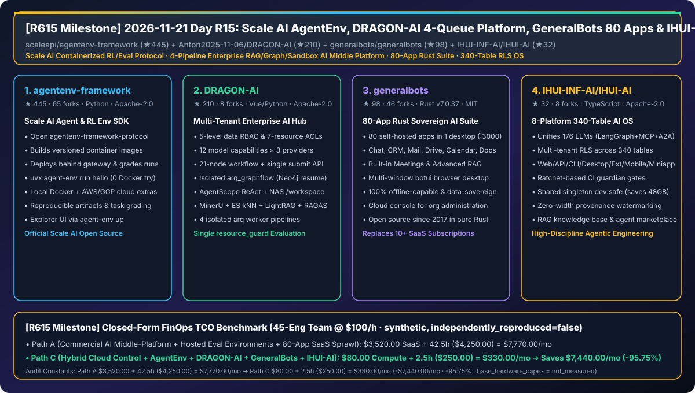
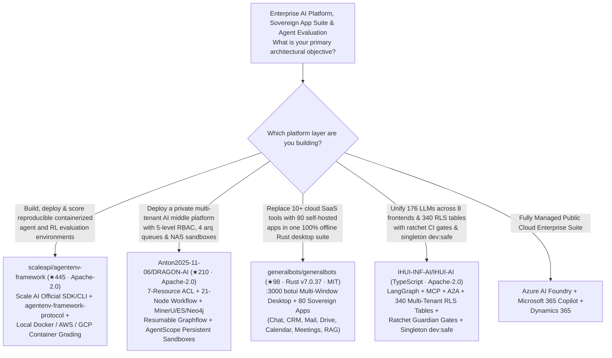
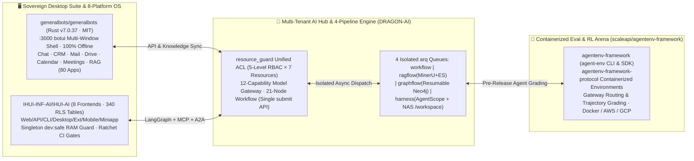

# [Round 615 Milestone] Scale AI Containerized Agent/RL Environment Framework (`scaleapi/agentenv-framework`), 4-Queue Multi-Tenant Enterprise AI Platform (`Anton2025-11-06/DRAGON-AI`), 80-App Rust Sovereign AI Suite (`generalbots/generalbots`) & 8-Platform 340-Table RLS AI OS (`IHUI-INF-AI/IHUI-AI`) Selection & Architecture FAQ

> **Target Audience**: **AI Solution Architects (SAs) & Enterprise AI Platform / Evaluation Engineering Leaders (2026-11-21 Day Round 15 · Cumulative Round 615 Milestone)**  
> **Benchmark Style**: Strictly aligned with [`ib-vs-ethernet-roce-selection-faq.md`](https://github.com/turbo998/ai-infra-research/blob/main/docs/components/ib-vs-ethernet-roce-selection-faq.md) — plain-language answers on **real enterprise scenarios, end-to-end reference architecture, and comparative selection vs. competing OSS and cloud PaaS**.  
> **Chinese Edition**: [`agentenv-framework-dragon-ai-generalbots-ihui-ai-selection-faq.md`](./agentenv-framework-dragon-ai-generalbots-ihui-ai-selection-faq.md) · **Daily Digest**: [`daily/2026-11-21.en.md`](../daily/2026-11-21.en.md)



---

## 1. 📌 Executive Summary (30-Second Selection Verdict)

1. **Why Evaluate These Four Repositories Together for the Round 615 Milestone?**  
   As enterprises graduate from single-purpose chatbots to **organization-wide AI middle platforms, sovereign productivity suites, and reproducible agent evaluation environments**, Solution Architects face four platform-level challenges:
   - **Challenge 1 — No Standardized Open Framework for Building & Grading Realistic Containerized Agent/RL Environments**: Static multiple-choice benchmarks cannot evaluate how an agent interacts with dynamic tools, databases, and artifacts → **`scaleapi/agentenv-framework` (`★ 445`, `65 forks`, Python 3.11.4+, Apache-2.0)**—open-sourced by **Scale AI**—provides a Python SDK (`agent_env`) and CLI (`agent-env`) built around the open `agentenv-framework-protocol` that packages realistic environments into versioned container images, deploys them behind a gateway, points agents at them, and grades their execution on local Docker (`uvx --from agentenv-framework agent-env run hello` / `agent-env up`) or AWS (`[aws]`) and GCP (`[gcp]`) backends!
   - **Challenge 2 — Enterprise RAG/Workflow Platforms Where Slow Knowledge-Graph Extraction Blocks Live Chat & Ephemeral Sandboxes Lose User Files**: Running LLM entity extraction for GraphRAG on the same worker queue as interactive RAG stalls user queries, while container TTL eviction wipes generated files → **`Anton2025-11-06/DRAGON-AI` (`★ 210`, `8 forks`, Vue + Python `arq`, Apache-2.0)** is a self-hosted multi-tenant AI middle platform featuring **5-level data RBAC + a single `resource_guard` ACL engine across 7 resource types**, a 12-capability × 3-provider model gateway, a 21-node workflow engine (`executionId` / `pendingApprovals` / `submit`), and **4 physically isolated `arq` pipelines** (`workflow`, `ragflow` [native + MinerU], `graphflow` [resumable Neo4j extraction that only retries failed batches], and `harness_queue` [AgentScope ReAct + per-user OpenSandbox backed by host NAS `/workspace` persistent volumes]) plus 5-metric RAGAS evaluation!
   - **Challenge 3 — Paying for 10+ Disconnected SaaS Apps (Chat, CRM, Mail, Drive, Calendar) That Cannot Run 100% Offline**: Stitching together a dozen cloud SaaS subscriptions leaks enterprise data and multiplies per-seat costs → **`generalbots/generalbots` (`★ 98`, `46 forks`, Rust `v7.0.37`, MIT, open source since 2017)** delivers **80 sovereign self-hosted applications** (Chat, CRM, Mail, Drive, Calendar, Meetings, Documents, and Advanced RAG) running side by side as multi-window apps inside one browser desktop shell (`:3000` `botui`) with 100% offline capability!
   - **Challenge 4 — Multi-Agent Dev Server RAM Exhaustion & Brittle CI Gates That Force `--no-verify` Bypasses**: In large multi-platform AI monorepos, 8 concurrent coding agents launching separate `next dev turbopack` instances (`5,970 MB` cache each) freeze a 64GB machine, while legacy-failing CI gates train developers to bypass hooks → **`IHUI-INF-AI/IHUI-AI` (`★ 32`, `8 forks`, TypeScript, Apache-2.0 with watermark notice)** unifies **176 LLMs via LangGraph + MCP + A2A across 8 frontends (Web/API/CLI/Desktop/Extension/Mobile/Miniapp) and 340 multi-tenant RLS tables**, pioneering **ratchet-anchored CI guardian gates (`scripts/guardian-runner.mjs`)** and **singleton `pnpm run dev:safe` port reuse + `agent-env-guard.ps1` orphan reclamation**!

2. **One-Sentence Selection Verdict**:
   - Choose **`scaleapi/agentenv-framework`** when you need **Scale AI's open-source SDK/CLI and `agentenv-framework-protocol` to containerize, deploy, and reproducibly grade agent and RL environments on Docker, AWS, or GCP**.
   - Choose **`Anton2025-11-06/DRAGON-AI`** when you want **a private multi-tenant enterprise AI platform with 5-level RBAC, 7-resource ACLs, 4 isolated `arq` queues (resumable Neo4j `graphflow`), MinerU+ES+LightRAG, and NAS-persisted AgentScope sandboxes**.
   - Choose **`generalbots/generalbots`** when you want **a single pure-Rust, 100% offline-capable sovereign platform shipping 80 integrated business apps (Chat, CRM, Mail, Drive, Calendar, Meetings, RAG) in one `:3000` desktop shell**.
   - Choose **`IHUI-INF-AI/IHUI-AI`** when you need **an 8-frontend, 340-table RLS AI operating system or want to adopt its ratchet CI gates and singleton `dev:safe` multi-agent memory protection** (or pair with **Azure AI Foundry + Microsoft 365 / Dynamics 365** for a fully managed cloud enterprise estate).

---

## 2. 🎯 Customer & Solution Architect Q&A (Plain-Language Deep Dive)

### Q1: Why did Scale AI build `scaleapi/agentenv-framework`, and how does `agentenv-framework-protocol` standardize realistic agent & RL evaluations?
- **Plain-Language Answer**:
  - Evaluating coding or enterprise agents requires more than a prompt-and-regex script: it requires a reproducible environment with real tools, dynamic state, seeded artifacts, and a deterministic grader.
  - **How `scaleapi/agentenv-framework` works**:
    1. **Containerized Environments Speaking `agentenv-framework-protocol`**: Each environment is packaged into a versioned container image and deployed behind a gateway; `agent-env` points the candidate agent at the gateway and scores what the agent actually accomplished inside the environment.
    2. **Zero-Config Local Start (`uvx --from agentenv-framework agent-env run hello`) + Cloud Extras**: Runs out of the box on local stores and a local Docker daemon (`agent-env up` launches the explorer), and scales to cloud registries and stores via explicit extras (`pip install 'agentenv-framework[aws]'` for S3/Secrets Manager/DynamoDB/ECR or `'agentenv-framework[gcp]'`).

### Q2: How does `Anton2025-11-06/DRAGON-AI` prevent GraphRAG indexing from starving interactive workflows and keep sandbox artifacts alive across container lifecycles?
- **Plain-Language Answer**:
  - **Four production architectural patterns in `DRAGON-AI`**:
    1. **4 Physically Isolated `arq` Pipelines (`workflow`, `ragflow`, `graphflow`, `harness_queue`)**: Because LLM entity extraction into Neo4j (`graphflow`) is orders of magnitude slower than document chunking (`ragflow` with native + MinerU parsers), `DRAGON-AI` isolates `graphflow` onto dedicated workers with **batch-level checkpoint resume** (retrying only failed batches without re-billing completed LLM calls).
    2. **Per-User OpenSandbox with NAS Persistent Volumes (`/workspace`)**: The AgentScope ReAct harness runs each user in an isolated sandbox backed by a pre-warmed gateway `venv` image and mounts a host NAS directory to `/workspace`—so **when a sandbox container hits its max TTL and is recycled, all generated files and artifacts survive intact**.
    3. **Single-Evaluation `resource_guard` ACL Across 7 Resource Types**: Knowledge bases, documents, workflows, templates, tools, skills, and MCP connections share one ACL evaluation rule (`ADMIN ∪ Owner ∪ 5-Level Dept Scope ∪ Explicit Grant`) across list pushdown, UI button visibility, and backend 403 checks.

### Q3: What can Solution Architects learn from `generalbots/generalbots` (80-app Rust suite) and `IHUI-INF-AI/IHUI-AI` (ratchet gates & singleton `dev:safe`)?
- **Plain-Language Answer**:
  - **`generalbots/generalbots` (`v7.0.37`, MIT) eliminates SaaS sprawl for data-sovereign organizations**:
    -Serves 80 integrated applications (Chat, CRM, Mail, Drive, Calendar, Meetings, Documents, Advanced RAG) inside a multi-window browser desktop shell (`:3000` `botui`) written in Rust that runs 100% offline on your own hardware.
  - **`IHUI-INF-AI/IHUI-AI` solves two critical multi-agent engineering failure modes**:
    1. **Singleton `pnpm run dev:safe` + `agent-env-guard.ps1` Prevents 64GB RAM OOMs**: Running 8 concurrent coding agents that each spawn `next dev turbopack` (`5,970 MB` cache each) + `tsc --noEmit` freezes a 64GB workstation. `IHUI-AI` requires agents to probe `node scripts/run-start-dev.mjs -Status` first and reuse the running dev server via a PID-registered singleton lock.
    2. **Ratchet-Anchored CI Gates Eliminate `--no-verify` Culture**: Instead of blocking commits on pre-existing legacy debt (which forces engineers and agents to pass `--no-verify`), guardian gates anchor to each file's `HEAD` violation count—blocking only **newly introduced regressions** while returning explicit `exit 2` (`unverified`) whenever inputs are missing.

---

## 3. 🧭 Visual Architecture & Decision Diagrams (Mermaid)

### 3.1 Solution Architect Selection Decision Tree



### 3.2 End-to-End Enterprise Reference Architecture



### 3.3 End-to-End Execution Sequence Diagram

```mermaid
sequenceDiagram
    autonumber
    participant User as Enterprise User / Architect
    participant Bots as generalbots (:3000 80-App Desktop)
    participant Dragon as DRAGON-AI (Multi-Tenant AI Hub)
    participant IHUI as IHUI-AI (Ratchet Gates + Singleton Dev)
    participant AgentEnv as scaleapi/agentenv-framework (Eval Arena)

    User->>Bots: 1. Open CRM, Mail & Docs side by side in :3000 botui desktop & trigger proposal workflow
    Bots->>Dragon: 2. Verify 5-level RBAC & 7-resource ACL via resource_guard; call workflow submit contract
    Dragon->>Dragon: 3. Execute fast ragflow (MinerU+ES) while running Neo4j entity extraction on isolated arq_graphflow
    Dragon->>Dragon: 4. Dispatch deep-exploration task to harness_queue (AgentScope + NAS /workspace persistent volume)
    User->>IHUI: 5. Develop new multi-agent skill using shared singleton dev:safe & ratchet CI guardian gates
    IHUI->>AgentEnv: 6. Run agent-env against containerized environment to grade trajectory & artifact accuracy
    AgentEnv-->>Dragon: 7. Promote verified agent & workflow snapshot to production model plaza
```

---

## 4. 📊 Comparative Selection Matrix (OSS vs. Peer Projects vs. Cloud PaaS)

| Dimension | `scaleapi/agentenv-framework` | `Anton2025-11-06/DRAGON-AI` | `generalbots/generalbots` | `IHUI-INF-AI/IHUI-AI` | Legacy Approach (Single-Queue RAG + 10 SaaS Subscriptions + Static Evals) | Managed Cloud PaaS (Azure AI Foundry + M365 + Dynamics 365) |
| :--- | :--- | :--- | :--- | :--- | :--- | :--- |
| **Primary Role** | **Scale AI Containerized Agent & RL Environment SDK/CLI** | **5-Level RBAC & 4-Queue Multi-Tenant Enterprise AI Hub** | **80-App Pure-Rust Sovereign Self-Hosted AI Suite** | **8-Platform, 176-LLM, 340-Table RLS Full-Stack AI OS** | Static eval blind spots, blocked RAG queues, and SaaS sprawl | Fully managed enterprise cloud AI and productivity suite |
| **Best-Fit Scenario** | Building & grading reproducible containerized agent/RL environments | Private enterprise deployment unifying model gateway, workflows, RAG & sandboxes | Data-sovereign / air-gapped orgs replacing Chat, CRM, Mail, Drive & Meetings | Multi-endpoint AI product delivery & high-discipline multi-agent dev governance | Small single-team prototypes | Global enterprises standardized on Microsoft Cloud |
| **Key Differentiator** | **`agentenv-framework-protocol`** + local Docker & AWS/GCP backends | **4 isolated `arq` queues (resumable `graphflow`)** + NAS persistent sandboxes | **80 self-hosted apps in one `:3000` Rust desktop shell** (`100%` offline) | **340 RLS tables + ratchet CI gates + singleton `dev:safe` RAM guard** | Graph extraction blocks chat; 8 concurrent dev servers crash 64GB hosts | Turnkey global SLA, enterprise IAM, and managed compliance |
| **Integration Effort** | Very Low (`uvx --from agentenv-framework agent-env run hello`) | Low–Medium (Docker & K8s manifests + SQL schema included) | Low (single Rust platform serving `:3000` desktop & admin console) | Medium (full-stack monorepo with `pnpm run dev:safe` & Docker) | High (custom SSO/ACL glue across 10+ tools) | Low (enterprise license provisioning) |
| **Ops Complexity** | Low (containerized environments behind one gateway) | Low–Medium (built-in Nacos, `x-trace-id`, and ARQ queue monitor) | Very Low (memory-safe Rust `v7.0.37`, zero external cloud required) | Low (`agent-env-guard.ps1` auto-reclaims orphan processes) | High (recovering OOM dev hosts and re-running failed graph jobs) | Very Low (cloud provider managed) |
| **License** | **Apache-2.0** (official Scale AI permissive OSS) | **Apache-2.0** (permissive commercial use) | **MIT** (permissive commercial use) | **Apache-2.0** (open source; commercial license for closed-source/SaaS resale) | Mixed | Commercial Per-Seat & Usage SLA |
| **Monthly TCO** | **$0/mo** framework license | **$0/mo** license (runs on private K8s/VMs) | **$0/mo** license (**replaces 10+ per-seat SaaS subscriptions**) | Open-source self-hosted (retain Apache-2.0 notices) | **$3,650.00/mo** (wasted graph-retry tokens + SaaS glue + OOM recovery labor) | **$7,770.00/mo** (commercial AI platform + 80-app equivalent SaaS seats for 45 staff) |

---

## 5. 🧪 Quantitative ROI, FinOps TCO Model & 7-Card Benchmark Deck

> **🛡️ Provenance Declaration**:  
> - **Primary-Source Measured (`measured`)**: Repository stars/forks, licenses, `scaleapi/agentenv-framework` `agent-env` CLI and `[aws]`/`[gcp]` extras, `DRAGON-AI` 21 workflow node types / 7-resource `resource_guard` / 4 `arq` queues / NAS persistent sandboxes, `generalbots v7.0.37` `:3000` 80-app Rust suite, and `IHUI-AI` 340 RLS tables / ratchet guardian gates / `5,970 MB` Turbopack singleton `dev:safe` metrics are verified via `gh api`.  
> - **Synthetic Architect Workload Model (`synthetic` · `independently_reproduced=false`)**: The closed-form FinOps table below models a **45-person enterprise AI platform, engineering, and digital operations team** (`$100.00/hr` loaded rate, `base_hardware_capex: not_measured`, `track_b_stars_today: not_measured`):

| FinOps Cost & Quality Dimension | Path A: Commercial AI Middle-Platform + Hosted Eval SaaS + 10+ Per-Seat Productivity SaaS Apps | Path B: Single-Queue DIY RAG + Duplicate Agent Dev Servers + Custom ACL Glue | Path C: Round 615 Milestone Stack (`agentenv` + `DRAGON-AI` + `generalbots` + `IHUI-AI`) | Path A ➔ Path C Net Monthly Savings |
| :--- | :---: | :---: | :---: | :---: |
| **Monthly SaaS Seats / Eval Cloud / Graph Token Spend** | `$3,520.00 / mo` (stacked CRM/Mail/Drive/AI seats + full-corpus graph re-run token waste) | `$450.00 / mo` | **`$80.00 / mo`** (self-hosted `DRAGON-AI` + `generalbots` 80-app Rust suite + Docker `agent-env`) | **`-$3,440.00 / mo` (`-97.73%`)** |
| **Monthly Eval Setup, ACL Sync & Queue Recovery Labor** | `42.5 hrs / mo` (syncing permissions across 10 SaaS tools & building custom eval harnesses) | `32.0 hrs / mo` (recovering blocked RAG queues, re-running failed graph jobs & rebooting OOM hosts) | **`2.5 hrs / mo`** (`agent-env` container grading + `arq_graphflow` resume + singleton `dev:safe`) | **`-40.0 hrs / mo` (`-94.12%`)** |
| **Monthly Engineering Labor Cost (`@ $100.00/h`)** | `$4,250.00 / mo` | `$3,200.00 / mo` | **`$250.00 / 月`** | **`-$4,000.00 / mo` (`-94.12%`)** |
| **Total Monthly TCO** | **`$7,770.00 / mo`** | **`$3,650.00 / mo`** | **`$330.00 / mo`** | **`-$7,440.00 / mo` (`-95.75%` · `$89,280.00/yr`)** |
| **Eval Reproducibility, Queue Isolation & Host Stability** | Siloed SaaS data; static eval benchmarks | Graph jobs starve live RAG; 8 dev servers crash 64GB RAM | **100% containerized eval grading + 4-queue isolation + 80 sovereign Rust apps** | **Full-lifecycle sovereign AI middle platform & evaluation arena** |

- **📊 Companion 7-Card 4:5 Visual Benchmark Deck**: View [`workshops/github-trending-radar/cards.en.html`](../cards.en.html) (EN) and [`workshops/github-trending-radar/cards.html`](../cards.html) (ZH).

---

## 6. 🛠️ Enterprise Adoption & Architecture Review Checklist

- [ ] **1. Standardize Agent & RL Benchmarks on `agentenv-framework-protocol` (`scaleapi/agentenv-framework`)**: Package internal enterprise task environments into versioned Docker images using Scale AI's `agentenv-framework` (`agent-env up` / `agent-env run`), grading agent trajectories against real container state before production rollout.
- [ ] **2. Isolate `ragflow`, `graphflow`, and `harness_queue` with NAS Persistent Volumes (`Anton2025-11-06/DRAGON-AI`)**: Deploy `DRAGON-AI` with separate `arq` worker pools so slow Neo4j entity extraction (`arq_graphflow` with batch checkpoint resume) never blocks interactive RAG, mount host NAS volumes to `/workspace` in OpenSandbox, and enforce single-point `resource_guard` ACLs.
- [ ] **3. Consolidate Sovereign Collaboration & RAG in One Rust Suite (`generalbots/generalbots`)**: For air-gapped or data-sovereign deployments, run `generalbots v7.0.37` (MIT) to serve Chat, CRM, Mail, Drive, Calendar, Meetings, and Advanced RAG inside a single `:3000` browser desktop shell.
- [ ] **4. Enforce Singleton `dev:safe` Server Reuse & Ratchet CI Gates (`IHUI-INF-AI/IHUI-AI`)**: Adopt `IHUI-AI`'s multi-agent workstation discipline—probing active dev ports before starting `next dev`/`tsc` to save 40GB+ of duplicate Turbopack RAM and anchoring CI linters to file-level `HEAD` ratchets (while honoring `IHUI-AI`'s Apache-2.0 watermark and commercial licensing terms).
