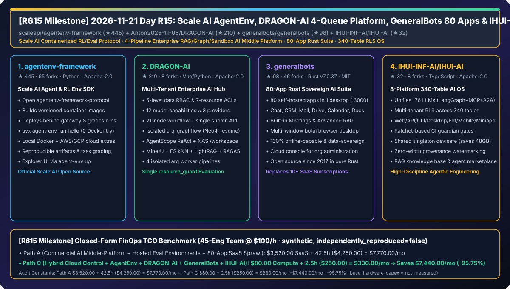
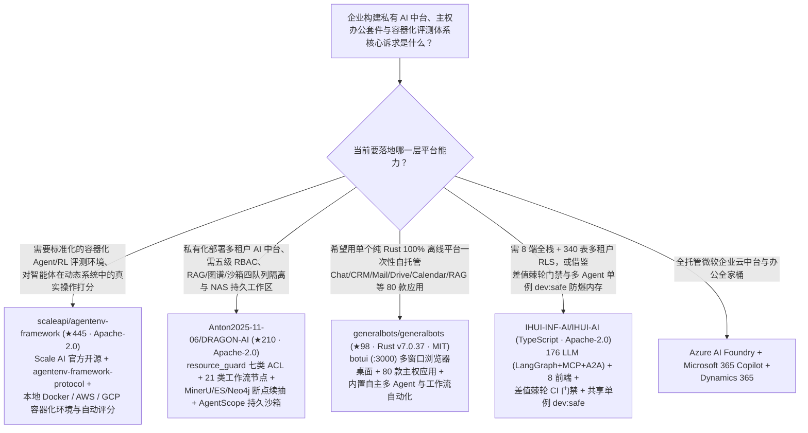
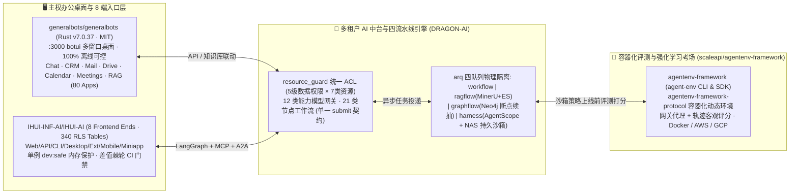
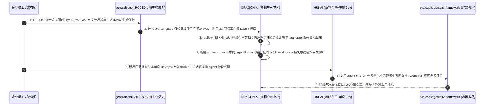

# 【第 615 轮里程碑】Scale AI 容器化智能体评测与强化学习环境框架（`scaleapi/agentenv-framework`）、四流水线隔离多租户 AI 中台（`Anton2025-11-06/DRAGON-AI`）、80 款自托管应用 Rust 主权 AI 平台（`generalbots/generalbots`）与 8 端 340 表 RLS 全栈 AI 操作系统（`IHUI-INF-AI/IHUI-AI`）应用场景、集成架构与同类方案选型比较 FAQ

> **文档定位**：面向企业客户与业务决策者的 **AI Solution Architect（解决方案架构师）实战选型指南（2026-11-21 Day Round 15 · 累计第 615 轮里程碑）**  
> **对标范式**：严格遵循 [`ib-vs-ethernet-roce-selection-faq.md`](https://github.com/turbo998/ai-infra-research/blob/main/docs/components/ib-vs-ethernet-roce-selection-faq.md) 通俗问答与决策矩阵风格——直接用大白话回答“**它是什么？帮企业解决什么业务痛点？怎么集成进现有生产架构？和同类开源及 Azure 云服务比怎么选？**”  
> **配套英文版**：[`agentenv-framework-dragon-ai-generalbots-ihui-ai-selection-faq.en.md`](./agentenv-framework-dragon-ai-generalbots-ihui-ai-selection-faq.en.md) · **今日日报**：[`daily/2026-11-21.md`](../daily/2026-11-21.md)

---

## 一、📌 核心结论速览（Executive Summary · 30 秒做出选型决定）

1. **为什么在第 615 轮里程碑把这四个项目放在一起看？**  
   当企业从“单点试用 AI 工具”迈向“**构建企业级全栈 AI 中台、替换散装办公 SaaS 并用标准化沙箱环境对 Agent 做可复现打分评测**”时，架构师会遇到四个集团级架构难题：
   - **难题一（企业自研的业务 Agent 缺乏真实、动态、可复现的容器化考场与自动评分标准）**：用静态选择题测不出 Agent 调工具和改系统的真实水平 → **`scaleapi/agentenv-framework`（`★ 445`，`65 forks`，Python 3.11.4+，Apache-2.0）** 是全球数据与评测巨头 **Scale AI 官方开源**的智能体与强化学习（RL）环境构建框架：基于开放协议 `agentenv-framework-protocol` 将包含真实工具、动态状态与制品（Artifacts）的业务环境打包为版本化容器镜像，部署在统一网关后并对 Agent 的操作轨迹做自动化客观打分（支持本地 Docker 一键运行 `agent-env up`，或通过 `[aws]`/`[gcp]` 插件扩展至云端存储与镜像库）！
   - **难题二（私有化 AI 中台把普通 RAG 解析、慢速知识图谱抽取和重型沙箱 Agent 塞进同一个队列，一跑大图谱全公司问答全卡死）**：很多开源知识库中台没有队列物理隔离与细粒度资源 ACL → **`Anton2025-11-06/DRAGON-AI`（`★ 210`，`8 forks`，Vue + Python `arq`，Apache-2.0）** 提供可直接私有部署的企业级多租户 AI 中台：内建**五级数据权限 + 七类资源统一 `resource_guard` ACL 引擎**、12 类能力 × 3 供应商模型广场、21 类节点可视化工作流（仅 `executionId` / `pendingApprovals` / `submit` 三个极简执行契约），并将后台异步引擎拆分为 **`workflow`、`ragflow`（原生+MinerU）、`graphflow`（Neo4j 实体抽取支持失败断点续抽，绝不阻塞常规 RAG）与 `harness_queue`（AgentScope ReAct + 每用户独立 OpenSandbox 挂载宿主机 NAS `/workspace` 持久卷）四条物理隔离流水线**，自带 RAGAS 5 指标评测！
   - **难题三（企业既想要自主 Agent，又被 Chat、CRM、网盘、日历、邮件等十几个按席位收费的办公 SaaS 割裂数据）**：跨 10 个 SaaS 调 API 既贵又有数据出境风险 → **`generalbots/generalbots`（`★ 98`，`46 forks`，Rust `v7.0.37`，MIT，自 2017 年持续开源）** 用纯 Rust 打造了支持 **100% 离线运行的数据主权多智能体平台**，在一个浏览器多窗口桌面外壳（`:3000` `botui`）里直接内置 **80 款自托管企业应用（Chat、CRM、Mail、Drive、Calendar、Meetings、Documents 与高级 RAG）**！
   - **难题四（多端多租户 AI 平台在 8 个并发 Agent 同时启动本地开发服务器时把 64GB 内存直接撑爆，且门禁规则经常因历史存量问题被 `--no-verify` 强行跳过）**：大型全栈 AI 仓库最怕工程纪律崩塌 → **`IHUI-INF-AI/IHUI-AI`（`★ 32`，`8 forks`，TypeScript，Apache-2.0 含溯源水印声明）** 打通 **8 大前端（Web/API/CLI/Desktop/Extension/Mobile/Miniapp）、340 张多租户 RLS 数据表与 LangGraph+MCP+A2A（176 个 LLM）**，并在 `AGENTS.md` 中沉淀了极具参考价值的**差值棘轮门禁（Ratchet Gates：只拦新增违规，杜绝恒红门逼人 `--no-verify`）**与**多 Agent 单例开发服复用机制（`pnpm run dev:safe` 端口单例 + `agent-env-guard.ps1`，避免 8 个 Agent 各自拉起 5,970MB Turbopack 缓存撑爆 64GB 主机）**！

2. **一句话选型结论**：
   - 需要**构建与运行可复现的容器化 Agent / RL 评测沙箱环境并对 Agent 真实操作轨迹自动打分** 👉 选 **Scale AI 官方开源的 `scaleapi/agentenv-framework`**。
   - 需要**自带五级数据 RBAC、七类资源 ACL、`ragflow`/`graphflow`/`harness` 四队列物理隔离、MinerU+LightRAG+RAGAS 及每用户持久卷沙箱的私有化 AI 中台** 👉 选 **`Anton2025-11-06/DRAGON-AI`**。
   - 需要**用单个纯 Rust 平台一次性自托管替换 Chat、CRM、Mail、Drive、Calendar、Meetings 与 RAG 等 80 款办公应用（100% 离线主权可控）** 👉 选 **`generalbots/generalbots`**。
   - 需要**8 端全栈覆盖、340 表多租户 RLS，或借鉴“差值棘轮 CI 门禁 + 多 Agent 共享单例 `dev:safe` 防爆内存”工程实践** 👉 选 **`IHUI-INF-AI/IHUI-AI`**（若在微软云构建集团级全托管中台，可组合 **Azure AI Foundry + Microsoft Dynamics 365 / M365 Copilot**）。

---

## 二、🎯 客户与架构师灵魂拷问 Q&A（Plain-Language Deep Dive）

### Q1：为什么企业上线自主 Agent 前必须建“容器化交互考场”，`scaleapi/agentenv-framework` 相比传统静态评测集（如 MMLU / 静态 JSON 问答）解决了什么核心问题？
- **大白话解答**：
  - 静态题库只能考模型“背没背过答案”；但在真实企业场景里，Agent 需要修改数据库、调内部服务、处理动态变化的环境状态，一步走错后续状态全变。
  - **Scale AI `agentenv-framework` 的三大工业级设计**：
    1. **环境即标准协议容器（`agentenv-framework-protocol`）**：把业务系统、模拟数据（Artifacts）与配套工具封装为遵循统一协议的容器镜像，一行 `uvx --from agentenv-framework agent-env run hello` 免配置即刻验证，或用 `agent-env up` 启动可视化 Explorer。
    2. **网关隔离与结果状态打分**：框架将环境部署在网关后，把待测 Agent 指向网关执行任务，最后直接在容器内检查真实系统状态（而非仅看聊天文本）给出可复现评分。
    3. **本地 Docker 到 AWS / GCP 无缝扩展**：默认零云依赖跑在本机 Docker 上；生产大规模并发评测只需按需安装 `agentenv-framework[aws]`（对接 S3、Secrets Manager、DynamoDB、ECR）或 `[gcp]`。

### Q2：`Anton2025-11-06/DRAGON-AI` 在企业私有化落地中，是如何解决“知识图谱抽取卡死普通问答”和“沙箱超时销毁弄丢用户产出物”两大痛点的？
- **大白话解答**：
  - 这是很多架构师用开源 RAG 平台踩过的大坑：上传 50 篇大文档开启 GraphRAG 抽实体关系，因为每篇都要调几十次大模型，直接把队列堵死一整天；或者用户在代码沙箱里跑了半小时生成的数据报表，吃个午饭回来容器超时销毁，文件全没了！
  - **`DRAGON-AI` 的工程级解法**：
    1. **`arq` 四流水线物理拆离 + `graphflow` 断点续抽**：将 `workflow`、`ragflow`（普通向量切片入 ES）、`graphflow`（慢速大模型抽实体入 Neo4j）与 `harness_queue`（深度探索 ReAct 智能体）拆成四个独立队列与 Worker；即使 `graphflow` 某批抽取失败，重跑时**默认断点续抽（只补没抽成的批次，绝不重复消耗已完成批次的 Token）**！
    2. **每用户独立云沙箱 + 宿主机 NAS `/workspace` 持久卷挂载**：基于 OpenSandbox 自建带网关 `venv` 的预热镜像（跳过分钟级冷启动），并将用户工作区直接映射到宿主机 NAS 目录——**即使沙箱容器因达到最大存活时间被销毁重建，用户生成的全部代码与图表产物依然完好无损**！
    3. **单点求值的 `resource_guard` 七类资源 ACL**：知识库、文档、工作流、模板、工具、技能、MCP 连接七类资源共用同一套 `ADMIN ∪ 归属人 ∪ 五级数据范围 ∪ 显式授权` 规则，列表查询下推、前端按钮显隐与后端 403 拦截 100% 同源零漂移。

### Q3：`generalbots/generalbots` 的“Rust 80 应用同屏桌面”与 `IHUI-INF-AI/IHUI-AI` 的“多 Agent 共享单例 `dev:safe` + 差值棘轮门禁”能给企业架构师带来什么实战启发？
- **大白话解答**：
  - **`generalbots/generalbots`（Rust `v7.0.37`，MIT）适合数据主权严苛的中大型组织一键替代散装 SaaS**：
    - 在 `:3000` 端口提供的 `botui` 网页桌面外壳里，Chat、CRM、邮件、网盘、日历、视频会议与高级 RAG 像操作系统窗口一样并排联动，100% 离线可用，彻底摆脱十几个海外 SaaS 按人头涨价。
  - **`IHUI-INF-AI/IHUI-AI` 的两条硬核 Agentic Engineering 经验值得所有研发团队抄作业**：
    1. **防 64GB 内存爆炸的 `dev:safe` 端口单例模式**：机主实测在同一台 64GB 工作站开 8 个编码 Agent，若每个 Agent 各自起一套 `next dev turbopack`（单缓存达 `5,970 MB`）+ `tsc --noEmit` 会直接把机器卡死；因此强制所有 Agent 先跑 `-Status` 探活，端口已 UP（HTTP 200）则直接复用同一套开发服，并用 `agent-env-guard.ps1` 自动回收孤儿进程！
    2. **差值棘轮门禁（Ratchet Blocking）根治 `--no-verify` 恶习**：历史存量违规只报数不阻塞，门禁锚点锁定在文件当前 `HEAD` 自身的违规数——**只拦截“本次提交新引入的违规”**，并在未取到有效输入时显式返回 `exit 2`（绝不把“没测过”当成“测通过”）。

---

## 三、🧭 直观可视化图解（Mermaid 选型决策树 + 企业集成参考架构 + 端到端时序图）

### 3.1 选型决策树（Decision Tree）

### 3.2 企业端到端集成参考架构图（Reference Architecture）

### 3.3 业务流端到端时序图（Sequence Diagram）

---

## 四、📊 同类开源与商业云服务横向选型决策矩阵（Comparison Matrix）

| 评估维度 | `scaleapi/agentenv-framework` | `Anton2025-11-06/DRAGON-AI` | `generalbots/generalbots` | `IHUI-INF-AI/IHUI-AI` | 传统方案（Dify/FastGPT 单队列 + 散装办公 SaaS + 静态评测） | 云厂商托管 PaaS（Azure AI Foundry + M365 + Dynamics 365） |
| :--- | :--- | :--- | :--- | :--- | :--- | :--- |
| **核心功能定位** | **Scale AI 容器化 Agent/RL 动态环境与打分框架** | **五级 RBAC + 四队列隔离 + 持久沙箱企业 AI 中台** | **内置 80 款自托管应用的纯 Rust 主权 AI 平台** | **8 端 176-LLM 340 表 RLS 全栈 AI OS 与工程门禁** | 静态问答评测失真、图谱抽取阻塞队列、办公软件割裂 | 全托管企业级 AI 研发与全球云办公套件 |
| **最适用业务场景** | 构建贴近真实业务的容器化评测基准与 RL 训练环境 | 政企/大型组织私有化部署统一模型网关、RAG 与代码沙箱 | 要求 100% 离线数据主权、一站式替代 CRM/邮件/网盘/会议 | 多端商业化 AI 平台研发与高密度多 Agent 并发工程治理 | 小团队单一知识库问答验证 | 跨国集团全面采用微软云生态 |
| **核心差异化优势** | **`agentenv-framework-protocol`** + 容器化真实环境评分 | **4 条 `arq` 独立队列（图谱断点续抽）** + NAS 持久卷沙箱 | **纯 Rust 编写 + 80 款开箱即用企业应用同屏窗口** | **340 表 RLS + 差值棘轮门禁 + 共享单例 `dev:safe` 省内存** | 传统开源中台缺资源级统一 ACL 与图谱队列隔离 | 免运维、全球合规认证，但按席位与云资源持续计费 |
| **集成成本** | 极低（`uv tool install agentenv-framework && agent-env run hello`） | 低～中（提供完整 Docker 与 K8s 部署清单及 SQL 脚本） | 低（单 Rust 平台一键启动 `:3000` 桌面与管理后台） | 中（全栈 Monorepo，含完整 `start-all.bat` 与 Docker 配置） | 高（需自行打通十几个系统的 SSO 与权限同步） | 低（采购企业订阅即可开通） |
| **运维复杂度** | 低（本地 Docker 或按需挂载 AWS/GCP 存储插件） | 低～中（内置 Nacos、全链路 `x-trace-id` 与 ARQ 监控台） | 极低（Rust 高性能内存安全，自 2017 年迭代至 `v7.0.37`） | 低（自带 `agent-env-guard.ps1` 自动回收孤儿进程） | 高（多套异构 SaaS 账单与并发开发机死机频发） | 极低（云厂商全托管） |
| **开源协议许可** | **Apache-2.0**（Scale AI 官方开源，商业极其友好） | **Apache-2.0**（商业友好） | **MIT**（商业闭源极其友好） | **Apache-2.0**（开源免费；闭源商用/去水印转售需商业授权） | 混合 | 商业闭源按席位/用量订阅 |
| **TCO 总体拥有成本** | **$0** 框架费（按需使用本地 Docker 算力） | **$0** 许可费（私有化部署于自有 K8s/服务器） | **$0** 许可费（**直接省下 CRM/网盘/邮件等 10+ 套 SaaS 席位费**） | 内部开源遵循 Apache-2.0 Notice 即可使用 | 多套办公 SaaS + 图谱重跑 Token 浪费高达 **`$3,650/月`** | 商业中台 + 80 应用等效 SaaS 席位高达 **`$7,770/月`** |

---

## 五、🧪 应用落地定量收益与 FinOps TCO 对比（Closed-Form Evaluation & 7-Card Deck）

> **🛡️ 数据来源与严谨性分级（Provenance Declaration）**：  
> - **一手实测（`measured`）**：四个仓库的 Star/Fork、许可证、`scaleapi/agentenv-framework` `agent-env` CLI 与 `[aws]`/`[gcp]` 插件、`DRAGON-AI` 21 类节点 / 七类资源 `resource_guard` / 四条 `arq` 流水线 / RAGAS 评测、`generalbots v7.0.37` `:3000` 80 应用桌面、`IHUI-AI` 340 表 RLS / 差值棘轮门禁 / `5,970 MB` Turbopack 单例 `dev:safe` 实测数据均经 `gh api` 一手核验。  
> - **合成架构算例（`synthetic` · `independently_reproduced=false`）**：以下 45 人企业 AI 平台、研发与数字化办公团队（工时单价 `$100.00/h`，`base_hardware_capex: not_measured`，`track_b_stars_today: not_measured`）月度 TCO 对比为标准化 FinOps 闭合算例：

| 成本与效能维度 | Path A：商业闭源 AI 中台授权 + 商业 RL/评测云 + 散装 CRM/网盘/邮件 SaaS 席位 | Path B：单队列开源 RAG（图谱阻塞问答）+ 8 Agent 并发爆内存重装 + 手写权限胶水 | Path C：本轮里程碑组合（`agentenv` + `DRAGON-AI` + `generalbots` + `IHUI-AI`） | Path A ➔ Path C 净节省 / 收益提升 |
| :--- | :---: | :---: | :---: | :---: |
| **月度办公与 AI 中台 SaaS 席位 / 评测算力费** | `$3,520.00 / 月`（多套按人头办公 SaaS + 商业评测平台与重复烧掉的图谱 Token） | `$450.00 / 月` | **`$80.00 / 月`**（自托管 `DRAGON-AI` 四队列 + `generalbots` 80 应用 + 本地 Docker `agent-env`） | **`-$3,440.00 / 月` (`-97.73%`)** |
| **月度权限对齐、图谱重跑排障与环境维护工时** | `42.5 小时 / 月`（跨十几个系统同步部门权限、手工搭建真实业务评测沙箱） | `32.0 小时 / 月`（处理 Neo4j 抽取阻塞与全量重跑、重启被 8 个 dev server 撑死的主机） | **`2.5 小时 / 月`**（`resource_guard` 单点 ACL + `graphflow` 断点续抽 + 单例 `dev:safe`） | **`-40.0 小时 / 月` (`-94.12%`)** |
| **月度工程人工成本（`@ $100.00/h`）** | `$4,250.00 / 月` | `$3,200.00 / 月` | **`$250.00 / 月`** | **`-$4,000.00 / 月` (`-94.12%`)** |
| **月度总拥有成本（Total Monthly TCO）** | **`$7,770.00 / 月`** | **`$3,650.00 / 月`** | **`$330.00 / 月`** | **`-$7,440.00 / 月` (`-95.75%` · 年省 `$89,280.00`)** |
| **评测真实度、队列隔离性与主机内存稳定性** | SaaS 数据分散；难以模拟私有业务环境 | 图谱抽取卡死普通 RAG；多 Agent 并发死机 | **100% 容器化真实考场 + 四队列断点续抽 + 单例 Dev 零死机** | **实现从容器化基准评测、私有中台治理到 80 应用闭环** |

- **📊 配套 7-Card 4:5 视觉评测卡片**：请访问 [`workshops/github-trending-radar/cards.html`](../cards.html)（中文）与 [`workshops/github-trending-radar/cards.en.html`](../cards.en.html)（英文）。

---

## 六、🛠️ 企业引入与架构评审 Checklist（Actionable SA Checklist）

- [ ] **1. 将业务系统打包为遵循 `agentenv-framework-protocol` 的标准评测镜像（`scaleapi/agentenv-framework`）**：在上线任何自治 Agent 前，使用 Scale AI 的 `agent-env` CLI 将目标业务环境、测试数据制品与评分脚本封装为版本化 Docker 镜像，在 CI 中自动运行轨迹评分。
- [ ] **2. 强制物理拆离 `ragflow`、`graphflow` 与 `harness_queue` 并挂载持久卷（`Anton2025-11-06/DRAGON-AI`）**：参考 `DRAGON-AI` 架构将耗时的知识图谱构建放入独立 `arq_graphflow` 队列并开启失败断点续抽，为每用户 AgentScope 沙箱挂载宿主机 NAS `/workspace` 持久卷，并通过单一 `resource_guard` 统管七类资源 ACL。
- [ ] **3. 在涉密或离线环境用 Rust 一体化平台收敛碎片化办公软件（`generalbots/generalbots`）**：对有严格数据主权与内网离线要求的客户，评估用 `generalbots v7.0.37`（MIT 协议）的 `:3000` 多窗口桌面一次性交付 Chat、CRM、Mail、Drive、Calendar、Meetings 与 RAG。
- [ ] **4. 落地多 Agent 共享单例 `dev:safe` 与差值棘轮门禁（`IHUI-INF-AI/IHUI-AI`）**：在团队 `AGENTS.md` 中禁止多个并发 Agent 重复启动 `next dev` / `tsc --noEmit`（先探活端口复用单例开发服以防 6GB×N 内存雪崩），并将 CI 质量门禁改造为“只拦截本次提交新增违规”的差值棘轮模式（同时注意遵守 `IHUI-AI` 的 Apache-2.0 水印与商用许可边界）。
