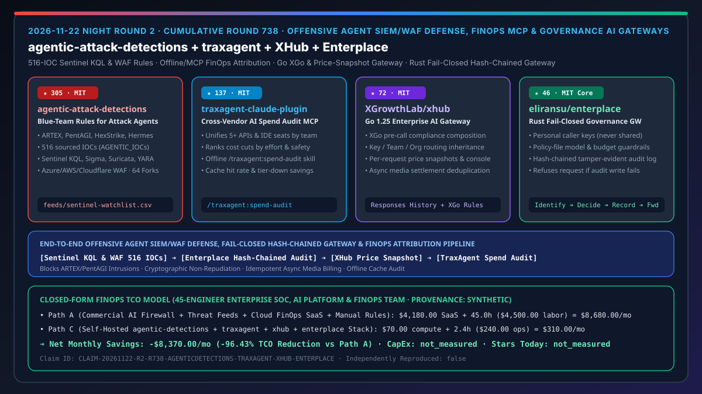
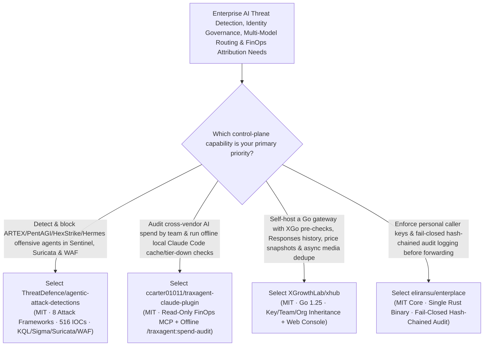
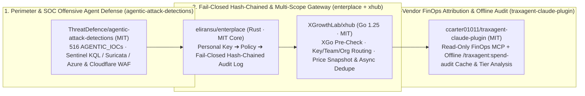
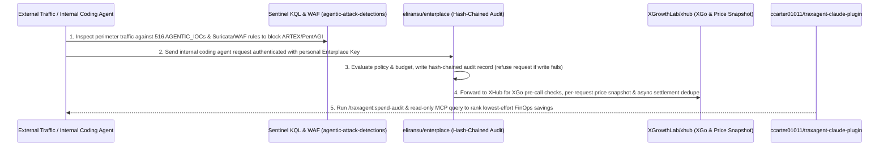

# Blue-Team SIEM/WAF Rules for Offensive AI Agents (`ThreatDefence/agentic-attack-detections`), Cross-Vendor AI Spend Attribution & Offline Audit MCP (`ccarter01011/traxagent-claude-plugin`), XGo & Responses-Aware Enterprise AI Gateway (`XGrowthLab/xhub`) & Fail-Closed Hash-Chained Rust Governance Gateway (`eliransu/enterplace`) Selection & Architecture FAQ

> **Document Type**: Enterprise AI Solution Architect Selection & Integration Guide (GitHub Trending AI Radar — 2026-11-22 Night Round 2 / Cumulative Round 738)
> **Covered Repositories**: [`ThreatDefence/agentic-attack-detections`](https://github.com/ThreatDefence/agentic-attack-detections) (`★ 305`, `64 forks`, `MIT`: open-source detection rules, hunting queries, and 516 sourced IOCs covering 8 offensive AI agent attack frameworks—ARTEX/AntiFox, Cairn, PentAGI, HexStrike, CyberStrikeAI, Strix, Hermes Agent, and Agent Zero—across Microsoft Sentinel/Defender XDR KQL, Sigma, Suricata, Zeek, YARA, STIX 2.1, and Azure/AWS/Cloudflare WAF) · [`ccarter01011/traxagent-claude-plugin`](https://github.com/ccarter01011/traxagent-claude-plugin) (`★ 137`, `MIT`, MCP Registry `io.traxagent/traxagent`: read-only multi-vendor AI spend attribution MCP server and local offline `/traxagent:spend-audit` skill ranking cost-cutting fixes by engineering effort) · [`XGrowthLab/xhub`](https://github.com/XGrowthLab/xhub) (`★ 72`, `4 forks`, `MIT`: self-hosted Go 1.25 enterprise AI gateway featuring XGo pre-call checks, Key/Team/Org routing template inheritance, OpenAI Responses history continuation, per-request price snapshots, and async media settlement deduplication) · [`eliransu/enterplace`](https://github.com/eliransu/enterplace) (`★ 46`, `MIT` core: single-binary Rust governance AI gateway enforcing personal caller keys, declarative policy decisions, and a fail-closed hash-chained tamper-evident audit log written before any provider forwarding)
> **Core Scenario**: When enterprise SOC teams, FinOps controllers, and AI platform architects need to **detect autonomous AI intrusion frameworks (such as ARTEX and PentAGI) in Microsoft Sentinel and perimeter WAFs, attribute fragmented AI spend across 5+ API and seat vendors with effort-ranked savings recommendations, prevent duplicate billing on asynchronous multimodal tasks, and enforce per-person identity plus fail-closed tamper-evident audit logging across all coding agents**, how do you integrate **`ThreatDefence/agentic-attack-detections` + `ccarter01011/traxagent-claude-plugin` + `XGrowthLab/xhub` + `eliransu/enterplace`** into a unified enterprise control plane?

---

## 1. 📌 Executive Summary (One-Line Selection Verdict)

1. **Need immediate blue-team SIEM, NDR, and WAF detections for autonomous AI attack frameworks (`ARTEX`, `PentAGI`, `HexStrike`, `CyberStrikeAI`, `Strix`, `Hermes Agent`, `Agent Zero`) across Microsoft Sentinel, Defender XDR, Suricata, and Azure/AWS/Cloudflare WAF?** ➔ Choose **[`ThreatDefence/agentic-attack-detections`](https://github.com/ThreatDefence/agentic-attack-detections) (`★ 305`, `64 forks`, `MIT`)**.
   - **Plain-English Mechanism**: Built from source-code audits of 8 offensive agent frameworks and public intrusion telemetry, it ships framework-specific detection packs (`frameworks/`), cross-framework behavioral analytics (`behaviors/`), and **516 sourced IOCs (`feeds/sentinel-watchlist.csv`)** ready to import into Microsoft Sentinel (`AGENTIC_IOCs` watchlist + KQL analytics rules + `hunting-order.md`), Defender XDR, Suricata, Zeek, YARA, STIX 2.1, Splunk, Elastic, and cloud WAFs.
2. **Need to ask Claude, Cursor, VS Code, or ChatGPT who spent your AI budget across 5+ vendor consoles and which low-effort config changes will cut costs fastest—or audit your local Claude Code cache hit rate 100% offline?** ➔ Choose **[`ccarter01011/traxagent-claude-plugin`](https://github.com/ccarter01011/traxagent-claude-plugin) (`★ 137`, `MIT`)**.
   - **Plain-English Mechanism**: Combines **`/traxagent:spend-audit`** (reads local Claude Code session logs directly on disk with zero network upload to calculate API-equivalent spend by model/project/day/session, cache hit rate, and 1-tier model downgrade savings) with a read-only MCP server (`https://www.traxagent.io/mcp`) that unifies Anthropic/OpenAI/Gemini APIs, Cursor, Codex, and seat subscriptions by team/person and **ranks cost-reduction fixes by implementation effort** (safe config tweaks before changes requiring quality re-evaluation).
3. **Need a self-hosted Go 1.25 enterprise AI gateway with XGo pre-call policy composition, `key ➔ team ➔ organization` routing inheritance, OpenAI Responses history continuation, per-request price snapshots, and idempotent settlement for async media generation?** ➔ Choose **[`XGrowthLab/xhub`](https://github.com/XGrowthLab/xhub) (`★ 72`, `4 forks`, `MIT`)**.
   - **Plain-English Mechanism**: Provides an OpenAI-compatible multi-provider gateway and web console where platform teams define hierarchical routing templates, capture exact per-request price snapshots at call time (preventing historical billing drift when vendor pricing changes), and deduplicate settlement on long-running asynchronous video/media tasks.
4. **Need a single-binary Rust governance gateway between coding agents (Codex, Claude Code, Cursor, Gemini CLI, Copilot) and LLM providers that enforces personal caller keys and refuses any request that cannot first be written to a hash-chained audit log?** ➔ Choose **[`eliransu/enterplace`](https://github.com/eliransu/enterplace) (`★ 46`, `MIT` core)**.
   - **Plain-English Mechanism**: Eliminates shared provider master keys by executing a strict **4-step fail-closed loop** on every request: **① Identify** caller by personal Enterplace key ➔ **② Decide** model, budget, and guardrails from a plain policy file ➔ **③ Record** the decision in a **hash-chained tamper-evident audit log** *before* forwarding (**requests that cannot be recorded are refused**) ➔ **④ Forward** using injected provider credentials across OpenAI, Anthropic, Gemini, Azure OpenAI, Bedrock, Vertex AI, Mistral, Ollama, and vLLM.

---

## 2. 🎯 Architect & Customer Deep-Dive Q&A

### Q1: Why do traditional WAFs, SIEM rules, and single-vendor billing consoles fail once enterprises scale autonomous agents? How do these four projects close the gap?

- **Four Enterprise Governance Gaps Closed**:
  1. **Legacy WAFs miss autonomous multi-step offensive agents ➔ `ThreatDefence/agentic-attack-detections`**: Detects ARTEX user agents (`[1:3800001:1]`), placeholder probe paths (`[1:3800020:1]`), unsigned `alg:none` JWT probes (`[1:3800023:2]`), and cross-framework reconnaissance chains across Sentinel KQL, Suricata, and WAFs.
  2. **Siloed AI billing across 5+ APIs and IDE seats ➔ `ccarter01011/traxagent-claude-plugin`**: Unifies spend by team/engineer and prioritizes zero-regression configuration savings first, plus zero-egress `/traxagent:spend-audit` local cache diagnostics.
  3. **Duplicate billing on async media retries & historical price drift ➔ `XGrowthLab/xhub`**: Locks per-request price snapshots and deduplicates asynchronous media task settlement.
  4. **Unattributable shared API keys across developer CLIs ➔ `eliransu/enterplace`**: Enforces personal caller keys and pre-forwarding hash-chained audit records.
- **When to Choose Managed Cloud PaaS (Path B)?**
  - For Azure-standardized enterprises, pair **Azure API Management (APIM) AI Gateway + Microsoft Sentinel + Defender XDR** directly with `ThreatDefence/agentic-attack-detections`'s native KQL analytics rules, `AGENTIC_IOCs` watchlist, and Azure WAF ruleset.

### Q2: How do we wire an end-to-end enterprise security and FinOps control plane using these four projects?

1. **Perimeter WAF & SOC Threat Hunting Layer (`ThreatDefence/agentic-attack-detections`)**:
   - Deploy `waf/` rules on Azure WAF / Cloudflare and import `feeds/sentinel-watchlist.csv` (`AGENTIC_IOCs`) + `frameworks/*/sentinel/analytics/` KQL rules into Microsoft Sentinel following `hunting-order.md`.
2. **Identity-Governed & Multi-Provider Gateway Layer (`eliransu/enterplace` + `XGrowthLab/xhub`)**:
   - Route developer CLIs and MCP clients through `enterplace` for personal-key authentication and fail-closed hash-chained audit logging, chaining into `xhub` for XGo pre-call checks, Responses history state, and price-snapshot ledgering.
3. **Cross-Vendor FinOps Attribution & Cache Optimization Layer (`ccarter01011/traxagent-claude-plugin`)**:
   - Run `/traxagent:spend-audit` locally on developer machines to remediate low prompt-cache hit rates and query the read-only `traxagent` MCP server for effort-ranked team budget optimizations.

### Q3: What are the compliance and licensing considerations for production rollout?

- **Audit & Compliance Readiness**:
  - `eliransu/enterplace`'s fail-closed guarantee (*"A request that cannot be recorded is refused"*) backed by a hash-chained log provides cryptographic non-repudiation for SOC 2 and ISO/IEC 42001 audits.
- **Licensing Boundaries**:
  - `ThreatDefence/agentic-attack-detections`, `ccarter01011/traxagent-claude-plugin`, and `XGrowthLab/xhub` are 100% `MIT`. `eliransu/enterplace` is `MIT` for everything outside `enterprise/` (which contains optional commercial features).

---

## 3. 🧭 Visual Architecture & Workflow Diagrams (Mermaid)

### 3.1 Solution Architect Selection Decision Tree

### 3.2 End-to-End Enterprise Reference Architecture

### 3.3 End-to-End Security, Governance & FinOps Sequence Diagram

---

## 4. 📊 Peer Open-Source vs. Commercial Cloud Selection Matrix

| Dimension | `ThreatDefence/agentic-attack-detections` (`★ 305`) | `ccarter01011/traxagent-claude-plugin` (`★ 137`) | `XGrowthLab/xhub` (`★ 72`) | `eliransu/enterplace` (`★ 46`) | Commercial AI Security Gateway + Proprietary Threat Feeds + Cloud FinOps SaaS (Path A) | Legacy Static WAF + Shared Master API Keys + Manual Monthly CSV Spreadsheets (Path B) |
| :--- | :--- | :--- | :--- | :--- | :--- | :--- |
| **Primary Role** | 8-framework offensive AI agent SIEM/WAF detection pack | Cross-vendor read-only FinOps MCP + offline local log audit | Go enterprise AI gateway with XGo & async settlement dedupe | Rust fail-closed hash-chained identity AI gateway | High-cost commercial AI firewall + proprietary threat feed + FinOps SaaS | Static regex WAF rules, shared `.env` API keys, manual monthly CSV billing |
| **Key Differentiator** | **516 sourced IOCs + native Sentinel KQL, Suricata & 3 cloud WAFs** | **Zero-upload `/traxagent:spend-audit` + effort-ranked cost fixes** | **XGo pre-checks + Responses history + price snapshots + async dedupe** | **Single Rust binary + fail-closed hash-chained audit log before forward** | High recurring license fees; full prompt/log telemetry uploaded to third parties | Blind to autonomous agent attack chains; shared keys prevent individual attribution |
| **License** | `MIT` | `MIT` | `MIT` | `MIT` (Core) | Proprietary SaaS | Internal scripts |
| **Monthly TCO (45-Eng Team)** | **`$310.00/mo` combined** (`$70.00` gateway containers + `2.4h` ops) | Included (offline local audit is 100% free) | Included (self-hosted Docker Compose) | Included (single static Rust binary) | **`$8,680.00/mo`** (`$4,180.00` commercial feeds/SaaS + `45.0h` manual rule/billing work) | ~`$3,100.00/mo` (manual SIEM rule authoring & multi-vendor invoice reconciliation) |

---

## 5. 🧪 Quantitative Enterprise ROI / FinOps TCO Model & 7-Card Report

> **📊 Provenance & Closed-Form Declaration**:
> - **provenance**: `synthetic` (45-engineer enterprise SOC, AI platform governance, and FinOps workload model: `independently_reproduced = false`; `base_hardware_capex = not_measured`; `track_b_stars_today = not_measured`).
> - **Closed-Form Equations**:
>   - **Path A (Commercial AI Security Gateway Add-Ons + Proprietary Threat Intelligence Feeds + Commercial Multi-Cloud FinOps Seats + Manual Custom KQL Authoring & Manual 5-Vendor Billing Reconciliation)**: Monthly commercial subscriptions & unoptimized model tier waste **`$4,180.00`** + custom detection rule engineering and manual cross-vendor invoice reconciliation labor **`45.0h × $100.00/h = $4,500.00`** = **`$8,680.00/mo`**.
>   - **Path C (Self-Hosted `ThreatDefence/agentic-attack-detections` + `ccarter01011/traxagent-claude-plugin` + `XGrowthLab/xhub` + `eliransu/enterplace` Stack)**: Shared gateway container compute **`$70.00`** + IOC watchlist sync & policy maintenance labor **`2.4h × $100.00/h = $240.00`** = **`$310.00/mo`**.
>   - **Net Monthly Savings vs. Path A**: **`-$8,370.00/mo`** (**`96.43%`** TCO reduction).

| Evaluation Path | Security / SaaS / Compute Cost | SOC & FinOps Engineering Labor (`$100/h`) | Total Monthly TCO | Net Savings vs. Path A | Architectural Delivery Impact |
| :--- | :---: | :---: | :---: | :---: | :--- |
| **Path A: Commercial AI Firewall + Threat Feeds + Manual FinOps** | `$4,180.00` | `45.0h` (`$4,500.00`) | **`$8,680.00`** | Baseline | High subscription overhead; manual effort still needed to reconcile 5+ AI consoles |
| **Path B: Legacy WAF + Shared Master Keys + Manual CSVs** | `$1,500.00` | `16.0h` (`$1,600.00`) | **`$3,100.00`** | `-$5,580.00` (`-64.29%`) | Misses ARTEX/PentAGI intrusion chains; lacks fail-closed hash-chained audit logs |
| **Path C: `agentic-detections` + `traxagent` + `xhub` + `enterplace`** | **`$70.00`** | **`2.4h` (`$240.00`)** | **`$310.00`** | **`-$8,370.00` (`-96.43%`)** | **516 IOC KQL/WAF defense + fail-closed hash chain + price snapshots + FinOps MCP** |

- 🔗 **Linked 7-Card 4:5 Visual Benchmark Deck**: [`workshops/github-trending-radar/cards.en.html`](../cards.en.html) · [`cards.html`](../cards.html)

---

## 6. 🛠️ Enterprise Adoption & Architecture Review Checklist

- [ ] **1. Import `ThreatDefence/agentic-attack-detections` into Microsoft Sentinel & Perimeter WAFs**: Upload `feeds/sentinel-watchlist.csv` as watchlist `AGENTIC_IOCs`, enable KQL analytics rules for ARTEX, PentAGI, HexStrike, and Hermes Agent, and deploy Suricata/Azure WAF signatures.
- [ ] **2. Enforce Personal Caller Keys & Fail-Closed Auditing with `eliransu/enterplace`**: Revoke shared provider master keys across coding agents and require every request to record a hash-chained audit entry before provider forwarding.
- [ ] **3. Deploy `XGrowthLab/xhub` for Hierarchical Routing & Async Settlement Deduplication**: Configure `key ➔ team ➔ organization` routing inheritance, XGo pre-call checks, per-request price snapshots, and idempotent async media billing.
- [ ] **4. Run Weekly FinOps Reviews with `ccarter01011/traxagent-claude-plugin`**: Execute offline `/traxagent:spend-audit` checks on developer endpoints to improve prompt-cache hit rates and apply effort-ranked cost reductions via the read-only MCP server.
