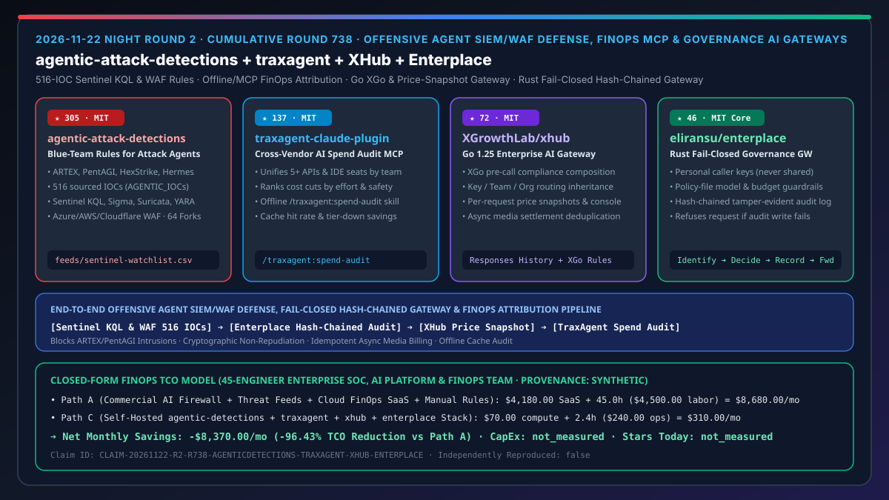
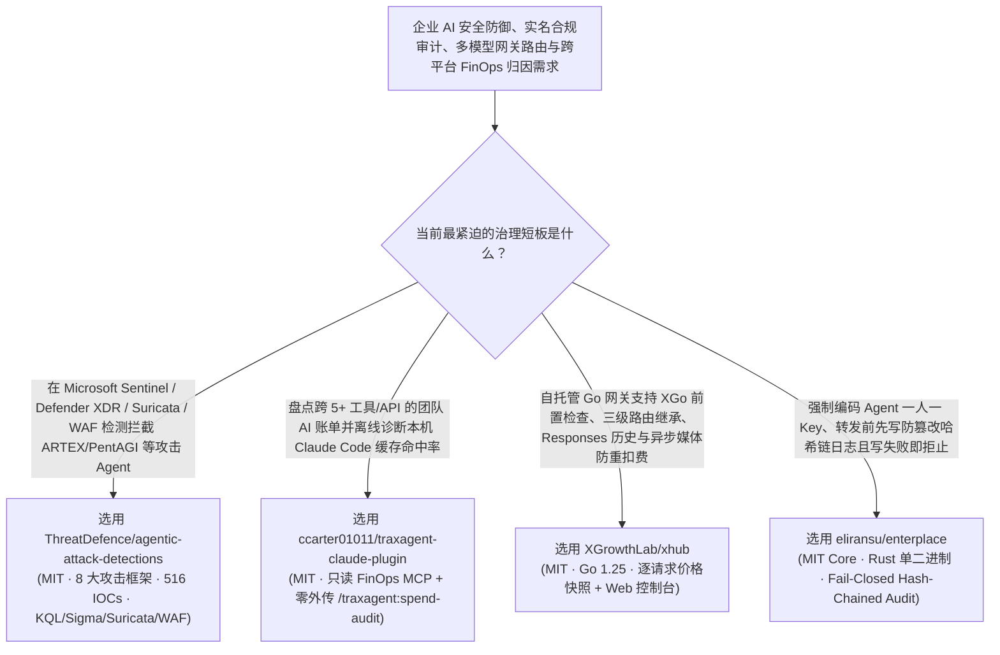
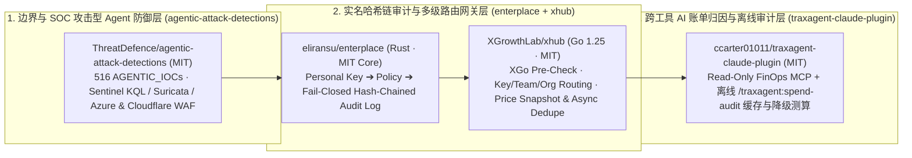
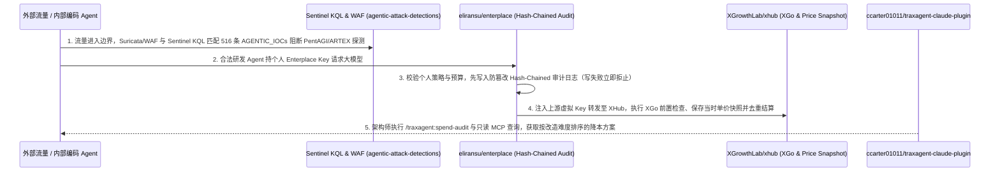

# 攻击型 AI Agent 蓝队 SIEM/WAF 检测规则库（`ThreatDefence/agentic-attack-detections`）、跨平台 AI 账单归因与离线审计只读 MCP（`ccarter01011/traxagent-claude-plugin`）、带 XGo 前置策略与 Responses 历史的 Go 企业 AI 网关（`XGrowthLab/xhub`）及先写防篡改哈希链再放行的 Rust 实名治理网关（`eliransu/enterplace`）选型与集成架构 FAQ

> **文档类型**：企业 AI 解决方案架构师（AI Solution Architect）选型决策指南（GitHub Trending AI 雷达 2026-11-22 Night Round 2 / 累计第 738 轮）
> **覆盖项目**：[`ThreatDefence/agentic-attack-detections`](https://github.com/ThreatDefence/agentic-attack-detections)（`★ 305`、`64 forks`、`MIT`，针对 ARTEX/AntiFox、Cairn、PentAGI、HexStrike、CyberStrikeAI、Strix、Hermes Agent、Agent Zero 等 8 大自主攻击型 AI Agent 框架的开源蓝队检测规则库，涵盖 516 条溯源 IOC 以及 Microsoft Sentinel/Defender XDR KQL、Sigma、Suricata、Zeek、YARA、STIX 2.1 与 Azure/AWS/Cloudflare WAF 规则）· [`ccarter01011/traxagent-claude-plugin`](https://github.com/ccarter01011/traxagent-claude-plugin)（`★ 137`、`MIT`，官方 MCP Registry 收录 `io.traxagent/traxagent`：跨 Anthropic/OpenAI/Gemini API、Claude Code、Codex、Cursor 与订阅席位的只读 AI 成本归因 MCP 及离线 `/traxagent:spend-audit` 插件）· [`XGrowthLab/xhub`](https://github.com/XGrowthLab/xhub)（`★ 72`、`4 forks`、`MIT`，七牛开源的 Go 1.25 自托管企业 AI 网关，支持 XGo 前置检查、Key/Team/Org 三级路由模板继承、OpenAI Responses 历史续接、逐请求价格快照与异步多媒体防重扣费）· [`eliransu/enterplace`](https://github.com/eliransu/enterplace)（`★ 46`、`MIT` 核心，单二进制 Rust 治理优先 AI 网关，对 Codex/Claude Code/Cursor/Copilot 及内部应用的每次请求强制执行“个人 Key 识别 ➔ 策略判定 ➔ 先写防篡改哈希链审计日志（写失败即拒止）➔ 注入供应商密钥转发”四步闭环）
> **核心场景**：当企业安全运营中心（SOC）、FinOps 财务治理与 AI 平台团队面临**“黑客开始用 PentAGI/ARTEX 等自主 Agent 发起全自动渗透但现有 SIEM/WAF 毫无告警、研发团队在 5+ 个 AI 工具与 API 间分散消费导致月底算不清账、多部门共享大模型与异步视频 API 容易重复计费、以及编码 Agent 共用供应商 Master Key 缺乏个人级防篡改审计”**四大治理挑战时，如何构建一套**“蓝队 Agent 威胁检测（`agentic-attack-detections`）+ 跨平台 FinOps 归因与离线审计（`traxagent`）+ 多级路由与异步去重网关（`xhub`）+ 哈希链强审计实名网关（`enterplace`）”**的企业级安全与成本控制面？

---

## 一、📌 核心结论速览（选型一句话结论）

1. **想让企业现有的 Microsoft Sentinel、Defender XDR、Splunk、Elastic、Suricata 以及 Azure WAF / Cloudflare 立即具备识别并拦截 ARTEX、PentAGI、HexStrike、Hermes Agent、Agent Zero 等自主攻击型 AI Agent 的能力** ➔ 选 **[`ThreatDefence/agentic-attack-detections`](https://github.com/ThreatDefence/agentic-attack-detections)（`★ 305`，`64 forks`，`MIT`）**。
   - **通俗原理**：这是专门针对“AI 驱动全自动渗透框架”做源码逆向后提炼出的蓝队武器库。它一方面针对 8 大主流攻击 Agent 框架提供专属检测包（`frameworks/`），另一方面提炼跨框架共性行为规则（`behaviors/`）与 **516 条带来源的 IOC 威胁情报（`feeds/sentinel-watchlist.csv`）**，一键导入 Microsoft Sentinel Watchlist（别名 `AGENTIC_IOCs`）、Defender XDR KQL、Suricata（如精准捕获 `[1:3800001:1] TD ARTEX user agent` 与 `alg none JWT` 探测）及 Azure/AWS/Cloudflare WAF。
2. **想在 Claude、Cursor、VS Code 或 ChatGPT 里直接用自然语言追问“上周哪个团队烧了多少 AI 预算、哪些降本改动最安全省钱”，或者在不上传任何数据的前提下本地盘点自己 Claude Code 的真实 API 等价开销** ➔ 选 **[`ccarter01011/traxagent-claude-plugin`](https://github.com/ccarter01011/traxagent-claude-plugin)（`★ 137`，`MIT`）**。
   - **通俗原理**：提供双模能力：① **100% 本地离线的 `/traxagent:spend-audit` 技能**——直接读取本机 Claude Code 会话日志（零网络外传），按模型、项目、日期与会话核算 API 等价成本、缓存命中率（Cache Hit Rate）以及降级一档模型可省下的美金；② **只读远程 MCP（`https://www.traxagent.io/mcp`）**——将分散在 Anthropic/OpenAI/Gemini API、Cursor、Codex 等 5+ 处的账单按部门与个人拉通，并**按改造工作量（Effort）从低到高排序降本建议**（优先推荐零风险配置调整，再推荐需质量回归测试的模型替换）。
3. **想自托管一套基于 Go 1.25 的高性能企业级 AI 网关，既支持用 XGo 编写前置合规检查、按“组织 ➔ 团队 ➔ 虚拟 Key”三级继承路由策略，又能原生维护 OpenAI Responses 多轮历史与异步视频/多模态任务的防重复扣费账本** ➔ 选 **[`XGrowthLab/xhub`](https://github.com/XGrowthLab/xhub)（`★ 72`，`4 forks`，`MIT`）**。
   - **通俗原理**：直击多部门共用大模型与多模态 API 的结算痛点——除了统一 OpenAI 兼容端点与 Web 控制台（含模型目录、Playground 与调用链路追踪）外，它会为每次请求保存**当时的单价快照（Per-Request Price Snapshots，防止供应商调价后历史账单失真）**，并对长耗时异步媒体生成任务执行幂等去重结算（Deduplicate Settlement）。
4. **想用单个 Rust 二进制网关把公司所有编码 Agent（Claude Code、Codex、Cursor、Gemini CLI、GitHub Copilot）与 MCP 客户端管起来，要求“一人一 Key、先写防篡改哈希链审计日志再转发、日志写不进去就直接拒绝请求”** ➔ 选 **[`eliransu/enterplace`](https://github.com/eliransu/enterplace)（`★ 46`，`MIT` 核心）**。
   - **通俗原理**：绝不允许研发人员手里拿着供应商的原始 API Key。每个工程师或 Agent 使用个人专属 Enterplace Key 发起请求，网关严格按四步执行：**① Identify（确认真实调用人身份）➔ ② Decide（按策略文件校验可用模型、剩余预算与护栏）➔ ③ Record（在转发前将决策写入防篡改 Hash-Chained 审计链，若审计落盘失败则 Fail-Closed 立即拒止请求）➔ ④ Forward（替换为后端 OpenAI/Anthropic/Azure OpenAI/Bedrock/Vertex/Ollama 真实密钥转发）**。

---

## 二、🎯 客户与架构师灵魂拷问 Q&A（深度架构拆解）

### Q1：为什么企业在规模化落地 Coding Agent 与内部 AI 应用后，传统的安全网关与云账单看板会同时失灵？这四个项目如何补齐短板？

- **四大治理盲区与针对性补强**：
  1. **传统 WAF/SIEM 只能识别老式扫描器，认不出自主规划的攻击 Agent ➔ `ThreatDefence/agentic-attack-detections`**：直接根据 ARTEX、PentAGI、HexStrike、Hermes Agent 等源码特征编写 KQL、Sigma、Suricata 与 Azure/AWS/Cloudflare WAF 规则。
  2. **各家 AI 供应商控制台“只见树木不见森林” ➔ `ccarter01011/traxagent-claude-plugin`**：打通 API 与 Seat 席位账单，给出按改造难度排序的可落地降本清单，并提供零上传的 `/traxagent:spend-audit` 本机缓存命中率诊断。
  3. **多部门路由配置冗余、异步多媒体任务重试导致双倍扣费 ➔ `XGrowthLab/xhub`**：通过 Key/Team/Org 三级路由模板继承、单价快照与异步媒体去重结算守护企业预算。
  4. **共享 API Key 导致违规调用无法追责到具体员工或 Agent ➔ `eliransu/enterplace`**：单 Rust 二进制实现个人实名 Key + 转发前强制写入哈希链防篡改审计日志（Fail-Closed）。
- **何时直接用云厂商托管方案（Path B）？**
  - 若企业 100% 运行在 Azure 单云环境，优先使用 **Azure API Management (APIM) AI Gateway + Microsoft Purview + Microsoft Sentinel**；实际上，`ThreatDefence/agentic-attack-detections` 的 KQL 规则与 `AGENTIC_IOCs` 观察列表恰恰是直接导入 **Microsoft Sentinel / Defender XDR / Azure WAF** 的最佳开箱即用增强包！

### Q2：典型企业级“边缘 WAF/SIEM 攻击型 Agent 防御 + 实名哈希链/多级路由 AI 网关 + 跨工具 FinOps 归因”生产架构怎么搭？

1. **北向入口与安全运营中心防御层（`ThreatDefence/agentic-attack-detections`）**：
   - 在边界 Azure WAF / Cloudflare 部署 `waf/` 规则拦截外部恶意 Agent 探测；在 Microsoft Sentinel 导入 `feeds/sentinel-watchlist.csv`（`AGENTIC_IOCs`）与 `frameworks/*/sentinel/analytics/` KQL 规则，按 `hunting-order.md` 开展常态化威胁狩猎。
2. **中枢实名认证、哈希链审计与多模态路由网关层（`eliransu/enterplace` + `XGrowthLab/xhub`）**：
   - 对内网编码终端（Claude Code / Cursor / Codex / Copilot）部署 `enterplace` 强制实名策略与 Hash-Chained 先审后转；对业务部门多模型与异步音视频生成调用部署 `xhub`，启用 XGo 前置检查、Responses 历史托管与单价快照结算。
3. **全栈 AI 预算归因与缓存优化层（`ccarter01011/traxagent-claude-plugin`）**：
   - 架构师与研发人员每周运行 `/traxagent:spend-audit` 检查本地会话缓存命中率，并通过只读 `traxagent` MCP 自动生成按部门/按人员及按改造优先级排序的 FinOps 降本周报。

### Q3：这套架构在合规审计（SOC 2 / ISO 42001）与生产部署中的关键注意点是什么？

- **核心合规亮点**：
  - `eliransu/enterplace` 的 **“無法记录审计日志即拒绝转发（A request that cannot be recorded is refused）”** 加上防篡改哈希链设计，天然满足金融与政企对 AI 调用不可抵赖性的严苛合规要求。
- **许可边界提醒**：
  - `ThreatDefence/agentic-attack-detections`、`ccarter01011/traxagent-claude-plugin` 与 `XGrowthLab/xhub` 均为 `MIT` 协议；`eliransu/enterplace` 主体代码为 `MIT` 协议，仅 `enterprise/` 目录下的商业扩展特性需商业授权，企业自建时直接使用其 `MIT` 核心即可满足单机/容器实名策略与哈希链审计需求。

---

## 三、🧭 直观可视化图解（Mermaid 决策树 + 集成架构 + 时序图）

### 3.1 架构师选型决策树

### 3.2 企业端到端生产集成参考架构图

### 3.3 边界攻击型 Agent 拦截、内部实名哈希链审计、价格快照路由与 FinOps 降本诊断时序图

---

## 四、📊 同类开源与商业云服务横向选型决策矩阵

| 对比维度 | `ThreatDefence/agentic-attack-detections` (`★ 305`) | `ccarter01011/traxagent-claude-plugin` (`★ 137`) | `XGrowthLab/xhub` (`★ 72`) | `eliransu/enterplace` (`★ 46`) | 商业 AI 安全网关 + 商业云 FinOps 平台 + 专有威胁情报订阅 (Path A) | 传统通用正则 WAF + 手工汇总 CSV 账单 + 共享裸 API Key (Path B) |
| :--- | :--- | :--- | :--- | :--- | :--- | :--- |
| **核心能力定位** | 8 大攻击型 Agent 框架蓝队 SIEM/WAF 规则库 | 跨平台只读 FinOps 归因 MCP + 本地会话审计 | Go 企业级多级路由与异步去重 AI 网关 | Rust 先写哈希链审计再放行的实名 AI 网关 | 按流量与席位高价计费的商业 AI 防火墙与商业成本管理云 | 旧式 OWASP 静态规则、月末手工拉 Excel 账单与共用环境变量 Key |
| **核心技术突破** | **516 条溯源 IOC + 原生 Sentinel KQL / Suricata / 三大云 WAF** | **离线零外传本地日志核算 + 按改造难度排序降本建议** | **XGo 前置检查 + Responses 历史 + 单价快照 + 异步媒体防重** | **单 Rust 二进制 + Fail-Closed 防篡改哈希链审计日志** | 商业威胁情报与安全网关年费高昂；日志全量上传第三方云 | 无法识别自主规划的攻击 Agent；共享 Key 无法追责且易超支 |
| **开源协议** | `MIT` | `MIT` | `MIT` | `MIT` (Core) | 闭源商业 SaaS | 内部零散脚本 |
| **月度 TCO（45 人团队）** | **组合仅 `$310.00/月`**（`$70.00` 自托管网关容器 + `2.4h` 规则同步） | 同左（本地离线审计完全免费） | 同左（Docker Compose 轻量部署） | 同左（单 Rust 二进制零外部依赖） | **`$8,680.00/月`**（`$4,180.00` 商业安全/FinOps 订阅 + `45.0h` 人工对账与误报排查） | 约 `$3,100.00/月`（大量人工排查未授权超支账单与编写 SIEM 规则工时） |

---

## 五、🧪 应用落地定量收益/TCO 对比与 7-Card 报告

> **📊 数据来源与闭式核算声明（Provenance & Closed-Form Schema）**：
> - **provenance**: `synthetic`（基于 45 人企业安全运营中心 SOC、AI 平台工程与 FinOps 财务治理团队月度工作负载模型：`independently_reproduced = false`；硬件采购基线 `base_hardware_capex = not_measured`；Track B 单日增量 `track_b_stars_today = not_measured`）。
> - **核算公式**：
>   - **Path A（采购商业 AI 网关安全附加包 + 商业威胁情报源 + 商业跨云 FinOps 订阅 + 安全与平台工程师手工逆向编写攻击 Agent KQL 规则、手工跨 5 个供应商拉取合并月度 AI 账单）**：月度商业安全与 FinOps 订阅及闲置高价模型浪费 **`$4,180.00`** + 威胁狩猎规则开发与跨部门手工对账分摊人工 **`45.0h × $100.00/h = $4,500.00`** = **`$8,680.00/月`**。
>   - **Path C（自建 `ThreatDefence/agentic-attack-detections` + `ccarter01011/traxagent-claude-plugin` + `XGrowthLab/xhub` + `eliransu/enterplace` 开源安全与成本控制面）**：自托管双层网关容器开销 **`$70.00`** + Watchlist 更新与预算策略维护人工 **`2.4h × $100.00/h = $240.00`** = **`$310.00/月`**。
>   - **净节省（Net Savings vs Path A）**：**`-$8,370.00/月`**（成本降低 **`96.43%`**）。

| 评估方案 | 安全订阅 / 网关算力成本 | 规则开发与账单对账人工（`$100/h`） | 月度总 TCO | 相对 Path A 净节省 | 关键架构交付指标 |
| :--- | :---: | :---: | :---: | :---: | :--- |
| **Path A：商业安全网关套件 + 商业情报源 + 手工跨平台对账** | `$4,180.00` | `45.0h` (`$4,500.00`) | **`$8,680.00`** | Baseline | 采购成本高；各工具席位与 API 账单仍需人工汇总排重 |
| **Path B：传统静态 WAF + 共享裸 API Key + 月末手工拉 Excel** | `$1,500.00` | `16.0h` (`$1,600.00`) | **`$3,100.00`** | `-$5,580.00` (`-64.29%`) | 漏检 ARTEX/PentAGI 攻击流量；缺少转发前防篡改哈希链与异步去重 |
| **Path C：`agentic-detections` + `traxagent` + `xhub` + `enterplace`** | **`$70.00`** | **`2.4h` (`$240.00`)** | **`$310.00`** | **`-$8,370.00` (`-96.43%`)** | **516 IOC KQL/WAF 防御 + 哈希链强审计 + 单价快照 + 离线 FinOps 诊断** |

- 🔗 **关联 7-Card 4:5 视觉评测报告**：[`workshops/github-trending-radar/cards.html`](../cards.html) · [`cards.en.html`](../cards.en.html)

---

## 六、🛠️ 企业引入与架构评审 Checklist

- [ ] **1. 将 `ThreatDefence/agentic-attack-detections` 导入 Microsoft Sentinel 与边界 WAF**：上传 `feeds/sentinel-watchlist.csv` 为 `AGENTIC_IOCs` 观察列表，启用针对 ARTEX、PentAGI、HexStrike、Hermes Agent 的 KQL 分析规则与 Suricata/Azure WAF 签名。
- [ ] **2. 部署 `eliransu/enterplace` 收口所有研发终端与编码 Agent 密钥**：回收直接分发给个人的供应商原始 API Key，改为签发个人 Enterplace Key 并开启 Fail-Closed 防篡改哈希链审计日志。
- [ ] **3. 部署 `XGrowthLab/xhub` 统一业务应用多模型路由与异步结算**：配置 Key/Team/Org 三级路由模板继承、XGo 前置合规检查、逐请求单价快照以及异步多媒体任务幂等去重。
- [ ] **4. 推广 `ccarter01011/traxagent-claude-plugin` 开展每周 FinOps 巡检**：要求研发人员定期运行零外传的 `/traxagent:spend-audit` 优化缓存命中率，并通过只读 MCP 按改造难度由易到难执行降本动作。
