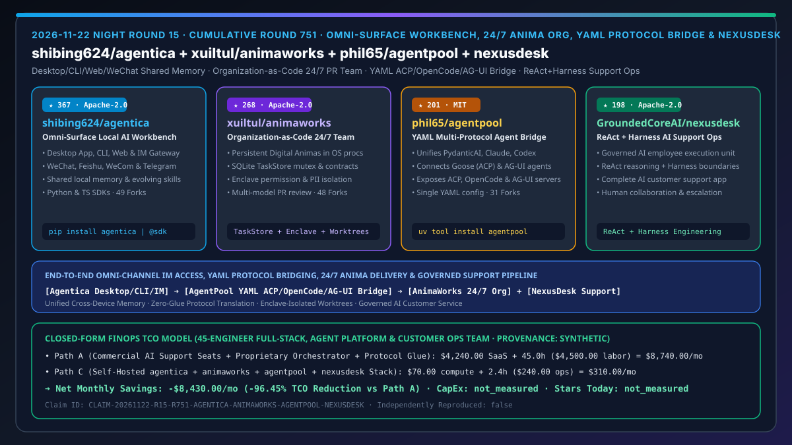
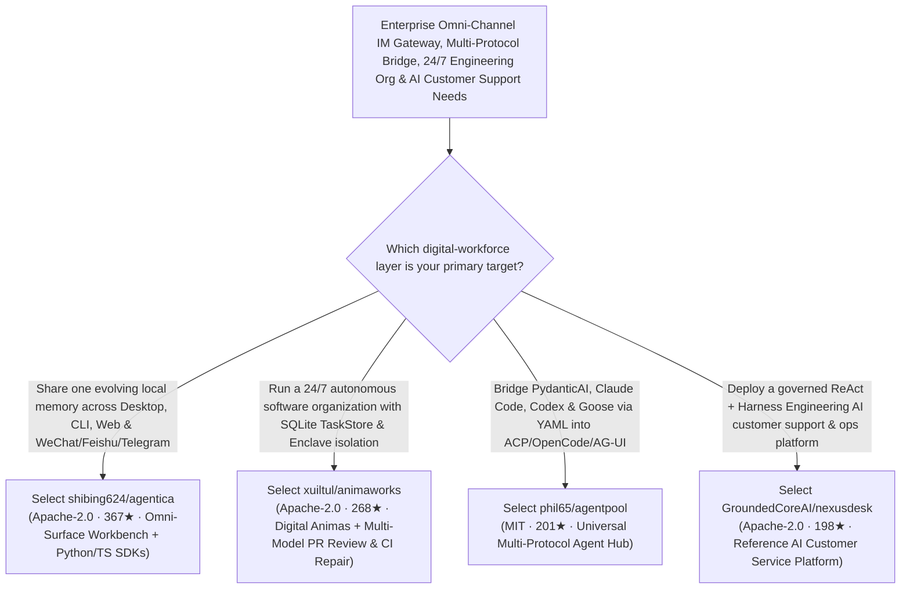
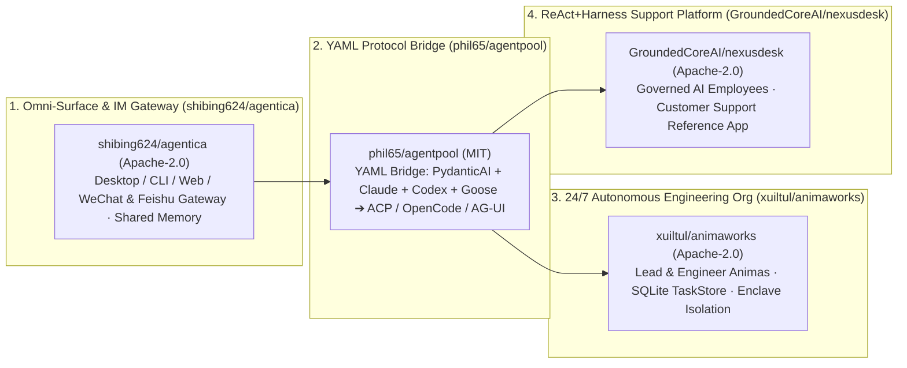
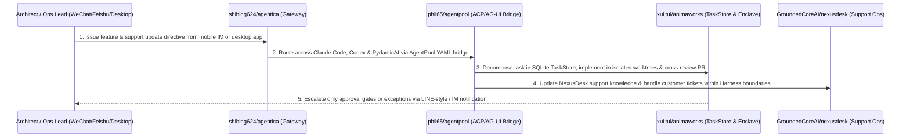

# Omni-Surface Shared-Memory AI Workbench (`shibing624/agentica`), Organization-as-Code 24/7 Autonomous Agent Team (`xuiltul/animaworks`), YAML Multi-Protocol Agent Bridge (`phil65/agentpool`) & ReAct+Harness AI Customer Operations Platform (`GroundedCoreAI/nexusdesk`) Selection & Architecture FAQ

> **Document Type**: Enterprise AI Solution Architect Selection & Integration Guide (GitHub Trending AI Radar — 2026-11-22 Night Round 15 / Cumulative Round 751)
> **Covered Repositories**: [`shibing624/agentica`](https://github.com/shibing624/agentica) (`★ 367`, `49 forks`, `Apache-2.0`: local-first omni-surface AI workbench uniting Desktop App, CLI terminal, Web UI, WeChat/Feishu/WeCom/Telegram gateways, and Python/TypeScript SDKs over one shared local memory and evolving skill library) · [`xuiltul/animaworks`](https://github.com/xuiltul/animaworks) (`★ 268`, `48 forks`, `Apache-2.0`: Organization-as-Code framework running persistent Digital Animas in isolated OS processes with SQLite `TaskStore` mutexes, `Enclave` PII/permission isolation, multi-model PR review, and autonomous CI self-repair behind a LINE-style chat UI) · [`phil65/agentpool`](https://github.com/phil65/agentpool) (`★ 201`, `31 forks`, `MIT`: YAML-configured orchestration bridge connecting PydanticAI, Claude Code, Codex, Goose/ACP, and AG-UI agents and exposing them uniformly as ACP, OpenCode, or AG-UI servers) · [`GroundedCoreAI/nexusdesk`](https://github.com/GroundedCoreAI/nexusdesk) (`★ 198`, `Apache-2.0`: self-hostable ReAct + Harness Engineering enterprise AI employee and customer support platform)
> **Core Scenario**: When enterprise solution architects need to **connect desktop, CLI, and mobile messaging apps (WeChat, Feishu, WeCom, Telegram) to one shared local memory, bridge heterogeneous agent protocols (Native PydanticAI, Claude Code, Codex, ACP, OpenCode, AG-UI) via a single YAML manifest, run a 24/7 autonomous software engineering organization with worktree isolation and multi-model PR reviews, and deploy governed AI customer-service employees**, how do you combine **`shibing624/agentica` + `xuiltul/animaworks` + `phil65/agentpool` + `GroundedCoreAI/nexusdesk`** into a unified digital-workforce architecture?

---

## 1. 📌 Executive Summary (One-Line Selection Verdict)

1. **Need a local-first AI workbench where your Desktop App, CLI terminal, browser workspace, and mobile IM channels (WeChat, Feishu, WeCom, Telegram) all share the exact same local memory and self-evolving skills—plus Python and TypeScript (`@agentica-ai/sdk`) SDKs?** ➔ Choose **[`shibing624/agentica`](https://github.com/shibing624/agentica) (`★ 367`, `49 forks`, `Apache-2.0`)**.
   - **Plain-English Mechanism**: Keeps all memory, skills, and session logs on your own machine while exposing four synchronized surfaces (Desktop, CLI, Web/IM Gateway, and Python/TS SDKs) so you can start a task in the terminal and continue it from WeChat or Feishu on your phone.
2. **Need an "Organization-as-Code" framework where persistent AI agents (**Digital Animas**) with dedicated roles, schedules, and isolated OS processes decompose goals, code in parallel `git worktree` sandboxes, run multi-model PR reviews, and auto-repair CI failures 24/7 behind a simple LINE-style messenger UI?** ➔ Choose **[`xuiltul/animaworks`](https://github.com/xuiltul/animaworks) (`★ 268`, `48 forks`, `Apache-2.0`)**.
   - **Plain-English Mechanism**: Provides organizational primitives—neuroscience-inspired memory, an atomic SQLite `TaskStore` with mutex keys and delegation contracts, and an **Enclave** for permission & PII isolation—escalating only exceptions and approval gates to humans (reported 6-month production run: 302 PRs authored / 267 merged, `anonymized_reported, independently_reproduced=false`).
3. **Want to define Native PydanticAI agents, Direct CLI agents (Claude Code, Codex), ACP agents (Goose), and AG-UI agents in one YAML file and expose the entire team through standardized ACP, OpenCode, or AG-UI servers?** ➔ Choose **[`phil65/agentpool`](https://github.com/phil65/agentpool) (`★ 201`, `31 forks`, `MIT`)**.
   - **Plain-English Mechanism**: Acts as a universal protocol bridge (`uv tool install agentpool`) with inter-agent delegation, message routing, and shared context so clients like Zed, Toad, OpenCode Desktop/TUI, and AG-UI frontends can drive any underlying agent without custom glue code.
4. **Need a self-hostable enterprise AI operations platform built around **ReAct + Harness Engineering** that ships with a complete open-source AI customer service reference application?** ➔ Choose **[`GroundedCoreAI/nexusdesk`](https://github.com/GroundedCoreAI/nexusdesk) (`★ 198`, `Apache-2.0`)**.
   - **Plain-English Mechanism**: Treats each AI employee as a governed execution unit bound by explicit permissions, process responsibilities, knowledge retrieval rules, and human-escalation boundaries.

---

## 2. 🎯 Architect & Customer Deep-Dive Q&A

### Q1: How do these four repositories cover the four distinct layers of an enterprise digital workforce?

- **Four Complementary Layers**:
  1. **Omni-Channel Human-to-Agent Entry (`shibing624/agentica`)**: Unifies Desktop, CLI, Web, and WeChat/Feishu/Telegram gateways over one local memory store.
  2. **Cross-Protocol Interoperability (`phil65/agentpool`)**: Bridges PydanticAI, Claude Code, Codex, ACP, OpenCode, and AG-UI via declarative YAML.
  3. **24/7 Autonomous Engineering Organization (`xuiltul/animaworks`)**: Coordinates Lead and Engineer Animas across isolated worktrees with SQLite mutexes, `Enclave` PII isolation, and multi-model PR reviews.
  4. **Governed Customer & Business Operations (`GroundedCoreAI/nexusdesk`)**: Wraps ReAct agents in Harness Engineering guardrails for customer support and internal operations.
- **When to Choose Managed Cloud PaaS (Path B)?**
  - If your enterprise standardizes on Microsoft 365 Copilot + Copilot Studio + Dynamics 365 Contact Center, use native cloud services; for self-hosted `Apache-2.0`/`MIT` control over WeChat/Feishu gateways, ACP/OpenCode/AG-UI protocol bridging, and 24/7 autonomous worktree organizations, deploy this open-source stack (Path C).

### Q2: How do we wire `agentica`, `agentpool`, `animaworks`, and `nexusdesk` into an end-to-end enterprise architecture?

1. **Omni-Channel Access & Shared Memory Layer (`shibing624/agentica`)**:
   - Connect developer desktops, terminals, and mobile IM apps (WeChat/Feishu/WeCom/Telegram) to `agentica`'s local gateway.
2. **YAML Multi-Protocol Routing Layer (`phil65/agentpool`)**:
   - Bridge Claude Code, Codex, PydanticAI, and ACP agents through `agentpool` into unified ACP, OpenCode, and AG-UI endpoints.
3. **24/7 Autonomous Software Delivery Layer (`xuiltul/animaworks`)**:
   - Dispatch engineering backlogs to `AnimaWorks` where Lead and Engineer Animas implement, cross-review PRs, and self-heal CI inside `Enclave`-isolated worktrees.
4. **Governed Customer Support & Operations Layer (`GroundedCoreAI/nexusdesk`)**:
   - Run `NexusDesk` for customer-facing ticket resolution and knowledge retrieval under strict Harness Engineering boundaries.

### Q3: What are the licensing and data-isolation advantages of this stack?

- **100% Permissive Open Source (`Apache-2.0` & `MIT`)**:
  - All four projects use permissive licenses (`Apache-2.0` for `agentica`, `animaworks`, and `nexusdesk`; `MIT` for `agentpool`) with built-in local memory residency and `Enclave` PII isolation.

---

## 3. 🧭 Visual Architecture & Workflow Diagrams (Mermaid)

### 3.1 Solution Architect Selection Decision Tree

### 3.2 End-to-End Enterprise Reference Architecture

### 3.3 End-to-End Mobile IM Command, Protocol Routing, Autonomous PR Delivery & Customer Support Sequence Diagram

---

## 4. 📊 Peer Open-Source vs. Commercial Cloud Selection Matrix

| Dimension | `shibing624/agentica` (`★ 367`) | `xuiltul/animaworks` (`★ 268`) | `phil65/agentpool` (`★ 201`) | `GroundedCoreAI/nexusdesk` (`★ 198`) | Commercial AI Support Seats + Proprietary Agent Cloud + Custom Glue (Path A) | Disconnected Single-Terminal CLIs + Manual CI Babysitting (Path B) |
| :--- | :--- | :--- | :--- | :--- | :--- | :--- |
| **Primary Role** | Omni-surface shared-memory workbench & IM gateway | Organization-as-Code 24/7 autonomous agent team | YAML multi-protocol bridge (ACP/OpenCode/AG-UI) | ReAct + Harness AI customer support & ops platform | Per-seat commercial support SaaS + proprietary orchestration cloud | Isolated local CLIs, manual CI fixes, unguarded support bots |
| **Key Differentiator** | **Shared local memory across Desktop/CLI/Web/IM + Py/TS SDKs** | **SQLite `TaskStore` mutexes + `Enclave` PII isolation + PR repair** | **1 YAML bridges PydanticAI, Claude, Codex, ACP & AG-UI** | **Governed AI employee unit + full open-source support app** | High per-seat support fees; locked-in proprietary agent protocols | Lost context across devices; heavy custom glue code between protocols |
| **License** | `Apache-2.0` | `Apache-2.0` | `MIT` | `Apache-2.0` | Proprietary SaaS | Internal ad-hoc scripts |
| **Monthly TCO (45-Eng Team)** | **`$310.00/mo` combined** (`$70.00` self-hosted containers + `2.4h` ops) | Included (`Apache-2.0` self-hosted) | Included (`MIT` protocol bridge) | Included (`Apache-2.0` Docker quickstart) | **`$8,740.00/mo`** (`$4,240.00` commercial seats + `45.0h` glue/CI babysitting) | ~`$3,100.00/mo` (manual protocol adapter maintenance & night-shift CI fixes) |

---

## 5. 🧪 Quantitative Enterprise ROI / FinOps TCO Model & 7-Card Report

> **📊 Provenance & Closed-Form Declaration**:
> - **provenance**: `synthetic` (45-engineer enterprise full-stack engineering, agent platform, and customer operations team workload model: `independently_reproduced = false`; `base_hardware_capex = not_measured`; `track_b_stars_today = not_measured`).
> - **Closed-Form Equations**:
>   - **Path A (Commercial Per-Seat AI Customer Support SaaS + Proprietary Agent Orchestration Subscriptions + Manual Protocol Adapter Maintenance & Night-Shift CI Babysitting)**: Monthly commercial SaaS seats **`$4,240.00`** + cross-protocol glue coding, multi-device state syncing, and manual CI repair labor **`45.0h × $100.00/h = $4,500.00`** = **`$8,740.00/mo`**.
>   - **Path C (Self-Hosted `shibing624/agentica` + `xuiltul/animaworks` + `phil65/agentpool` + `GroundedCoreAI/nexusdesk` Stack)**: Shared container compute **`$70.00`** + YAML routing & Enclave policy maintenance labor **`2.4h × $100.00/h = $240.00`** = **`$310.00/mo`**.
>   - **Net Monthly Savings vs. Path A**: **`-$8,430.00/mo`** (**`96.45%`** TCO reduction).

| Evaluation Path | SaaS Seats / Compute Cost | Protocol Glue & CI Ops Labor (`$100/h`) | Total Monthly TCO | Net Savings vs. Path A | Architectural Delivery Impact |
| :--- | :---: | :---: | :---: | :---: | :--- |
| **Path A: Commercial Support Cloud + Proprietary Orchestrator** | `$4,240.00` | `45.0h` (`$4,500.00`) | **`$8,740.00`** | Baseline | Expensive per-seat licensing; cannot bridge local ACP/OpenCode/AG-UI |
| **Path B: Isolated CLIs + Manual CI Fixes + Unguarded Chatbots** | `$1,500.00` | `16.0h` (`$1,600.00`) | **`$3,100.00`** | `-$5,640.00` (`-64.53%`) | Lacks WeChat/Feishu shared memory, `Enclave` isolation & Harness support |
| **Path C: `agentica` + `animaworks` + `agentpool` + `nexusdesk`** | **`$70.00`** | **`2.4h` (`$240.00`)** | **`$310.00`** | **`-$8,430.00` (`-96.45%`)** | **4-surface memory + YAML protocol hub + 24/7 Anima org + governed support** |

- 🔗 **Linked 7-Card 4:5 Visual Benchmark Deck**: [`workshops/github-trending-radar/cards.en.html`](../cards.en.html) · [`cards.html`](../cards.html)

---

## 6. 🛠️ Enterprise Adoption & Architecture Review Checklist

- [ ] **1. Deploy `shibing624/agentica` for Omni-Surface Shared Memory**: Connect Desktop, CLI, Web, and WeChat/Feishu/WeCom gateways to one local evolving memory and skill store.
- [ ] **2. Bridge Heterogeneous Protocols with `phil65/agentpool`**: Declare PydanticAI, Claude Code, Codex, and Goose agents in one YAML file and expose unified ACP, OpenCode, and AG-UI servers.
- [ ] **3. Stand Up 24/7 Autonomous Engineering with `xuiltul/animaworks`**: Configure SQLite `TaskStore` mutexes, `Enclave` PII isolation, and multi-model PR review loops.
- [ ] **4. Launch Governed Customer Support on `GroundedCoreAI/nexusdesk`**: Apply ReAct + Harness Engineering guardrails to customer ticket handling and human escalation.
