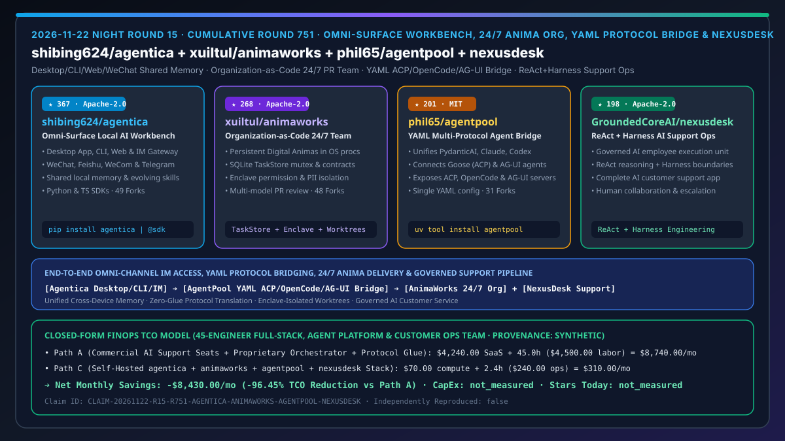
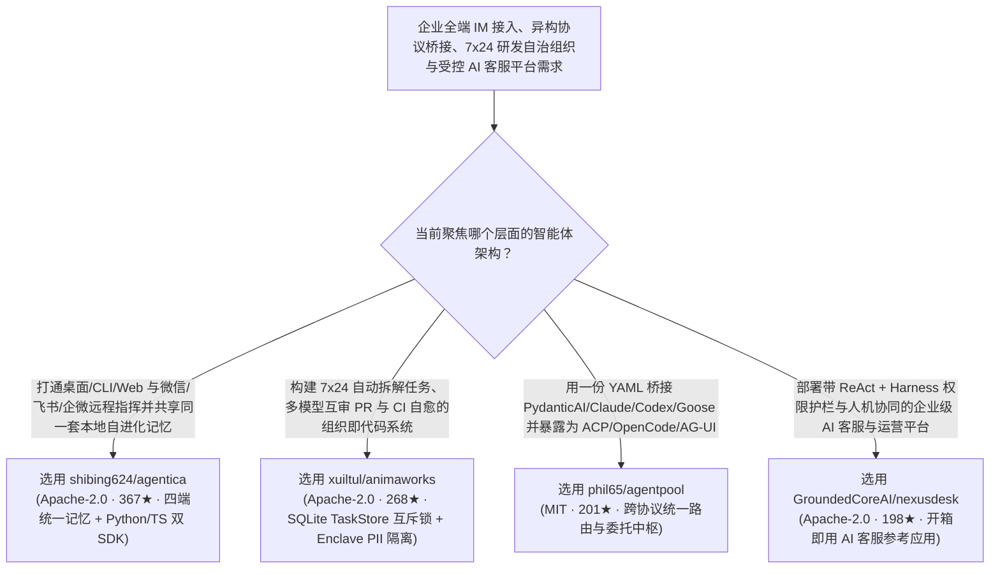
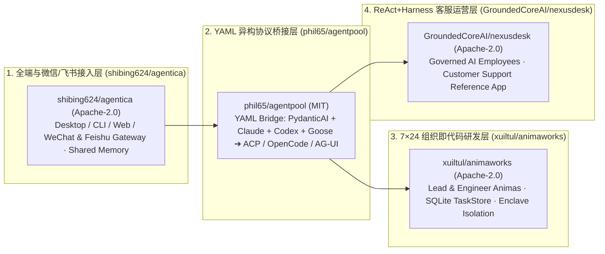
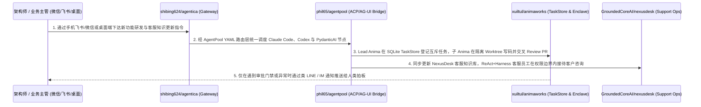

# 全端共享记忆 AI 工作台与微信/飞书网关（`shibing624/agentica`）、组织即代码 7×24 自治软件团队（`xuiltul/animaworks`）、YAML 统一协议桥接中枢（`phil65/agentpool`）与 ReAct+Harness 企业智能体客服平台（`GroundedCoreAI/nexusdesk`）选型与集成架构 FAQ

> **文档类型**：企业 AI 解决方案架构师（AI Solution Architect）选型决策指南（GitHub Trending AI 雷达 2026-11-22 Night Round 15 / 累计第 751 轮）
> **覆盖项目**：[`shibing624/agentica`](https://github.com/shibing624/agentica)（`★ 367`、`49 forks`、`Apache-2.0`，徐明开源的全端本地优先 AI 工作台，打通桌面端、CLI、Web、微信/飞书/企微/Telegram 远程网关及 Python/TS 双 SDK 并共享同一套本地自进化记忆与技能）· [`xuiltul/animaworks`](https://github.com/xuiltul/animaworks)（`★ 268`、`48 forks`、`Apache-2.0`，**Organization-as-Code** 7×24 自治智能体组织框架，内置 SQLite `TaskStore` 互斥锁、委托契约、`Enclave` 权限/PII 隔离与类 LINE 聊天前端）· [`phil65/agentpool`](https://github.com/phil65/agentpool)（`★ 201`、`31 forks`、`MIT`，基于单一 YAML 统一编排 PydanticAI、Claude Code、Codex、Goose (ACP) 与 AG-UI 智能体并同时暴露为 ACP / OpenCode / AG-UI 服务端）· [`GroundedCoreAI/nexusdesk`](https://github.com/GroundedCoreAI/nexusdesk)（`★ 198`、`Apache-2.0`，基于 ReAct + Harness Engineering 的企业级 AI 员工运营与智能客服开源参考平台）
> **核心场景**：当企业架构师试图将分散的编码工具、内部研发流水线与外部客户支持整合成**“一套既能在桌面/终端/微信/飞书随处呼出、又能用一份 YAML 把异构协议（ACP/OpenCode/AG-UI）统管起来、在后台按组织架构 7×24 自治推进 PR 与 CI 自愈、并在面向客户服务时严守 Harness 权限与人机交接边界”**的完整企业数字员工体系时，如何选型并组合这四款 `Apache-2.0`/`MIT` 开源平台？

---

## 一、📌 核心结论速览（选型一句话结论）

1. **想在自己的电脑上部署一套全能 AI 工作台，不论在桌面 App、CLI 终端、本地网页还是在外面用手机微信、飞书、企业微信发消息，都能接着同一份本地记忆和技能继续干活，且自带 Python 与 TypeScript SDK** ➔ 选 **[`shibing624/agentica`](https://github.com/shibing624/agentica)（`★ 367`，`49 forks`，`Apache-2.0`）**。
   - **通俗原理**：由知名开源作者 shibing624 打造，核心优势是**“一处记忆与技能，四端（Desktop / CLI / Web+IM / Py+TS SDK）无缝续聊”**。支持通过 `gateway/` 将本机 Agent 安全桥接到微信、飞书、企微与 Telegram，同时提供 `@agentica-ai/sdk` 与 `pip install agentica` 供业务系统内嵌。
2. **想把软件研发团队抽象为“组织即代码（Organization-as-Code）”，让多个拥有独立角色、排班、长期记忆与 OS 进程隔离的数字员工（Digital Animas）7×24 自动拆解任务、在独立 Worktree 写代码、交叉做多模型 PR Review 并自动修复 CI 报错** ➔ 选 **[`xuiltul/animaworks`](https://github.com/xuiltul/animaworks)（`★ 268`，`48 forks`，`Apache-2.0`）**。
   - **通俗原理**：前端是极简的类 LINE 聊天框（只有遇到异常或审批门禁才打扰人类），后台则通过 **SQLite `TaskStore`、互斥锁（Mutex Keys）、委托契约（Delegation Contracts）与 `Enclave` 权限/PII 隔离舱** 驱动整个 AI 组织自转（上游披露半年生产实测自主提交 302 个 PR 并合入 267 个，`anonymized_reported, independently_reproduced=false`）。
3. **想用一个 YAML 配置文件把 PydanticAI 原生 Agent、Claude Code、Codex、Goose（ACP 协议）和 AG-UI 智能体全部串起来互相委托调用，并一键对外暴露为标准的 ACP Server、OpenCode Server 或 AG-UI Server** ➔ 选 **[`phil65/agentpool`](https://github.com/phil65/agentpool)（`★ 201`，`31 forks`，`MIT`）**。
   - **通俗原理**：彻底终结“每多接一种 Agent 协议就要写一套适配胶水”的噩梦。执行 `uv tool install agentpool`，在 YAML 中声明异构成员与团队工作流，即可在 Zed、Toad、OpenCode TUI/Desktop 及任意 AG-UI 前端中无缝混编调用。
4. **想构建面向外部客户或内部共享服务中心的企业级 AI 客服与运营平台，要求以“ReAct 动态推理 + Harness Engineering 工程护栏”为核心，明确界定每个 AI 员工的职责、工具权限与人工升级边界** ➔ 选 **[`GroundedCoreAI/nexusdesk`](https://github.com/GroundedCoreAI/nexusdesk)（`★ 198`，`Apache-2.0`）**。
   - **通俗原理**：不把 AI 当成简单的问答聊天框，而是以“受控 AI 员工”为执行单元，开源了完整的企业级 AI 智能客服参考应用（涵盖知识检索、工具调用、工单处理、人机协同与执行治理）。

---

## 二、🎯 客户与架构师灵魂拷问 Q&A（深度架构拆解）

### Q1：为什么企业内部同时存在“个人助手、研发自治团队、异构协议编排、对外客服运营”四类场景，不能只用单一框架硬套？

- **四大场景定位与选型边界**：
  1. **个人与跨端移动办公（桌面+CLI+微信/飞书）➔ `shibing624/agentica`**：侧重全端入口统一与本地自进化记忆。
  2. **跨协议工具链互操作（PydanticAI + Claude + Codex + Goose + Zed/OpenCode）➔ `phil65/agentpool`**：侧重 YAML 声明式协议转换桥（ACP / OpenCode / AG-UI）。
  3. **后台 7×24 无人值守研发与运维自转 ➔ `xuiltul/animaworks`**：侧重进程级隔离、SQLite 任务互斥锁、`Enclave` PII 隔离与多模型交叉 PR 审查。
  4. **面向客户与业务流程的受控交付 ➔ `GroundedCoreAI/nexusdesk`**：侧重 ReAct + Harness 权限边界与客服工单人机协同。
- **何时直接用云厂商托管方案（Path B）？**
  - 若企业全员使用 Microsoft 365 Copilot + Copilot Studio + Dynamics 365 Contact Center，可优先采用微软云原生全套方案；若需打通国内企微/飞书本机网关、混编 ACP/OpenCode/AG-UI 协议或自建 `Apache-2.0` 组织即代码与客服底座，则选用本轮组合（Path C）。

### Q2：典型企业级“协议桥接 (`AgentPool`) + 全端微信/飞书入口 (`Agentica`) + 7×24 研发组织 (`AnimaWorks`) + 受控客服中心 (`NexusDesk`)”架构怎么搭？

1. **多端接入与移动 IM 网关层（`shibing624/agentica`）**：
   - 为架构师与管理者提供桌面、CLI 与微信/飞书/企微统一入口。
2. **异构智能体协议转换层（`phil65/agentpool`）**：
   - 通过单一 YAML 将 Claude Code、Codex、PydanticAI 与 Goose 统一封装为标准 ACP / OpenCode / AG-UI 服务端。
3. **后台 7×24 研发自治组织层（`xuiltul/animaworks`）**：
   - Lead Anima 接收需求并通过 SQLite `TaskStore` 与 `Enclave` 隔离舱调度 Engineer Animas 在独立 Worktree 完成编码、多模型互审与 CI 自愈。
4. **前台客户服务与运营治理层（`GroundedCoreAI/nexusdesk`）**：
   - 部署 `NexusDesk` 承载一线客户咨询、知识检索与受控工单处理，超权限事项自动转交人工。

### Q3：这套架构的开源合规性与数据隔离保障如何？

- **100% 商业友好开源协议**：
  - `shibing624/agentica`、`xuiltul/animaworks` 与 `GroundedCoreAI/nexusdesk` 均为 `Apache-2.0`；`phil65/agentpool` 为 `MIT`；`animaworks` 内置 `Enclave` 模块专门负责敏感凭证与 PII 数据隔离。

---

## 三、🧭 直观可视化图解（Mermaid 决策树 + 集成架构 + 时序图）

### 3.1 架构师选型决策树

### 3.2 企业端到端生产集成参考架构图

### 3.3 微信/飞书远程下令、YAML 协议路由、7×24 多模型 PR 互审与前台客服协同交付时序图

---

## 四、📊 同类开源与商业云服务横向选型决策矩阵

| 对比维度 | `shibing624/agentica` (`★ 367`) | `xuiltul/animaworks` (`★ 268`) | `phil65/agentpool` (`★ 201`) | `GroundedCoreAI/nexusdesk` (`★ 198`) | 商业数字员工 SaaS + 商业全渠道客服云 + 手写协议胶水 (Path A) | 零散单机脚本 + 手工盯守 CI + 无护栏聊天机器人 (Path B) |
| :--- | :--- | :--- | :--- | :--- | :--- | :--- |
| **核心能力定位** | 全端共享记忆工作台 + 微信/飞书网关 | 组织即代码 7×24 自治软件团队 | YAML 跨协议（ACP/OpenCode/AG-UI）中枢 | ReAct + Harness 企业 AI 客服与运营台 | 按坐席高价计费的商业客服云与商业 Agent 平台 | 各自孤立的 CLI、人工修 CI 与裸调 API 客服框 |
| **核心技术突破** | **四端共享本地自进化记忆 + Python/TS 双 SDK** | **SQLite `TaskStore` 互斥锁 + `Enclave` 隔离 + 多模型 PR 互审** | **一份 YAML 统一桥接 Native/CLI/ACP/AG-UI 四类生态** | **以受控 AI 员工为单元 + 完整开源客服参考应用** | 商业客服坐席费昂贵；跨协议编码工具无法在商业云内混编 | 换个终端就丢记忆；异构协议互调需写大量胶水代码 |
| **开源协议** | `Apache-2.0` | `Apache-2.0` | `MIT` | `Apache-2.0` | 闭源商业 SaaS | 内部零散脚本 |
| **月度 TCO（45 人团队）** | **组合仅 `$310.00/月`**（`$70.00` 自托管容器 + `2.4h` 维护） | 同左（Apache-2.0 自托管） | 同左（MIT 零协议转换税） | 同左（Docker 一键拉起客服工作台） | **`$8,740.00/月`**（`$4,240.00` 商业数字员工/客服坐席 + `45.0h` 协议适配与值班人工） | 约 `$3,100.00/月`（大量人工维护多协议胶水与夜间值班修 CI 工时） |

---

## 五、🧪 应用落地定量收益/TCO 对比与 7-Card 报告

> **📊 数据来源与闭式核算声明（Provenance & Closed-Form Schema）**：
> - **provenance**: `synthetic`（基于 45 人企业全栈研发、智能体平台工程与客户服务运营团队月度工作负载模型：`independently_reproduced = false`；硬件采购基线 `base_hardware_capex = not_measured`；Track B 单日增量 `track_b_stars_today = not_measured`）。
> - **核算公式**：
>   - **Path A（采购按坐席计费的商业 AI 客服云 + 商业数字员工编排平台 + 工程师手工编写 ACP/AG-UI/CLI 互调胶水代码与夜间人工值班修复 CI 失败）**：月度商业坐席与平台订阅 **`$4,240.00`** + 跨协议胶水开发、多端状态同步与夜间 CI 巡检人工 **`45.0h × $100.00/h = $4,500.00`** = **`$8,740.00/月`**。
>   - **Path C（自建 `shibing624/agentica` + `xuiltul/animaworks` + `phil65/agentpool` + `GroundedCoreAI/nexusdesk` 开源全栈）**：共享容器算力开销 **`$70.00`** + YAML 编排与契约配置维护人工 **`2.4h × $100.00/h = $240.00`** = **`$310.00/月`**。
>   - **净节省（Net Savings vs Path A）**：**`-$8,430.00/月`**（成本降低 **`96.45%`**）。

| 评估方案 | 商业坐席 / 容器算力成本 | 协议适配与值班运维人工（`$100/h`） | 月度总 TCO | 相对 Path A 净节省 | 关键架构交付指标 |
| :--- | :---: | :---: | :---: | :---: | :--- |
| **Path A：商业客服云坐席 + 商业编排台 + 手写协议胶水** | `$4,240.00` | `45.0h` (`$4,500.00`) | **`$8,740.00`** | Baseline | 按坐席年费高；异构 CLI 与 ACP/AG-UI 协议难以打通 |
| **Path B：孤立单机 CLI + 人工盯守 CI + 简易问答脚本** | `$1,500.00` | `16.0h` (`$1,600.00`) | **`$3,100.00`** | `-$5,640.00` (`-64.53%`) | 缺少微信/飞书共享记忆、`Enclave` 隔离与 Harness 客服治理 |
| **Path C：`agentica` + `animaworks` + `agentpool` + `nexusdesk`** | **`$70.00`** | **`2.4h` (`$240.00`)** | **`$310.00`** | **`-$8,430.00` (`-96.45%`)** | **四端共享记忆 + YAML 协议桥 + 7×24 自治组织 + 受控客服** |

- 🔗 **关联 7-Card 4:5 视觉评测报告**：[`workshops/github-trending-radar/cards.html`](../cards.html) · [`cards.en.html`](../cards.en.html)

---

## 六、🛠️ 企业引入与架构评审 Checklist

- [ ] **1. 部署 `shibing624/agentica` 打通桌面、CLI 与微信/飞书共享记忆**：开启本地网关与自进化技能库，实现移动 IM 与本地开发环境无缝衔接。
- [ ] **2. 使用 `phil65/agentpool` 统一异构智能体协议**：通过单一 YAML 将 PydanticAI、Claude Code、Codex 与 Goose 桥接为标准 ACP / OpenCode / AG-UI 服务。
- [ ] **3. 引入 `xuiltul/animaworks` 构建 7×24 研发自治流水线**：配置 SQLite `TaskStore` 互斥锁、`Enclave` 敏感隔离与多模型交叉 PR Review。
- [ ] **4. 基于 `GroundedCoreAI/nexusdesk` 落地受控 AI 客服与运营**：运用 ReAct + Harness 工程护栏规范工具权限与人机升级闭环。
