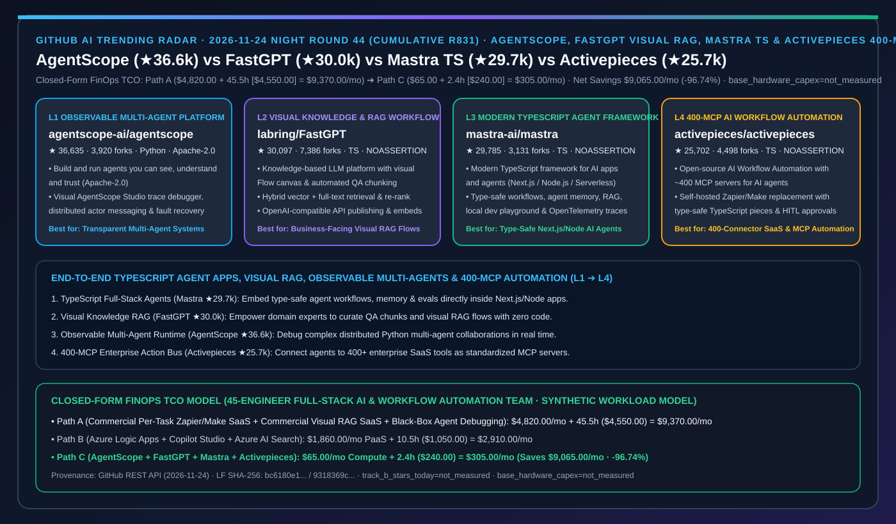
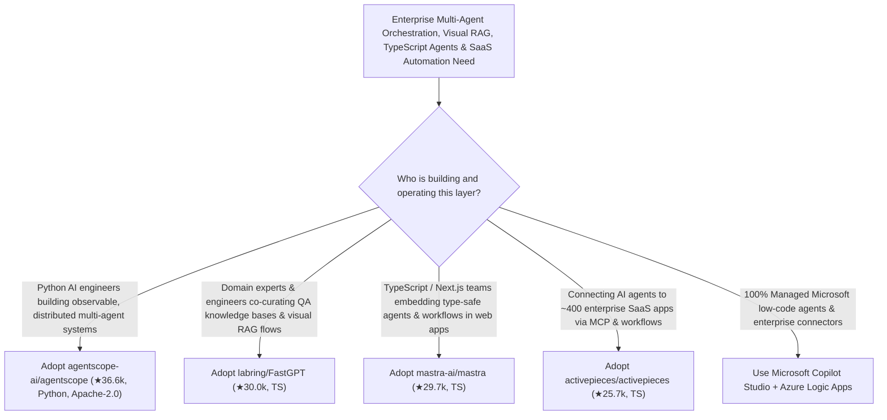
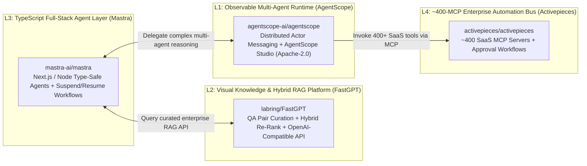
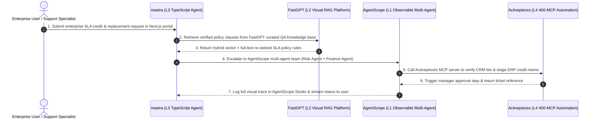

# Observable Multi-Agent Platform (`agentscope-ai/agentscope`), Visual Knowledge & RAG Orchestration (`labring/FastGPT`), Modern TypeScript Agent Framework (`mastra-ai/mastra`) & 400-MCP Workflow Automation (`activepieces/activepieces`) Selection & Architecture FAQ

> **Document Type**: AI Solution Architect Selection & Integration Guide (2026-11-24 Night Round 44 / Cumulative Round 831)  
> **Reading Time**: ~8 minutes  
> **Covered Repositories**: [`agentscope-ai/agentscope`](https://github.com/agentscope-ai/agentscope) (`★ 36,635` · `3,920 forks` · Python · `Apache-2.0`) · [`labring/FastGPT`](https://github.com/labring/FastGPT) (`★ 30,097` · `7,386 forks` · TypeScript · `NOASSERTION`) · [`mastra-ai/mastra`](https://github.com/mastra-ai/mastra) (`★ 29,785` · `3,131 forks` · TypeScript · `NOASSERTION`) · [`activepieces/activepieces`](https://github.com/activepieces/activepieces) (`★ 25,702` · `4,498 forks` · TypeScript · `NOASSERTION`)  
> **Evidence Provenance**: GitHub REST API verified metadata (2026-11-24) and sealed local evidence files `trending-daily-2026-11-24-raw.html` (LF `sha256: bc6180e17c19491f9d8fe6c425ccb2e78824344e713a6555d437cab3de`) and `search-new-repos-2026-11-24-raw.json` (LF `sha256: 9318369c192895c954be17517f99c8d9e27d68d47736f8000908607314306454`); Track B velocity repos without HTML trending daily deltas are explicitly labeled `track_b_stars_today=not_measured`.  
> **中文版本**: [`agentscope-fastgpt-mastra-activepieces-selection-faq.md`](./agentscope-fastgpt-mastra-activepieces-selection-faq.md)

---

## ① 📌 Executive Summary

**One-Sentence Selection Verdict**: When an enterprise spans **Python AI engineers, TypeScript/Next.js full-stack product teams, and non-technical domain operations teams**, combining **`agentscope-ai/agentscope` (L1 Observable & Trustworthy Python Multi-Agent Platform), `labring/FastGPT` (L2 Visual Knowledge-Base & Hybrid RAG Workflow Platform), `mastra-ai/mastra` (L3 Modern TypeScript Framework for AI Applications & Agents), and `activepieces/activepieces` (L4 Open-Source AI Workflow Automation with ~400 MCP Servers)** reduces monthly TCO for a 45-engineer team from **`$9,370.00/mo`** (Path A: Commercial Per-Task Automation SaaS + Commercial Visual RAG SaaS + Black-Box Multi-Agent Debugging) to **`$305.00/mo`** (Path C), saving **`$9,065.00/mo` (`-96.74%`)**.

| Dimension | `agentscope-ai/agentscope` (L1 Observable Multi-Agents) | `labring/FastGPT` (L2 Visual Knowledge & RAG Platform) | `mastra-ai/mastra` (L3 TypeScript Agent Framework) | `activepieces/activepieces` (L4 400-MCP Automation Engine) |
|---|---|---|---|---|
| **Verified Stars & Forks** | `★ 36,635` · `3,920 forks` | `★ 30,097` · `7,386 forks` | `★ 29,785` · `3,131 forks` | `★ 25,702` · `4,498 forks` |
| **Language & License** | Python (`Apache-2.0`) | TypeScript (`NOASSERTION`) | TypeScript (`NOASSERTION`) | TypeScript (`NOASSERTION`) |
| **Plain-English Positioning** | Build and run agents you can see, understand, and trust with AgentScope Studio observability | Knowledge-based LLM platform offering out-of-the-box QA chunking, hybrid RAG & visual workflow orchestration | Modern TypeScript framework for AI-powered applications and agents (workflows, memory, RAG & evals) | Open-source AI workflow automation platform exposing ~400 SaaS connectors as MCP servers for AI agents |
| **Core Enterprise Pain Solved** | Eliminates black-box multi-agent debugging by making every message, tool call, and state transition visually inspectable | Empowers non-technical domain experts to inspect, edit, and tune RAG chunks and QA pairs in a web UI | Lets TypeScript/Next.js teams build type-safe agents and suspend/resume workflows without spinning up a separate Python stack | Eliminates hand-coding OAuth2 and API wrappers across 400+ enterprise SaaS tools by exposing them directly as MCP servers |
| **When to Choose vs Cloud PaaS** | Choose for complex, observable Python multi-agent simulations and distributed actor workflows | Choose when business operators must co-maintain high-precision RAG knowledge bases alongside engineers | Mandatory for TypeScript/Next.js full-stack teams building production AI web applications | Choose as a self-hosted replacement for Zapier/Make with native 400-MCP support; use Azure Logic Apps on pure Azure |

---

## ② 🎯 Architect & Customer Q&A (1–2 Minute Read)

### Q1: Why are full-stack web engineering teams adopting `mastra-ai/mastra` (`★ 29,785`) instead of maintaining a separate Python microservice just to run AI agents?
- **The Pain**: Maintaining a split TypeScript frontend/BFF and Python agent backend doubles CI/CD pipelines, duplicates Zod/Pydantic schemas, and complicates deployment.
- **Architect's Answer**: **`mastra-ai/mastra`** gives TypeScript/Node.js/Next.js teams a first-class agent framework with **Zod-typed tools, durable suspend-and-resume workflows, agent memory, RAG, built-in evals, and OpenTelemetry tracing** in one unified TypeScript codebase.

### Q2: Why do enterprise support and knowledge operations teams favor `labring/FastGPT` (`★ 30,097` · `7,386 forks`) for customer-facing RAG?
- **Fine-Grained QA Chunk Curation + Visual Flow Canvas**: `FastGPT` excels at turning raw enterprise documents into **editable Q&A pairs and hybrid vector/full-text chunks**, allowing non-technical subject-matter experts to inspect retrieval scores and fix edge-case answers directly in the browser.

### Q3: How do `agentscope-ai/agentscope` (`★ 36,635`) and `activepieces/activepieces` (`★ 25,702`) power backend reasoning and enterprise SaaS execution?
- **Visual Multi-Agent Debugging + ~400 Ready-Made MCP Servers**:
  1. **`agentscope-ai/agentscope` (`Apache-2.0`)**: Provides transparent message-passing multi-agent orchestration with **AgentScope Studio** for real-time visual inspection and fault recovery.
  2. **`activepieces/activepieces`**: Turns **~400 production SaaS integrations into ready-to-use MCP servers**, letting any `agentscope` or `mastra` agent trigger enterprise actions with human-in-the-loop approval gates.

---

## ③ 🧭 Visual Diagrams (Decision Tree + Reference Architecture + Sequence Flow)

### 3.1 Selection Decision Tree

### 3.2 End-to-End Enterprise Production Reference Architecture

### 3.3 End-to-End Execution Sequence Diagram

---

## ④ 📊 Comparative Selection Matrix: OSS Stack vs. Peer OSS vs. Cloud PaaS

| Dimension | This OSS Stack (`agentscope` + `FastGPT` + `mastra` + `activepieces`) | Uncoordinated Custom Stack (`Black-Box Scripts` + `CLI-Only Chunking` + `Custom OAuth Glue`) | Managed Cloud Stack (`Zapier Enterprise` + `Commercial RAG SaaS` + `Managed Agent Cloud`) |
|---|---|---|---|
| **Core Role** | Observable Python multi-agents + visual RAG platform + TS agent framework + 400-MCP automation engine | Opaque console logs + developer-bottlenecked RAG tuning + brittle custom webhooks | Per-task automation SaaS + per-seat RAG cloud + proprietary agent builder |
| **Best-Fit Scenario** | Polyglot TS/Python organizations, operator-curated enterprise RAG, and multi-SaaS MCP automation | Single-developer prototypes with no SaaS integrations | Small teams with low monthly task volume and 100% SaaS preference |
| **Integration Effort** | **Low** (OpenAI-compatible endpoints, standard MCP servers, and native TS/Python SDKs) | Very High (Maintaining OAuth2 token refresh and custom UIs for dozens of SaaS apps) | Low (Fast onboarding, but per-task billing scales steeply at enterprise volume) |
| **Operational Complexity** | **Low** (Visual debugging in AgentScope Studio and FastGPT; ~`2.4h/mo` ops) | Very High (Debugging black-box agent loops and manually re-chunking docs costs ~`45.5h/mo`) | Low (Managed cloud PaaS, plus ~`10.5h/mo` connector governance) |
| **License & Compliance** | `agentscope` (`Apache-2.0`); verify community vs enterprise license boundaries for `FastGPT`, `mastra`, and `activepieces` (`NOASSERTION`) | MIT / custom code | Proprietary per-task and per-seat contracts |
| **45-Engineer Monthly TCO** | **`$305.00/mo`** (`$65.00` internal container cluster + `2.4h` ops) | ~`$4,615.00/mo` (`$65.00` host + `45.5h` black-box debugging & connector maintenance) | **`$2,910.00/mo`** (Path B) to **`$9,370.00/mo`** (Path A commercial stack) |

---

## ⑤ 🧪 Quantitative ROI & Closed-Form FinOps TCO Comparison

> **Provenance Disclosure**: The TCO table below is a closed-form synthetic architectural model (`provenance: synthetic`, `independently_reproduced: false`) for a **45-engineer enterprise full-stack AI and workflow automation team** operating 20 curated domain RAG knowledge bases, observable multi-agent workflows, and 400,000 monthly SaaS automation tasks (`$100.00/hr` loaded engineering rate). Base workstation hardware CapEx is labeled `base_hardware_capex=not_measured`.

| Cost Component | Path A: Commercial Per-Task Automation SaaS + Commercial Visual RAG SaaS + Black-Box Debugging | Path B: Azure Logic Apps + Copilot Studio + Azure AI Search | Path C: `agentscope` + `FastGPT` + `mastra` + `activepieces` |
|---|---|---|---|
| **Monthly API / SaaS / Cloud Spend** | **`$4,820.00`** (400k commercial automation task fees + commercial RAG seats + tracing SaaS) | **`$1,860.00`** (Logic Apps connector executions + Copilot Studio capacity + AI Search) | **`$65.00`** (`$0` community license fees; `$65` internal container cluster) |
| **Monthly Custom OAuth Maintenance, Manual RAG Re-Chunking & Debugging Labor** | `45.5h` (Engineers manually re-chunking docs for business teams + debugging opaque agent loops) | `10.5h` (Cloud workflow & knowledge connector administration) | **`2.4h`** (Self-service RAG curation in `FastGPT` + visual traces in `AgentScope` + 400 MCPs in `activepieces`) |
| **Monthly Labor Cost (`$100.00/hr`)** | **`$4,550.00`** (`45.5 * 100.00`) | **`$1,050.00`** (`10.5 * 100.00`) | **`$240.00`** (`2.4 * 100.00`) |
| **Total Monthly TCO** | **`$9,370.00 / mo`** | **`$2,910.00 / mo`** | **`$305.00 / mo`** |
| **Net Monthly Savings vs. Path A** | Baseline (`$0.00`) | Saves `$6,460.00 / mo` (`-68.94%`) | **Saves `$9,065.00 / mo` (`-96.74%`)** |

---

## ⑥ 🛠️ Enterprise Architecture Review & Adoption Checklist

- [ ] **Enforce Max-Turn & Token Circuit Breakers in AgentScope (`agentscope-ai/agentscope`)**: Configure explicit message-exchange ceilings and stream all multi-agent execution traces to `AgentScope Studio` for auditability.
- [ ] **Self-Service Business QA Curation with Regression Benchmarks (`labring/FastGPT`)**: Let domain owners refine QA pairs and chunk boundaries in `FastGPT` while gating production workflow updates on golden evaluation sets.
- [ ] **Strict Zod Input/Output Schemas for TypeScript Agents (`mastra-ai/mastra`)**: Define strict `zod` schemas on every `Mastra` tool and workflow step, using native `suspend`/`resume` primitives for human approvals.
- [ ] **Role-Scoped MCP Tool Whitelisting (`activepieces/activepieces`)**: Expose only the 5–10 specific `activepieces` MCP tools required for each agent's role rather than loading all ~400 connectors into a single prompt context.
