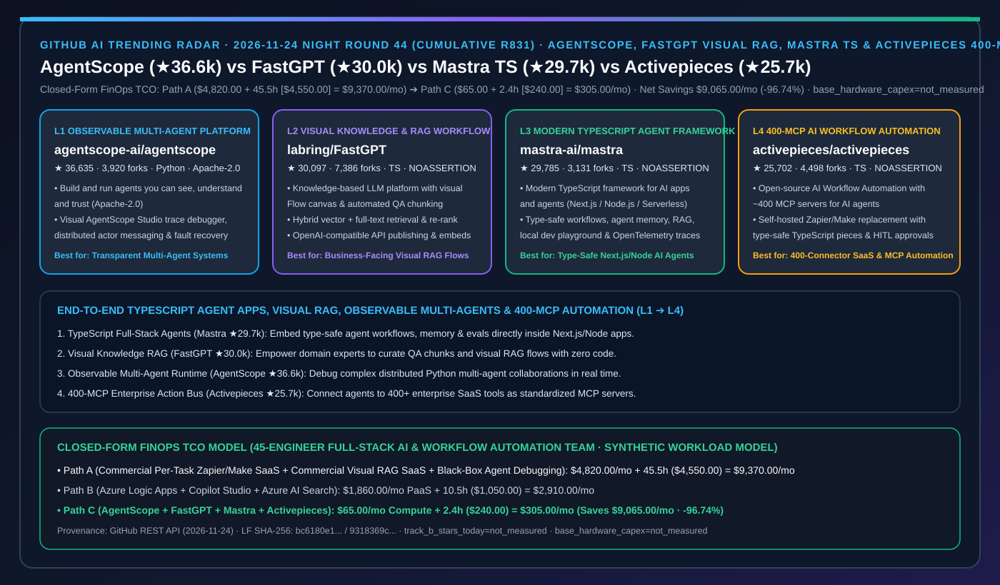
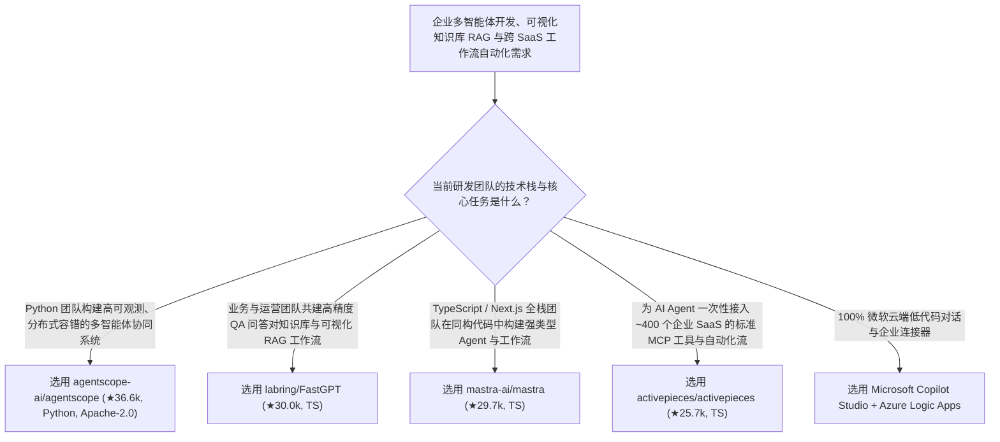
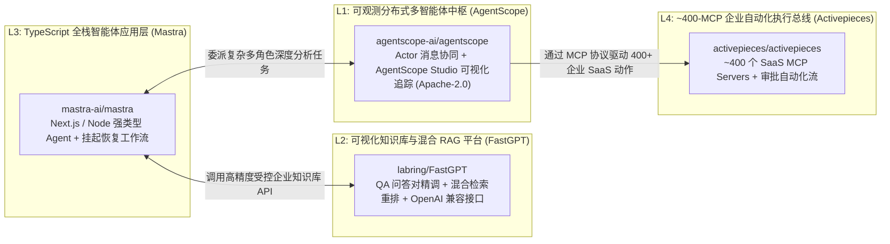
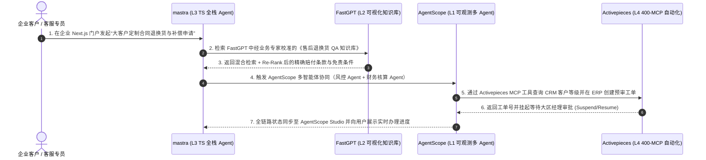

# 可观测多智能体框架（`agentscope-ai/agentscope`）、可视化知识库与 RAG 编排（`labring/FastGPT`）、现代 TypeScript 智能体框架（`mastra-ai/mastra`）与 400-MCP 自动化工作流引擎（`activepieces/activepieces`）选型与集成 FAQ

> **文档类型**：AI 解决方案架构师（AI Solution Architect）选型决策指南（2026-11-24 Night Round 44 / 累计第 831 轮）  
> **阅读耗时**：约 8 分钟  
> **覆盖项目**：[`agentscope-ai/agentscope`](https://github.com/agentscope-ai/agentscope)（`★ 36,635` · `3,920 forks` · Python · `Apache-2.0`） · [`labring/FastGPT`](https://github.com/labring/FastGPT)（`★ 30,097` · `7,386 forks` · TypeScript · `NOASSERTION`） · [`mastra-ai/mastra`](https://github.com/mastra-ai/mastra)（`★ 29,785` · `3,131 forks` · TypeScript · `NOASSERTION`） · [`activepieces/activepieces`](https://github.com/activepieces/activepieces)（`★ 25,702` · `4,498 forks` · TypeScript · `NOASSERTION`）  
> **证据溯源**：GitHub REST API 实测元数据（2026-11-24）与本地冻结证据文件 `trending-daily-2026-11-24-raw.html`（LF `sha256: bc6180e17c19491f9d8fe6c425ccb2e78824344e713a6555d437cab3de`）、`search-new-repos-2026-11-24-raw.json`（LF `sha256: 9318369c192895c954be17517f99c8d9e27d68d47736f8000908607314306454`）；Track B 仓库无 HTML 榜单对应的单日增量，统一标记为 `track_b_stars_today=not_measured`。  
> **English Version**: [`agentscope-fastgpt-mastra-activepieces-selection-faq.en.md`](./agentscope-fastgpt-mastra-activepieces-selection-faq.en.md)

---

## ① 📌 核心结论速览（Executive Summary）

**选型一句话结论**：当企业同时拥有 **Python 算法团队、TypeScript/Next.js 全栈研发团队与非技术业务运营团队**，需要打通“代码级可观测多 Agent + 前端类型安全 Agent 嵌入 + 业务可视化知识库编排 + 400 个外部 SaaS MCP 连接器”时，采用 **`agentscope-ai/agentscope`（L1 阿里开源的“看得见、懂逻辑、可信赖”Python 可观测多智能体平台）+ `labring/FastGPT`（L2 3 万星开箱即用 QA 问答对拆分与可视化 RAG 工作流平台）+ `mastra-ai/mastra`（L3 面向现代 TypeScript/Next.js 全栈开发者的类型安全 Agent 框架）+ `activepieces/activepieces`（L4 内置约 400 个 MCP Server 的开源 AI 工作流自动化引擎）**，可将 45 人团队的月度 TCO 从商业按任务计费自动化云（Zapier/Make）+ 商业 RAG SaaS 席位 + 黑盒多 Agent 排障损耗（Path A）的 **`$9,370.00/月`** 降至 **`$305.00/月`**（净省 **`$9,065.00/月`**，降幅 **`-96.74%`**）。

| 评估维度 | `agentscope-ai/agentscope` (L1 可观测 Python 多智能体) | `labring/FastGPT` (L2 可视化知识库与 RAG 编排) | `mastra-ai/mastra` (L3 现代 TypeScript 智能体框架) | `activepieces/activepieces` (L4 400-MCP 自动化引擎) |
|---|---|---|---|---|
| **GitHub 实测热度** | `★ 36,635` · `3,920 forks` | `★ 30,097` · `7,386 forks` | `★ 29,785` · `3,131 forks` | `★ 25,702` · `4,498 forks` |
| **实现语言与开源协议** | Python (`Apache-2.0`) | TypeScript (`NOASSERTION` · 社区版 + 商业版) | TypeScript (`NOASSERTION` · 核心 Apache-2.0/ELv2) | TypeScript (`NOASSERTION` · 核心 MIT + EE) |
| **一句话通俗定位** | “构建看得见、可理解、可信赖的智能体”——带可视化调试工作台与分布式 Actor 通信的多 Agent 框架 | 基于大模型的知识库平台：提供开箱即用的数据清洗、QA 拆分、混合 RAG 检索与可视化工作流编排 | 由 Gatsby 原班人马打造的现代 TypeScript AI 应用与 Agent 开发框架（内置工作流、记忆、RAG 与评测） | 开源版 Zapier：把约 400 个企业 SaaS 插件直接暴露为 AI Agent 可调用的 MCP Servers |
| **解决的核心业务痛点** | 解决传统 Python 多智能体框架“跑起来是个黑盒、几个 Agent 死循环互聊烧光 Token 却看不清调用栈”的痛点 | 解决纯代码 RAG 框架对业务部门门槛太高、客服主管无法自己在网页上修正某条错误知识切片的痛点 | 解决全栈 TypeScript/Next.js 团队被迫为了写一个简单 Agent 而额外维护一套异构 Python 微服务的割裂痛点 | 免除为 Salesforce、HubSpot、Notion、Gmail、Jira 逐个手写 MCP Server 的重复造轮子工作 |
| **何时选它 vs 云托管** | Python 团队构建复杂多角色协同、分布式仿真与强可观测生产级 Agent 时首选 | 需要让产品经理与客服运营直接在可视化画布上微调企业知识库问答逻辑时首选 | 团队主力技术栈为 TypeScript / Node.js / Next.js 且追求端到端强类型校验（Zod）时必选 | 需要自托管替代按执行步数昂贵计费的 Zapier 并一键获得 400+ MCP 工具时首选；纯微软云选 Azure Logic Apps |

---

## ② 🎯 客户与架构师灵魂拷问 Q&A（1–2 分钟速读）

### Q1：现在全栈 Web 团队 80% 都在用 TypeScript（Next.js / Node.js），为什么他们越来越倾向于直接选 `mastra-ai/mastra`（`★ 29,785`）而不是去调 Python 框架？
- **痛点**：如果前端和 BFF 层全是 TypeScript，为了跑一个智能体专门起一套 Python 服务，会导致两套 CI/CD、两套类型定义、两套部署容器。
- **架构师解答**：**`mastra-ai/mastra`** 是专为现代 TypeScript 工程团队设计的全功能 Agent 框架：
  1. **原生 Zod 强类型工具与状态机工作流（Workflows）**：支持分支、并行、挂起等待人工审批（Suspend & Resume），与 Next.js / React / Vercel / Node.js 无缝同构部署。
  2. **内置本地 Playground 与 OpenTelemetry 追踪**：启动本地开发服务器即可在网页端交互调试 Agent 记忆、RAG 切片与评分器（Evals）。

### Q2：同样是开源可视化 AI 平台，为什么在重度企业知识库问答（客服、售后、内部制度查询）场景下，很多中国与亚太企业点名选 `labring/FastGPT`（`★ 30,097` · `7,386 forks`）？
- **核心收益**：企业做 RAG 最痛苦的不是接大模型，而是**脏文档清洗与问答对（Q&A Pairs）精细化运营**。`labring/FastGPT` 把“文档分块预览、LLM 自动抽取 QA 问答对、手动修改单个切片向量、混合检索（向量 + 全文检索）+ 重排（Re-Rank）测试台”做到了极致易用，业务运营人员无需懂代码即可把知识库准确率从 70% 调优到 95%+。

### Q3：`agentscope-ai/agentscope`（`★ 36,635`）与 `activepieces/activepieces`（`★ 25,702`）如何赋能后端算法与跨系统自动化？
- **透明多 Agent 追踪 + 400 个现成 MCP 工具**：
  1. **`agentscope-ai/agentscope`（`Apache-2.0`）**：通过基于消息（Message-Exchange）的容错机制与 **AgentScope Studio** 可视化面板，让架构师像看分布式链路追踪一样看清每个智能体的思考、工具调用与 Token 消耗。
  2. **`activepieces/activepieces`**：将平台上近 **400 个经过生产验证的 SaaS 自动化连接器（Pieces）直接转化为标准 MCP Servers**，任何 `agentscope` 或 `mastra` 智能体只需连上 Activepieces MCP 端点，立刻拥有操作数百个企业软件的手脚。

---

## ③ 🧭 直观可视化图解（Mermaid 决策树 + 集成架构 + 时序图）

### 3.1 技术选型决策树

### 3.2 企业端到端生产集成参考架构图

### 3.3 业务流全链路时序图

---

## ④ 📊 同类开源与商业云服务横向选型决策矩阵

| 对比维度 | 本轮开源组合 (`agentscope` + `FastGPT` + `mastra` + `activepieces`) | 传统孤岛开发 (`黑盒 Python 脚本` + `无界面手写切片` + `手写几十个 API 对接`) | 商业云与 SaaS 方案 (`Zapier 企业版` + `商业 RAG SaaS` + `商业 Agent 云`) |
|---|---|---|---|
| **功能定位** | 可观测 Python 多 Agent + 可视化精细 RAG + TS 强类型 Agent + 400-MCP 自动化引擎 | 难调试黑盒脚本 + 业务无法参与的硬编码 RAG + 脆弱自定义 Webhook | 按 Task 计费商业自动化云 + 按席位/Token 计费商业知识库 |
| **适用场景** | Python 与 TypeScript 混合研发团队、业务运营深度参与的企业知识库、跨数百个 SaaS 的智能自动化 | 仅需单一模型对话且不连外部业务系统的简单玩具 | 不设自建容器团队、全量购买 SaaS 年框的小型商务团队 |
| **集成成本** | **低**（提供 OpenAI 兼容接口、标准 MCP 协议与 npm/pip 开箱即用 SDK） | 极高（手写 50 个外部 SaaS 的 OAuth2 令牌刷新与分块调优界面需数月） | 低（SaaS 配置快，但当自动化步骤数突破每月十万次时账单暴涨） |
| **运维复杂度** | **低**（AgentScope Studio 提供全链路可视化排障，月均维护仅 `2.4h`） | 极高（在几万行纯文本日志里捞多 Agent 死循环原因耗费 `45.5h/月`） | 低（云端全托管，月均流程与配额管理约 `10.5h`） |
| **开源协议与合规** | `agentscope` 为 `Apache-2.0`；`FastGPT`、`mastra`、`activepieces` 需核验社区开源目录与商业企业版特性边界 | MIT / 自研脚本 | 商业闭源按执行步数/按席位计费 |
| **45 人团队月度 TCO** | **`$305.00/月`**（含 `$65.00` 内部容器集群 + `2.4h` 运维） | 约 `$4,615.00/月`（含 `$65.00` 主机 + `45.5h` 黑盒排障与手写连接器工时） | **`$2,910.00/月`**（Path B）至 **`$9,370.00/月`**（Path A 商业全栈） |

---

## ⑤ 🧪 应用落地定量收益 / TCO 对比（Closed-Form FinOps 模型）

> **数据性质声明（Provenance Metadata）**：以下 TCO 模型为面向 **45 人企业全栈 AI 研发与业务自动化团队**（维护 20 个业务线精细化 RAG 知识库、运行多智能体协同决策流并月均执行 40 万次跨 SaaS 自动化任务，工程师折算时薪 `$100.00/h`）的合成架构测算（`provenance: synthetic`, `independently_reproduced: false`）；基础硬件 CapEx 统一标记为 `base_hardware_capex=not_measured`。

| 成本构成项 | Path A：商业按步计费自动化 SaaS (Zapier/Make) + 商业 RAG 席位 + 黑盒排障 | Path B：Azure Logic Apps + Copilot Studio + Azure AI Search | Path C：`agentscope` + `FastGPT` + `mastra` + `activepieces` |
|---|---|---|---|
| **API / SaaS / 云资源月费** | **`$4,820.00`**（40 万次商业自动化 Task 费用 + 商业知识库 SaaS 订阅 + 托管追踪云） | **`$1,860.00`**（Logic Apps 标准连接器执行费 + Copilot Studio 消息包 + AI Search） | **`$65.00`**（开源社区版 `$0` 授权费；仅需 `$65` 内网 Docker/K8s 工作节点） |
| **月度手写 SaaS OAuth 连接器、帮业务手工改知识切片与排查黑盒 Agent 工时** | `45.5h`（研发频繁替业务手动重跑 RAG 入库 + 排查无追踪多 Agent 超时） | `10.5h`（云端连接器与知识源同步维护） | **`2.4h`**（业务在 `FastGPT` 自助维护切片 + `AgentScope Studio` 可视化追踪 + `activepieces` 现成 400 MCP） |
| **人工研发与运维成本（`$100.00/h`）** | **`$4,550.00`** (`45.5 * 100.00`) | **`$1,050.00`** (`10.5 * 100.00`) | **`$240.00`** (`2.4 * 100.00`) |
| **月度总拥有成本（Total Monthly TCO）** | **`$9,370.00 / 月`** | **`$2,910.00 / 月`** | **`$305.00 / 月`** |
| **相对 Path A 净节省** | 基准线 (`$0.00`) | 节省 `$6,460.00 / 月` (`-68.94%`) | **净省 `$9,065.00 / 月` (`-96.74%`)** |

---

## ⑥ 🛠️ 企业引入与架构评审 Checklist

- [ ] **多智能体发言轮数上限与可观测断点配置（`agentscope-ai/agentscope`）**：在 `AgentScope` 中为每个多 Agent 协作群组设置最大通信轮数（Max Rounds）与单任务 Token 预算，并接入 AgentScope Studio 实时监控消息拓扑。
- [ ] **建立“业务自助精调 QA 切片 + 黄金测试集回归”机制（`labring/FastGPT`）**：授权业务线专家在 `FastGPT` 后台直接修正高频报错的 QA 问答对切片，并通过 OpenAI 兼容接口将其挂载为全公司统一的受控知识服务。
- [ ] **全栈 TypeScript 工具入参强制 Zod Schema 校验（`mastra-ai/mastra`）**：在 `Mastra` 中定义的所有 Agent Tools 与 Workflows 必须声明严格的 `zod` 输入输出 Schema，杜绝大模型传入非法参数导致 Node.js 后端崩溃。
- [ ] **按最小权限原则裁剪暴露给 Agent 的 MCP 工具集（`activepieces/activepieces`）**：虽然 `activepieces` 提供了约 400 个 MCP Servers，但切勿把 400 个工具一次性塞进单个 Agent 的上下文；应按业务角色每次仅挂载 5–10 个必需的 MCP 工具以保证调用准确率与安全性。
