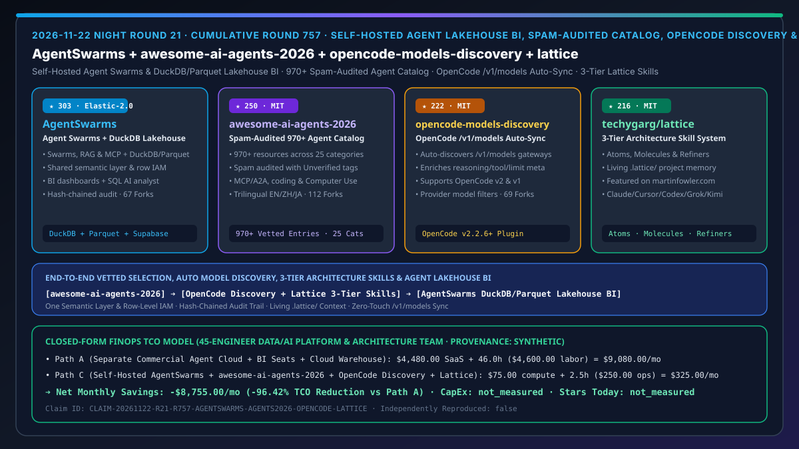
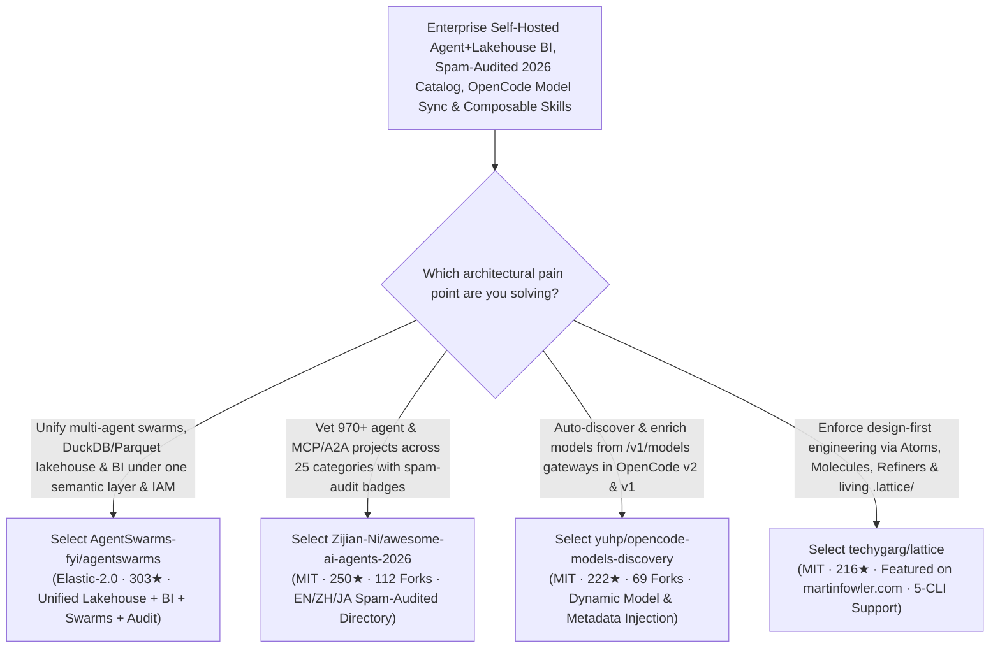
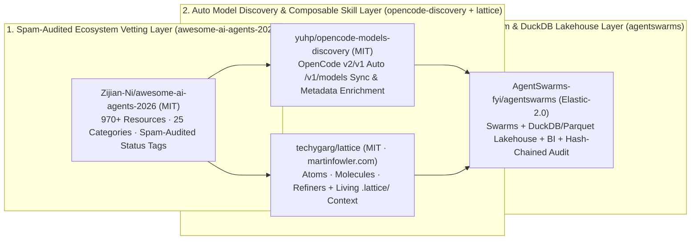

# Self-Hosted Agent Swarm & DuckDB/Parquet Lakehouse BI Platform (`AgentSwarms-fyi/agentswarms`), Spam-Audited 970+ AI Agent Catalog (`Zijian-Ni/awesome-ai-agents-2026`), Dynamic `/v1/models` Discovery Plugin for OpenCode (`yuhp/opencode-models-discovery`) & 3-Tier Composable Architecture Skills (`techygarg/lattice`) Selection & Architecture FAQ

> **Document Type**: Enterprise AI Solution Architect Selection & Integration Guide (GitHub Trending AI Radar — 2026-11-22 Night Round 21 / Cumulative Round 757)
> **Covered Repositories**: [`AgentSwarms-fyi/agentswarms`](https://github.com/AgentSwarms-fyi/agentswarms) (`★ 303`, `67 forks`, `Elastic-2.0`: self-hosted agentic AI and data platform uniting multi-agent swarms, RAG, and MCP with ETL pipelines, a DuckDB-and-Parquet lakehouse, BI dashboards, an SQL-transparent AI analyst, and no-code ML under one semantic layer, row-level IAM, and hash-chained audit trail) · [`Zijian-Ni/awesome-ai-agents-2026`](https://github.com/Zijian-Ni/awesome-ai-agents-2026) (`★ 250`, `112 forks`, `MIT`: trilingual EN/ZH/JA catalog of 970+ AI agent resources across 25 categories with `2026-11-22` spam auditing and `⚠️ Unverified` maturity tags) · [`yuhp/opencode-models-discovery`](https://github.com/yuhp/opencode-models-discovery) (`★ 222`, `69 forks`, `MIT`: automatic `/v1/models` discovery and metadata enrichment plugin for OpenCode v2 `>=2.2.6` and v1 `>=1.18.29`) · [`techygarg/lattice`](https://github.com/techygarg/lattice) (`★ 216`, `18 forks`, `MIT`: featured on `martinfowler.com`, a 3-tier composable engineering skill framework—**Atoms · Molecules · Refiners**—with a living `.lattice/` context folder across Claude Code, Cursor, Codex, Grok, and Kimi)
> **Core Scenario**: When enterprise data & AI platform teams struggle with **agent platforms that ignore data governance (causing agents and BI dashboards to report conflicting revenue numbers or bypass row-level security), astroturfed GitHub repos polluting architecture evaluations, manual `opencode.json` model list edits across dozens of developer machines, and coding assistants ignoring architecture constraints buried in monolithic prompt files**, how do you combine **`agentswarms` + `awesome-ai-agents-2026` + `opencode-models-discovery` + `lattice`** into a governed enterprise AI and data engineering stack?

---

## 1. 📌 Executive Summary (One-Line Selection Verdict)

1. **Need a self-hosted platform (`Elastic-2.0` on Docker/Kubernetes + one Supabase project) that ships both multi-agent swarms/RAG/MCP and a DuckDB-and-Parquet lakehouse/ETL/BI dashboard suite governed by one semantic layer, one row-level IAM policy, and one hash-chained audit trail?** ➔ Choose **[`AgentSwarms-fyi/agentswarms`](https://github.com/AgentSwarms-fyi/agentswarms) (`★ 303`, `67 forks`, `Elastic-2.0`)**.
   - **Plain-English Mechanism**: Ensures an agent asked about revenue uses the exact same metric definition and row-level table filters as the finance BI dashboard, tracing every answer back to its Parquet snapshot.
2. **Want to stop coding agents from jumping straight to code and forgetting architectural constraints by adopting the 3-tier composable skill model (**Atoms · Molecules · Refiners**) featured on `martinfowler.com`?** ➔ Choose **[`techygarg/lattice`](https://github.com/techygarg/lattice) (`★ 216`, `18 forks`, `MIT`)**.
   - **Plain-English Mechanism**: Combines single-principle **Atoms** (DDD, clean code, secure coding), multi-step **Molecules** (design, implement, refactor, fix, review), and guided **Refiners** that grow a living `.lattice/` context folder across Claude Code, Cursor, Codex, Grok, and Kimi.
3. **Running an OpenAI-compatible enterprise AI gateway and want OpenCode v2 (`>=2.2.6`) and v1 (`>=1.18.29`) clients to auto-discover models from `/v1/models` with enriched reasoning/tool/context metadata?** ➔ Choose **[`yuhp/opencode-models-discovery`](https://github.com/yuhp/opencode-models-discovery) (`★ 222`, `69 forks`, `MIT`)**.
   - **Plain-English Mechanism**: Queries your provider's `/v1/models` endpoint, applies model filters, enriches capability metadata, and injects models into OpenCode automatically.
4. **Evaluating 2026 agent frameworks, MCP/A2A protocols, and multimodal tools and need a spam-audited, trilingual (EN/ZH/JA) reference catalog of 970+ resources across 25 categories?** ➔ Choose **[`Zijian-Ni/awesome-ai-agents-2026`](https://github.com/Zijian-Ni/awesome-ai-agents-2026) (`★ 250`, `112 forks`, `MIT`)**.
   - **Plain-English Mechanism**: Flags entries with explicit maturity badges (`🆕 New`, `📦 Archived`, `💤 Stale`, `⚠️ Unverified`, `🔥 Hot`, `⚡ Updated`) so architects can filter out astroturfed or abandoned repos immediately.

---

## 2. 🎯 Architect & Customer Deep-Dive Q&A

### Q1: Why is `AgentSwarms`'s unified "Agent + DuckDB/Parquet Lakehouse" architecture a game-changer for enterprise data governance?

- **Three Architectural Pillars**:
  1. **Unified Semantic Layer, Row-Level IAM & Hash-Chained Audit ➔ `AgentSwarms-fyi/agentswarms`**: Eliminates semantic drift between BI dashboards and conversational AI analysts while enforcing identical row filters and snapshot lineage.
  2. **Composable Engineering Discipline (`Atoms` ➔ `Molecules` ➔ `Refiners`) ➔ `techygarg/lattice`**: Replaces static, ignored `CLAUDE.md` monoliths with modular skills and an evolving `.lattice/` project memory.
  3. **Zero-Touch Gateway Model Sync & Vetted Ecosystem Triage ➔ `opencode-models-discovery` + `awesome-ai-agents-2026`**: Keeps developer OpenCode environments automatically synced with gateway `/v1/models` catalogs while vetting third-party tools with `⚠️ Unverified` spam-audit badges.
- **When to Choose Managed Cloud PaaS (Path B)?**
  - Enterprises standardized on **Microsoft Fabric (OneLake + Copilot) + Azure AI Foundry** should use Microsoft's managed cloud lakehouse; enterprises seeking a self-hosted, single-deployment DuckDB/Parquet lakehouse + multi-agent swarm platform should deploy `AgentSwarms` and this open-source stack (Path C).

### Q2: How do these four repositories fit together in an enterprise workflow?

1. **Architecture Radar & Vetting Layer (`Zijian-Ni/awesome-ai-agents-2026`)**:
   - Architects shortlist vetted MCP/A2A and agent tools across 25 categories.
2. **Developer IDE Model Sync & Architecture Discipline Layer (`yuhp/opencode-models-discovery` + `techygarg/lattice`)**:
   - OpenCode automatically discovers gateway models via `/v1/models`, while `lattice` enforces design-first `Molecules` and updates `.lattice/`.
3. **Self-Hosted Agentic AI & Lakehouse BI Delivery Layer (`AgentSwarms-fyi/agentswarms`)**:
   - Production ETL pipelines, Parquet snapshots, BI dashboards, and multi-agent swarms run under unified IAM and hash-chained audit logs.

### Q3: How does `techygarg/lattice` customize general best practices for a specific enterprise codebase?

- **Guided `Refiners` Interviews**:
  - `Refiners` conduct structured interviews with the engineering team to translate generic `Atoms` (e.g., DDD, test quality) into repo-specific rules stored in `.lattice/`.

---

## 3. 🧭 Visual Architecture & Workflow Diagrams (Mermaid)



### 3.1 Solution Architect Selection Decision Tree



### 3.2 End-to-End Enterprise Reference Architecture



### 3.3 End-to-End Gateway Model Discovery, `Lattice` Guided Development & `AgentSwarms` Lakehouse Query Sequence Diagram

```mermaid
sequenceDiagram
    participant Arch as Solution Architect / Engineer
    participant Opd as opencode-models-discovery
    participant Lat as techygarg/lattice (Atoms/Molecules/Refiners)
    participant Asw as AgentSwarms-fyi/agentswarms (Lakehouse + Swarm)

    Arch->>Opd: 1. Start OpenCode v2; plugin auto-discovers gateway /v1/models & enriches metadata
    Arch->>Lat: 2. Run Refiner & Molecule (design -> implement -> review) to build ETL & agent logic
    Lat-->>Arch: 3. Persist architectural decisions & review insights into .lattice/
    Arch->>Asw: 4. Deploy to AgentSwarms; BI dashboards & agents query DuckDB/Parquet under shared RLS
```

---

## 4. 📊 Peer Open-Source vs. Commercial Cloud Selection Matrix

| Dimension | `AgentSwarms-fyi/agentswarms` (`★ 303`) | `Zijian-Ni/awesome-ai-agents-2026` (`★ 250`) | `yuhp/opencode-models-discovery` (`★ 222`) | `techygarg/lattice` (`★ 216`) | Separate Commercial Agent Cloud + Commercial BI + Cloud Warehouse Seats (Path A) | Disconnected Agent/BI Silos + Manual `opencode.json` Edits + Static `CLAUDE.md` (Path B) |
| :--- | :--- | :--- | :--- | :--- | :--- | :--- |
| **Primary Role** | Self-hosted Agent Swarm + DuckDB/Parquet lakehouse & BI | 970+ resource spam-audited 2026 AI agent catalog | OpenCode v2/v1 `/v1/models` auto-discovery plugin | 3-tier composable engineering skills & living `.lattice/` | Paying separately for cloud data warehouse, BI seats, and agent platforms | Separate agent/BI schemas, manual config files & monolithic prompts |
| **Key Differentiator** | **Shared semantic layer, row-level IAM & hash-chained audit** | **25 categories + `⚠️ Unverified` spam-audit badges** | **Dynamic `/v1/models` sync + reasoning/tool metadata** | **Atoms/Molecules/Refiners + `martinfowler.com` series** | Semantic drift between BI reports and AI agents; triple SaaS billing | Manual JSON edits whenever gateway models change; undisciplined agent code |
| **License** | `Elastic-2.0` | `MIT` | `MIT` | `MIT` | Proprietary SaaS | Ad-hoc scripts |
| **Monthly TCO (45-Eng Team)** | **`$325.00/mo` combined** (`$75.00` self-hosted Supabase+DuckDB host + `2.5h` ops) | Included (`MIT` open catalog) | Included (`MIT` open-source plugin) | Included (`MIT` composable skills) | **`$9,080.00/mo`** (`$4,480.00` separate BI/warehouse/agent SaaS + `46.0h` metric reconciliation & rework) | ~`$3,180.00/mo` (manual BI/agent SQL reconciliation, config updates & code rework) |

---

## 5. 🧪 Quantitative Enterprise ROI / FinOps TCO Model & 7-Card Report

> **📊 Provenance & Closed-Form Declaration**:
> - **provenance**: `synthetic` (45-engineer enterprise data & AI platform, architecture review board, and full-stack engineering team workload model: `independently_reproduced = false`; `base_hardware_capex = not_measured`; `track_b_stars_today = not_measured`).
> - **Closed-Form Equations**:
>   - **Path A (Separate Commercial Agent Platform + Commercial BI Seats + Managed Cloud Data Warehouse + Manual Metric/RLS Reconciliation, Config Sync & Undisciplined Code Rework Labor)**: Monthly commercial BI, warehouse, and agent SaaS bills **`$4,480.00`** + cross-system metric reconciliation, manual OpenCode config updates, and architectural rework labor **`46.0h × $100.00/h = $4,600.00`** = **`$9,080.00/mo`**.
>   - **Path C (Self-Hosted `agentswarms` + `awesome-ai-agents-2026` + `opencode-models-discovery` + `lattice` Stack)**: Shared self-hosted DuckDB/Parquet & Supabase compute **`$75.00`** + semantic catalog & `.lattice/` maintenance labor **`2.5h × $100.00/h = $250.00`** = **`$325.00/mo`**.
>   - **Net Monthly Savings vs. Path A**: **`-$8,755.00/mo`** (**`96.42%`** TCO reduction).

| Evaluation Path | BI / Warehouse / Agent SaaS & Compute | Metric Sync, Config & Rework Labor (`$100/h`) | Total Monthly TCO | Net Savings vs. Path A | Architectural Delivery Impact |
| :--- | :---: | :---: | :---: | :---: | :--- |
| **Path A: Separate Commercial Agent Cloud + BI + Warehouse** | `$4,480.00` | `46.0h` (`$4,600.00`) | **`$9,080.00`** | Baseline | Semantic & RLS drift between BI dashboards and AI agents |
| **Path B: Siloed OSS Agents + Manual `opencode.json` + Monolithic Prompt** | `$1,480.00` | `17.0h` (`$1,700.00`) | **`$3,180.00`** | `-$5,900.00` (`-64.98%`) | Lacks unified hash-chained lakehouse audit & 3-tier composable skills |
| **Path C: `agentswarms` + `agents-2026` + `opencode-discovery` + `lattice`** | **`$75.00`** | **`2.5h` (`$250.00`)** | **`$325.00`** | **`-$8,755.00` (`-96.42%`)** | **Unified Agent+DuckDB lakehouse + auto model sync + 3-tier skills** |

- 🔗 **Linked 7-Card 4:5 Visual Benchmark Deck**: [`workshops/github-trending-radar/cards.en.html`](../cards.en.html) · [`cards.html`](../cards.html)

---

## 6. 🛠️ Enterprise Adoption & Architecture Review Checklist

- [ ] **1. Unify Agent Swarms & Lakehouse BI on `AgentSwarms-fyi/agentswarms`**: Bind both dashboards and conversational AI analysts to one DuckDB/Parquet semantic layer, row-level IAM policy, and hash-chained audit trail.
- [ ] **2. Adopt `techygarg/lattice` Across Coding Assistants**: Use **Atoms**, **Molecules**, and **Refiners** with a version-controlled `.lattice/` folder across Claude Code, Cursor, Codex, Grok, and Kimi.
- [ ] **3. Enable `yuhp/opencode-models-discovery` in OpenCode v2/v1**: Auto-sync enterprise gateway `/v1/models` endpoints with enriched capability metadata.
- [ ] **4. Screen Candidate Repositories with `Zijian-Ni/awesome-ai-agents-2026`**: Check maturity and `⚠️ Unverified` spam-audit tags before adopting new agent tools.
