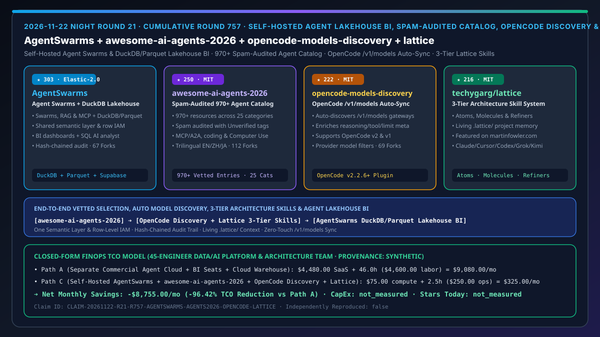
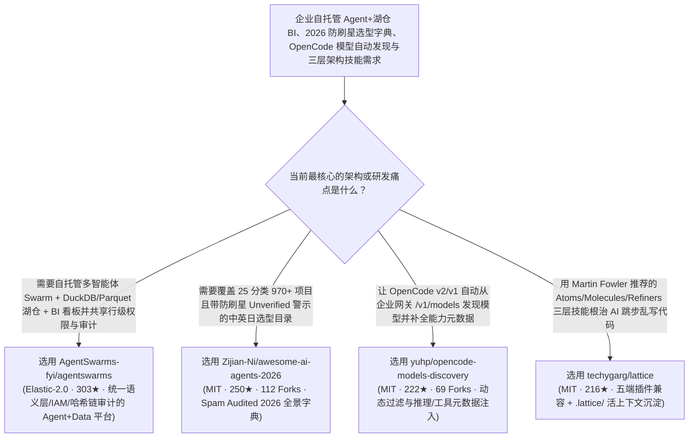
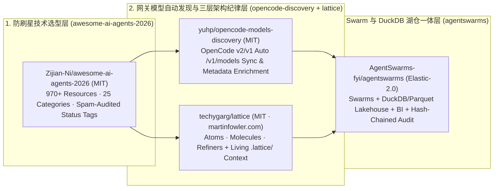
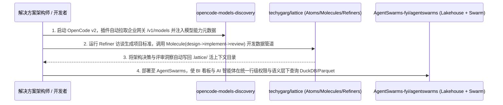

# 自托管 Agent Swarm 与 DuckDB/Parquet 湖仓一体 BI 平台（`AgentSwarms-fyi/agentswarms`）、带防刷星审计的 970+ 智能体全景图谱（`Zijian-Ni/awesome-ai-agents-2026`）、OpenCode 网关模型自动发现与元数据增强插件（`yuhp/opencode-models-discovery`）与 Martin Fowler 推荐的三层原子/分子架构技能库（`techygarg/lattice`）选型与集成架构 FAQ

> **文档类型**：企业 AI 解决方案架构师（AI Solution Architect）选型决策指南（GitHub Trending AI 雷达 2026-11-22 Night Round 21 / 累计第 757 轮）
> **覆盖项目**：[`AgentSwarms-fyi/agentswarms`](https://github.com/AgentSwarms-fyi/agentswarms)（`★ 303`、`67 forks`、`Elastic-2.0`，将多智能体 Swarm、RAG、MCP 与自托管 DuckDB+Parquet 湖仓、ETL 管道、BI 仪表盘、透明 SQL 分析师融合在同一套语义层、行级权限 IAM 与哈希链审计日志下的全栈平台）· [`Zijian-Ni/awesome-ai-agents-2026`](https://github.com/Zijian-Ni/awesome-ai-agents-2026)（`★ 250`、`112 forks`、`MIT`，覆盖 25 大分类、970+ 资源并带有 `⚠️ Unverified` 防刷星审计标签的 2026 智能体与 MCP/A2A 协议中英日三语选型字典）· [`yuhp/opencode-models-discovery`](https://github.com/yuhp/opencode-models-discovery)（`★ 222`、`69 forks`、`MIT`，自动从企业 OpenAI 兼容网关 `/v1/models` 探测模型并注入上下文窗口/推理/工具/多模态元数据至 OpenCode v2/v1 的插件）· [`techygarg/lattice`](https://github.com/techygarg/lattice)（`★ 216`、`18 forks`、`MIT`，获 `martinfowler.com` 专题文章推介的 **Atoms · Molecules · Refiners** 三层可组合工程纪律技能与 `.lattice/` 演进式上下文框架，通配 Claude Code/Cursor/Codex/Grok/Kimi）
> **核心场景**：当企业数据与智能体平台团队面临**“市面上绝大多数 Agent 平台只管聊天不管数据底座导致 BI 报表口径与 Agent 回答口径不一致且行级权限割裂、架构师在调研 2026 新兴 Agent 项目时难辨刷星水军仓、企业内部网关每次上新模型都要全员手动改 OpenCode JSON 配置、以及研发团队把所有规范塞进单个臃肿 `CLAUDE.md` 导致 Agent 跳步乱写代码”**四大痛点时，如何组合**`agentswarms` + `awesome-ai-agents-2026` + `opencode-models-discovery` + `lattice`** 打造数据与智能体同源治理、架构驱动的企业工程体系？

---

## 一、📌 核心结论速览（选型一句话结论）

1. **想在企业自有基础设施（Docker/K8s + 单一 Supabase）上同时搞定“多智能体 Swarm 编排 + DuckDB/Parquet 湖仓一体 + ETL 管道 + BI 看板 + 展示完整 SQL 的 AI 数据分析师”，并让仪表盘和 AI 智能体共享同一套财务语义层、行级权限（Row Filter）与防篡改哈希链审计日志** ➔ 选 **[`AgentSwarms-fyi/agentswarms`](https://github.com/AgentSwarms-fyi/agentswarms)（`★ 303`，`67 forks`，`Elastic-2.0`）**。
   - **通俗原理**：彻底终结“Agent 算出来的营收和财务 BI 看板对不上”的顽疾——一张表配置一次行级过滤（RLS）与指标口径，同时约束人类看板与所有 Swarm 智能体，且每个回答都能溯源到具体的 Parquet 数据快照。
2. **想治好 AI 编码助手“不看架构设计直接写代码、聊到一半忘掉安全与 DDD 边界”的毛病，用 `martinfowler.com` 推荐的三层可组合技能（Atoms 原子原则 + Molecules 分子工作流 + Refiners 交互式定制）替代无人维护的单体大 Prompt** ➔ 选 **[`techygarg/lattice`](https://github.com/techygarg/lattice)（`★ 216`，`18 forks`，`MIT`）**。
   - **通俗原理**：提供 `.claude-plugin`、`.cursor-plugin`、`.codex-plugin`、`.grok-plugin`、`.kimi-plugin` 五端插件，并在仓库 `.lattice/` 目录下随每个功能迭代持续沉淀团队真实的架构决策与代码评审洞察。
3. **企业内部使用 LiteLLM / BitRouter / New-API 等统一 AI 网关，想让全员的 OpenCode（v2 `>=2.2.6` 及 v1 `>=1.18.29`）每次启动时自动调用 `/v1/models` 发现最新可用模型，并自动补全推理能力、工具调用、上下文上限与多模态标签** ➔ 选 **[`yuhp/opencode-models-discovery`](https://github.com/yuhp/opencode-models-discovery)（`★ 222`，`69 forks`，`MIT`）**。
   - **通俗原理**：在 `opencode.json` 中启用 `opencode-models-discovery@2.2.1` 插件后，平台团队在网关后台增删模型即可秒级同步到所有开发者终端，零手工改配置。
4. **想查阅一份经过防刷星审计（Spam Audited）、明确标注 `⚠️ Unverified / 📦 Archived / 💤 Stale / 🔥 Hot` 成熟度标签的 2026 智能体与 MCP/A2A 全景选型手册（含中英日三语）** ➔ 选 **[`Zijian-Ni/awesome-ai-agents-2026`](https://github.com/Zijian-Ni/awesome-ai-agents-2026)（`★ 250`，`112 forks`，`MIT`）**。
   - **通俗原理**：覆盖 25 个细分赛道、970+ 个项目，专门对缺乏第三方背书、单人刷榜的可疑提交打上 `⚠️ Unverified` 警示标，帮架构师避坑。

---

## 二、🎯 客户与架构师灵魂拷问 Q&A（深度架构拆解）

### Q1：为什么 `AgentSwarms` 的“智能体 + DuckDB 湖仓同源语义层”比“独立 Agent 框架外挂外部 BI”更适合中大型企业？

- **三大数据与智能体融合优势**：
  1. **单一语义层与行级权限（One Semantic Layer & Row Filter）➔ `AgentSwarms-fyi/agentswarms`**：传统架构里 BI 工程师在 Tableau/Power BI 定义一套指标，AI 工程师在 Agent Prompt 里又写一套 SQL 逻辑，极易产生数据打架和越权泄露；`AgentSwarms` 让 BI 看板与 AI 智能体共用同一个 DuckDB/Parquet 湖仓、同一套语义目录与哈希链审计日志。
  2. **三层可组合工程纪律（Atoms/Molecules/Refiners）➔ `techygarg/lattice`**：通过 `Refiners` 引导式访谈生成团队专属规范，让 `Atoms`（DDD、安全编码、测试质量）组合成 `Molecules`（设计 ➔ 实现 ➔ 评审）闭环。
  3. **网关模型动态发现与选型排雷 ➔ `opencode-models-discovery` + `awesome-ai-agents-2026`**：前端编码台自动同步网关模型，选型阶段利用 `⚠️ Unverified` 标签过滤虚假繁荣项目。
- **何时直接用云厂商托管方案（Path B）？**
  - 若企业已全面部署 **Microsoft Fabric (OneLake + semantic link) + Azure AI Foundry**，优先使用微软原生融合底座；若希望在自有 K8s/Docker 环境用一套开源系统同时交付 Agent Swarm 与 DuckDB/Parquet 湖仓 BI，则采用 `AgentSwarms` 及本轮开源栈（Path C）。

### Q2：典型企业级“架构选型排雷 (`awesome-ai-agents-2026`) ➔ 三层工程技能 (`lattice`) + 模型自动发现 (`opencode-models-discovery`) ➔ 湖仓一体智能体平台 (`agentswarms`)”怎么搭？

1. **技术雷达与防刷星选型层（`Zijian-Ni/awesome-ai-agents-2026`）**：
   - 架构委员会基于 25 大分类与成熟度标签筛选进入 PoC 的开源组件。
2. **开发者终端模型同步与架构纪律层（`yuhp/opencode-models-discovery` + `techygarg/lattice`）**：
   - 研发终端通过 `opencode-models-discovery` 自动挂载内部网关模型，并加载 `lattice` 的三层技能与 `.lattice/` 演进上下文。
3. **企业数据湖仓与多智能体业务交付层（`AgentSwarms-fyi/agentswarms`）**：
   - 将业务数据落地至 `AgentSwarms` 的 DuckDB/Parquet 湖仓，在统一 IAM 与哈希链审计下向业务部门开放 BI 仪表盘与多智能体 Swarm。

### Q3：`lattice` 的 `.lattice/` 目录和普通静态 `CLAUDE.md` 有什么本质区别？

- **静态配置 vs 持续复利的活上下文（Living Context）**：
  - 静态 `CLAUDE.md` 写完即过时；`.lattice/` 会在每次走完 `design ➔ implement ➔ review` 分子工作流后，自动把新发现的架构约束与评审结论沉淀回版本库，越用越懂你的项目。

---

## 三、🧭 直观可视化图解（Mermaid 决策树 + 集成架构 + 时序图）

### 3.1 架构师选型决策树

### 3.2 企业端到端生产集成参考架构图

### 3.3 网关模型自动同步、`Lattice` 三层架构开发与 `AgentSwarms` 湖仓问答时序图

---

## 四、📊 同类开源与商业云服务横向选型决策矩阵

| 对比维度 | `AgentSwarms-fyi/agentswarms` (`★ 303`) | `Zijian-Ni/awesome-ai-agents-2026` (`★ 250`) | `yuhp/opencode-models-discovery` (`★ 222`) | `techygarg/lattice` (`★ 216`) | 独立采购商业 BI + 商业数仓 + 商业 Agent 平台三套席位 (Path A) | 散装 Agent 框架 + 手工同步 `opencode.json` + 臃肿 `CLAUDE.md` (Path B) |
| :--- | :--- | :--- | :--- | :--- | :--- | :--- |
| **核心能力定位** | 自托管 Agent Swarm + DuckDB/Parquet 湖仓 BI 平台 | 970+ 项目防刷星审计 2026 智能体全景图谱 | OpenCode v2/v1 网关模型自动发现与元数据插件 | 三层可组合工程纪律技能与 `.lattice/` 活上下文 | 分别购买商业数仓、BI 报表与云端 Agent 平台的高昂组合 | 权限割裂的数据孤岛、手动改模型配置与无人维护的长 Prompt |
| **核心技术突破** | **一套语义层/行级权限/哈希链审计同时管住 BI 与 Agent** | **25 分类中英日三语 + `⚠️ Unverified` 防刷星排雷标签** | **自动轮询 `/v1/models` 注入推理/工具/上下文上限元数据** | **Atoms/Molecules/Refiners 三层组合 + `martinfowler.com` 专题** | BI 与 Agent 指标口径不一致；三套商业系统按人头重复收费 | 网关换模型需全员手改 JSON；Agent 缺乏设计先行约束频繁返工 |
| **开源协议** | `Elastic-2.0` | `MIT` | `MIT` | `MIT` | 闭源商业 SaaS | 内部零散脚本 |
| **月度 TCO（45 人团队）** | **组合仅 `$325.00/月`**（`$75.00` 自托管 Supabase+DuckDB 容器 + `2.5h` 维护） | 同左（`MIT` 免费选型图谱） | 同左（`MIT` 免费插件） | 同左（`MIT` 免费工程技能库） | **`$9,080.00/月`**（`$4,480.00` 商业 BI/数仓/Agent 席位 + `46.0h` 跨系统口径对齐与返工） | 约 `$3,180.00/月`（大量人工核对报表口径偏差、同步模型配置与代码返工） |

---

## 五、🧪 应用落地定量收益/TCO 对比与 7-Card 报告

> **📊 数据来源与闭式核算声明（Provenance & Closed-Form Schema）**：
> - **provenance**: `synthetic`（基于 45 人企业数据智能平台、架构委员会与全栈研发团队月度工作负载模型：`independently_reproduced = false`；硬件采购基线 `base_hardware_capex = not_measured`；Track B 单日增量 `track_b_stars_today = not_measured`）。
> - **核算公式**：
>   - **Path A（分别采购商业云端 Agent 平台、商业 BI 报表席位与托管数据仓库 + 工程师手工对齐 BI 与 Agent 指标口径、全员手动修改终端模型配置及修补无架构约束的 AI 劣质代码人工）**：月度商业 BI/数仓/Agent 订阅账单 **`$4,480.00`** + 跨系统权限与口径对齐、配置同步及架构返工人工 **`46.0h × $100.00/h = $4,600.00`** = **`$9,080.00/月`**。
>   - **Path C（自建 `agentswarms` + `awesome-ai-agents-2026` + `opencode-models-discovery` + `lattice` 开源湖仓与架构纪律栈）**：自托管 DuckDB/Parquet 与 Supabase 容器开销 **`$75.00`** + 语义层与 `.lattice/` 规范维护人工 **`2.5h × $100.00/h = $250.00`** = **`$325.00/月`**。
>   - **净节省（Net Savings vs Path A）**：**`-$8,755.00/月`**（成本降低 **`96.42%`**）。

| 评估方案 | 商业 BI/数仓/Agent 订阅与算力成本 | 口径对齐、模型同步与架构返工人工（`$100/h`） | 月度总 TCO | 相对 Path A 净节省 | 关键架构交付指标 |
| :--- | :---: | :---: | :---: | :---: | :--- |
| **Path A：商业 Agent 平台 + 独立商业 BI 与数仓席位** | `$4,480.00` | `46.0h` (`$4,600.00`) | **`$9,080.00`** | Baseline | BI 与 Agent 语义层割裂；三套商业账单叠加 |
| **Path B：散装 Agent 框架 + 手改 `opencode.json` + 单体 `CLAUDE.md`** | `$1,480.00` | `17.0h` (`$1,700.00`) | **`$3,180.00`** | `-$5,900.00` (`-64.98%`) | 缺少行级权限同源绑定与 Atoms/Molecules 结构化工程纪律 |
| **Path C：`agentswarms` + `agents-2026` + `opencode-discovery` + `lattice`** | **`$75.00`** | **`2.5h` (`$250.00`)** | **`$325.00`** | **`-$8,755.00` (`-96.42%`)** | **Agent+DuckDB 同源语义层/审计 + 自动模型发现 + 三层架构技能** |

- 🔗 **关联 7-Card 4:5 视觉评测报告**：[`workshops/github-trending-radar/cards.html`](../cards.html) · [`cards.en.html`](../cards.en.html)

---

## 六、🛠️ 企业引入与架构评审 Checklist

- [ ] **1. 部署 `AgentSwarms-fyi/agentswarms` 统一企业智能体与数据湖仓底座**：在单一语义层、行级过滤（RLS）与哈希链审计日志下同时驱动 BI 仪表盘与多智能体 Swarm。
- [ ] **2. 在代码仓引入 `techygarg/lattice` 三层工程纪律**：通过 `Refiners` 生成 `.lattice/` 项目标准，强制编码 Agent 遵循 `design ➔ implement ➔ review` 分子工作流。
- [ ] **3. 为 OpenCode 团队启用 `yuhp/opencode-models-discovery`**：自动从内部统一网关 `/v1/models` 同步可用模型与上下文/工具元数据。
- [ ] **4. 架构选型前核查 `Zijian-Ni/awesome-ai-agents-2026`**：重点过滤带有 `⚠️ Unverified`、`📦 Archived` 或 `💤 Stale` 警示标签的高风险仓库。
