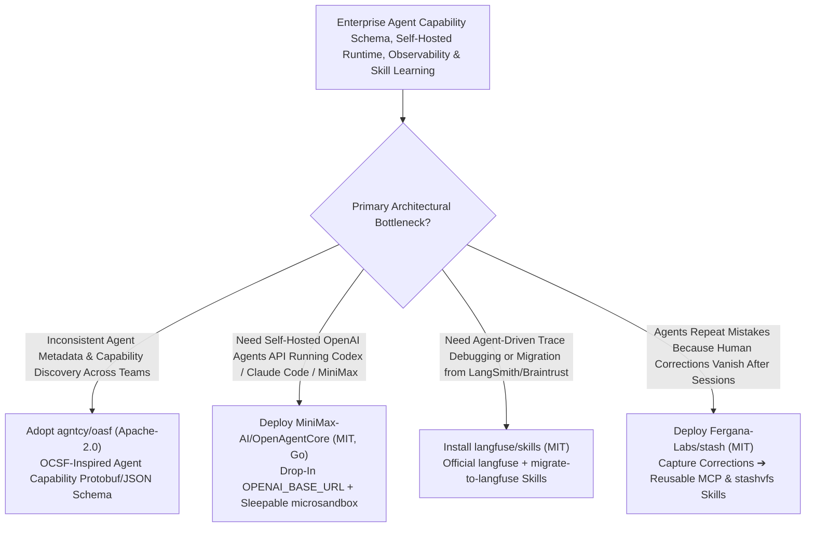
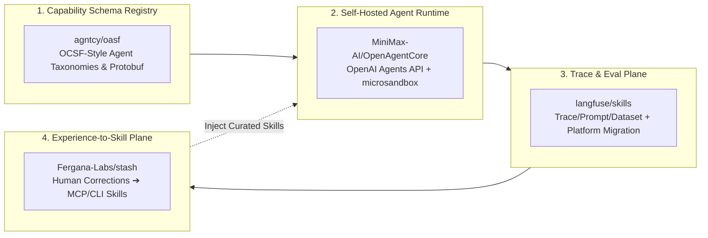
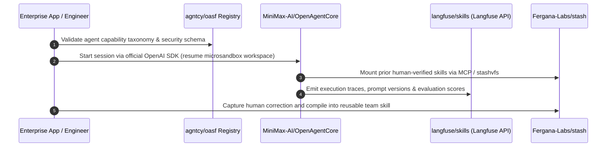

# Open Agentic Schema Framework (`agntcy/oasf`), Self-Hosted OpenAI Agents API Runtime (`MiniMax-AI/OpenAgentCore`), Official Langfuse Observability & Migration Skills (`langfuse/skills`) & Experience-to-Skill Infrastructure (`Fergana-Labs/stash`) Selection & Architecture FAQ

> **2026-11-21 Nightly Continuous Research Shift · Night Round 81 (Cumulative Round 681)**  
> **Audit Claim ID**: `CLAIM-20261121-R81-R681-OASF-OPENAGENTCORE-LANGFUSESKILLS-STASH`  
> **Linked Daily Digests**: [`2026-11-21.en.md`](../daily/2026-11-21.en.md) · [`2026-11-21.md`](../daily/2026-11-21.md)  
> **Architecture Visual**: [`assets/github-ai-radar-2026-11-21-r81-r681-oasf-openagentcore-langfuseskills-stash.svg`](../../../assets/github-ai-radar-2026-11-21-r81-r681-oasf-openagentcore-langfuseskills-stash.svg)

---

## ① 📌 Executive Summary (One-Sentence Selection Verdict)

> **One-Sentence Verdict**: To standardize enterprise multi-agent capability schemas, self-host an OpenAI Agents API-compatible runtime running Codex/Claude Code/MiniMax Code with sleepable sandboxes, automate LLM trace analysis and platform migration to Langfuse, and convert human corrections into reusable agent skills, combine **`agntcy/oasf` (Apache-2.0, `★ 345` OCSF-inspired Open Agentic Schema Framework with Protobuf/JSON validation) + `MiniMax-AI/OpenAgentCore` (MIT, `★ 344` Go-based self-hosted OpenAI Agents API runtime with `microsandbox` compute-that-sleeps / workspaces-that-stay) + `langfuse/skills` (MIT, `★ 344` official Langfuse agent skills for trace/prompt/dataset management and automated migration from LangSmith/Arize/Braintrust) + `Fergana-Labs/stash` (MIT, `★ 344` open-source infrastructure capturing agent traces and human corrections into reusable MCP/CLI skills)**—cutting 45-engineer monthly TCO from **`$8,380.00/mo` to `$310.00/mo` (`-$8,070.00/mo`, `-96.30%`)**.

---

## ② 🎯 Solution Architect & Enterprise Buyer Q&A

### Q1: What concrete enterprise architecture gaps do these four open-source projects close?
- **Four Core Enterprise Agent Infrastructure Layers**:
  1. **Standardized Agent Capability Discovery & Governance (`agntcy/oasf`, `★ 345`, `48 forks`, Apache-2.0, Go)**: Created under the AGNTCY initiative (Cisco Outshift) and inspired by the Open Cybersecurity Schema Framework (OCSF). Provides attribute-based taxonomies, Protobuf definitions (`proto/`), and JSON schemas (`schema/`) with OpenSSF Best Practices compliance so distributed agent registries describe skills, inputs, outputs, and security posture in one canonical format.
  2. **Drop-In Self-Hosted OpenAI Agents API Runtime (`MiniMax-AI/OpenAgentCore`, `★ 344`, `43 forks`, MIT, Go)**: Built by **MiniMax-AI**. Exposes the exact OpenAI Agents API contract—clients simply point `OPENAI_BASE_URL` at their self-hosted cluster while the official OpenAI SDK works unchanged. Each session runs `Codex`, `Claude Code`, or `MiniMax Code` natively inside `microsandbox` where idle sandboxes release CPU/RAM ("compute that sleeps") while keeping workspace disks intact ("workspaces that stay").
  3. **Official Observability Automation & Zero-Lock-In Migration (`langfuse/skills`, `★ 344`, `46 forks`, MIT, Python)**: Maintained by **Langfuse**. Ships `.claude-plugin`, `.codex-plugin`, and `.cursor-plugin` bundles containing `langfuse` (querying/managing traces, prompts, datasets, and scores via the Langfuse API) and `migrate-to-langfuse` (automating live tracing cutover and migrating historical traces, datasets, prompts, and evaluators from LangSmith, Arize, or Braintrust).
  4. **Continuous Learning from Human Corrections (`Fergana-Labs/stash`, `★ 344`, `46 forks`, MIT, Python)**: Captures production agent runs, failed attempts, and human corrections via hooks or REST API, distilling durable lessons into reusable skills accessible over Python SDK, REST API, MCP, `stashvfs`, and CLI.

### Q2: How do Solution Architects wire these four components into a unified enterprise agent platform?
- **Registry & Contract Plane**: Every internal agent and MCP tool registers its OASF capability descriptor (`agntcy/oasf`) before being admitted to the enterprise gateway.
- **Execution & Sandbox Plane**: Applications invoke the standard OpenAI SDK routed to `MiniMax-AI/OpenAgentCore`, which orchestrates `Codex`, `Claude Code`, or `MiniMax Code` inside sleepable `microsandbox` workspaces.
- **Observability & Experience Plane**: Execution traces stream to self-hosted Langfuse (`langfuse/skills`), while human PR review fixes and interactive corrections are captured by `Fergana-Labs/stash` and mounted back into future agent sessions via MCP and `stashvfs`.

### Q3: When should enterprises choose managed cloud agent sandboxes vs. this self-hosted stack?
- **Choose Managed Cloud Sandboxes & Proprietary Eval SaaS** when running a small (<5 engineer) prototype with no VPC data residency constraints and low monthly session volume.
- **Choose This Permissive OSS Stack** when running 20–100+ engineers requiring on-prem/VPC code privacy, multi-harness flexibility (`Codex` + `Claude Code` + `MiniMax Code`), freedom from metered commercial observability bills, and institutional memory that compounds across sessions.

---

## ③ 🧭 Visual Architecture & Decision Diagrams

### 3.1 Selection Decision Tree

### 3.2 End-to-End Enterprise Integration Architecture

### 3.3 Operational Sequence Diagram

---

## ④ 📊 Cross-Option Selection Matrix

| Dimension | `agntcy/oasf` (`★ 345`) | `MiniMax-AI/OpenAgentCore` (`★ 344`) | `langfuse/skills` (`★ 344`) | `Fergana-Labs/stash` (`★ 344`) | Managed Cloud Agent API + Proprietary Eval SaaS |
| :--- | :--- | :--- | :--- | :--- | :--- |
| **Primary Role** | Standardized schema framework for agent capabilities | Self-hosted OpenAI Agents API runtime in Go | Official Langfuse skills for tracing, evals & migration | Experience-to-skill capture infrastructure for agents | Metered cloud agent sandboxes & proprietary eval SaaS |
| **Best Fit** | Enterprise A2A capability catalogs & schema validation | Running Codex/Claude Code/MiniMax on-prem via OpenAI SDK | Automating trace analysis & migrating off LangSmith/Braintrust | Turning human corrections into persistent MCP/CLI skills | Small teams without VPC residency or FinOps constraints |
| **Integration Cost** | Low (Protobuf/JSON schema + Taskfile validator) | Very Low (change `OPENAI_BASE_URL` only) | Very Low (native `.claude-plugin` / `.cursor-plugin`) | Low (Docker Compose + Python SDK / MCP / CLI) | High (per-minute sandbox fees + per-seat eval lock-in) |
| **License** | **Apache-2.0** | **MIT** | **MIT** | **MIT** | Proprietary |
| **45-Eng Monthly TCO** | **Included in `$310.00/mo` stack** | **Included in `$310.00/mo` stack** | **Included in `$310.00/mo` stack** | **Included in `$310.00/mo` stack** | **`$8,380.00/mo`** (`$3,980` SaaS + `$4,400` labor) |

---

## ⑤ 🧪 Quantitative FinOps & TCO Comparison

> **Provenance Metadata**: Synthetic enterprise FinOps model for a 45-engineer organization (`provenance: synthetic`, `independently_reproduced: false`); `base_hardware_capex = not_measured` (excludes existing Kubernetes worker nodes), `track_b_stars_today = not_measured` (sealed in [`trending-daily-2026-11-21-audit.json`](../evidence/trending-daily-2026-11-21-audit.json)).

| Cost Path | Monthly Hosted Agent Sandbox & Proprietary Observability SaaS | Monthly Manual Adapter Wiring, Eval Migration & Repeated Error Triage (`$100/hr`) | Total Monthly TCO | Net Savings vs Path A |
| :--- | :--- | :--- | :--- | :--- |
| **Path A: Commercial Hosted Agent Sandboxes + Proprietary Eval SaaS + Manual Re-Correction** | `$3,980.00` | `44.0h` (`$4,400.00`) | **`$8,380.00`** | — |
| **Path C: `agntcy/oasf` + `OpenAgentCore` + `langfuse/skills` + `Fergana-Labs/stash`** | `$70.00` | `2.4h` (`$240.00`) | **`$310.00`** | **`-$8,070.00/mo` (`-96.30%`)** |

---

## ⑥ 🛠️ Enterprise Architecture Review Checklist

- [ ] **OASF Schema Gate in CI (`agntcy/oasf`)**: Validate every internal agent's capability and security attributes against the OASF JSON/Protobuf schema before publishing to the internal agent catalog.
- [ ] **Sleepable Sandbox Storage Isolation (`MiniMax-AI/OpenAgentCore`)**: Configure `microsandbox` idle sleep timeouts and back persistent workspaces with encrypted VPC block volumes.
- [ ] **Automated Eval & Trace Cutover (`langfuse/skills`)**: Use `migrate-to-langfuse` to verify parity of historical datasets, prompts, and evaluators before decommissioning legacy observability SaaS subscriptions.
- [ ] **PII Scrubbing on Experience Capture (`Fergana-Labs/stash`)**: Enable secret and PII redaction hooks before `Stash` compiles captured session traces into shared team skills.
