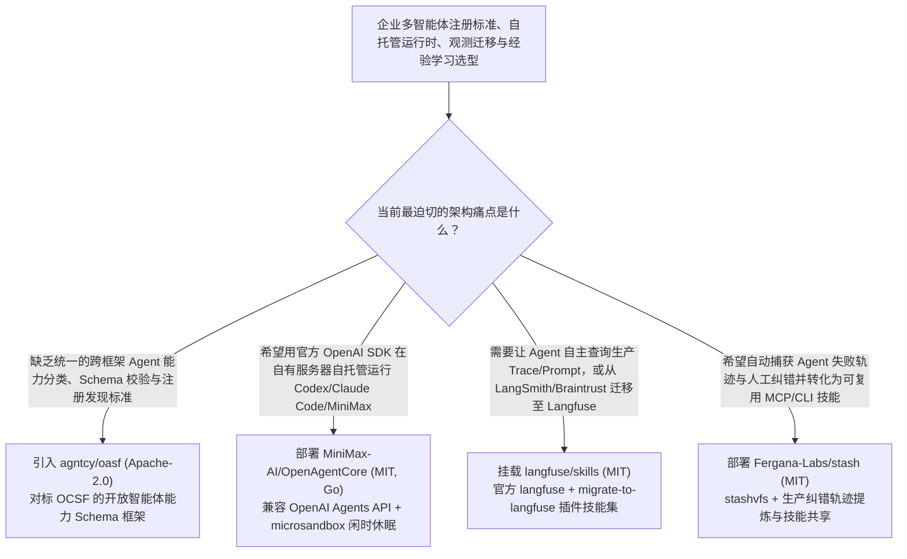
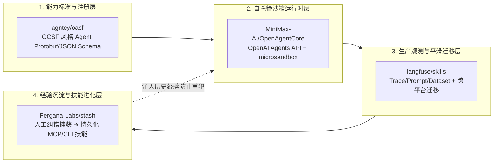
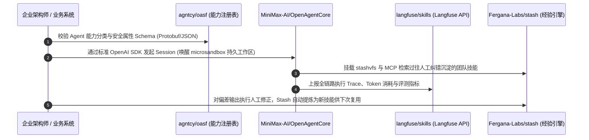

# 开放智能体能力模式框架（`agntcy/oasf`）、自托管 OpenAI Agents API 运行时（`MiniMax-AI/OpenAgentCore`）、Langfuse 官方观测与迁移技能集（`langfuse/skills`）与经验转技能基础设施（`Fergana-Labs/stash`）架构选型与落地 FAQ

> **2026-11-21 夜间持续研究班次 · Night Round 81（累计 Round 681）**  
> **审计凭据**：`CLAIM-20261121-R81-R681-OASF-OPENAGENTCORE-LANGFUSESKILLS-STASH`  
> **关联日刊**：[`2026-11-21.md`](../daily/2026-11-21.md) · [`2026-11-21.en.md`](../daily/2026-11-21.en.md)  
> **可视化架构图**：[`assets/github-ai-radar-2026-11-21-r81-r681-oasf-openagentcore-langfuseskills-stash.svg`](../../../assets/github-ai-radar-2026-11-21-r81-r681-oasf-openagentcore-langfuseskills-stash.svg)

---

## ① 📌 核心结论速览（选型一句话结论）

> **一句话选型结论**：当企业需要构建一套“**跨厂商 Agent 能力注册与发现标准 ➔ 自有算力自托管 OpenAI Agents API 沙箱运行时 ➔ 全链路生产 Trace 观测与跨平台无损迁移 ➔ 生产纠错轨迹自动提炼可复用技能**”的企业级 Agent 工程底座时，推荐采用 100% 宽松协议（Apache-2.0 / MIT）的四件套：**“`agntcy/oasf`（Apache-2.0，`★ 345` 对标网络安全 OCSF 标准的开放智能体能力分类与 Protobuf/JSON Schema 框架）+ `MiniMax-AI/OpenAgentCore`（MIT，`★ 344` MiniMax 官方开源的 Go 语言自托管 OpenAI Agents API 运行时，支持 Codex / Claude Code / MiniMax Code 与 `microsandbox` 闲时休眠）+ `langfuse/skills`（MIT，`★ 344` Langfuse 官方出品的 Trace/Prompt/Dataset 管理与 LangSmith/Arize/Braintrust 一键迁移技能包）+ `Fergana-Labs/stash`（MIT，`★ 344` 捕获智能体执行与人工纠错历史并沉淀为持久化知识与 MCP/CLI 可复用技能的基础设施）”**。在 45 人企业 AI 平台与研发团队基准下，可将月度总拥有成本（TCO）从 **`$8,380.00/月`** 降至 **`$310.00/月`**（净省 **`$8,070.00/月`**，降幅 **`-96.30%`**）。

---

## ② 🎯 客户与架构师灵魂拷问 Q&A

### Q1：为什么企业在规模化落地多智能体平台时，必须补齐这四个核心环节？
- **四大工程断层与对应开源破局方案**：
  1. **解决跨团队/跨厂商 Agent 能力描述各自为政的难题 —— `agntcy/oasf`（`★ 345`，`48 forks`，Apache-2.0，Go）**：由 AGNTCY（Cisco Outshift 发起的开放智能体互联联盟）开源，深度借鉴安全界 OCSF（Open Cybersecurity Schema Framework）的数据建模哲学。通过标准化的属性分类学（Attribute-Based Taxonomies）、`proto/` 与 `schema/` 定义 AI Agent 的技能、输入输出契约与安全属性，获 OpenSSF Best Practices 认证，是企业内部 A2A / Agent Registry 的标准元数据底座。
  2. **解决商业 Hosted Agent API 按分钟高价计费且代码出域的痛点 —— `MiniMax-AI/OpenAgentCore`（`★ 344`，`43 forks`，MIT，Go）**：MiniMax 官方开源的 OpenAI Agents API 自托管实现。研发团队只需修改 `OPENAI_BASE_URL`，即可在不改动官方 OpenAI SDK 代码的前提下，在企业自有集群上原生运行 `Codex`、`Claude Code` 或 `MiniMax Code`。内置基于 `microsandbox` 的计算与存储分离机制——空闲会话自动释放计算资源（Compute that sleeps），唤醒时在任意兼容节点瞬间挂载原有工作区文件（Workspaces that stay）。
  3. **解决 LLM 观测平台绑定（Vendor Lock-in）与 Agent 自助排障难题 —— `langfuse/skills`（`★ 344`，`46 forks`，MIT，Python）**：Langfuse 官方维护的 `.claude-plugin`、`.codex-plugin` 与 `.cursor-plugin` 技能库。包含两大核心技能：`langfuse`（让 Coding Agent 直接查询生产 Trace、管理 Prompt 版本、构建评测 Dataset 与打分）与 `migrate-to-langfuse`（自动盘点并执行从 LangSmith、Arize、Braintrust 到开源 Langfuse 的实时埋点切换与历史 Trace/Dataset/Evaluator 批量迁移）。
  4. **解决 Agent 每次犯同样错误、人工纠偏经验随会话清空而丢失的痛点 —— `Fergana-Labs/stash`（`★ 344`，`46 forks`，MIT，Python）**：提供完整的开源经验沉淀基础设施（含 `stashai`、`stashvfs` 虚拟文件系统、`powerpoint-mcp`、浏览器插件与桌面端）。通过 Hook 或 API 自动捕获 Agent 执行轨迹与人类工程师的纠错动作（Human Corrections），将其提炼为持久化的知识库与可复用技能，并通过 Python SDK、REST API、MCP 和 CLI 注入后续会话。

### Q2：如何将这四个项目组装为企业私有云上的闭环 Agent 生产流水线？
- **注册与调度层**：所有内部 Agent 与工具遵照 `agntcy/oasf` 标准 Schema 注册能力标签，网关据此执行路由与合规校验。
- **沙箱执行层**：业务代码通过标准 OpenAI Agents SDK 指向企业内网部署的 `MiniMax-AI/OpenAgentCore`，按会话拉起 `Codex` 或 `Claude Code` 容器，并在空闲时自动休眠算力、保留持久化工作区。
- **可观测与经验进化层**：所有会话 Trace 实时汇入自托管 Langfuse，研发人员通过 `langfuse/skills` 让 Agent 自动拉取失败 Trace 与评测集；一旦工程师做出人工修正，`Fergana-Labs/stash` 立即捕获该修正并固化为团队共享的防踩坑技能。

### Q3：同直接采购商业托管 Agent 云服务 + LangSmith 企业版相比，何时自建更划算？
- **适用云托管 PaaS 的场景**：团队少于 5 人、无专职基础设施运维、且允许源代码与业务上下文发往公有云托管沙箱。
- **适用本四件套自建的场景**：中大型研发组织（20–100+ 人）需要将代码与生产数据留在自有 VPC 内、需要同时混用 Codex/Claude Code/MiniMax 等多种 Harness、或者正面临商业观测平台（如 LangSmith / Braintrust）按量账单激增需平滑迁回自托管 Langfuse 的场景。

---

## ③ 🧭 直观可视化图解（Mermaid 选型决策树 + 企业集成架构 + 业务流时序图）

### 3.1 选型决策树

### 3.2 企业集成参考架构图

### 3.3 业务流时序图

---

## ④ 📊 同类开源与商业云服务横向选型决策矩阵

| 维度 | `agntcy/oasf` (`★ 345`) | `MiniMax-AI/OpenAgentCore` (`★ 344`) | `langfuse/skills` (`★ 344`) | `Fergana-Labs/stash` (`★ 344`) | 商业托管 Agent 沙箱 + 商业闭源 APM/Eval SaaS |
| :--- | :--- | :--- | :--- | :--- | :--- |
| **核心定位** | 开放智能体能力分类与 Schema 标准框架 | 自托管 OpenAI Agents API 多 Harness 运行时 | Langfuse 官方 Trace/Prompt 管理与迁移技能集 | 捕获人工纠错并转化为可复用技能的基础设施 | 按席位与按量计费的闭源托管 Agent 平台 |
| **适用场景** | 跨团队 A2A 能力目录、合规审计与网关路由 | 内网自托管运行 Codex / Claude Code / MiniMax | Agent 自助分析生产 Trace 及摆脱闭源 Eval 锁定 | 防止编码与办公 Agent 在同一业务坑位重复犯错 | 无运维团队、预算充裕的早期小型试点 |
| **集成成本** | 低（标准 JSON/Protobuf Schema + Taskfile） | 极低（仅改 `OPENAI_BASE_URL` 零代码侵入） | 极低（Claude/Codex/Cursor 官方插件直装） | 低（Docker Compose + Python SDK / MCP / CLI） | 高（商业合同绑定 + 历史 Trace 迁出困难） |
| **开源许可** | **Apache-2.0** | **MIT** | **MIT** | **MIT** | 商业专有 |
| **45 人团队月均 TCO** | **包含于 `$310.00/月` 联合栈** | **包含于 `$310.00/月` 联合栈** | **包含于 `$310.00/月` 联合栈** | **包含于 `$310.00/月` 联合栈** | **`$8,380.00/月`**（`$3,980` SaaS + `$4,400` 人工） |

---

## ⑤ 🧪 应用落地定量收益 / TCO 对比与 7-Card 报告锚点

> **数据来源说明（Provenance Metadata）**：以下 TCO 模型为面向 45 人企业 AI 平台与应用工程团队的合成架构测算（`provenance: synthetic`, `independently_reproduced: false`）；硬件资本开支 `base_hardware_capex = not_measured`（不含自有 K8s 宿主机硬件折旧），单日热榜增量 `track_b_stars_today = not_measured`（审计账本锚定于 [`trending-daily-2026-11-21-audit.json`](../evidence/trending-daily-2026-11-21-audit.json)）。

| 成本路径 | 月度商业托管 Agent 沙箱与闭源 Trace/Eval SaaS 席位费 | 人工编写异构 Agent 适配胶水、手动迁移评测集与重复纠正相同 Agent 错误 (`$100/h`) | 月度总成本 (Total Monthly TCO) | 相对 Path A 净节省 |
| :--- | :--- | :--- | :--- | :--- |
| **Path A：商业云端 Agent 沙箱 + 闭源商业可观测 SaaS + 人工重复纠偏与脚本迁移** | `$3,980.00` | `44.0h` (`$4,400.00`) | **`$8,380.00`** | — |
| **Path C：`agntcy/oasf` + `OpenAgentCore` + `langfuse/skills` + `Fergana-Labs/stash`** | `$70.00` | `2.4h` (`$240.00`) | **`$310.00`** | **`-$8,070.00/月` (`-96.30%`)** |

---

## ⑥ 🛠️ 企业引入与架构评审 Checklist

- [ ] **Agent 注册表 Schema 门禁（`agntcy/oasf`）**：在 CI/CD 中接入 OASF Schema 校验器，要求所有新上线的内部 Agent 声明标准化能力分类、权限边界与负责人元数据。
- [ ] **计算休眠与存储持久化分离（`MiniMax-AI/OpenAgentCore`）**：启用 `microsandbox` 闲时自动释放算力策略，并将工作区卷挂载至受企业 KMS 加密的独立持久化存储。
- [ ] **可观测平台平滑切换演练（`langfuse/skills`）**：利用 `migrate-to-langfuse` 技能先在预发环境完成历史 Dataset、Prompt 与评分器（Evaluators）的校验比对，再切换生产双写流量。
- [ ] **生产轨迹脱敏与技能入库审核（`Fergana-Labs/stash`）**：在 `Stash` 捕获会话并提炼组织级可复用技能前，配置正则与敏感凭证过滤钩子，杜绝把测试密钥固化进共享技能文档。
