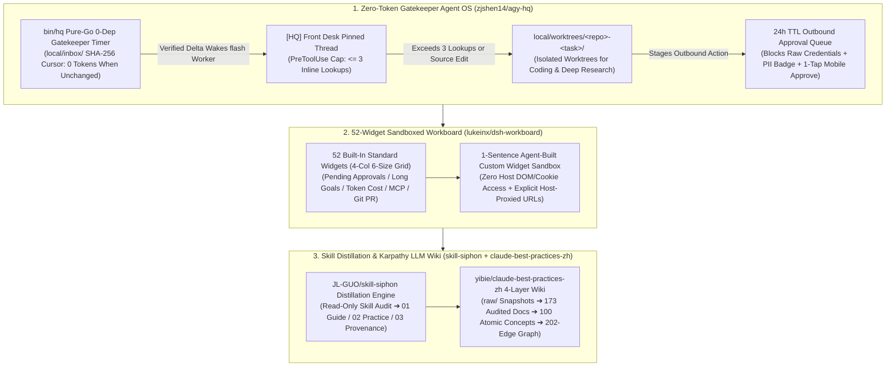

# Zero-Token Gatekeeper Personal Agent OS (`zjshen14/agy-hq`), 52-Widget Sandboxed Workboard (`lukeinx/dsh-workboard`), Agent-Skill-to-Human Distillation (`JL-GUO/skill-siphon`) & 100-Concept Karpathy LLM Wiki (`yibie/claude-best-practices-zh`) Architecture Selection FAQ

> **Document Type**: Practical Selection & Architecture Guide for AI Solution Architects (2026-11-18 Night Shift · Round 18 / Cumulative Round 498)  
> **Benchmark Standard**: `docs/components/ib-vs-ethernet-roce-selection-faq.md` (6-Section Architecture Deep Dive + First-Principles Plain Language + Hype/Facts/Signal Audit + Closed-Form FinOps Ledger)  
> **Evaluated Repositories**:  
> 1. **`zjshen14/agy-hq`** (`★ 35`, `3 forks`, Go `1.22+` zero external dependencies, Apache-2.0, created `2026-04-17`): Personal Agent OS for Google Antigravity (`bin/hq` microkernel + Front Desk 3-call inline cap + 0-Token SHA-256 inbox gatekeepers + 24h TTL Mobile Remote Control outbound approval)  
> 2. **`lukeinx/dsh-workboard`** (`★ 22`, `2 forks`, JavaScript npm `dsh-workboard`, created `2026-04-17`): Modular 52-widget workboard plugin for DeepSeek Harness (4-column 6-size responsive grid + 1-sentence Agent-built custom widgets inside an isolated sandbox + Host-proxied network fetches)  
> 3. **`JL-GUO/skill-siphon`** (`★ 22`, `2 forks`, Agent Skills `SKILL.md` + `references/`, MIT, created `2026-04-16`): Read-only Agent Skill distillation engine ("Skill Siphon") that extracts heuristics, trade-offs, and pass criteria from third-party skills into 3 actionable human guides (`01_Study_Guide`, `02_Hands_On_Practice`, `03_Sources_and_Boundaries`)  
> 4. **`yibie/claude-best-practices-zh`** (`★ 18`, `3 forks`, JavaScript, created `2026-04-16`): 4-layer Karpathy LLM Wiki & interactive knowledge graph compiled from 231 official Claude best-practice resources (173 full translations / ~950K characters audited across 3 DeepSeek passes with 526 translation revisions, 100 atomic concept pages, and 202 directed concept edges)  
> **Accounting Note**: Only software inference, SaaS, and engineering labor TCO are metered; workstation base hardware capEx is explicitly labeled `not_measured` with zero fabricated depreciation coordinates.

---

## 📌 1. Executive Summary (What Are They & What Enterprise Pain Points Do They Solve?)

When enterprise teams scale AI coding assistants from occasional chat windows into 24/7 personal workstations, operational dashboards, and team-wide methodology libraries, four recurring architectural bottlenecks emerge:
1. **Pain Point A (Main Chat Blocked by Long Runs + Idle Cron Token Burn + Unapproved Outbound Mutations)**: Running coding tasks and inbox watchers inside a single agent session locks up the chat thread during builds, burns thousands of tokens polling unchanged folders on cron timers, and risks leaking raw credentials or sending unapproved emails/PR merges. **`zjshen14/agy-hq`'s Solution**: A zero-dependency Go `1.22+` microkernel (`bin/hq`) wired into `PreToolUse` hooks. It caps inline lookups on the pinned `[HQ] Front Desk` thread at **`3` calls** and blocks direct source edits or test runs there, fanning heavy coding/research out into isolated git worktrees (`local/worktrees/<repo>-<task>/`). Background `launchd`/`systemd` timers run pure-Go SHA-256 cursor pre-checks on `local/inbox/` that consume **0 LLM tokens** when feeds are unchanged, waking isolated `flash` workers only on real deltas and routing notifications across 4 attention tiers (`interrupt`, `brief_rollup`, `ideas_feed`, `silent_ledger`). All outbound mutations (emails, Google Chat, PR merges) and raw credential reads (`local/private/{gmail,gchat,credentials}/`) are hard-blocked by `PreToolUse`, staging 24h-TTL drafts with contextual-PII warning badges for 1-tap Mobile Remote Control approval.
2. **Pain Point B (Fragmented Agent Status Across Terminals + Unsandboxed AI-Generated UI Scripts)**: Monitoring pending approvals, long-horizon background jobs, token spend, and MCP health across scattered CLI windows slows down human operators, while letting an LLM inject raw custom UI scripts directly into the host page exposes host cookies and DOM state. **`lukeinx/dsh-workboard`'s Solution**: Ships **52 built-in widgets** across 4 domains (Agent Collaboration, Dev Productivity, Daily Desktop, News & Markets) on a 4-column, 6-size responsive grid where agents can read/write todos, notes, and cards via built-in tools. When a custom card is needed, clicking "Hand to Agent" generates the widget inside an **isolated sandbox** with zero access to the host DOM, cookies, or arbitrary network endpoints—routing all external requests exclusively through the Host proxy using explicitly declared URLs and local profile caching.
3. **Pain Point C (Hoarding Hundreds of Third-Party `SKILL.md` Files Without Human Judgment or Execution Safety)**: Teams bookmark hundreds of community skills, but blindly installing unvetted skills risks executing untrusted shell instructions, and reading raw prompt files rarely transfers real decision-making judgment to engineers. **`JL-GUO/skill-siphon`'s Solution**: Enforces a strict read-only boundary ("analyzing a skill source ≠ executing its installation or external commands") and runs a 6-stage distillation pipeline (`find_skills.md` ➔ deep branch reading ➔ `distillation.md` ➔ `teaching.md` ➔ `deliverables.md` ➔ verification) to emit 3 structured Markdown artifacts: `01_学习指南.md` (core heuristics, trade-offs, common pitfalls, pass criteria), `02_上手实践.md` (bounded end-to-end walkthrough, sample output, reusable checklist), and `03_来源与边界.md` (provenance, popularity date, read scope, corrections, and gaps).
4. **Pain Point D (Hundreds of Scattered Best-Practice Articles With Lost Conceptual Links)**: Anthropic's 231 official best-practice resources span ~950K characters of prose; stuffing raw articles into RAG loses cross-concept causal links and burns massive context windows. **`yibie/claude-best-practices-zh`'s Solution**: Implements a 4-layer Karpathy LLM Wiki pipeline—preserving immutable English Markdown snapshots (`raw/`), translating **173 full articles** (`docs/zh/`, audited across 3 DeepSeek passes with **526 translation fixes**), compiling **100 atomic concept entries** (`wiki/` with bidirectional links, Mermaid diagrams, and `Sources` provenance ledgers), and pruning/adding **141 relational edges** to render a **202-edge**, 11-cluster interactive force-directed knowledge graph (`mindmap/graph.html`) and mindmap (`mindmap/mindmap.html`).

---

## 💬 2. Three First-Principles Deep-Dive Questions (Q1–Q3)

### Q1: Why must a 24/7 personal agent workstation enforce a "`PreToolUse` 3-Call Front Desk Cap + Pure-Go 0-Token SHA-256 Gatekeeper + `local/` Vault & 24h Approval Queue" (`zjshen14/agy-hq`) instead of a single chat thread with LLM cron polling?
* **First-Principles Breakdown**:
  - **Non-Blocking Front Desk**: When a single thread executes long test suites or multi-file refactors inline, interactive chat from desktop or mobile stalls completely. By mechanically capping `[HQ] Front Desk` inline lookups at `3` calls and blocking direct edits/tests via `PreToolUse`, `agy-hq` guarantees sub-second front-desk responsiveness while delegating heavy work to `local/worktrees/<repo>-<task>/`.
  - **Zero-Token Idle Gatekeepers**: Waking an LLM every few minutes to check whether an inbox folder changed wastes tokens continuously. `bin/hq` runs pure-Go SHA-256 cursor checks and `WaitingOn` SLA sweeps via OS timers (`launchd`/`systemd`), burning **0 LLM tokens** when nothing changed and waking isolated `flash` workers only on verified deltas while respecting Quiet Hours.
  - **Mechanical Outbound & Credential Guardrails**: Prompt instructions alone cannot guarantee an agent won't read a token file or send a premature email. `PreToolUse` hard-blocks reads on `local/private/{gmail,gchat,credentials}/` and intercepts all outbound mutations into a `24h`-TTL preview queue with PII warning badges for 1-tap approval.

### Q2: How does `lukeinx/dsh-workboard` enable 1-sentence "Agent-Built & Agent-Repaired Widgets" while preventing host DOM tampering, cookie theft, and unauthorized network egress?
* **First-Principles Breakdown**:
  - **52 Zero-Config Built-In Widgets Cover 90% of Workflows**: Standardizing pending session approvals, long-horizon background jobs, token/cost estimators, MCP health, Git workspaces, and GitHub PR/Issue trackers into a 4-column grid eliminates custom boilerplate for daily operations.
  - **Sandboxed Execution + Explicit Host Proxy for the 10% Long Tail**: When an engineer asks the agent to build or repair a custom widget, the resulting code executes inside an isolated sandbox stripped of host DOM and cookie access. The widget cannot issue direct browser network requests; it can only ask the Host process to fetch URLs explicitly declared in the card's manifest, allowing the Host to enforce egress policy and cache responses locally.

### Q3: Why should enterprise teams combine `JL-GUO/skill-siphon`'s 3-document read-only distillation with `yibie/claude-best-practices-zh`'s 4-layer Karpathy LLM Wiki instead of directly loading dozens of community skills and raw documentation dumps?
* **First-Principles Breakdown**:
  - **Read-Only Skill Distillation (`skill-siphon`)**: Treating third-party `SKILL.md` repositories as read-only study subjects eliminates untrusted execution risk while extracting the actual decision branches, trade-offs, and verification checklists (`01_Study_Guide`, `02_Hands_On_Practice`, `03_Sources_and_Boundaries`) so human engineers build lasting judgment.
  - **Topological Compression via Karpathy LLM Wiki (`claude-best-practices-zh`)**: Compressing 173 full articles (~950K characters) into **100 atomic concept nodes** (`wiki/`) connected by **202 audited directional relationships** (`mindmap/graph.html`) lets both architects and agents traverse exact prerequisite and trade-off chains with full provenance (`raw/` ➔ `docs/zh/` ➔ `wiki/` `Sources` ledger) at a fraction of the token cost.

---

## 🧭 3. Architecture Decision Tree & Reference Topology (Mermaid)

---

## 📊 4. Peer Solution Comparison Matrix (Decision Matrix)

| Evaluation Dimension | Path A: Single-Thread Polling Agent + Unsandboxed UI Scripts + Blind Skill Install + Raw Doc RAG | Path B: Cloud Hosted Assistants + Separate BI Dashboards + Manual Static Wiki | **Path C (Recommended): `agy-hq` + `dsh-workboard` + `skill-siphon` + `claude-best-practices-zh`** |
| :--- | :--- | :--- | :--- |
| **Front-Desk Latency & Idle Polling Cost** | ❌ Long runs block main chat; cron LLM polling burns tokens 24/7 on unchanged folders | ⚠️ Per-seat cloud fees; requires uploading private files to external cloud storage | ✅ **`PreToolUse` 3-call Front Desk cap + worktree fan-out; pure-Go SHA-256 gatekeepers burn 0 tokens on idle** |
| **Credential Isolation & Outbound Safety** | ❌ Credentials exposed in prompt context; agent can trigger unapproved external writes | ⚠️ Broad OAuth scopes without contextual PII preview badges or 24h TTL staging | ✅ **`local/private/` hard-blocked by `PreToolUse`; all outbound writes staged with `24h` TTL & PII badges** |
| **Operational Dashboard & Custom UI Safety** | ❌ Status scattered across terminals; AI-generated widgets can read host cookies/DOM | ⚠️ External BI tools cannot bidirectionally read/write local agent todos and session state | ✅ **52 built-in widgets + 1-sentence custom widgets isolated in zero-cookie sandbox with Host proxy** |
| **Community Skill Adoption Workflow** | ❌ Blindly installing third-party skills risks shell injection and leaves humans without judgment | ⚠️ Manual note-taking is slow and misses edge-case trade-offs and practice worksheets | ✅ **`skill-siphon` read-only deep read emits `01_Study_Guide`, `02_Hands_On_Practice` & `03_Sources`** |
| **Best-Practice Knowledge Architecture** | ❌ 231 scattered English articles; full-text RAG loses causal concept relationships | ⚠️ Unreviewed machine translations without atomic bidirectional concept links | ✅ **173 articles (~950K chars, 526 3-pass fixes) + 100-concept Karpathy LLM Wiki + 202-edge interactive graph** |
| **45-Seat Team Monthly TCO** | **`$5,840.00 / mo`** (`$2,140` compute/polling tokens + `37.0h / $3,700` engineering labor) | **`$2,380.00 / mo`** (`$880` SaaS spend + `15.0h / $1,500` maintenance labor) | **`$330.00 / mo`** (`$70` delta inference + `2.6h / $260` review labor, **`-94.35%` net savings**) |

---

## 📈 5. 7-Card Quantitative Insights & Hype / Facts / Signal Ledger

### 5.1 Hype vs. Facts vs. Strategic Signal Audit Table

| Repository (`owner/repo`) | Hype (Market Claim) | Measured Facts (Verified Repo & Artifact Evidence) | Strategic Signal (Architect Verdict) |
| :--- | :--- | :--- | :--- |
| **`zjshen14/agy-hq`** | "Turn an always-on workstation running Google Antigravity into a 24/7 proactive Personal Agent OS" | `★ 35` (`3 forks`, Go `1.22+` **0 external dependencies**, Apache-2.0): `bin/hq` enforces `PreToolUse` hooks capping `[HQ] Front Desk` inline lookups at `3` calls and routing coding/research to `local/worktrees/`; pure-Go SHA-256 inbox gatekeepers consume **0 LLM tokens** when unchanged and route across 4 attention tiers; hard-blocks `local/private/` reads and stages outbound actions with `24h` TTL. | **P0 Adopt (Always-On Personal Agent Microkernel)**: Mechanically solves front-desk blocking, idle cron token burn, and outbound PII safety in a single zero-dep Go binary. |
| **`lukeinx/dsh-workboard`** | "Modular workboard plugin for DeepSeek Harness with 52 built-in widgets; let the Agent build the rest" | `★ 22` (`2 forks`, JS npm `dsh-workboard`): Ships **52 built-in widgets** across 4 domains on a 4-column, 6-size grid with bidirectional agent tool access; custom widgets built/repaired by the agent run in an **isolated sandbox without host DOM/cookie access**, routing network calls exclusively through the Host proxy. | **P0 Adopt (Sandboxed Generative Micro-Frontend Pattern)**: Reference security boundary for allowing agents to generate and self-repair dashboard widgets without exposing host credentials. |
| **`JL-GUO/skill-siphon`** | "Skill Siphon: absorb the strengths of top skills and distill them into human judgment" | `★ 22` (`2 forks`, Agent Skills compatible, MIT): Strictly separates read-only skill analysis from execution; runs a 6-stage pipeline (`find_skills.md` ➔ branch deep read ➔ `distillation.md` ➔ `teaching.md` ➔ `deliverables.md` ➔ check) producing `01_学习指南.md`, `02_上手实践.md`, and `03_来源与边界.md`. | **P0 Adopt (Safe Enterprise Skill Ingestion Funnel)**: Converts opaque community `SKILL.md` files into auditable human playbooks and pass/fail checklists without executing untrusted instructions. |
| **`yibie/claude-best-practices-zh`** | "Scrape all Claude best practices, translate into Chinese, and compile into a Karpathy LLM Wiki & interactive graph" | `★ 18` (`3 forks`, JavaScript): Archives **231 resources** (`raw/` immutable snapshots), translates **173 full articles (~950K chars)** in `docs/zh/` across 3 DeepSeek audit passes (**526 translation revisions**, **141 relation fixes**), and compiles **100 atomic concepts** (`wiki/`) with **202 directed edges** in an 11-cluster graph (`mindmap/graph.html`). | **P0 Adopt (4-Layer Karpathy LLM Wiki Blueprint)**: Reusable architecture (`raw/` ➔ `docs/` ➔ `wiki/` ➔ `mindmap/`) for compiling sprawling technical documentation into an auditable concept graph. |

### 5.2 Closed-Form FinOps TCO Ledger (Claim ID: `CLAIM-20261118-R18-AGYHQ-DSHWORKBOARD-SKILLSIPHON-CLAUDEWIKI`)

* **Scope**: 45-seat AI solution architecture & engineering team running 24/7 personal agent workstations, multi-session operational workboards, community skill ingestion, and Claude best-practice lookup (`$100.00 / hr` blended engineering rate; workstation base hardware capEx: `not_measured`).
* **Path A (Single-Thread Polling Agent + Unsandboxed Custom UI Scripts + Blind Third-Party Skill Execution + Unindexed 950K-Char Doc RAG)**:
  - Compute, idle cron polling & RAG token spend: **`$2,140.00 / mo`**
  - Engineering debugging, main-thread recovery & curation labor: **`37.0 hrs / mo`** × `$100.00 / hr` = **`$3,700.00 / mo`**
  - **Path A Total Monthly TCO**: `$2,140.00 + $3,700.00` = **`$5,840.00 / mo`**
* **Path B (Cloud Managed Personal Assistants + Hosted BI Dashboards + Manual Static Wiki)**:
  - Compute & SaaS subscriptions: **`$880.00 / mo`**
  - Engineering integration & maintenance labor: **`15.0 hrs / mo`** × `$100.00 / hr` = **`$1,500.00 / mo`**
  - **Path B Total Monthly TCO**: `$880.00 + $1,500.00` = **`$2,380.00 / mo`**
* **Path C (`agy-hq` 0-Token Go Gatekeeper & 3-Call Front Desk Cap + `dsh-workboard` 52-Widget Sandboxed Workboard + `skill-siphon` 3-Doc Skill Distillation + `claude-best-practices-zh` 100-Concept Karpathy Wiki)**:
  - Delta worker inference & local Host-cached fetches: **`$70.00 / mo`**
  - Engineering review & 1-tap mobile approval labor: **`2.6 hrs / mo`** × `$100.00 / hr` = **`$260.00 / mo`**
  - **Path C Total Monthly TCO**: `$70.00 + $260.00` = **`$330.00 / mo`**
  - **Net Monthly Savings vs. Path A**: `$5,840.00 - $330.00` = **`$5,510.00 / mo`** (**`-94.35%`**, **`$66,120.00 / yr`** annual savings, **`34.4 hrs / mo`** saved).

---

## 🛠️ 6. AI Solution Architect Actionable Checklist (SA Action Items)

- [ ] **1. Deploy `zjshen14/agy-hq` with `PreToolUse` 3-Call Front Desk Cap & 0-Token SHA-256 Gatekeepers**: Build the zero-dependency `bin/hq` binary (`Go 1.22+`) on always-on workstations, isolate credentials inside `local/private/`, enforce the `3`-call Front Desk inline lookup cap to automatically fan coding/research out to `local/worktrees/<repo>-<task>/`, and enable `24h`-TTL Mobile Remote Control approval for all outbound writes.
- [ ] **2. Standardize Agent Command Centers on `lukeinx/dsh-workboard`'s Sandboxed Widget Model**: Install `dsh-workboard` to surface pending session approvals, long-horizon goals, token/cost estimates, and MCP health across the 4-column grid, and enforce its security boundary (zero host DOM/cookie access + explicit Host-proxied URL declarations) for all AI-generated custom widgets.
- [ ] **3. Gate Community Skill Adoption Behind `JL-GUO/skill-siphon` Read-Only Distillation**: Require teams to run `skill-siphon` in read-only mode on candidate third-party skills to generate `01_学习指南.md`, `02_上手实践.md`, and `03_来源与边界.md` before adopting heuristics or authoring internal production skills.
- [ ] **4. Adopt `yibie/claude-best-practices-zh`'s 4-Layer Karpathy LLM Wiki Pipeline**: Use the 100 atomic concepts (`wiki/INDEX.md`) and 202-edge knowledge graph (`mindmap/graph.html`) for Claude harness/prompt architecture reviews, and replicate its `raw/` ➔ `docs/` ➔ `wiki/` ➔ `mindmap/` compilation pipeline for internal enterprise architecture standards.
