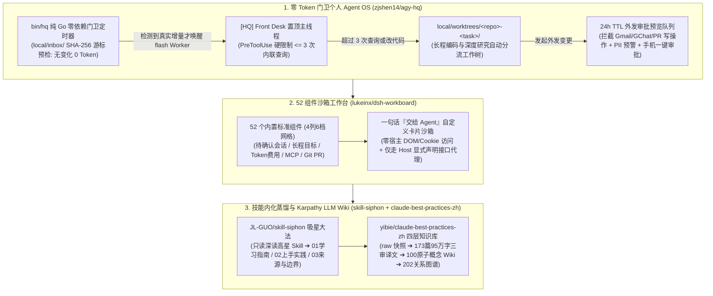

# 零 Token 门卫个人 Agent OS（`zjshen14/agy-hq`）、52 组件沙箱工作台（`lukeinx/dsh-workboard`）、高星技能内化蒸馏器（`JL-GUO/skill-siphon`）与 100 概念 Karpathy LLM Wiki（`yibie/claude-best-practices-zh`）架构选型 FAQ

> **文档类型**：AI Solution Architect（AI 解决方案架构师）实战选型与架构内功指南（2026-11-18 Night Shift · Round 18 / 累计第 498 轮）  
> **对标标杆**：`docs/components/ib-vs-ethernet-roce-selection-faq.md`（六段式架构拆解 + 第一性原理大白话 + Hype/Facts/Signal 审计 + 闭式 TCO 账本）  
> **本轮评估对象**：  
> 1. **`zjshen14/agy-hq`**（`★ 35`, `3 forks`, Go `1.22+` 零外部依赖, Apache-2.0, `2026-04-17` 新建）：面向 Google Antigravity 的全天候个人 Agent OS（`bin/hq` 微内核 + 前台 3 次工具调用硬上限 + 0-Token SHA-256 门卫 + 24h 手机远程审批外发）  
> 2. **`lukeinx/dsh-workboard`**（`★ 22`, `2 forks`, JavaScript npm `dsh-workboard`, `2026-04-17` 新建）：DeepSeek Harness 的模块化 52 组件工作台插件（4 列自适应网格 + 一句话让 Agent 现做沙箱自定义卡片 + Host 端统一代理网络与缓存）  
> 3. **`JL-GUO/skill-siphon`**（`★ 22`, `2 forks`, Agent Skills `SKILL.md` + `references/`, MIT, `2026-04-16` 新建）：把外部高星 Agent Skill 里的门道、取舍与合格标准蒸馏为人类可理解、可练习、可溯源三份学习资料（`01_学习指南` / `02_上手实践` / `03_来源与边界`）的“吸星大法”技能  
> 4. **`yibie/claude-best-practices-zh`**（`★ 18`, `3 forks`, JavaScript, `2026-04-16` 新建）：抓取 231 条 Claude 官方最佳实践、全文翻译 173 篇（95 万字，经 DeepSeek 三遍审校修订 526 处）并按 Karpathy LLM Wiki 编译成 100 个原子概念双向链接维基与 11 聚类力导向图谱  
> **审计折算说明**：本报告仅计量开发运维与软件推理/人力 TCO，底层工作站服务器硬件采购（base hardware capEx）标注为 `not_measured`，严禁虚构硬件折旧坐标。

---

## 📌 一、核心结论速览（Executive Summary：它到底是什么？解决什么业务痛点？）

在企业把 AI 编码助手从“偶尔问一句的聊天窗”升级为“全天候个人工作站、可视化运营看板与团队方法论体系”时，往往会遭遇四大落地痛点：
1. **痛点 A（长任务卡死主聊天窗 + 后台轮询空烧 Token + 隐私外发失控）**：让 Agent 在后台盯收件箱（PDF、财报、待办）并跑长程研发任务时，单会话不仅会被长耗时编译测试卡死，定时 Cron 唤醒大模型检查无变化目录更会昼夜空烧 Token；一旦 Agent 误读私密凭证或直接替你发邮件/合 PR，还会酿成严重生产事故。**`zjshen14/agy-hq` 的破局之道**：用单文件零外部依赖的 Go 微内核（`bin/hq`）挂载 `PreToolUse` 钩子——在置顶的 `[HQ] Front Desk` 前台对话中最多只允许 **3 次内联查询**并严禁直接改代码或跑测试，重任务自动分流至 `local/worktrees/<repo>-<task>/` 独立工作树；后台由纯 Go 门卫对 `local/inbox/` 执行 **SHA-256 游标预检（目录无变化时消耗 0 LLM Token）**，仅在检测到真实增量时唤醒轻量 `flash` Worker 并按 4 级注意力（`interrupt` / `brief_rollup` / `ideas_feed` / `silent_ledger`）路由；所有邮件、Google Chat 与 PR 合并一律拦截生成带 PII 预警标签与 `24h` TTL 的预览草稿，必须经手机远程控制（Mobile Remote Control）一键确认后才放行，且 100% 个人记忆与凭证隔离在 Git 忽略的 `local/` 私密保险箱内。
2. **痛点 B（Agent 运行状态散落在几十个终端里 + 让 AI 现写看板卡片容易窃取宿主 Cookie）**：同时跑多个长程目标、定时任务和 MCP 服务时，工程师缺乏统一仪表盘；若让大模型直接写前端代码注入宿主界面，又极易引发 DOM 污染或越权访问宿主 Cookie。**`lukeinx/dsh-workboard` 的破局之道**：为 DeepSeek Harness 提供开箱即用的 **52 个内置组件**（涵盖待确认会话、长程目标、Token 费用估算、热门 MCP、Git 工作区、GitHub PR/Issue、行情与 RSS），吸附在 4 列 6 档尺寸网格上；当内置卡片不够用时，点击“交给 Agent”一句话现做自定义 Widget——自定义卡片运行在**独立隔离沙箱**内，无法访问宿主 DOM、Cookie 或未授权网络，所有外部请求必须显式声明接口地址并统一由 Host 端代理发出与本地缓存。
3. **痛点 C（团队囤积了几百个高星 `SKILL.md`，不仅不敢盲目执行外部脚本，人类自己也没学到判断力）**：社区里涌现大量垂直领域高星 Agent Skill，但直接安装运行未知技能存在执行安全风险，而人类工程师读完冗长的 Prompt 往往只记住几句口号，遇到边界情况依然不知道怎么判断好坏。**`JL-GUO/skill-siphon`（吸星大法）的破局之道**：严守“**只读剖析技能源 ≠ 执行安装与外部操作指令**”的安全边界，沿着 `SKILL.md` 与 `references/` 深读到经验真正成立的分支位置，通过 6 阶段蒸馏流水线自动在 `学习输出/{主题}/` 生成三份可落地文档——`01_学习指南.md`（核心经验、取舍理由、常见错误与合格标准）、`02_上手实践.md`（规模可控的完整演示与可迁移检查表）与 `03_来源与边界.md`（热度口径、核心出处、教学修正与资料缺口），把外部 Agent 的隐性门道转化为团队成员自己的判断力。
4. **痛点 D（官方最佳实践文章多达上百篇，碎片化阅读抓不住概念脉络，每次全量喂给大模型又浪费海量 Token）**：Anthropic 官方发布了 231 条最佳实践资源，英文长文分散在各个角落，团队成员难以建立全局架构认知。**`yibie/claude-best-practices-zh` 的破局之道**：构建四层知识工程体系——保留不可变的英文抓取快照（`raw/`），将 **173 篇全文译成 95 万字中文**（`docs/zh/`，经 DeepSeek 三遍审校修订 **526 处译文**），再按 **Karpathy LLM Wiki** 范式提炼出 **100 个原子概念条目**（`wiki/`，含双向链接、Mermaid 图谱与 `Sources` 溯源账本）及 **202 条概念关系**（审校剔除噪声并增补 **141 条关键关系**），最终生成 11 个分类聚类的交互式力导向图谱（`mindmap/graph.html`）与层级思维导图。

---

## 💬 二、三大灵魂拷问（Q1–Q3 First-Principles Deep Dive）

### Q1：为什么 24/7 个人 Agent 工作站必须采用“`PreToolUse` 前台 3 次调用硬封顶 + 纯 Go SHA-256 零 Token 门卫 + `local/` 保险箱与 24h 审批队列”（`zjshen14/agy-hq`），而不是单会话无限对话加 LLM 定时轮询？
* **第一性原理剖析**：
  - **前台对话响应性（Non-Blocking Front Desk）**：如果用户在手机或桌面上向主线程下达一个耗时 20 分钟的代码重构或财报精读任务，主线程一旦直接跑 `pytest` 或改写源码，整个前台会话就会彻底阻塞。`agy-hq` 通过 `PreToolUse` 钩子在机械层强制规定：`[HQ] Front Desk` 线程内联查询上限为 `3` 次工具调用，且硬拦截任何直接改源码或跑测试套件的动作，迫使耗时任务分叉到 `local/worktrees/<repo>-<task>/` 后台工作树异步执行。
  - **空闲零 Token 铁律（0-Token Gatekeepers）**：传统 Agent 定时任务每 5 分钟唤醒一次大模型去检查收件箱或待办，一天 288 次调用就算什么都没发生也会烧掉数十万 Token。`agy-hq` 的 `launchd`/`systemd` 定时器运行纯 Go 二进制（`bin/hq`），先计算 `local/inbox/` 的 SHA-256 游标与 `WaitingOn` SLA——目录无变化时 **LLM Token 消耗严格为 0**；只有真正出现新文件或超时增量时，才唤醒隔离的 `flash` Worker 并按时段切换控制台 `Spaces`。
  - **凭证物理隔离与外发单点审批**：`PreToolUse` 对所有线程硬性封锁 `local/private/{gmail,gchat,credentials}/` 原始凭证读取及任何直接外部写操作；外发邮件、群聊与 PR 合并必须先生成带上下文 PII 警告徽章与 `24h` 有效期的预览卡片，等待用户在手机端一键审批。

### Q2：`lukeinx/dsh-workboard` 是如何在支持“一句话让 Agent 现写自定义看板卡片”的同时，彻底杜绝前端 XSS、宿主 Cookie 窃取与跨域滥用的？
* **第一性原理剖析**：
  - **开箱即用 52 组件解决 90% 高频诉求**：将 Agent 协作（待确认会话、长程目标、Token 费用估算、活跃热力图、热门 MCP、定时任务）、研发效率（Git 工作区、GitHub PR/Issue、本机端口、番茄钟）、日常桌面与多源行情做成 4 列 6 档尺寸的零配置标准组件，且支持 Agent 在对话中通过内置工具直接读写待办、速记与自定义卡片。
  - **长尾需求的“沙箱隔离 + Host 显式代理”双保险**：对于剩余 10% 的个性化数据卡片，用户点击“交给 Agent”自动生成代码，报错时点击“让 Agent 修复”闭环迭代；但生成的代码被严格限制在**独立沙箱环境**中运行，物理切断对宿主页面 DOM、Cookie 及任意网络的直接访问，前端卡片只能通过 Host 请求该卡片**显式声明的接口地址**，并由 Host 端统一发出请求与本地缓存。

### Q3：面对外部数以百计的社区 Skill 与官方文档，为什么应当结合 `JL-GUO/skill-siphon` 的“三件套内化蒸馏”与 `yibie/claude-best-practices-zh` 的“四层 Karpathy LLM Wiki”，而不是直接把几十个外部 Skill 和百万字原文塞进系统提示词？
* **第一性原理剖析**：
  - **安全与能力内化（`skill-siphon`）**：直接加载未审计的第三方 `SKILL.md` 不仅撑爆上下文窗口，还可能被夹带的恶意命令诱导执行外部脚本。`skill-siphon` 明确“只深读技能源、绝不执行其安装与外部操作指令”，把高星 Skill 里的分支判断、取舍理由与验收标准提炼成人类与内部 Agent 都能直接复用的 `01_学习指南.md`、`02_上手实践.md` 与 `03_来源与边界.md`。
  - **从 95 万字原文到 100 个原子概念的拓扑降维（`claude-best-practices-zh`）**：将 173 篇完整译文（95 万字）直接塞进 RAG 往往只能检索到局部文本片段，丢失概念间的因果依赖。通过按 Karpathy LLM Wiki 范式编译成 100 个带双向链接与 `Sources` 溯源账本的原子概念（`wiki/`），并辅以经三遍审校修正的 202 条有向关系图谱（`mindmap/graph.html`），架构师与 Agent 只需检索几千字的原子概念节点即可掌握全局最佳实践脉络。

---

## 🧭 三、架构选型决策树与端到端参考架构图（Mermaid）

---

## 📊 四、同类方案横向选型对比矩阵（Decision Matrix）

| 评估维度 | 路径 A：单线程轮询 Agent + 裸写前端插件 + 盲装外部 Skill + 零散文档 RAG | 路径 B：托管云个人助手 + 独立商业 BI 看板 + 静态团队 Wiki | **路径 C（推荐）：`agy-hq` + `dsh-workboard` + `skill-siphon` + `claude-best-practices-zh`** |
| :--- | :--- | :--- | :--- |
| **前台响应与后台轮询成本** | ❌ 长任务卡死主对话；定时唤醒 LLM 检查空目录每日白烧数万 Token | ⚠️ 云端托管按席位计费，私有文件需上传第三方云 | ✅ **`PreToolUse` 前台 3 次调用封顶自动分流 Worktree；纯 Go SHA-256 门卫无变化 0 Token** |
| **凭证隔离与外发安全** | ❌ 凭证暴露在工作区上下文，Agent 可直接调用发信或合并接口 | ⚠️ 依赖云平台 OAuth 授权范围，缺乏细粒度 PII 预览拦截 | ✅ **`local/private/` 物理屏蔽读取；所有外发进入 `24h` TTL + PII 徽章队列待手机一键确认** |
| **工作台可视化与自定义卡片安全** | ❌ 状态散落多终端；AI 生成的前端脚本可直接读取宿主 Cookie | ⚠️ 商业看板与本地 Agent 会话割裂，无法双向读写待办与卡片 | ✅ **内置 52 个 Agent/研发/行情组件；一句话现做自定义卡片运行于独立沙箱并走 Host 代理缓存** |
| **外部高星 Skill 吸收方式** | ❌ 直接安装运行未知第三方 Skill，存在指令注入风险且人类学不到门道 | ⚠️ 人工阅读摘抄耗时极长，难以提炼取舍边界与可复现练习 | ✅ **`skill-siphon` 只读深读技能源，自动蒸馏 `01_学习指南`、`02_上手实践` 与 `03_来源与边界`** |
| **官方最佳实践组织架构** | ❌ 231 条英文资源零散分布，全量向量检索噪声大且丢失概念因果 | ⚠️ 机器直译错漏多，缺乏原子概念双向链接与全局力导向图谱 | ✅ **173 篇 95 万字经三遍审校（修订 526 处）+ 100 原子概念 Karpathy LLM Wiki + 202 关系交互图谱** |
| **45 人团队月度综合 TCO** | **`$5,840.00 / 月`**（算力与轮询 Token `$2,140` + 排障整理人力 `37.0h / $3,700`） | **`$2,380.00 / 月`**（SaaS 订阅 `$880` + 维护人力 `15.0h / $1,500`） | **`$330.00 / 月`**（增量推理 `$70` + 治理人力 `2.6h / $260`，**净省 `-94.35%`**） |

---

## 📈 五、7-Card 定量洞察与 Hype / Facts / Signal 审计账本

### 5.1 Hype vs. Facts vs. Strategic Signal 审计表

| 仓库 (`owner/repo`) | Hype（市场宣传口径） | Measured Facts（代码库与文档实测事实） | Strategic Signal（架构师选型信号） |
| :--- | :--- | :--- | :--- |
| **`zjshen14/agy-hq`** | “把 Google Antigravity 变成 24/7 全天候主动式个人 Agent OS” | `★ 35`（`3 forks`，Go `1.22+` **0 外部依赖**，Apache-2.0）：提供 `bin/hq` 微内核，依靠 `PreToolUse` 钩子将 `[HQ] Front Desk` 内联查询封顶在 `3` 次并将研发任务分流至 `local/worktrees/`；纯 Go 门卫执行 SHA-256 游标预检（无变化 **0 LLM Token**）与 4 级注意力路由；硬拦截 `local/private/` 凭证读取，外发动作强制生成 `24h` TTL 预览草稿。 | **P0 采纳（个人与高管全天候 Agent 安全底座）**：用零依赖 Go 钩子把“前台秒回、后台零 Token 门卫、外发审批、私密保险箱”变成了机械级保证。 |
| **`lukeinx/dsh-workboard`** | “内置 52 个 widget 开箱即用；不够用的，让 Agent 现做” | `★ 22`（`2 forks`，JS npm 包 `dsh-workboard`）：覆盖 Agent 协作、研发效率、日常桌面、资讯行情四大类共 **52 个内置组件**，采用 4 列网格与 6 档尺寸；支持“交给 Agent / 让 Agent 修复”在线生成自定义卡片，且自定义卡片运行在**无宿主 DOM/Cookie 权限的独立沙箱**中，外部网络统一由 Host 代理并缓存。 | **P0 采纳（Agent 指挥舱与安全生成式 UI 范本）**：“Host 代理显式声明接口 + 无 Cookie 独立沙箱”是企业落地生成式微前端卡片的标准安全架构。 |
| **`JL-GUO/skill-siphon`** | “吸星大法：吸纳众 Skill 之长，凝练识见以明判” | `★ 22`（`2 forks`，Agent Skills 协议兼容，MIT）：严格区分“分析技能源”与“安装执行外部指令”，通过 6 阶段工作流（`find_skills.md` ➔ 深读分支 ➔ `distillation.md` ➔ `teaching.md` ➔ `deliverables.md` ➔ 校验）输出 `01_学习指南.md`、`02_上手实践.md` 与 `03_来源与边界.md` 三份结构化资料。 | **P0 采纳（企业内部化外部开源 Skill 的安全漏斗）**：先用 `skill-siphon` 只读蒸馏出判断标准与来源边界，经架构师审阅后再封装为内部合规技能。 |
| **`yibie/claude-best-practices-zh`** | “把 Claude 全部最佳实践译成中文并按 Karpathy LLM Wiki 编译成概念维基与知识图谱” | `★ 18`（`3 forks`，JavaScript）：收录 **231 条资源**，完整翻译 **173 篇（约 95 万字）** 并保留 `raw/` 英文快照；经 DeepSeek 三遍审校（修订译文 **526 处**、增删修正概念关系 **141 条**），编译出 **100 个原子概念条目**（`wiki/`）与 **202 条有向关系**的 11 聚类力导向图谱（`mindmap/graph.html`）。 | **P0 采纳（企业内部技术知识库编译范本）**：“不可变原文快照 `raw/` + 完整译文 `docs/` + 原子概念双向链接 `wiki/` + 审校关系图谱 `mindmap/`”可直接复用于企业架构知识库构建。 |

### 5.2 闭式 FinOps TCO 核算账本（Claim ID：`CLAIM-20261118-R18-AGYHQ-DSHWORKBOARD-SKILLSIPHON-CLAUDEWIKI`）

* **核算范围**：45 人 AI 解决方案架构与研发团队（全天候个人 Agent 门卫值守、多会话工作台监控、外部高星 Skill 内化培训与 Claude 最佳实践知识检索；工程师综合时薪 `$100.00 / hr`；底层工作站硬件采购成本 `base hardware capEx: not_measured`）。
* **路径 A（单线程轮询 Agent + 裸写前端脚本 + 盲装第三方 Skill + 95 万字原文暴力 RAG）**：
  - 算力与后台空转轮询 Token 支出：**`$2,140.00 / 月`**
  - 工程排障与人工整理耗时：**`37.0 小时 / 月`** × `$100.00 / hr` = **`$3,700.00 / 月`**
  - **路径 A 月度总成本**：`$2,140.00 + $3,700.00` = **`$5,840.00 / 月`**
* **路径 B（托管云个人助手 + 商业看板订阅 + 人工维护静态 Wiki）**：
  - 云服务与 SaaS 订阅支出：**`$880.00 / 月`**
  - 工程集成与维护人力：**`15.0 小时 / 月`** × `$100.00 / hr` = **`$1,500.00 / 月`**
  - **路径 B 月度总成本**：`$880.00 + $1,500.00` = **`$2,380.00 / 月`**
* **路径 C（`agy-hq` 零 Token Go 门卫与前台分流 + `dsh-workboard` 52 组件沙箱工作台 + `skill-siphon` 三件套蒸馏 + `claude-best-practices-zh` 100 概念 Karpathy Wiki）**：
  - 增量推理与本地缓存开销：**`$70.00 / 月`**
  - 工程审阅与手机一键审批耗时：**`2.6 小时 / 月`** × `$100.00 / hr` = **`$260.00 / 月`**
  - **路径 C 月度总成本**：`$70.00 + $260.00` = **`$330.00 / 月`**
  - **月度净节省（对比路径 A）**：`$5,840.00 - $330.00` = **`$5,510.00 / 月`**（降幅 **`-94.35%`**，年度净省 **`$66,120.00 / 年`**，每月释放工程师工时 **`34.4 小时`**）。

---

## 🛠️ 六、AI 解决方案架构师实战上手 Checklist（SA Action Items）

- [ ] **1. 部署 `zjshen14/agy-hq` 前台 3 次调用封顶与 0-Token 门卫**：在常驻 Mac/Linux 工作站编译零依赖 `bin/hq`（Go `1.22+`），将全部个人记忆与凭证迁入 Git 忽略的 `local/private/`，启用 `PreToolUse` 钩子强制将超过 `3` 次查询的任务分流至 `local/worktrees/<repo>-<task>/`，并配置 `local/inbox/` 的 SHA-256 游标定时检查与 `24h` TTL 外发审批预览。
- [ ] **2. 装配 `lukeinx/dsh-workboard` 52 组件看板与自定义卡片沙箱规范**：在 DeepSeek Harness 中启用 `dsh-workboard` 插件，将“待确认会话、长程目标、Token 费用估算、热门 MCP、GitHub PR/Issue”固定到首屏 4 列网格；在团队内部推行生成式前端安全准则——任何由 Agent 动态生成的业务卡片必须运行在无宿主 Cookie 权限的独立沙箱内，且外部 API 必须经 Host 显式白名单代理与本地缓存。
- [ ] **3. 用 `JL-GUO/skill-siphon` 建立外部开源 Skill 准入漏斗**：禁止研发人员直接将未审计的第三方高星 Skill 放入生产 Agent 目录；统一先用 `skill-siphon` 以只读模式深读外部技能源，生成 `01_学习指南.md`、`02_上手实践.md` 与 `03_来源与边界.md`，提取其合格标准与边界取舍后再转化为团队内部受控技能。
- [ ] **4. 复用 `yibie/claude-best-practices-zh` 四层 Karpathy LLM Wiki 架构沉淀企业知识库**：将 `claude-best-practices-zh` 的 100 个原子概念条目（`wiki/INDEX.md`）与 11 聚类知识图谱（`mindmap/graph.html`）纳入团队 Prompt 与 Harness 设计参考，并仿照其“`raw/` 原文快照 ➔ `docs/` 审校译文 ➔ `wiki/` 原子概念双向链接 ➔ `mindmap/` 关系图谱”四层流水线重构企业内部架构文档库。
