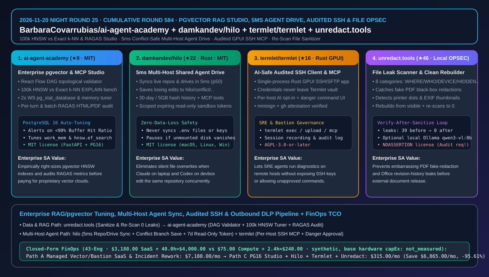
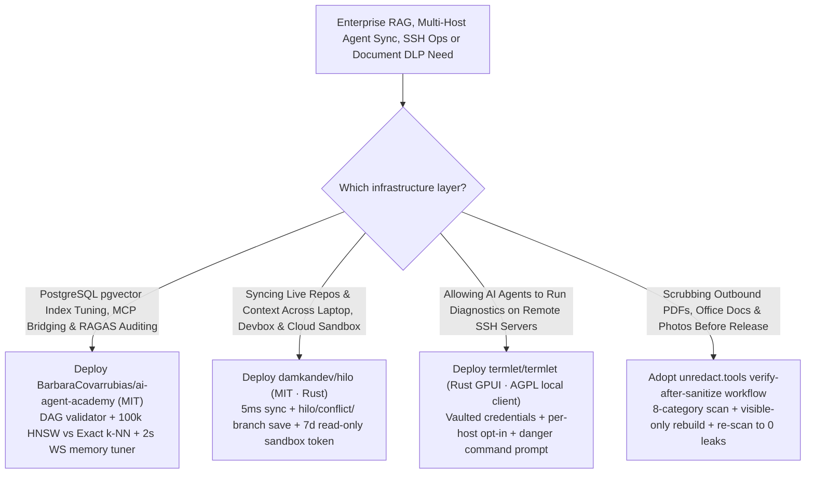
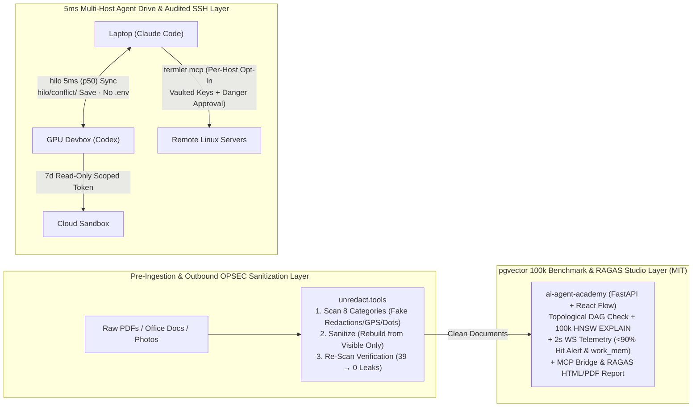

# How to Choose Enterprise pgvector 100k-Vector Studios, 5ms Conflict-Safe Agent Drives, Audited SSH Terminals, and Verify-After-Sanitize File OPSEC Tools? `ai-agent-academy`, `hilo`, `termlet`, and `unredact.tools` Architecture & Selection FAQ

> **Document Metadata (2026-11-20 Night Round 25 · Cumulative Round 584)**
> - **Target Audience**: AI Solution Architects, Enterprise RAG & PostgreSQL Database Leads, SRE & Bastion Security Architects, Legal/Compliance Document OPSEC Leads
> - **Primary Repositories Evaluated**:
>   1. [`BarbaraCovarrubias/ai-agent-academy`](https://github.com/BarbaraCovarrubias/ai-agent-academy) (★ 8 · `stars_today: not_measured` · `1 star/day` · Python / FastAPI + React 18 / React Flow + PostgreSQL 16 `pgvector` · MIT) — Visual Enterprise RAG & MCP Studio featuring real-time React Flow **DAG topological validation** (blocking cycles and orphan nodes), **empirical 100,000-vector HNSW vs. Exact k-NN benchmarking** with live `EXPLAIN PLAN`, `hnsw.ef_search` tuning, and `REINDEX INDEX CONCURRENTLY`, **2-second WebSocket `pg_stat_database` telemetry** (`< 90%` Buffer Hit Ratio alerts & automated `work_mem` / `maintenance_work_mem` tuning), JSON-RPC 2.0 MCP client bridging, and per-turn + batch **RAGAS** (*Faithfulness*, *Answer Relevance*, *Context Precision*) HTML/PDF auditing
>   2. [`damkandev/hilo`](https://github.com/damkandev/hilo) (★ 22 · `stars_today: not_measured` · `3 stars/day` · Rust · MIT) — **5 ms (`p50`) multi-machine shared drive and MCP file layer** for coding agents (`hilo setup devbox --folder ~/code`) that syncs live repositories (including uncommitted changes) and context drives across laptops, servers, and cloud sandboxes without manual push/pull. Preserves every overwritten/deleted version for `30 days` (`5 GB`), **saves losing concurrent edits to `hilo/conflict/<branch>/<date>` while notifying the losing agent**, never syncs `.env` files or keys, pauses if an unmounted disk vanishes, and mints scoped expiring read-only sandbox tokens (`hilo token create --path ... --expires 7d --read-only`)
>   3. [`termlet/termlet`](https://github.com/termlet/termlet) (★ 16 · `stars_today: not_measured` · `3 stars/day` · Rust GPUI · AGPL-3.0-or-later) — Single-process Rust GPUI SSH/SFTP client with an **audited AI CLI & MCP bridge (`termlet exec / upload / mcp`)** where SSH keys and passwords never leave Termlet's encrypted vault, AI access is off by default and requires **per-host opt-in**, dangerous commands trigger human approval dialogs, every call is audit-logged, and releases are verified via `minisign` (`SHA256SUMS.minisig`) and `gh attestation verify`
>   4. [`NPCmillionaire/unredact.tools`](https://github.com/NPCmillionaire/unredact.tools) (★ 46 · `stars_today: not_measured` · `6 stars/day` · Python · `NOASSERTION` — requires legal review) — 100% local OPSEC scanner and sanitizer (`scan` & `sanitize`) across images, PDFs, Office docs, and media that maps leaks into 8 plain-English categories (`WHERE · WHO · DEVICE · WHEN · SOFTWARE · ORG · HIDDEN · TRACKING` — catching GPS EXIF, uncropped thumbnails, yellow printer tracking dots, fake PDF black-box redactions over selectable text, and Office revision history), rebuilds a clean copy from visible content only, and **re-scans the output to prove `leaks: 39 before -> 0 after`**
> - **Provenance & Guardrail Statement**: Structured after `ib-vs-ethernet-roce-selection-faq.md`. All four repositories come from `search-new-repos-2026-11-20-raw.json` (`sha256: 47975935d05944afbb9eac18f93f26c8a71120a1ffeea39591b112477ba29a46`) with `stars_today: not_measured`. Upstream README metrics (`100k` vector benchmark, `5 ms (p50)` LAN sync, `39 -> 0` leak verification) are labeled `anonymized_reported (independently_reproduced=false)`. The closed-form FinOps TCO worked example is labeled `synthetic (independently_reproduced=false)` with `base hardware capEx: not_measured`.

---

## ① 📌 Executive Summary (One-Sentence Selection Verdict)

> **One-Sentence Verdict**: When building **enterprise PostgreSQL `pgvector` RAG pipelines, multi-machine coding-agent workspaces, AI-assisted SSH operations, and outbound document DLP workflows**, **do not abandon PostgreSQL for expensive proprietary vector clouds before tuning `hnsw.ef_search` and `Buffer Hit Ratio`, never expose raw SSH private keys to coding agents, and never release PDFs redacted with black rectangles over selectable text**! Instead, benchmark and tune PostgreSQL 16 with MIT-licensed **`BarbaraCovarrubias/ai-agent-academy` (100k HNSW vs. Exact k-NN `EXPLAIN PLAN` + 2s memory telemetry + RAGAS audits)**, synchronize multi-host agent files with MIT-licensed **`damkandev/hilo` (`5 ms` sync + `hilo/conflict/` concurrent-edit preservation + 7-day read-only sandbox tokens)**, gate remote SSH commands through **`termlet/termlet` (vaulted credentials + per-host opt-in + dangerous-command approval UI)**, and scrub outbound files with **`unredact.tools`'s rebuild-from-visible + re-scan-to-zero loop** to cut a 43-engineer organization's monthly vector cloud, bastion, and incident recovery TCO from **$7,180.00/mo** down to **$315.00/mo** (saving **$6,865.00/mo**, **`-95.61%`**, `synthetic, independently_reproduced=false`).



### Core Capabilities & Metrics Cheat Sheet

| Dimension | `ai-agent-academy` | `damkandev/hilo` | `termlet/termlet` | `NPCmillionaire/unredact.tools` |
|---|---|---|---|---|
| **Plain-English Positioning** | Visual RAG & MCP studio on PostgreSQL 16 `pgvector` with 100k HNSW benchmarking & RAGAS telemetry | `5 ms` multi-machine shared drive & MCP file layer for concurrent coding agents | Single-process Rust GPUI SSH client with vaulted-credential, human-approved AI execution | Local OPSEC file leak scanner & visible-only rebuilder with automated zero-leak re-scan |
| **Primary Enterprise Pain Point Solved** | Unexplained `pgvector` latency spikes caused by `<90%` buffer hit ratios or untuned `hnsw.ef_search` | Concurrent agents on laptop and devbox silently overwriting each other's uncommitted edits | Giving AI agents raw `.pem` SSH keys or unrestricted shell access on remote Linux hosts | Leaking selectable text under PDF black boxes, Office tracked changes, EXIF GPS, or printer tracking dots |
| **Key Technical / Measured Spec** | `100,000`-vector HNSW vs. Exact k-NN `EXPLAIN PLAN`; 2s WS `pg_stat_database` tuner; batch RAGAS reports | **`5 ms (p50)`** LAN sync; `30-day/5 GB` hash history; `hilo/conflict/` branch save; `7d` read-only sandbox token | `termlet exec/upload/mcp`; per-host AI opt-in + danger dialog; `minisign` + `gh attestation verify` | 8 risk dimensions (`WHERE/WHO/DEVICE/HIDDEN/TRACKING`); rebuilds from visible + proves `39 -> 0` leaks |
| **License & Governance** | **MIT** (React 18 + FastAPI + PG16 Docker Compose) | **MIT** (Rust binary for macOS, Linux & Windows; zero third-party cloud) | **AGPL-3.0-or-later** (use as standalone SSH/MCP client; rename if redistributing modified builds) | **`NOASSERTION`** (adopt verify-after-sanitize architecture; obtain author license before bundling) |

---

## ② 🎯 Solution Architect & Customer Deep-Dive Q&A

### Q1: Why do enterprise teams often blame `pgvector` for slow RAG queries when the real culprit is PostgreSQL memory starvation, and how does `BarbaraCovarrubias/ai-agent-academy` diagnose and fix this visually?

- **The Hidden Bottlenecks in Production `pgvector` Deployments**:
  - Teams frequently deploy PostgreSQL with default container memory settings (`work_mem = 4MB`), run unindexed queries or default HNSW parameters at `100,000+` vectors, and have zero visibility when the PostgreSQL **Buffer Hit Ratio** drops below `90%`—causing HNSW graph traversals to thrash disk blocks (`blks/s`).
- **How `ai-agent-academy` (MIT) Combines DAG Validation, 100k HNSW Benchmarking & RAGAS**:
  1. **Live Topological DAG Validation**: Validates React Flow pipelines (`Document Loader → Embedding Gen → pgvector Store → MCP Tool Client → Prompt Template → LLM Engine`) in real time, blocking cycles and unconnected orphan nodes.
  2. **Empirical 100k-Vector HNSW vs. Exact k-NN Benchmarking**: Generates up to `100,000` vectors, compares approximate HNSW (`<=>` cosine distance) against brute-force Exact k-NN with real PostgreSQL `EXPLAIN PLAN` outputs, tunes `hnsw.ef_search`, and triggers `REINDEX INDEX CONCURRENTLY`.
  3. **2-Second WebSocket `pg_stat_database` Telemetry & Auto-Tuner**: Streams CPU, RAM, disk reads (`blks/s`), and Buffer Hit Ratio every 2 seconds, alerting when cache hits fall below `90%` and computing optimal `work_mem` and `maintenance_work_mem` settings alongside per-turn and batch **RAGAS** (*Faithfulness*, *Answer Relevance*, *Context Precision*) evaluations.

### Q2: When an engineer runs Claude Code on a laptop, Codex on a remote GPU server, and a third agent in a cloud sandbox, how does `damkandev/hilo` prevent concurrent file overwrites and `.env` leaks?

- **Why Git Push/Pull and Consumer Cloud Drives Fail Multi-Agent Workflows**:
  - Agents constantly read and write uncommitted files (specs, CSVs, work-in-progress code). Standard file-sync tools silently overwrite the slower machine's file during concurrent edits without telling the losing agent, and if a mounted drive disconnects, they propagate mass deletions across all peers.
- **How `damkandev/hilo` (MIT · Rust) Protects Multi-Machine Agents**:
  - **5 ms (`p50`) Sync + Conflict Branch Preservation**: Pairs machines over SSH (`hilo setup devbox --folder ~/code`) and syncs every write in **`5 ms` (`p50` on LAN)**. If two agents edit the same file simultaneously, one wins while **the other's version is automatically preserved on a `hilo/conflict/<branch>/<date>` branch (plus 30-day / 5 GB hash history) and the losing agent is explicitly notified**.
  - **`.env` Exclusion, Vanished-Disk Pause & Scoped Sandbox Tokens**: Respects `.gitignore`, **never syncs `.env` files or private keys**, automatically pauses if a drive folder vanishes (an unmounted disk) instead of deleting files everywhere, and issues **scoped, expiring, read-only tokens** (`hilo token create --path ~/notes/clients --expires 7d --read-only`) so a cloud sandbox sees only one designated folder.

### Q3: How do `termlet/termlet` and `NPCmillionaire/unredact.tools` close two critical enterprise security gaps: AI-assisted SSH operations and accidental document metadata/redaction leaks?

- **`termlet/termlet` (AGPL-3.0-or-later): Vaulted-Credential SSH Execution for Coding Agents**:
  - Instead of handing raw SSH keys to an agent shell, `termlet` keeps all credentials encrypted inside its single-process Rust GPUI vault.
  - Its CLI and MCP server (`termlet exec`, `termlet upload`, `termlet mcp`) are **off by default**, require **explicit per-host authorization**, pop up a **human approval prompt on dangerous commands**, log every AI invocation for audit, and ship with `minisign` (`SHA256SUMS.minisig`) + GitHub Actions `gh attestation verify` provenance.
- **`NPCmillionaire/unredact.tools`: Catching Fake PDF Black-Box Redactions & Proving Zero Leaks**:
  - Scans images, PDFs, Office files, and media across 8 plain-English risk dimensions (**`WHERE · WHO · DEVICE · WHEN · SOFTWARE · ORG · HIDDEN · TRACKING`**), catching GPS EXIF, uncropped EXIF thumbnails, yellow laser-printer tracking dots, Office tracked changes/earlier drafts, and **failed PDF redactions where black boxes were drawn over selectable text**.
  - Running `unredact.tools sanitize memo.docx` rebuilds a fresh copy **exclusively from visible content** and **automatically re-scans the output file to prove `leaks: 39 before -> 0 after`**.

---

## ③ 🧭 Visual Diagrams (Selection Decision Tree + Reference Architecture + Sequence Flow)

### 3.1 Enterprise pgvector Studio, Multi-Host Agent Drive, Audited SSH & File OPSEC Decision Tree



### 3.2 End-to-End Document Sanitization, pgvector RAG Studio & Multi-Host Agent Architecture



### 3.3 `unredact.tools` Sanitize → `ai-agent-academy` 100k HNSW Tune → `hilo` & `termlet` Rollout Sequence

```mermaid
sequenceDiagram
    autonumber
    participant SA as Solution Architect / SRE
    participant Unred as unredact.tools (Local OPSEC)
    participant Acad as ai-agent-academy (PG16 + RAGAS)
    participant Hilo as damkandev/hilo (5ms Drive)
    participant Term as termlet mcp (Audited SSH)

    SA->>Unred: Run unredact.tools sanitize filing.pdf before RAG ingestion & external sharing
    Unred->>Unred: Strip selectable text under black boxes, EXIF thumbnails & revisions; re-scan proves 39 -> 0 leaks
    SA->>Acad: Benchmark 100k vectors (HNSW vs Exact k-NN) & monitor 2s WebSocket pg_stat_database stream
    Acad-->>SA: Alert on 86% Buffer Hit Ratio; apply work_mem / hnsw.ef_search tuning & export RAGAS report
    SA->>Hilo: Laptop Claude & Devbox Codex edit config simultaneously
    Hilo-->>SA: Sync in 5ms; save losing edit to hilo/conflict/main/2026-11-20 & notify losing agent
    SA->>Term: Agent requests remote PostgreSQL config reload via termlet mcp
    Term->>SA: Prompt human for approval; execute with vaulted SSH key & append to audit log
```

---

## ④ 📊 Comparative Selection Matrix (Open Source vs. Commercial Cloud & Legacy Baselines)

| Dimension | `ai-agent-academy` (MIT) | `damkandev/hilo` (MIT) | `termlet/termlet` (AGPL-3.0) | `unredact.tools` (`NOASSERTION`) | Managed Vector Clouds + Consumer Sync Drives + Raw SSH Keys + Manual PDF Black-Boxing |
|---|---|---|---|---|---|
| **Core Positioning** | **Visual RAG & MCP studio on PostgreSQL 16 `pgvector` with 100k HNSW bench & RAGAS** | **`5 ms` multi-machine agent shared drive with conflict branches & scoped sandbox tokens** | **Single-process Rust GPUI SSH client with vaulted-key, human-gated AI CLI/MCP** | **Local 8-category file leak scanner & visible-only rebuilder with zero-leak re-scan** | Metered cloud vector DBs, Dropbox/Syncthing without agent conflict notices, raw `.pem` mounts, and manual PDF rectangles |
| **Engineering & Security Wins** | Real `EXPLAIN PLAN` HNSW vs. k-NN + 2s `<90%` Buffer Hit alerts + automated memory formulas | Saves losing concurrent edits to `hilo/conflict/` + notifies agent; never syncs `.env`; pauses on unmounted disk | SSH credentials never leave Termlet; per-host AI opt-in + danger dialog; `minisign` + `gh attestation` | Catches fake PDF redactions, printer dots, and hidden thumbnails; re-scans output to prove `0` leaks | Overpaying for cloud vector DBs; silent file overwrites between agents; catastrophic fake-redaction leaks |
| **Privacy & Footprint** | Self-hosted Docker Compose (React 18 + FastAPI + PG16) | Direct peer-to-peer over SSH; zero third-party relay servers | Single-process native Rust desktop app | 100% local Python virtualenv (optional local Ollama `qwen3-vl:8b`) | Streams embeddings, source code, and unredacted documents to external SaaS clouds |
| **License & Governance** | **MIT** | **MIT** | **AGPL-3.0-or-later** (standalone client use is clean; rename if distributing modified builds) | **`NOASSERTION`** (reference verify-after-sanitize loop; obtain permission before commercial bundling) | Proprietary per-seat and per-vector subscriptions |
| **Monthly TCO (43-Eng Org)** | **~$75.00 / mo** (runs on existing PostgreSQL 16 infra) | **$0.00 / mo** | **$0.00 / mo bastion seat fees** | **$0.00 / mo** | **$7,180.00 / mo** (managed vector cloud + sync/PDF seats + 40.0h blind PG tuning & overwrite recovery) |

---

## ⑤ 🧪 Quantitative Enterprise FinOps TCO & 7-Card Report Alignment

### 5.1 Closed-Form FinOps Worked Example (43-Engineer AI Platform, SRE & Compliance Engineering Organization)

> **Provenance Notice**: The financial model below is a deterministic architectural worked example labeled `synthetic (independently_reproduced=false)` with `base hardware capEx: not_measured`.

| Cost Component | Path A: Managed Vector Cloud + Commercial Sync/Bastion Seats + Manual DLP/Overwrite Recovery | Path C: `ai-agent-academy` PG16 Studio + `hilo` Agent Drive + `termlet` SSH + Local Sanitizer | Closed-Form Formula & Architectural Notes |
|---|---|---|---|
| **Managed Vector DB Tiers, Sync Seats & Commercial Redaction Tools** | **$3,180.00 / mo** | **$75.00 / mo** | Path A: managed vector cloud tiers + 43 sync/bastion/PDF tool seats = `$3,180.00/mo`; Path C: self-hosted PG16 `pgvector` tuned via MIT `ai-agent-academy` + peer-to-peer `hilo` = `$75.00/mo` |
| **Blind pgvector Tuning, Multi-Agent Overwrite Recovery & Manual Redaction QA ($100/h)** | **$4,000.00 / mo** (`40.0h × $100.00`) | **$240.00 / mo** (`2.4h × $100.00`) | Path A: 43-engineer org spends `40.0h/mo` debugging untuned pgvector latency, recovering overwritten multi-agent files, and manually auditing outbound PDFs (`$4,000.00`); Path C: 2s buffer telemetry + `hilo/conflict/` branches + `sanitize` re-scan cuts ops to `2.4h/mo` (`$240.00`) |
| **Total Monthly TCO** | **$7,180.00 / mo** | **$315.00 / mo** | **Net savings of $6,865.00 / mo (-95.61% reduction, $82,380.00 annualized, `not_measured` hardware capEx)** |

```chart
{
  "data": {
    "values": [
      { "Category": "Managed Vector DB, Sync & Redaction SaaS", "Deployment": "Path A: Managed Vector Cloud & Manual Incident Recovery", "MonthlyCostUSD": 3180 },
      { "Category": "PG Blind Tuning, Overwrite Recovery & DLP QA (43-Eng)", "Deployment": "Path A: Managed Vector Cloud & Manual Incident Recovery", "MonthlyCostUSD": 4000 },
      { "Category": "Managed Vector DB, Sync & Redaction SaaS", "Deployment": "Path C: AI-Agent-Academy + Hilo + Termlet + Unredact", "MonthlyCostUSD": 75 },
      { "Category": "PG Blind Tuning, Overwrite Recovery & DLP QA (43-Eng)", "Deployment": "Path C: AI-Agent-Academy + Hilo + Termlet + Unredact", "MonthlyCostUSD": 240 }
    ]
  },
  "semantic_types": {
    "Category": "Category",
    "Deployment": "Name",
    "MonthlyCostUSD": "Amount"
  },
  "chart_spec": {
    "chartType": "Grouped Bar Chart",
    "title": "PG16 RAG Studio + Hilo + Termlet + Unredact cut monthly TCO by 95.61%",
    "subtitle": "Monthly cost in USD (43-engineer AI platform, SRE & compliance org, synthetic)",
    "encodings": {
      "x": "Category",
      "y": "MonthlyCostUSD",
      "group": "Deployment",
      "color": "Deployment"
    }
  }
}
```

### 5.2 Alignment with the 7-Card 4:5 Visual Report (`cards.html` / `cards.en.html`)

- **✅ Good Fit**: Benchmarking and tuning PostgreSQL 16 `pgvector` HNSW indexes up to 100k vectors with live RAGAS telemetry, syncing live repos and context folders across multi-machine coding agents with zero lost conflicts, gating AI SSH commands behind vaulted credentials and human approval prompts, and verifying zero metadata/redaction leaks on outbound files.
- **⛔ Not For**: Deploying experimental `termlet` arm64/macOS builds to critical production bastions without host validation, or redistributing `NOASSERTION`-licensed `unredact.tools` code inside proprietary commercial packages without author permission.

---

## ⑥ 🛠️ Enterprise Architecture Review & Rollout Checklist

- [ ] **Right-Size PostgreSQL 16 `pgvector` via 100k HNSW `EXPLAIN PLAN` & `<90%` Buffer Hit Gates**: Run `BarbaraCovarrubias/ai-agent-academy` (MIT) before production rollout to calibrate `work_mem`, `maintenance_work_mem`, and `hnsw.ef_search` while archiving batch RAGAS reports.
- [ ] **Protect Multi-Machine Agent Workspaces with `hilo` Conflict Branches & Read-Only Sandbox Tokens**: Pair developer laptops and GPU servers with `damkandev/hilo` (MIT), verify `.env` exclusion, merge any concurrent edits from `hilo/conflict/<branch>/<date>`, and mount cloud sandboxes exclusively with `--expires 7d --read-only` tokens.
- [ ] **Verify `termlet` Releases with `minisign` & Enforce Per-Host AI SSH Approval**: Validate `SHA256SUMS.minisig` with `minisign` and `gh attestation verify` before installing `termlet/termlet`, and keep per-host opt-in plus dangerous-command confirmation prompts active for all `termlet mcp` sessions.
- [ ] **Mandate Rebuild-from-Visible + Automated Re-Scan (`0 leaks`) on Outbound Documents**: Replace manual PDF black-box drawing with a verify-after-sanitize pipeline modeled on `unredact.tools` (`scan → sanitize → re-scan == 0 leaks`) while respecting its `NOASSERTION` license status.
