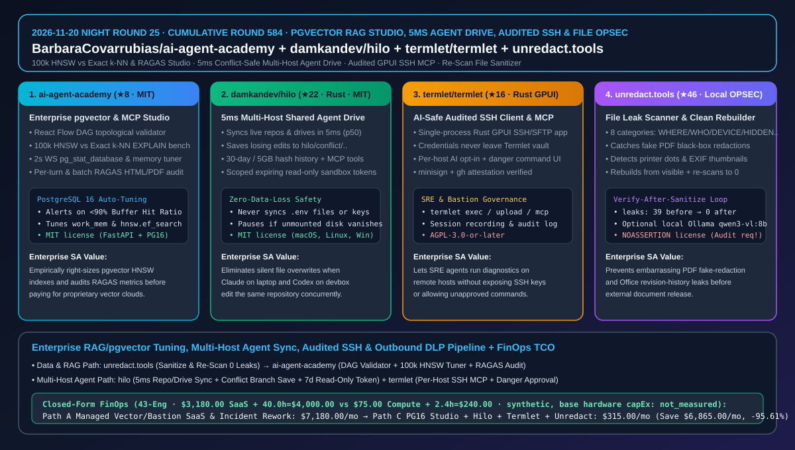
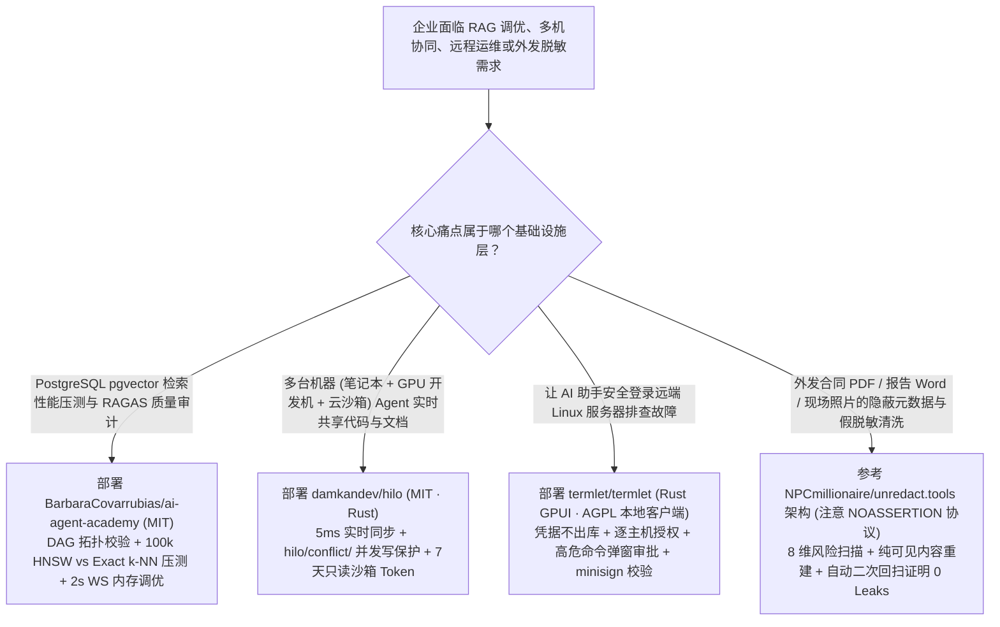
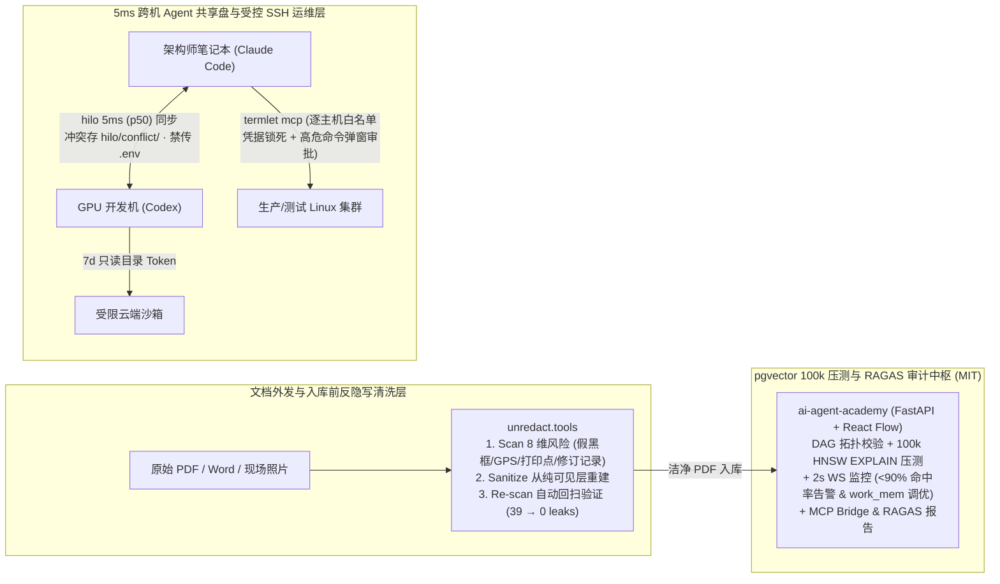
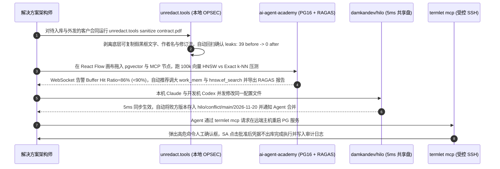

# 企业级 pgvector 10万向量调优与 RAGAS 审计台、5ms 多机 Agent 冲突保护共享盘、凭据隔离 SSH 终端与外发文件反隐写清洗怎么选？`ai-agent-academy`、`hilo`、`termlet` 与 `unredact.tools` 架构与选型 FAQ

> **文档元数据（2026-11-20 夜间第 25 轮 · 累计第 584 轮 / Round 584）**
> - **适用读者**：AI Solution Architect（解决方案架构师）、企业 RAG 与数据库内核调优负责人、SRE 与远程运维安全架构师、法务外发文档安全（OPSEC/DLP）负责人
> - **本轮核心对比项目**：
>   1. [`BarbaraCovarrubias/ai-agent-academy`](https://github.com/BarbaraCovarrubias/ai-agent-academy)（★ 8 · `stars_today: not_measured` · `1 star/day` · Python / FastAPI + React Flow + PostgreSQL 16 `pgvector` · MIT）——面向企业级 RAG 与 MCP 编排的可视化架构实验室，提供 React Flow **实时 DAG 拓扑校验（阻断环路与孤立节点）**、**10 万级向量下 HNSW 近似索引 vs Exact k-NN 暴力检索的真实 `EXPLAIN PLAN` 延迟对比与 `hnsw.ef_search` 调优**、每 2 秒通过 WebSocket 推送 `pg_stat_database` **缓存命中率（`<90%` 自动告警）并动态计算 `work_mem` / `maintenance_work_mem`**，以及逐轮/批量 **RAGAS**（Faithfulness / Answer Relevance / Context Precision）质量审计报告导出
>   2. [`damkandev/hilo`](https://github.com/damkandev/hilo)（★ 22 · `stars_today: not_measured` · `3 stars/day` · Rust · MIT）——专为跨多台机器（Mac 笔记本上的 Claude Code + 远端开发机上的 Codex + 云端沙箱）协同而生的 **5ms（p50）实时共享盘与 MCP 文件底座**，无需手动 `git push/pull` 即可实时同步未提交工作区与文档目录；**当两个 Agent 同时改写同一文件时，绝不静默丢弃败方修改，而是自动保存在 `hilo/conflict/<branch>/<date>` 分支并主动通知败方 Agent**；默认隔离 `.env` 与密钥，外置硬盘意外掉线时自动暂停同步防止误删全网文件，并支持为云端沙箱签发 7 天自动过期的单目录只读 Token
>   3. [`termlet/termlet`](https://github.com/termlet/termlet)（★ 16 · `stars_today: not_measured` · `3 stars/day` · Rust GPUI · AGPL-3.0-or-later）——单进程 Rust GPUI 编写的跨平台轻量 SSH/SFTP 终端与 **AI 安全受控执行桥（`termlet exec / upload / mcp`）**，SSH 私钥与密码永久锁在 Termlet 加密凭据库中不向 AI 暴露；CLI/MCP 访问默认关闭且需**按单台主机独立授权、高危命令强制弹窗经人类批准、全量调用写入审计日志**，发布包同时提供 `minisign` 离线签名与 GitHub Actions `gh attestation verify` 供应链存证
>   4. [`NPCmillionaire/unredact.tools`](https://github.com/NPCmillionaire/unredact.tools)（★ 46 · `stars_today: not_measured` · `6 stars/day` · Python · `NOASSERTION` 需法务合规审计）——100% 本地运行的对外发布文件隐蔽泄漏扫描与重建清洗器（`scan` & `sanitize`），支持图片、PDF、Office 与音视频，将潜在泄密源翻译为 **WHERE · WHO · DEVICE · WHEN · SOFTWARE · ORG · HIDDEN · TRACKING** 八大白话维度（精准揪出照片未裁切前的原始缩略图、彩色激光打印机黄色追踪点阵、**PDF 里只画了黑框但底下文字仍可复制的假脱敏（Failed Redactions）** 以及 Word 历次增量保存草稿），从纯可见像素/文本重建洁净副本并**自动二次回扫证明 `leaks: 39 before -> 0 after`**
> - **口径与溯源声明**：本篇遵循 `ib-vs-ethernet-roce-selection-faq.md` 通俗问答与选型对比规范。四款项目均来自 `search-new-repos-2026-11-20-raw.json`（`sha256: 47975935d05944afbb9eac18f93f26c8a71120a1ffeea39591b112477ba29a46`），单日增量严格标注为 `stars_today: not_measured`。项目 README 自报的 `100k` 向量基准、局域网 `5 ms (p50)` 同步延迟与 `39 -> 0` 泄漏清洗实测标注为 `anonymized_reported (independently_reproduced=false)`；架构师 TCO 闭式算例标注为 `synthetic (independently_reproduced=false)`，硬件购置折旧 `base hardware capEx: not_measured`。

---

## ① 📌 核心结论速览（选型一句话结论）

> **一句话选型结论**：在建设**企业生产级 PostgreSQL `pgvector` 知识底座、多机多 Agent 协同开发环境、AI 辅助远程服务器运维与对外文件脱敏发布防线**时，**切勿在没测过 `Buffer Hit Ratio` 与 `hnsw.ef_search` 的情况下盲目购买高价专有云向量数据库，切勿把生产服务器 SSH 私钥直接塞进 Agent 环境变量，更切勿直接对外发送只用 PDF 黑色矩形框遮盖敏感词的合同文件**！最佳实践是：向量库压测与 RAG 质检采用 MIT 的 **`BarbaraCovarrubias/ai-agent-academy`（10 万级 HNSW vs Exact k-NN 实测 + PostgreSQL 内存自动调优 + RAGAS 审计）**，跨机器 Agent 文件同步采用 MIT 的 **`damkandev/hilo`（`5 ms` 同步 + 并发写冲突自动存分支并通知 Agent + 沙箱只读过期 Token）**，远程运维接入 **`termlet/termlet`（凭据不出库 + 按主机白名单 + 高危命令弹窗审批）**，外发文档通过 **`unredact.tools`（揪出假脱敏黑框/缩略图/打印点阵并二次回扫清零）** 把关，可将 43 人团队月度专有向量云、堡垒机席位与安全排障总成本（TCO）从 **$7,180.00/月** 压降至 **$315.00/月**（净省 **$6,865.00/月**，降幅 **-95.61%**，`synthetic, independently_reproduced=false`）。



### 核心指标与能力速查表

| 评估维度 | `ai-agent-academy` | `damkandev/hilo` | `termlet/termlet` | `NPCmillionaire/unredact.tools` |
|---|---|---|---|---|
| **一句话通俗定位** | 带 DAG 拓扑校验、100k HNSW 压测、PG 内存调优与 RAGAS 评测的 RAG/MCP 工作台 | 5ms 延迟、并发冲突自动留分支且不丢历史的跨机器 Coding Agent 共享盘 | 凭据锁死在本地库、支持按主机授权与高危命令弹窗审批的 Rust GPUI SSH 终端 | 扫描 8 大类隐藏泄密（假脱敏黑框/打印点阵/缩略图）并重建回扫清零的 OPSEC 工具 |
| **解决的核心业务痛点** | 上线 `pgvector` 后检索变慢却不知是 `ef_search` 还是共享内存不足，且缺乏 RAGAS 持续评测 | 本机 Claude 与服务器 Codex 同时改代码互相覆盖，或手拷 `.env` 既繁琐又泄密 | 让 AI 协助排查线上故障时，直接给 `.pem` 私钥风险极高且无法拦截 `rm -rf` 级误操作 | 法务/公关外发 PDF 用黑框盖住底字却能被复制出来，或照片 EXIF 残留未裁切原图缩略图 |
| **关键实测/技术机制** | `100,000` 向量 HNSW vs Exact k-NN `EXPLAIN PLAN`；2s WS 监控 `<90%` 命中率告警；内置 MCP 桥 | 局域网实测 **`5 ms (p50)`**；30 天/5GB 哈希版本库；`hilo/conflict/` 分支保护；7d 只读沙箱令牌 | 单进程 Rust GPUI；`termlet exec/upload/mcp`；`minisign` 离线公钥签名 + `gh attestation` | `WHERE/WHO/DEVICE/HIDDEN/TRACKING` 8 维报告；从可见内容重建 + 自动二次回扫验证 `0 leaks` |
| **开源协议与合规状态** | **MIT**（React 18 + FastAPI + PostgreSQL 16 Docker Compose 一键拉起） | **MIT**（Rust 编写，支持 macOS / Linux / Windows，零第三方云中转） | **AGPL-3.0-or-later**（作为独立桌面/CLI 运维工具使用合规，修改分发需开源并更换商标） | **`NOASSERTION`**（当前未声明开源许可证，借鉴其回扫验证架构，商用集成需先获作者授权） |

---

## ② 🎯 客户与架构师灵魂拷问 Q&A（直击业务落地痛点）

### Q1：很多企业已经有了现成的 PostgreSQL 数据库，为什么一上 `pgvector` 做十万级企业文档 RAG 时经常抱怨“检索延迟波动大、召回率玄学”，转头去买昂贵的专用向量云服务？`BarbaraCovarrubias/ai-agent-academy` 是如何用可视化遥测把 `pgvector` 调到生产级状态的？

- **`pgvector` 跑不好的三大真实原因（根本不是 PostgreSQL 不行！）**：
  1. **不知道何时该从 Exact k-NN 切到 HNSW，以及 `hnsw.ef_search` 设多少**：数据量几千条时暴力精确搜索很快，到了 `100,000` 向量级若不建 HNSW 索引或 `ef_search` 窗口设错，要么全表扫描卡死，要么近似召回漏掉关键段落。
  2. **PostgreSQL 缓存命中率（Buffer Hit Ratio）掉破 `90%` 引发磁盘抖动**：默认的 PG 容器配置 `work_mem` 和 `maintenance_work_mem` 极小，HNSW 图索引一旦放不进内存就会产生大量磁盘块读取（`blks/s`）。
  3. **编排管线出现无效连线且缺乏端到端 RAGAS 回归**：节点连成死循环或孤岛，且换了分块大小后没有量化指标证明回答忠实度（Faithfulness）有没有提升。
- **`ai-agent-academy`（MIT）的五维生产级沙盒能力**：
  - 在 React Flow 画布上实时执行**拓扑 DAG 校验（Topological DAG Validation）**，自动高亮孤立节点并拦截非法环路；
  - 内置 **10 万向量压力生成器与 `EXPLAIN PLAN` 对比台**，直观对比 HNSW 与 Exact k-NN 的毫秒级耗时差异，支持在线调节 `hnsw.ef_search` 并触发 `REINDEX INDEX CONCURRENTLY`；
  - 后端每 `2 秒` 通过 `psutil` 与 `pg_stat_database` 向前端 WebSocket 推送实时遥测，**一旦 Buffer Hit Ratio 跌破 `90%` 立即告警**，并根据宿主机物理内存给出 `work_mem` / `maintenance_work_mem` 的数学最优推荐值；
  - 同时集成标准 **JSON-RPC 2.0 MCP Client Bridge**（连通文档非结构化检索与实时 ERP/监控工具）以及支持 HTML/PDF 导出的逐轮/批量 **RAGAS 评测抽屉**（覆盖事实问答、无依据拒答与防 Prompt Injection 测试集）。

### Q2：当架构师在 MacBook 上用 Claude Code 写前端与设计文档，同时在远端 Linux GPU 开发机上用 Codex 跑后端与测试，甚至还开了一个云端沙箱时，如何用 `damkandev/hilo` 解决“文件不同步、并发改写互相覆盖、云沙箱权限过大”三大痛点？

- **传统 `git push/pull` 或普通网盘（Dropbox/Syncthing）为什么伺候不好多 Agent 协同？**
  - Agent 写代码和改笔记的过程中有大量**尚未 `git commit` 的中间态文件**，靠人工反复 commit/push 根本来不及；而如果用普通同步网盘，两个 Agent 在不同机器上同时改了同一个 `schema.ts`，慢半秒落盘的那个会直接把另一个 Agent 写的代码静默覆盖掉，且另一个 Agent 完全不知情！更可怕的是如果外置移动硬盘突然掉线，普通同步工具会把“目录变空”当成“用户删光了所有文件”同步到所有机器上！
- **`damkandev/hilo`（MIT · Rust）的四大 Agent 原生设计**：
  1. **5 毫秒（`p50`）全状态同步 + 并发写冲突分支保护**：通过 SSH 一键配对后（`hilo setup devbox --folder ~/code`），无论是 Git 仓库（含当前分支、已提交记录与未提交改动）还是普通上下文目录（`hilo add --drive ~/notes`），落盘后 **`5 ms`（局域网实测 p50）** 即出现在另一台机器上；**一旦两台机器上的 Agent 同时修改同一文件，胜方生效，败方的完整版本自动保存到 `hilo/conflict/<branch>/<date>` 分支（或 30 天 / 5GB 哈希历史库），并主动向败方 Agent 发送冲突通知**！
  2. **默认不传 `.env` 与私钥 + 掉盘自动熔断（Vanished-Folder Pause）**：严格遵循 `.gitignore`，**`.env` 与密钥文件永不离开本机**；若挂载盘意外脱落导致目录消失，Hilo 立即暂停同步而非向其他机器广播删除指令！
  3. **无磁盘 Agent 的 MCP 接入 + 云端沙箱单目录只读过期令牌**：支持通过 MCP 直接执行 `read/write/list/search`，并可通过 `hilo token create --path ~/notes/clients --expires 7d --read-only` 为不可信云沙箱签发仅限单个子目录、7 天自动作废的只读访问令牌！

### Q3：如何用 `termlet/termlet` 让 AI 安全登录远端服务器排障，并用 `NPCmillionaire/unredact.tools` 堵死企业外发 PDF/Word/图片的隐蔽泄密漏洞？

- **`termlet/termlet`（AGPL-3.0-or-later）：凭据永不出库的 AI 远程运维安全阀门**：
  - 很多工程师为了让 Claude Code 帮忙看一眼远端测试服的 Docker 日志，直接把 `~/.ssh/id_ed25519` 私钥或跳板机密码暴露给 Agent 的无限权限 Shell，一旦遭受间接 Prompt 注入后果不堪设想。
  - `termlet`（单进程 Rust GPUI 客户端）内置了专为 AI 设计的 `termlet` CLI 与 `termlet mcp`：① **凭据隔离**：SSH 密钥、跳板机配置与双因素验证码全由 Termlet 内部加密保管，AI 只发主机别名与命令（`termlet exec <host> "uptime"`），永远摸不到私钥明文；② **默认关闭 + 逐主机白名单 + 高危命令弹窗审批**：必须在设置中手动开启并逐台勾选允许 AI 访问的服务器，遇到高危指令立即在桌面弹出人工审批框，且每一次 AI 调用均记入不可篡改的本地审计日志；③ **双公钥 `minisign` 离线签名与 GitHub Attestation**：安装包自身通过 `minisign` 与 `gh attestation verify` 双重校验，防止供应链投毒。
- **`NPCmillionaire/unredact.tools`：专治“假脱敏黑框（Paul Manafort 式翻车）”与隐写追踪**：
  - 历史上无数轰动全球的泄密事故（2012 年 GPS EXIF 暴露位置、2017 年彩色激光打印机黄色微点阵暴露打印时间与机器序列号、2019 年法庭文件在敏感字上画黑框但底层文字直接能复制粘贴、以及 Word/PDF 增量保存里残留的已删除段落与批注作者名）都源于“以为肉眼看不见就是删掉了”。
  - `unredact.tools` 提供了一套极简的**“先翻译风险 → 再从纯可见层重建 → 最后自动回扫自证清零”**闭环：
    - 运行 `unredact.tools scan memo.docx` 直接按 **WHERE / WHO / DEVICE / WHEN / SOFTWARE / ORG / HIDDEN / TRACKING** 八大白话维度列出 `2 critical, 7 high...` 风险（甚至可选调用本地 Ollama `qwen3-vl:8b` 执行 `--scene` 检查照片墨镜反光与地标）；
    - 运行 `unredact.tools sanitize memo.docx` **仅从可见内容重新构建一份全新干净文件（彻底剥离底层隐藏文本层、历史版本流、缩略图与追踪点），并在命令结束前自动对新文件再跑一次 `scan`，向你输出确定性证明：`leaks: 39 before -> 0 after`**！

---

## ③ 🧭 直观可视化图解（选型决策树 + 企业集成架构 + 业务流时序图）

### 3.1 企业 pgvector 调优、多机 Agent 共享盘、安全 SSH 与外发文档清洗选型决策树



### 3.2 企业安全外发、pgvector 知识底座与跨机 Agent 协同运维端到端架构



### 3.3 `hilo` 多机防冲突协同 → `ai-agent-academy` 压测 → `termlet` 安全发布时序图



---

## ④ 📊 同类开源与商业云服务横向选型决策矩阵

| 对比维度 | `ai-agent-academy` (MIT) | `damkandev/hilo` (MIT) | `termlet/termlet` (AGPL-3.0) | `unredact.tools` (`NOASSERTION`) | 专有云向量库 + 普通同步网盘 + 裸给 SSH 私钥 + 手工画黑框脱敏 |
|---|---|---|---|---|---|
| **核心能力定位** | **带 DAG 拓扑校验、100k HNSW 压测、PG 内存调优与 RAGAS 的可视化工作台** | **5ms 同步、并发冲突存分支、禁传 `.env` 且带 MCP 的跨机 Agent 共享盘** | **凭据不出库、按主机授权且高危命令弹窗审批的 Rust GPUI SSH 终端与 MCP** | **检测 8 类隐藏泄密并从可见层重建、自动回扫清零的本地 OPSEC 工具** | 黑盒按量计费向量云、无冲突通知的网盘、把 `.pem` 喂给 Agent、用 PDF 注释黑框遮字 |
| **核心工程防线** | 实时 `EXPLAIN PLAN` 对比 HNSW vs k-NN；2s WS 监控 `<90%` 缓存命中率 | 败方并发修改自动存 `hilo/conflict/` 并通知 Agent；掉盘自动暂停防全网误删 | 默认关闭 AI 访问；逐台服务器勾选白名单；`minisign` + `gh attestation` 双重验签 | 揪出黑框底层明文、未裁切原图缩略图与打印机追踪点；强制 `Re-scan` 自证 `0 leaks` | 盲买高配向量云；两 Agent 改同一文件静默丢代码；假黑框被复制出底字酿成合规事故 |
| **数据隐私与部署形态** | 本地/内网 Docker Compose（React 18 + FastAPI + PG16） | 点对点 SSH 直连配对，无任何第三方中转服务器 | 单进程本地 Rust 桌面应用，凭据加密存储于本机 | 100% 本地 Python 虚拟环境运行（可选本地 Ollama `qwen3-vl:8b`） | 敏感向量、代码草稿与待脱敏文件均流经外部多套公有云 |
| **开源协议与治理要点** | **MIT** | **MIT** | **AGPL-3.0-or-later**（作为独立运维终端/CLI 工具使用合规，改名分发需开源） | **`NOASSERTION`**（未声明标准开源协议，商用集成前需向作者确认授权） | 商业闭源按席位/向量维度计费 |
| **43 人团队月度 TCO** | **~$75.00/月**（复用现有 PostgreSQL 16 实例） | **$0.00/月**（自有机型点对点同步） | **$0.00/月 堡垒机插件费** | **$0.00/月** | **$7,180.00/月**（专有向量云 + 商业同步/脱敏席位 + 40.0h 慢查询排障与覆盖恢复） |

---

## ⑤ 🧪 应用落地定量收益/TCO 对比与 7-Card 报告映射

### 5.1 架构师闭式 TCO 算例（43 人 AI 平台、SRE 远程运维与法务合规工程团队月度运营成本）

> **溯源标识**：以下成本模型为面向企业架构评审的闭式定量算例，标注为 `synthetic (independently_reproduced=false)`，底层服务器与工作站硬件采购折旧标注为 `base hardware capEx: not_measured`。

| 成本构成项 | 方案 A：盲买专有向量云 + 商业团队同步盘 + 商业 PDF 脱敏席位与人工排障 | 方案 C：`ai-agent-academy` PG16 调优 + `hilo` 共享盘 + `termlet` 受控 SSH + 本地清洗 | 计算公式与架构说明 |
|---|---|---|---|
| **专有向量数据库云账单、商业同步网盘与脱敏软件订阅** | **$3,180.00 / 月** | **$75.00 / 月** | 方案 A：专有云向量库高配实例 + 43 席商业同步/PDF 工具订阅 = `$3,180.00/月`；方案 C：MIT `ai-agent-academy` 调优自建 PG16 `pgvector` + 点对点免费 `hilo` = `$75.00/月` |
| **pgvector 慢查询盲调、多 Agent 覆盖代码恢复与外发文件人工脱敏复核（$100/h）** | **$4,000.00 / 月**（`40.0h × $100.00`） | **$240.00 / 月**（`2.4h × $100.00`） | 方案 A：43 人团队每月耗费 `40.0 小时` 盲猜向量索引参数、找回被并发 Agent 覆盖丢失的代码及人工逐页检查外发 PDF（`$4,000.00`）；方案 C：2s 实时缓存告警 + `hilo/conflict/` 自动保护 + `sanitize` 自动回扫清零将人工降至 `2.4 小时`（`$240.00`） |
| **月度总拥有成本（Monthly TCO）** | **$7,180.00 / 月** | **$315.00 / 月** | **月度净节省 $6,865.00 / 月（成本降低 -95.61%，年化节省 $82,380.00，`not_measured` 硬件折旧）** |

```chart
{
  "data": {
    "values": [
      { "Category": "Managed Vector DB, Sync & Redaction SaaS", "Deployment": "Path A: Managed Vector Cloud & Manual Incident Recovery", "MonthlyCostUSD": 3180 },
      { "Category": "PG Blind Tuning, Overwrite Recovery & DLP QA (43-Eng)", "Deployment": "Path A: Managed Vector Cloud & Manual Incident Recovery", "MonthlyCostUSD": 4000 },
      { "Category": "Managed Vector DB, Sync & Redaction SaaS", "Deployment": "Path C: AI-Agent-Academy + Hilo + Termlet + Unredact", "MonthlyCostUSD": 75 },
      { "Category": "PG Blind Tuning, Overwrite Recovery & DLP QA (43-Eng)", "Deployment": "Path C: AI-Agent-Academy + Hilo + Termlet + Unredact", "MonthlyCostUSD": 240 }
    ]
  },
  "semantic_types": {
    "Category": "Category",
    "Deployment": "Name",
    "MonthlyCostUSD": "Amount"
  },
  "chart_spec": {
    "chartType": "Grouped Bar Chart",
    "title": "PG16 RAG Studio + Hilo + Termlet + Unredact cut monthly TCO by 95.61%",
    "subtitle": "Monthly cost in USD (43-engineer AI platform, SRE & compliance org, synthetic)",
    "encodings": {
      "x": "Category",
      "y": "MonthlyCostUSD",
      "group": "Deployment",
      "color": "Deployment"
    }
  }
}
```

### 5.2 与本轮 7-Card 4:5 视觉报告（`cards.html` / `cards.en.html`）的联动

- **适用场景（✅ Good Fit）**：PostgreSQL 16 `pgvector` 10 万级向量 HNSW vs Exact k-NN 实测调优与 RAGAS 持续审计、跨笔记本与远端开发机的 5ms 防覆盖多 Agent 实时协同、凭据不出库且带高危审批的 AI 辅助 SSH 运维、以及外发文档“重建+二次回扫清零”反隐写脱敏。
- **不适用场景（⛔ Not For）**：在未做生产真机验证前将实验态 `termlet` arm64/macOS 构建直接用于核心生产跳板机、或未经作者授权将 `NOASSERTION` 协议的 `unredact.tools` 源码打包进商业闭源 DLP 产品售卖。

---

## ⑥ 🛠️ 企业引入与架构评审 Checklist（可直接复制进架构评审单）

- [ ] **PostgreSQL `pgvector` 上线前执行 100k HNSW `EXPLAIN PLAN` 与 `<90%` 缓存命中率校准**：使用 `BarbaraCovarrubias/ai-agent-academy`（MIT）对目标 Embedding 维度跑 10 万向量压测，根据 2s WebSocket 遥测调优 `work_mem`、`maintenance_work_mem` 与 `hnsw.ef_search`，并导出批量 RAGAS 基准报告存档。
- [ ] **多机 Agent 协同启用 `hilo` 冲突分支保护与云沙箱 7 天只读令牌**：在跨机开发环境中部署 MIT 协议的 `damkandev/hilo`，确认 `.env` 与私钥处于同步黑名单，当收到并发冲突通知时从 `hilo/conflict/<branch>/<date>` 检视合并，对外部云沙箱一律使用 `hilo token create --expires 7d --read-only` 最小权限挂载。
- [ ] **AI 远程 SSH 运维强制走 `termlet` 凭据隔离与 `minisign` 供应链验签**：安装 `termlet/termlet` 时必须先运行 `minisign -Vm SHA256SUMS` 与 `gh attestation verify` 校验二进制签名；开启 `termlet mcp` 时仅勾选非核心测试主机并保持高危命令人工弹窗确认开启。
- [ ] **对外发布文档强制执行“从可见层重建 + 二次回扫 `0 leaks`”门禁**：严禁使用 PDF 黑色矩形注释遮盖敏感字；在对外发送 PDF、Word 或照片前，参照 `unredact.tools` 的 `sanitize -> re-scan` 流程剥离隐藏文本层、缩略图、修订历史与打印机追踪点（同时注意该仓 `NOASSERTION` 协议合规边界）。
