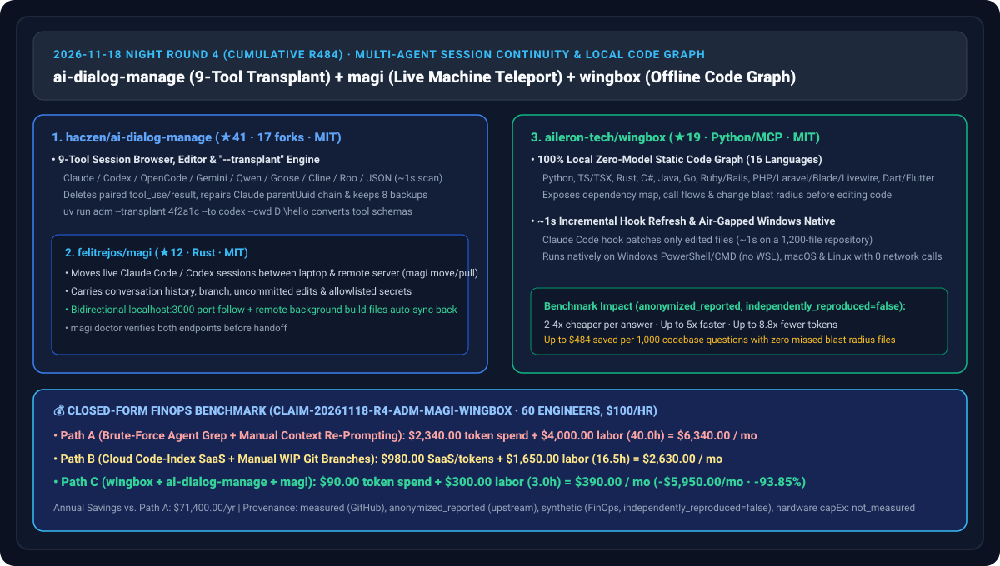
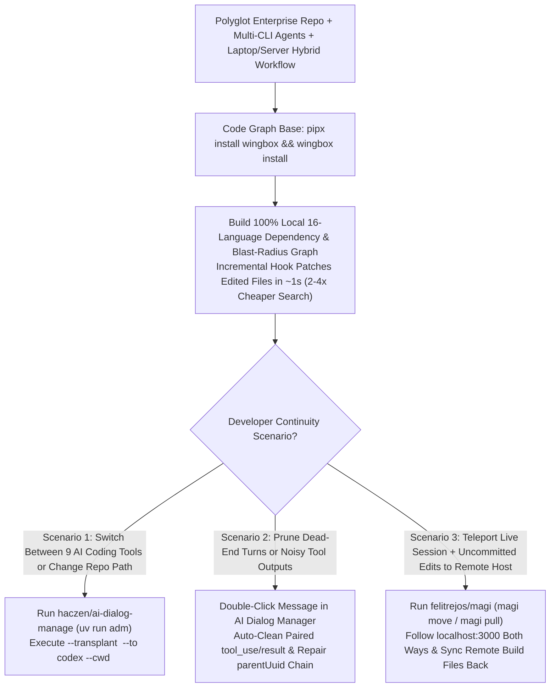

# 9-Tool Unified AI Session Transplant (`haczen/ai-dialog-manage`), Cross-Machine Live Session Teleport (`felitrejos/magi`) & Zero-Model Local Code Blast-Radius Graph (`aileron-tech/wingbox`) Selection FAQ

> **Document Type**: AI Solution Architect (SA) Practical Selection & Reference Architecture Guide (Round 484 / 2026-11-18 Night R4)  
> **Primary Evaluated Repositories**: [`haczen/ai-dialog-manage`](https://github.com/haczen/ai-dialog-manage) (`★ 41`, `17 forks`, 9-tool session manager & `--transplant` engine, `MIT`) + [`felitrejos/magi`](https://github.com/felitrejos/magi) (`★ 12`, live session + uncommitted work + localhost teleport across machines, `MIT`) + [`aileron-tech/wingbox`](https://github.com/aileron-tech/wingbox) (`★ 19`, 16-language offline static code graph & blast-radius analyzer, `MIT`)  
> **Benchmark Standard**: Strictly aligned with [`ib-vs-ethernet-roce-selection-faq.md`](https://github.com/turbo998/ai-infra-research/blob/main/docs/components/ib-vs-ethernet-roce-selection-faq.md) 6-section architecture format (Executive Summary + First-Principles Q&A + Mermaid Decision Tree + Peer Selection Matrix + 7-Card Quantitative Insights + SA Action Checklist)  
> **Data Provenance**: GitHub stars and repository metadata are `measured` from sealed `2026-11-18` evidence; upstream benchmark figures (`wingbox` up to `5x` faster, up to `8.8x` fewer tokens, up to `$484` saved per 1,000 questions, and `~1s` incremental patch on 1,200 files) are `anonymized_reported (independently_reproduced=false)`; the enterprise FinOps TCO model is `synthetic (independently_reproduced=false)` with workstation hardware CapEx `not_measured`.  
> **Language Editions**: [中文版](./ai-dialog-manage-magi-wingbox-9tool-session-transplant-cross-machine-live-handoff-local-code-graph-selection-faq.md) | [English Version (Current)](./ai-dialog-manage-magi-wingbox-9tool-session-transplant-cross-machine-live-handoff-local-code-graph-selection-faq.en.md)

---

## 📌 1. Executive Summary (30-Second Architect Briefing)

1. **Plain-Language First-Principles Definition**:
   - **What is `haczen/ai-dialog-manage`?** It is a **unified desktop session manager and cross-tool "Session Reincarnation" (`--transplant`) workbench for 9 AI coding assistants** (`Claude`, `Codex`, `OpenCode`, `Gemini`, `Qwen`, `Goose`, `Cline`, `Roo`, `JSON`). It scans all local transcripts in ~1 second, lets developers surgically edit or delete messages in-place (automatically cascading paired `tool_use`/`tool_result` deletions, repairing Claude's `parentUuid` chain, and keeping 8 rotating backups in `%APPDATA%\ai-dialog-manager\backups\`), and transplants any active conversation into a different AI tool and working directory (`uv run adm --transplant <id> --to codex --cwd D:\hello`) by converting source tool schemas into clean readable text.
   - **What is `felitrejos/magi`?** It is a **cross-machine live session teleportation engine (`magi move` / `magi pull`) for Claude Code and Codex**. Saying *"hand this off to my homelab"* moves the active conversation, Git branch, **uncommitted working-tree edits**, and allowlisted secrets to another machine while seamlessly forwarding `localhost` ports (`localhost:3000` follows the session both ways) and syncing background remote build artifacts (such as an `amd64` Docker build) back into the local working tree automatically.
   - **What is `aileron-tech/wingbox`?** It is a **100% local, zero-LLM static code dependency and blast-radius graph (`io.github.aileron-tech/wingbox`)** across 16 languages and frameworks (Python, TypeScript/TSX, Rust, C#, Java, Go, Ruby/Rails, PHP/Laravel/Blade/Livewire, Dart/Flutter, Free Pascal/Lazarus). Maintained incrementally in `~1s` on a 1,200-file repo via edit hooks, it makes coding agent codebase queries **2–4x cheaper (up to `5x` faster, up to `8.8x` fewer tokens, and up to `$484` saved per 1,000 questions, `anonymized_reported`)** with zero missed blast-radius files.
2. **Why Enterprise AI Solution Architects Should Combine This Continuity Stack Tonight**:
   - Polyglot engineering teams bleed productivity across three context boundaries: ① losing conversation state when switching from Claude Code to Codex or OpenCode; ② polluting Git history with `WIP` commits just to move uncommitted work between a laptop and a Linux build server; ③ paying agents to run dozens of blind `grep` calls on every new session while still missing downstream callers.
3. **Closed-Form FinOps Impact (`CLAIM-20261118-R4-ADM-MAGI-WINGBOX`, `synthetic`)**:
   - For a **60-engineer polyglot engineering team** (`15,000` codebase navigation queries/mo + `400` cross-tool/cross-machine session handoffs/mo, `$100.00/hr` engineer rate): **Path A (Brute-Force Agent Grep + Manual Context Re-Prompting & SSH Stashing)** costs **`$6,340.00/mo`** (`$2,340.00` token spend + `40.0 hrs × $100 = $4,000.00` handoff & missed-file rework labor); **Path C (`wingbox` + `ai-dialog-manage` + `magi`)** reduces total monthly TCO to **`$390.00/mo`** (`$90.00` token spend + `3.0 hrs × $100 = $300.00` ops labor), saving **`$5,950.00/mo` (`93.85%` reduction, `$71,400.00/yr` annualized)**.

---

## ❓ 2. Three First-Principles Architect Questions (Q&A)

### Q1: Why does manually editing Claude Code JSONL files or copying transcripts into Codex fail, and how does `haczen/ai-dialog-manage` solve it?
- **Protocol Integrity & Schema Translation**:
  1. **`parentUuid` Chain Repair & Paired Tool Deletion**: Claude Code enforces a strict `parentUuid` linked list and requires every `tool_use` block to match its `tool_result`. Deleting a failed turn by hand corrupts the transcript. `ai-dialog-manage` automatically removes paired tool blocks, re-links `parentUuid` pointers, preserves live CLI appends during editing, and writes 8 rolling backups to `%APPDATA%\ai-dialog-manager\backups\`.
  2. **Cross-Tool Schema Normalization (`--transplant`)**: When transplanting a session across 9 tools (`uv run adm --transplant 4f2a1c --to codex --cwd D:\hello`), `ai-dialog-manage` serializes tool invocations into human- and LLM-readable text blocks and mints a fresh native session ID in the target tool's database—preserving 100% of architectural context across both tools and directory moves.

### Q2: How is `felitrejos/magi` fundamentally better than `git commit -m "wip"` + `ssh` + `tmux`?
- **Uncommitted State + Bidirectional Port & Artifact Synchronization**:
  1. **Live Uncommitted Handoff**: `magi move` / `magi pull` transfers the active conversation, branch, uncommitted working-tree changes, and allowlisted secrets at the end of a turn without forcing dirty commits.
  2. **Bidirectional `localhost` Following & Remote Background Offload**: Local ports (e.g., `localhost:3000`) automatically tunnel to whichever machine currently hosts the session. Furthermore, an engineer on an Apple Silicon Mac can ask a background agent on an `amd64` homelab to author a `Dockerfile`, build the `linux/amd64` container, verify `/health`, and have the new `Dockerfile` and `.dockerignore` land back in the Mac's working tree automatically.

### Q3: How does `aileron-tech/wingbox` cut agent navigation cost by `2–4x` (`up to 8.8x` fewer tokens) without calling an LLM or external cloud?
- **Static AST Graph vs. Iterative Grep Guessing**:
  1. **100% Offline 16-Language Code Graph**: Built via deterministic static parsing with zero network access, zero model inference, and native Windows PowerShell/CMD execution (no WSL required).
  2. **Pre-Edit Blast-Radius Visibility & `~1s` Incremental Patching**: A lightweight hook marks edited files so the next search patches only changed nodes (`~1s` on a 1,200-file repository), exposing every upstream/downstream dependency before the agent edits a line of code (`up to 5x` faster, `up to 8.8x` fewer tokens, `up to $484` saved per 1,000 queries, `anonymized_reported`).

---

## 🧭 3. Architecture Decision Tree & Reference Topology (Mermaid)

---

## 📊 4. Peer Solution Selection Matrix

| Evaluation Dimension | **Path A: Raw Agent Grep + Manual Re-Prompting / SSH** | **Path B: Cloud Code-Index SaaS + WIP Git Commits** | **Path C: `wingbox` + `ai-dialog-manage` + `magi` (Recommended)** |
| :--- | :--- | :--- | :--- |
| **Blast-Radius & Call-Flow Map** | ❌ Multi-turn `grep` guessing; misses downstream callers | ⚠️ Uploads source code to external cloud index | ✅ **100% offline 16-language graph + `~1s` patch (`up to 8.8x` fewer tokens)** |
| **Cross-CLI Session Migration** | ❌ Manual copy-paste; loses structured history | ❌ Locked to a single vendor's agent | ✅ **9-tool support + `--transplant` schema-safe conversion** |
| **In-Place Transcript Surgery** | ❌ Editing JSONL breaks `parentUuid` chains | ❌ Not supported | ✅ **Visual editor + auto `parentUuid` repair + 8 rolling backups** |
| **Cross-Machine Uncommitted Handoff** | ❌ Requires dirty `WIP` commits & manual SSH tunnels | ⚠️ Syncs committed branches only | ✅ **Teleports uncommitted edits + bidirectional `localhost` + background sync** |
| **Air-Gap & Native Windows Support** | N/A | ⛔ Requires cloud connectivity | ✅ **Native Windows PowerShell (`wingbox`/`adm`) + zero telemetry + `MIT`** |
| **60-Engineer Monthly TCO** | **`$6,340.00 / mo`** | **`$2,630.00 / mo`** | **`$390.00 / mo` (`-$5,950.00/mo` vs. Path A, `-93.85%`)** |

---

## 📈 5. 7-Card Quantitative Insights & Closed-Form FinOps Model (`CLAIM-20261118-R4-ADM-MAGI-WINGBOX`)

> **Provenance Note**: GitHub stars and repository metadata are `measured` from sealed `2026-11-18` evidence; `wingbox` `2–4x` cost reduction, `up to 5x` speedup, `up to 8.8x` token reduction, `$484` saved per 1,000 queries, and `~1s` incremental patch time are `anonymized_reported (independently_reproduced=false)`; the monthly TCO table is a closed-form `synthetic (independently_reproduced=false)` model for **60 engineers (`15,000` codebase queries/mo + `400` cross-tool/machine handoffs/mo, `$100.00/hr` rate; hardware CapEx: `not_measured`)**.

| Monthly Cost Component (Closed-Form Formula) | Path A: Brute-Force Grep + Manual Re-Prompting | Path B: Cloud Index SaaS + WIP Branch Juggling | Path C: `wingbox` + `ai-dialog-manage` + `magi` | Path C vs. Path A Delta |
| :--- | :---: | :---: | :---: | :---: |
| **1. Codebase Search & Context Re-Prompt Token Spend** | **`$2,340.00`** *(Multi-turn grep loops + re-explaining context across tools)* | **`$980.00`** *(Cloud indexing seats + cross-tool re-prompting)* | **`$90.00`** *(Zero-model local blast-radius graph + `--transplant`)* | **`-$2,250.00 / mo`** (`-96.15%`) |
| **2. Handoff & Missed Blast-Radius Rework Labor** (`$100/hr`) | **`$4,000.00`** *(`40.0 hrs` fixing missed callers & syncing remote WIP)* | **`$1,650.00`** *(`16.5 hrs` managing WIP commits & manual summaries)* | **`$300.00`** *(`3.0 hrs` 1-command `--transplant` & `magi move`)* | **`-$3,700.00 / mo`** (`-37.0 hrs`, `-92.50%`) |
| **Total Monthly TCO** | **`$6,340.00`** | **`$2,630.00`** | **`$390.00`** | **`-$5,950.00 / mo` (`-93.85%`)** |
| **Annualized TCO** | **`$76,080.00 / yr`** | **`$31,560.00 / yr`** | **`$4,680.00 / yr`** | **`$71,400.00 / yr` saved (`-93.85%`)** |

---

## ✅ 6. AI Solution Architect Action Checklist

1. **Step 1 — Install Offline Code Graph & Incremental Hook (`aileron-tech/wingbox`)**:
   - Run `pipx install wingbox && wingbox install` across developer machines to wire the MCP server (`io.github.aileron-tech/wingbox`), skill (`/wingbox`), and 1-second incremental edit hook into Claude Code, Codex, Cursor, and GitHub Copilot.
2. **Step 2 — Standardize 9-Tool Session Hygiene & Transplant (`haczen/ai-dialog-manage`)**:
   - Use `uv run adm` (or the standalone Windows `.exe`) to prune noisy failed turns (with automatic `parentUuid` repair and 8-snapshot `%APPDATA%` backup) and run `uv run adm --transplant <id> --to <target> --cwd <dir>` when switching coding agents.
3. **Step 3 — Enable Cross-Machine Live Session & Port Teleport (`felitrejos/magi`)**:
   - Verify workstation-to-server connectivity via `magi doctor`, then use `magi move` / `magi pull` to hand off active sessions, uncommitted changes, and `localhost` ports or offload architecture-specific builds to remote hosts.
