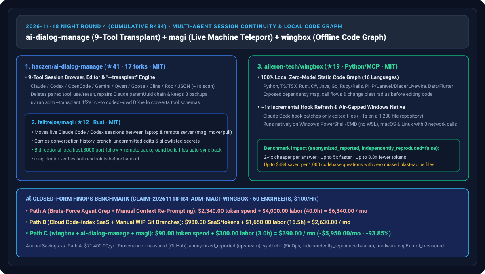
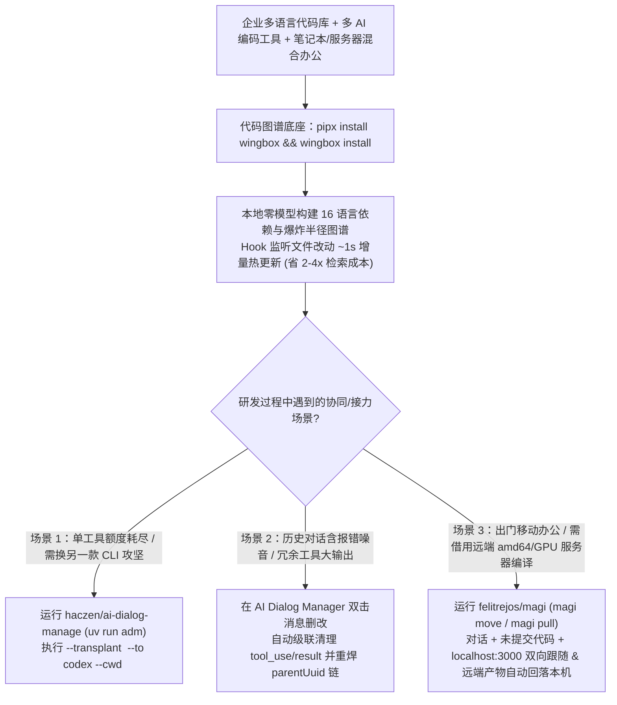

# 9 工具统一会话管理与跨工具转生（`haczen/ai-dialog-manage`）、带未提交代码跨机热迁移（`felitrejos/magi`）与零模型本地代码爆炸半径图谱（`aileron-tech/wingbox`）选型 FAQ

> **文档类型**：AI Solution Architect (SA) 实战选型与参考架构指南（Round 484 / 2026-11-18 Night R4）  
> **核心评估对象**：[`haczen/ai-dialog-manage`](https://github.com/haczen/ai-dialog-manage)（`★ 41`，`17 forks`，9 工具会话管理与 `--transplant` 跨工具转生，`MIT`） + [`felitrejos/magi`](https://github.com/felitrejos/magi)（`★ 12`，带未提交代码与端口跟随的跨机实时会话迁移，`MIT`） + [`aileron-tech/wingbox`](https://github.com/aileron-tech/wingbox)（`★ 19`，16 语言零模型静态代码图谱与爆炸半径分析，`MIT`）  
> **对标范式**：严格遵循 [`ib-vs-ethernet-roce-selection-faq.md`](https://github.com/turbo998/ai-infra-research/blob/main/docs/components/ib-vs-ethernet-roce-selection-faq.md) 六段式结构（核心结论速览 + 三大灵魂拷问 + Mermaid 决策树 + 选型对比矩阵 + 7-Card 定量洞察 + SA 落地 Checklist）  
> **数据溯源分级（Provenance）**：GitHub 仓库星标与目录元数据为 `measured`；上游性能基准（如 `wingbox` 最高 `5x` 提速、最高省 `8.8x` Token、每千次问答省 `$484` 及 1,200 文件仓库 `~1s` 增量补丁）标注为 `anonymized_reported (independently_reproduced=false)`；企业 FinOps 成本算例为 `synthetic (independently_reproduced=false)`，硬件折旧 `not_measured`。  
> **语言版本**：[中文版 (当前)](./ai-dialog-manage-magi-wingbox-9tool-session-transplant-cross-machine-live-handoff-local-code-graph-selection-faq.md) | [English Version](./ai-dialog-manage-magi-wingbox-9tool-session-transplant-cross-machine-live-handoff-local-code-graph-selection-faq.en.md)

---

## 📌 一、核心结论速览（Executive Summary — 30 秒看懂）

1. **大白话本质定义**：
   - **`haczen/ai-dialog-manage` 是什么？** 它是 **统一纳管本机 9 种 AI 编程工具聊天记录并支持“跨工具会话转生（Transplant）”的桌面中控台**。它 1 秒内扫描本机 `Claude / Codex / OpenCode / Gemini / Qwen / Goose / Cline / Roo / JSON` 全部历史会话，支持双击编辑/删除历史消息（自动级联清理成对的 `tool_use` / `tool_result` 并修复 Claude 的 `parentUuid` 链表，写入前在 `%APPDATA%\ai-dialog-manager\backups\` 自动保留 8 份滚动备份），更能通过 **`uv run adm --transplant <id> --to codex --cwd D:\hello`** 将 Claude 聊到一半的会话一键“转生”到 Codex 或 OpenCode 的新工作目录继续干活，自动把源工具调用转写为可读文本以防目标工具 Schema 报错。
   - **`felitrejos/magi` 是什么？** 它是 **将正在运行的 Claude Code / Codex 会话连同“未提交代码（Uncommitted Work）”和本地端口一起跨机器热迁移的传送门**。在笔记本上说一句 `"hand this off to my homelab"`（或执行 `magi move` / `magi pull`），当前对话历史、Git 分支、未提交的工作区改动与白名单密钥立即降落到远端服务器，连本机的 `localhost:3000` 都会自动代理指向远端；还能派发后台远端编译任务（如在 Mac 上写业务代码的同时派发远端 `linux/amd64` 机器构建 Docker 镜像，完成后自动把生成的 `Dockerfile` 同步回本机工作区）。
   - **`aileron-tech/wingbox` 是什么？** 它是 **100% 本地离线、零大模型调用的 16 语言静态代码依赖与“变更爆炸半径（Blast Radius）”图谱引擎**（MCP 标识 `io.github.aileron-tech/wingbox`）。它在编辑前先给 Agent 一张精确的调用链与模块边界地图，通过 Hook 在 1,200 文件规模仓库上实现 **`~1 秒`增量热更新**，实测每答成本降低 **`2–4x`**（最高节省 **`8.8x` Tokens**，每 1,000 个问题最高节省 **`$484`**，`anonymized_reported`），且不会漏改关联文件。
2. **为什么企业 AI 解决方案架构师（SA）今晚要把这三者组合成“多端连续工程套件”？**
   - 企业研发每天都在经历三种“上下文断裂税”：① Claude 额度用完切 Codex 时，被迫从零重新解释项目背景；② 笔记本算力或架构（ARM Mac vs x86 Linux）受限切开发机时，不得不提交一堆脏 `WIP commit`；③ 每次换会话或改公共函数，Agent 都要盲目跑几十次 `grep` 扫全仓，既烧 Token 又漏改下游调用方。
   - **三剑客协同**：用 **`wingbox`** 提供秒级增量本地代码图谱消除盲搜，用 **`ai-dialog-manage`** 实现本机 9 大工具间无损换脑，用 **`magi`** 实现笔记本与远端服务器之间带脏工作区的丝滑热接力！
3. **闭式 FinOps 量化收益（`CLAIM-20261118-R4-ADM-MAGI-WINGBOX`，`synthetic`）**：
   - 以 **60 人多语言企业研发团队**（月均 15,000 次跨文件代码定位查询 + 400 次跨工具/跨机器会话接力，工程师时薪 `$100.00/hr`）计：**Path A（Agent 暴力全仓 Grep + 换工具/换机器手工重喂背景）** 月均总成本 **`$6,340.00`**（暴力检索与重复喂上下文 Token `$2,340.00` + 人工交接与漏改返工 `40.0h × $100 = $4,000.00`）；**Path C（`wingbox` + `ai-dialog-manage` + `magi` 闭环）** 月均总成本降至 **`$390.00`**（残余检索 Token `$90.00` + 维护人工 `3.0h × $100 = $300.00`），**净省 `$5,950.00/月`（降幅 `93.85%`，年化节省 `$71,400.00`）**。

---

## ❓ 二、三大灵魂拷问（First-Principles Q&A）

### Q1：为什么直接把 Claude Code 的 JSONL 会话文件拷给 Codex 或手工删减历史消息会直接报错崩溃？`haczen/ai-dialog-manage` 是怎么解决的？
- **底层格式壁垒**：
  1. **`parentUuid` 断链与 `tool_use/tool_result` 配对强校验**：Claude Code 的会话记录是严格的 `parentUuid` 单向链表，且每个 `tool_use` 块必须紧跟匹配的 `tool_result` ID。手工删掉中间某条报错对话，会导致整条链表断裂或 API 报 `400 Bad Request`。`ai-dialog-manage` 在删除任意消息时**自动级联移除配对的工具块并重焊 `parentUuid` 链**，同时在 `%APPDATA%\ai-dialog-manager\backups\` 保存最近 8 份快照，且能自动合并编辑期间 CLI 新写入的消息。
  2. **跨工具 Schema 降级转写（`--transplant`）**：不同 AI 编程工具的 Tool Call Schema 互不兼容。`ai-dialog-manage` 在执行「⤴ 适配其它 AI」（或 `uv run adm --transplant 4f2a1c --to codex --cwd D:\hello`）时，会将源工具私有的工具调用记录智能降级转写为结构化可读文本，并在目标工具会话库中生成全新 ID，实现换工具、换目录一行上下文不丢。

### Q2：用 `git stash` + `ssh` + `tmux` 不也能在服务器跑 Claude 吗？`felitrejos/magi` 的跨机热迁移好在哪？
- **`tmux` 不能把笔记本和远端算力变成同一个工作区**：
  1. **未提交改动（Uncommitted Work）与会话状态原子随行**：在本地改了一半代码还没法 `commit` 时，只需说一句 `"hand this off to my homelab"`，当前回合结束后，对话上下文、分支、未提交的文件改动和指定环境变量直接出现在远端机器的新标签页里；在远端说 `"hand this back to my Mac"`（或运行 `magi pull MACHINE`）即刻原样返回。
  2. **`localhost` 端口双向跟随 + 异构架构后台协同**：会话移到远端后，本机的 `localhost:3000` 会自动转发到远端正在跑的服务；更实用的是，当你在 ARM 架构 MacBook 上开发业务路由时，可以直接让后台 Claude 去远端原生 `linux/amd64` 服务器编写 `Dockerfile` 并构建验证 `/health`，构建通过后新增的 `Dockerfile` 与 `.dockerignore` 会**自动落回你 Mac 的本地工作树**！

### Q3：`aileron-tech/wingbox` 不调大模型也不连外网，是怎么做到比 Agent 自带搜索省 `2–4x` 成本且不漏改文件的？
- **第一性原理：确定性 AST 静态解析 > 概率性多轮 Grep 猜谜**：
  1. **全本地静态代码知识图谱（16 语言/框架）**：原生支持 Python、TypeScript/TSX、Rust、C#、Java、Go、Ruby/Rails、PHP/Laravel（含 Blade/Livewire）、Dart/Flutter 与 Free Pascal/Lazarus，完全在本地离线构建模块依赖、调用流与架构边界图谱（零网络请求、零模型调用、零遥测，可进涉密内网），且在 Windows PowerShell/CMD 下免 WSL 原生运行。
  2. **修改前先看“爆炸半径（Blast Radius）” + 1 秒增量补丁**：通过 Claude Code Hook 自动标记每次编辑过的文件，下次检索时仅对变更文件打补丁（1,200 文件工程仅需 **`~1 秒`**），让 Agent 在动手改代码前一眼看清所有受影响的上下游文件，实测最高提速 **`5x`**、最高减少 **`8.8x` Tokens**（每 1,000 次提问最高省 **`$484`**，`anonymized_reported`）。

---

## 🧭 三、架构师选型决策树与端到端参考架构（Mermaid）

---

## 📊 四、同类方案横向选型对比矩阵（Peer Selection Matrix）

| 评估维度 | **Path A：Agent 原生暴力 Grep + 手工重开会话/SSH** | **Path B：云端代码索引 SaaS + 手工 WIP 分支推送** | **Path C：`wingbox` + `ai-dialog-manage` + `magi`（推荐）** |
| :--- | :--- | :--- | :--- |
| **代码库调用链与爆炸半径感知** | ❌ 靠多轮 `rg`/`find` 盲搜，常漏改下游引用且费 Token | ⚠️ 需上传源码至云端向量库，存在合规风险 | ✅ **100% 本地零模型静态图谱 + `~1s` 增量补丁（最高省 `8.8x` Token）** |
| **跨 AI 工具（Claude↔Codex 等）迁移** | ❌ 手工复制粘贴，丢失完整上下文 | ❌ 不支持跨厂商 CLI 会话转换 | ✅ **统一纳管 9 大工具 + `--transplant` 自动降级转写工具调用** |
| **会话历史噪音精准手术刀编辑** | ❌ 无法修改，改坏 JSONL 即导致 `parentUuid` 报错 | ❌ 不支持 | ✅ **可视化删改消息 + 自动修复 `parentUuid` + 8 份滚动备份** |
| **跨机器未提交代码与端口接力** | ❌ 必须先提交脏 `WIP commit` 并手工配 SSH 隧道 | ⚠️ 仅同步已提交 Git 分支 | ✅ **未提交改动原子随行 + `localhost` 双向跟随 + 远端产物自动回传** |
| **Windows 原生与内网气隙兼容性** | N/A | ⛔ 强依赖外网云服务 | ✅ **`wingbox` 免 WSL 原生支持 Windows + `adm` 独立 `.exe` + 全部 MIT** |
| **60 人团队月均总拥有成本 (TCO)** | **`$6,340.00 / 月`** | **`$2,630.00 / 月`** | **`$390.00 / 月`（较 Path A 净省 `$5,950.00/月`，`-93.85%`）** |

---

## 📈 五、7-Card 定量洞察与闭式 FinOps 算例（`CLAIM-20261118-R4-ADM-MAGI-WINGBOX`）

> **Provenance 声明**：GitHub 星标与仓库元数据源自 `2026-11-18` 封存证据（`measured`）；`wingbox` 最高 `5x` 提速、最高减少 `8.8x` Token、每千次问答省 `$484` 与 `~1s` 增量更新源自上游基准报告（`anonymized_reported`, `independently_reproduced=false`）；月度 TCO 为面向 **60 人多语言研发团队（月均 15,000 次代码定位问答 + 400 次跨工具/跨机接力）** 的闭式合成模型（`synthetic`, `independently_reproduced=false`；宿主机硬件折旧 CapEx：`not_measured`）。

| 成本构成项（月度闭式公式） | Path A：暴力全仓 Grep + 手工重喂背景/SSH | Path B：云端代码索引 SaaS + 手工 WIP 分支 | Path C：`wingbox` + `ai-dialog-manage` + `magi` | Path C 对比 Path A 净变化 |
| :--- | :---: | :---: | :---: | :---: |
| **1. 代码检索与重复喂上下文 Token 支出** | **`$2,340.00`** *(多轮盲目 Grep 读文件 + 换工具重发长背景)* | **`$980.00`** *(云索引席位费 + 跨工具重开会话 Token)* | **`$90.00`** *(本地零模型图谱直达目标模块 + 无损会话转生)* | **`-$2,250.00 / 月`** (`-96.15%`) |
| **2. 跨端交接与漏改关联文件返工人工** (`$100/hr`) | **`$4,000.00`** *(`40.0 hrs`：漏改爆炸半径返工 + 跨机同步脏代码)* | **`$1,650.00`** *(`16.5 hrs`：维护 WIP 临时分支与跨工具整理)* | **`$300.00`** *(`3.0 hrs`：一键 `--transplant` 与 `magi move`)* | **`-$3,700.00 / 月`** (`-37.0 hrs`, `-92.50%`) |
| **月度总拥有成本 (Monthly Total TCO)** | **`$6,340.00`** | **`$2,630.00`** | **`$390.00`** | **`-$5,950.00 / 月` (`-93.85%`)** |
| **年化总拥有成本 (Annualized TCO)** | **`$76,080.00 / 年`** | **`$31,560.00 / 年`** | **`$4,680.00 / 年`** | **年省 `$71,400.00` (`-93.85%`)** |

---

## ✅ 六、AI 解决方案架构师（SA）实战落地 Checklist

1. **Step 1 — 部署 `aileron-tech/wingbox` 本地静态代码图谱与增量 Hook**：
   - 在开发机执行 `pipx install wingbox && wingbox install`（或仅装技能 `npx skills add aileron-tech/wingbox`），为本机所有主流 Coding Agent 注册 `/wingbox` 技能与文件修改增量 Hook，确保每次修改公共模块前先查清爆炸半径。
2. **Step 2 — 配备 `haczen/ai-dialog-manage` 统一治理 9 大工具会话资产**：
   - 下载 Windows 免安装版或运行 `uv sync && uv run adm`，日常用其剔除长会话中的报错死胡同消息（自动修复 `parentUuid`），并在需要切换模型/工具时执行 `uv run adm --transplant <id> --to codex --cwd <new_dir>` 无损接力。
3. **Step 3 — 打通 `felitrejos/magi` 笔记本与内网构建机双向热迁移**：
   - 在笔记本与远端 Linux 构建机双端运行 `magi doctor` 完成连通性自检，实现未提交改动与 `localhost` 端口跨机无缝漫游，并将重型跨架构容器构建任务卸载给远端后台 Agent 自动回写工作树。
