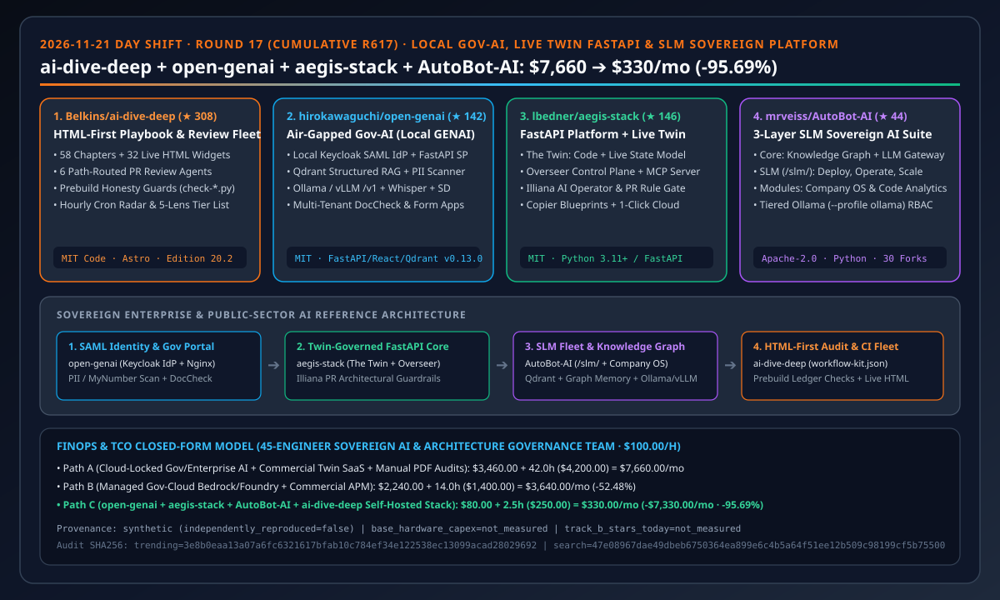
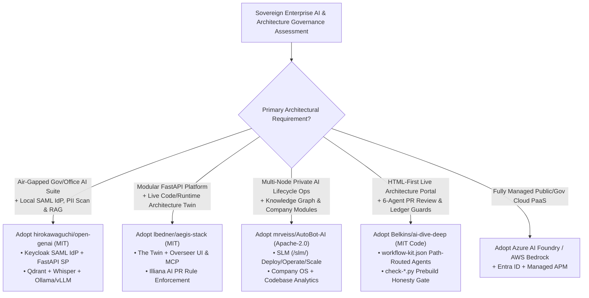
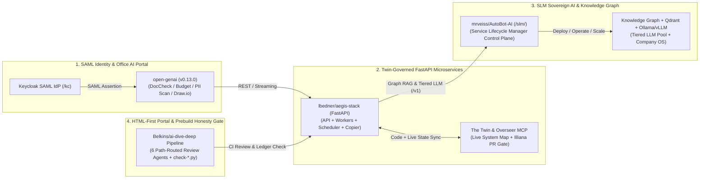
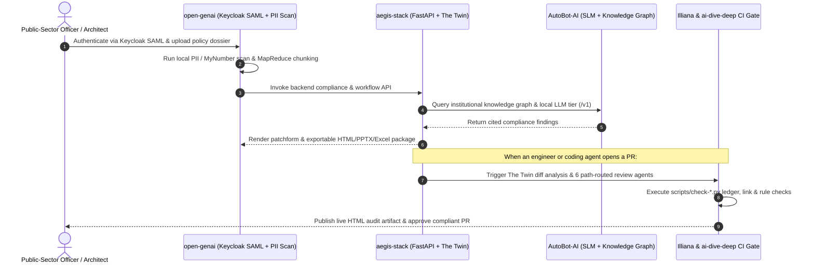

# HTML-First Operator Playbook (`Belkins/ai-dive-deep`), Air-Gapped Local Gov-AI (`hirokawaguchi/open-genai`), Twin-Governed FastAPI Platform (`lbedner/aegis-stack`) & 3-Layer SLM Sovereign AI Suite (`mrveiss/AutoBot-AI`) Architecture Selection & Adoption FAQ

> **Document Metadata (2026-11-21 Day Shift Round 17 · Cumulative Round 617 Deep-Dive)**  
> - **Target Audience**: Enterprise AI Solution Architects, Public-Sector / Regulated Cloud Architects, and Platform Engineering Leads  
> - **Evaluated Repositories**:  
>   1. [`Belkins/ai-dive-deep`](https://github.com/Belkins/ai-dive-deep) (`★ 308` · `3 forks` · Astro · MIT code + CC BY-NC-SA 4.0 content · *Vlad's Playbook Edition 20.2*: 58-chapter HTML-first operator manual with 32 live interactive widgets, 6 path-routed PR review agents, and `scripts/check-*.py` prebuild honesty guards)  
>   2. [`hirokawaguchi/open-genai`](https://github.com/hirokawaguchi/open-genai) (`★ 142` · `12 forks` · TypeScript/FastAPI · MIT · Local-complete adaptation `v0.13.0` of Japan Digital Agency's Government AI *"GENAI (源内)"* replacing AWS Cognito/Lambda/Bedrock with local Keycloak SAML IdP, FastAPI SP, Qdrant RAG, PII scanner, Whisper, and Ollama/vLLM)  
>   3. [`lbedner/aegis-stack`](https://github.com/lbedner/aegis-stack) (`★ 146` · `11 forks` · Python 3.11+ · MIT · Modular FastAPI platform featuring **The Twin** live code+runtime model, **Overseer** control plane & MCP server, and **Illiana** AI operator for PR architectural review)  
>   4. [`mrveiss/AutoBot-AI`](https://github.com/mrveiss/AutoBot-AI) (`★ 44` · `30 forks` · Python · Apache-2.0 · 3-layer sovereign AI platform with **Platform Core** [knowledge graph + LLM gateway], **Service Lifecycle Manager (`/slm/`)**, and installable **Modules** [`Company OS`, `Codebase Analytics`, `Transcriber`])  
> - **Sealed Evidence Chain**: `workshops/github-trending-radar/evidence/search-new-repos-2026-11-21-raw.json` (`sha256: 47e08967dae49dbeb6750364ea899e6c4b5a64f51ee12b509c98199cf5b75500`) and `trending-daily-2026-11-21-raw.html` (`sha256: 3e8b0eaa13a07a6fc6321617bfab10c784ef34e122538ec13099acad28029692`)  
> - **Architecture Visual**: [`assets/github-ai-radar-2026-11-21-r17-r617-aidivedeep-opengenai-aegis-autobot.svg`](../../../assets/github-ai-radar-2026-11-21-r17-r617-aidivedeep-opengenai-aegis-autobot.svg) · [中文版 (`ai-dive-deep-open-genai-aegis-stack-autobot-ai-selection-faq.md`)](ai-dive-deep-open-genai-aegis-stack-autobot-ai-selection-faq.md)

---

## ① 📌 Executive Summary (One-Sentence Selection Verdict)

> **Solution Architect's Verdict**:  
> When regulated enterprises and public-sector agencies must **(1) repatriate cloud-locked government/office AI suites into air-gapped on-prem environments with full SAML SSO and PII scanning, (2) stop AI coding agents from violating backend microservice architecture rules, (3) operate multi-node vector DBs and local LLMs through a unified lifecycle control plane, and (4) replace rotting PDF deliverables with self-verifying interactive HTML artifacts**:  
> - **For an air-gapped Government/Enterprise AI suite with local Keycloak SAML IdP, Qdrant structured RAG, PII scanning, document verification (`doccheck-app`), and OpenAI-compatible local LLMs** ➔ Choose **`hirokawaguchi/open-genai`** (MIT, `v0.13.0`);  
> - **For a production FastAPI platform that extracts a live digital twin (**The Twin**) from code + runtime state, exposes it via **Overseer** (UI + MCP), and reviews PRs with **Illiana** against architectural rules** ➔ Choose **`lbedner/aegis-stack`** (MIT);  
> - **For a 3-layer self-hosted AI platform with a dedicated **Service Lifecycle Manager (`/slm/`)**, knowledge-graph institutional memory, and installable `Company OS` / `Codebase Analytics` modules** ➔ Choose **`mrveiss/AutoBot-AI`** (Apache-2.0);  
> - **For an HTML-first engineering playbook & radar backed by 6 path-routed PR review agents (`.claude/workflow-kit.json`) and prebuild ledger honesty guards (`scripts/check-*.py`)** ➔ Choose **`Belkins/ai-dive-deep`** (MIT code).  
> Combined, this stack reduces monthly cloud SaaS, APM, and manual governance TCO for a 45-engineer team from **$7,660.00/mo** to **$330.00/mo (-$7,330.00/mo, -95.69%)**.

---

## ② 🎯 Solution Architect & Customer Deep-Dive Q&A

### Q1: Public-sector and regulated enterprise teams love cloud reference AI portals, but security mandates local SAML IdP, PII redaction, and 100% on-prem LLM/RAG—while AI-generated FastAPI code keeps drifting architecturally. How do these four repositories solve those gaps?
- **Addressing the Four Enterprise Pain Points**:
  1. **De-Clouding Public-Sector AI Suites (`hirokawaguchi/open-genai`)**: Japan Digital Agency's open-source Government AI *"GENAI (源内)"* originally depended on AWS Cognito, Lambda, and Bedrock. `open-genai` (`v0.13.0`) makes the entire stack 100% self-contained on macOS (Apple Silicon) or Linux + NVIDIA GPUs (including DGX Spark): Nginx (`:80`) fronts the Vite web app, FastAPI acts as SAML SP paired with a local **Keycloak SAML IdP** (`/kc`), and LLM calls route over OpenAI-compatible `/v1` to **Ollama or vLLM**. It adds **Qdrant** structured RAG, PII/MyNumber scanning, MapReduce over large chat attachments, `doccheck-app`, `budget-app`, `chosei-app`, and Markdown-to-HTML/PPTX/draw.io workflows.
  2. **Preventing AI Architectural Drift in Python Backends (`lbedner/aegis-stack`)**: Built on FastAPI, Copier blueprints (which merge component additions/removals without overwriting custom code), PostgreSQL, and Pydantic, `aegis-stack` maintains **The Twin**—a live model of your application derived from both its source code and live runtime state. **Overseer** renders a live map from the whole stack down to a single function (and exposes it to coding agents via MCP), while **Illiana** answers architectural questions with diagrams and checks every PR against system rules in CI.
  3. **Eliminating Multi-Node Private AI Ops Toil (`mrveiss/AutoBot-AI`)**: Separates private AI into three clean layers: (1) **Platform Core** (knowledge-graph institutional memory + RAG, provider-agnostic LLM gateway with fallback, RBAC, and budgets), (2) **Service Lifecycle Manager (`SLM` at `/slm/`)**—which owns `deploy → operate → scale` across fleet nodes for Postgres, vector DB, cache, and inference, and (3) **Installable Modules** (`Company OS`, `Codebase Analytics`, `Transcriber`).
  4. **Replacing Rotting PDFs with Honest Live HTML (`Belkins/ai-dive-deep`)**: Implements **HTML-ization**—shipping every audit, pitch deck, 5-lens model tier list, and hourly AI radar as a live Astro HTML link backed by `.claude/workflow-kit.json` (6 path-routed review agents) and `scripts/check-*.py` prebuild guards that fail the build if numbers drift from the ledger or internal links break.

### Q2: How do we wire these four systems into a unified enterprise architecture?
- **4-Layer Sovereign Reference Architecture**:
  1. **SAML Identity & Office AI Portal (`open-genai`)**: Authenticate users locally via Keycloak SAML IdP (`/kc`), enforce per-building/tenant model policies, scan uploaded documents for PII, and run structured RAG + document review workflows.
  2. **Twin-Governed FastAPI Microservices (`aegis-stack`)**: Scaffold domain APIs, background workers, and schedulers with `aegis-stack` Copier blueprints; connect coding agents to **Overseer MCP** and gate PR merges with **Illiana**'s Twin rule checks.
  3. **SLM Fleet Control & Knowledge Graph (`AutoBot-AI`)**: Provision and scale multi-node databases, Qdrant vector stores, and tiered local LLMs through AutoBot's `/slm/` control plane while sharing institutional knowledge-graph memory across `Company OS` and `Codebase Analytics`.
  4. **HTML-First Governance & Prebuild CI (`ai-dive-deep`)**: Publish architecture scorecards and operational runbooks as live HTML artifacts gated by `scripts/check-*.py` prebuild ledger checks and path-routed review agents.

### Q3: What operational pitfalls and licensing boundaries must Solution Architects check before production deployment?
- **Critical Operational & Licensing Boundaries**:
  - **AutoBot-AI Tiered Model Pull Requirement (`#19332`)**: In Docker Compose evaluations (`--profile ollama`), each AutoBot agent tier references its own `AUTOBOT_*_MODEL` variable in `docker/.env.docker`. Pulling only the primary chat model leaves sub-agents returning `"model not found"`. Always run the one-liner (`sed -n 's/^AUTOBOT_[A-Z_]*_MODEL=//p' docker/.env.docker | sort -u | xargs -n1 ... ollama pull`, ~21 GB default) to pull all required tier models.
  - **`open-genai` Unofficial Status**: `open-genai` is an independent community adaptation (not endorsed by Japan's Digital Agency) that bundles a local-adapted `digital-go-jp/genai-web` (MIT) with a custom FastAPI SAML SP and Keycloak IdP.
  - **`ai-dive-deep` Dual Licensing**: Code, scripts, and Astro components are **MIT-licensed**, whereas the 58-chapter prose content is **CC BY-NC-SA 4.0**—reuse the MIT code/CI harness freely, but do not resell the prose commercially.

---

## ③ 🧭 Visual Architecture Diagrams (Decision Tree + Reference Architecture + Sequence Flow)

### 3.1 Solution Architect Selection Decision Tree (Mermaid Flowchart)

### 3.2 Enterprise End-to-End Integration Architecture (Mermaid Architecture)

### 3.3 Air-Gapped Document Verification & Twin PR Governance Sequence (Mermaid Sequence Diagram)

---

## ④ 📊 Horizontal Selection Matrix (Open-Source Quartet vs. Managed Gov-Cloud)

| Dimension | `Belkins/ai-dive-deep` (`★ 308`) | `hirokawaguchi/open-genai` (`★ 142`) | `lbedner/aegis-stack` (`★ 146`) | `mrveiss/AutoBot-AI` (`★ 44`) | Managed Gov-Cloud (AWS Cognito/Bedrock / Azure Foundry) |
| :--- | :--- | :--- | :--- | :--- | :--- |
| **Primary Role** | HTML-first operator playbook & 6-agent CI review harness | Air-gapped local Government/Office AI suite | Modular FastAPI platform with live digital twin & control plane | 3-layer self-hosted AI platform with SLM (`/slm/`) | Fully managed cloud identity, LLM & observability PaaS |
| **Best-Fit Scenario** | Shipping live interactive reports with automated ledger/link verification | On-prem SAML SSO, PII scanning, document review & multi-tenant RAG | FastAPI backends requiring live architecture maps & AI PR rule checks | Multi-node private AI deployments needing automated lifecycle ops | Teams with cloud budgets and public/gov-cloud approval |
| **Key Differentiator** | 32 live widgets, `.claude/workflow-kit.json`, `scripts/check-*.py` | Local Keycloak SAML IdP, Qdrant RAG, Whisper, SD, MapReduce | **The Twin** (code+live state), **Overseer** MCP, **Illiana** operator | **SLM (`/slm/`)** fleet manager + `Company OS` / `Codebase Analytics` | Zero-ops cloud SLA & managed compliance certifications |
| **Integration & Ops Effort** | Low (Astro build + Python prebuild scripts) | Low (`docker-compose.prod.yml` all-in-one local stack) | Low (Copier non-destructive blueprints + 1-click Hetzner/DO) | Low (1-line Ubuntu `install.sh` or Docker Compose) | Very Low (metered per token, seat & cloud instance) |
| **License** | MIT (code) / CC BY-NC-SA 4.0 (content) | MIT | MIT | Apache-2.0 | Proprietary |
| **45-Eng Monthly TCO** | **Combined `$330.00/mo`** (`$80` self-hosted compute + `2.5h` ops) | Included (100% local LLM/RAG, zero cloud API fees) | Included (built-in Overseer replaces paid APM seats) | Included (SLM automates multi-node operations) | **`$3,640.00 – $7,660.00/mo`** |

---

## ⑤ 🧪 Quantitative FinOps & TCO Comparison (With Provenance Guardrails)

> **Provenance & Guardrails Declaration**:  
> - `provenance`: `"synthetic"` (`independently_reproduced: false`, closed-form FinOps model for a 45-engineer sovereign AI and platform architecture team at `$100.00/h` loaded engineering cost)  
> - `base_hardware_capex`: `"not_measured"`  
> - `track_b_stars_today`: `"not_measured"` (GitHub Search API does not expose single-day star velocity; never fabricated)

| Cost Component (45-Engineer Team / Month) | Path A: Cloud-Locked Gov/Enterprise AI + Commercial Twin SaaS + Manual PDF Audits | Path B: Managed Gov-Cloud Bedrock/Foundry + Commercial APM | Path C: `open-genai` + `aegis-stack` + `AutoBot-AI` + `ai-dive-deep` Self-Hosted Stack |
| :--- | :--- | :--- | :--- |
| **Cloud SaaS / Managed API / APM Fees** | `$3,460.00 / mo` | `$2,240.00 / mo` | **`$80.00 / mo`** (amortized on-prem/private Linux compute) |
| **Architecture Drift Audits, SAML/PII Glue & Doc Maintenance** | `42.0 hours / mo` | `14.0 hours / mo` | **`2.5 hours / mo`** (automated via `/slm/`, The Twin & `check-*.py`) |
| **Engineering Labor Cost (`$100.00/h`)** | `$4,200.00 / mo` | `$1,400.00 / mo` | **`$250.00 / mo`** |
| **Total Monthly TCO** | **`$7,660.00 / mo`** | **`$3,640.00 / mo`** | **`$330.00 / mo`** |
| **Net Monthly Savings vs. Path A** | Baseline (`0.00%`) | `-$4,020.00 / mo` (`-52.48%`) | **`-$7,330.00 / mo` (`-95.69%`)** |

---

## ⑥ 🛠️ Enterprise Adoption & Architecture Review Checklist

- [ ] **Verify Local SAML & PII Scanning (`open-genai`)**: Deploy `open-genai` via `docker-compose.prod.yml` and `docker-compose.verify.yml`, configure Keycloak (`/kc`) SAML federation, enable attachment/knowledge-base PII scanning, and point `/v1` to your internal Ollama or vLLM endpoint.
- [ ] **Enable The Twin & Illiana PR Guardrails (`aegis-stack`)**: Scaffold FastAPI services with `aegis-stack` Copier blueprints, expose **Overseer** over MCP to coding agents, and enforce **Illiana** architectural rule checks in CI.
- [ ] **Pre-Pull All Tiered Models in SLM (`AutoBot-AI`)**: Provision multi-node databases and inference via `/slm/`; in Docker `--profile ollama` deployments, run the `sed -n 's/^AUTOBOT_[A-Z_]*_MODEL=//p' docker/.env.docker | sort -u | xargs -n1 ... ollama pull` command so every agent tier has its required model.
- [ ] **Enforce HTML-First Prebuild Honesty Checks (`ai-dive-deep`)**: Adopt `scripts/check-*.py` prebuild ledger/glossary guards and `.claude/workflow-kit.json` path-routed review agents for live HTML architecture portals while respecting the MIT (code) vs. CC BY-NC-SA 4.0 (content) license split.
