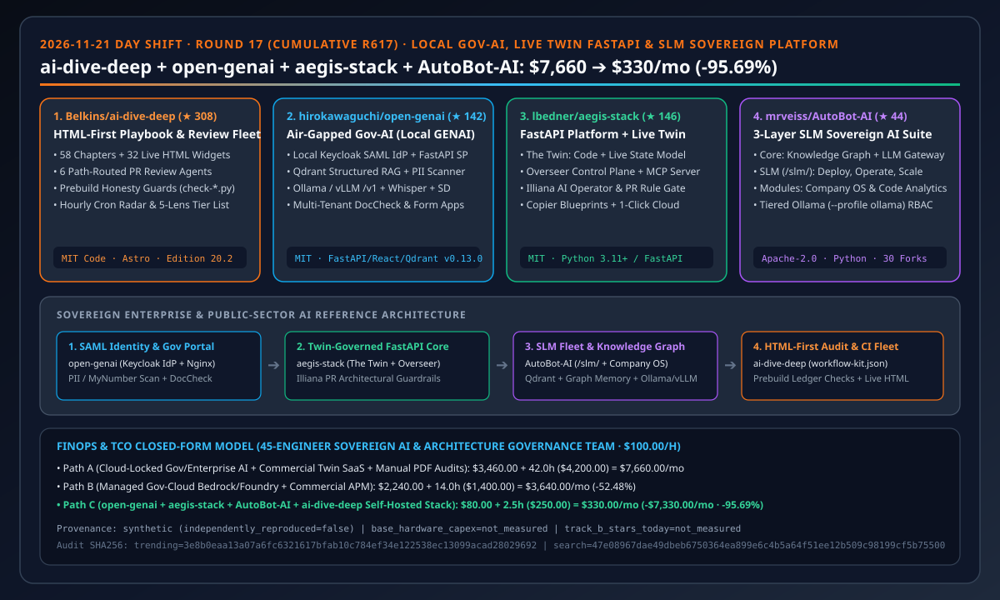
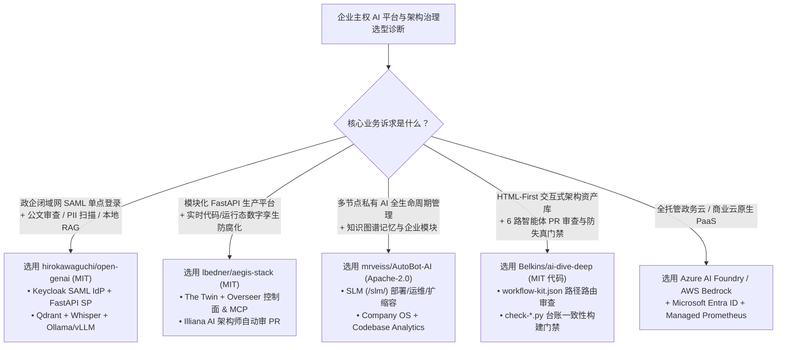
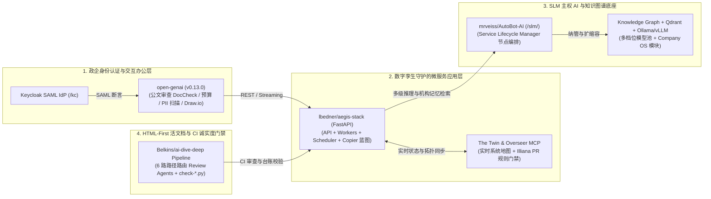
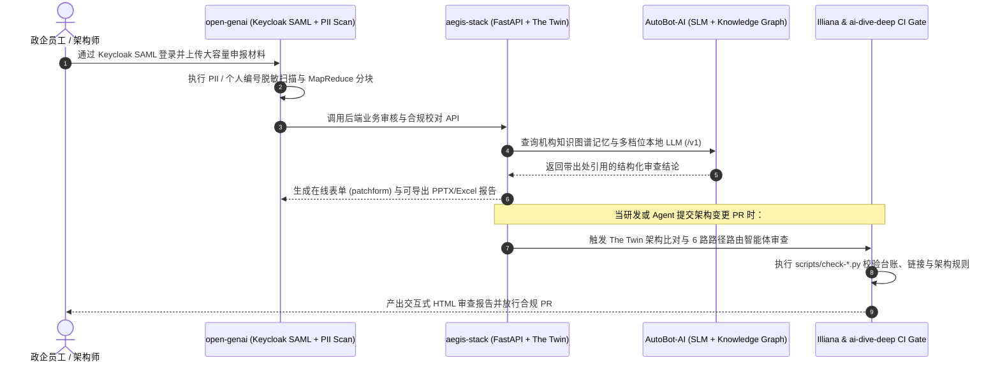

# HTML-First 智能体工程手册（`Belkins/ai-dive-deep`）、全本地政务 AI 源内（`hirokawaguchi/open-genai`）、带数字孪生控制面的 FastAPI 平台（`lbedner/aegis-stack`）与三层 SLM 主权 AI 平台（`mrveiss/AutoBot-AI`）选型与落地 FAQ

> **文档元数据（2026-11-21 白班 Day Round 17 · 累计第 617 轮深潜专题）**  
> - **面向对象**：企业 AI 解决方案架构师（AI Solution Architect）、政企私有云架构师、平台工程负责人  
> - **本轮核心评估对象**：  
>   1. [`Belkins/ai-dive-deep`](https://github.com/Belkins/ai-dive-deep)（`★ 308` · `3 forks` · Astro · MIT 代码 + CC BY-NC-SA 4.0 内容 · *Vlad's Playbook Edition 20.2*：58 章“HTML-First”交互式 AI 操盘手手册，含 32 个交互组件、6 路按路径路由的 PR 审查智能体舰队与 `scripts/check-*.py` 构建前防失真门禁）  
>   2. [`hirokawaguchi/open-genai`](https://github.com/hirokawaguchi/open-genai)（`★ 142` · `12 forks` · TypeScript/FastAPI · MIT · 日本数字厅政务 AI“源内（GENAI）”完全本地化开源改造版 `v0.13.0`，用本地 Keycloak SAML IdP + FastAPI + Qdrant RAG + Ollama/vLLM 替代公有云 Cognito/Lambda/Bedrock）  
>   3. [`lbedner/aegis-stack`](https://github.com/lbedner/aegis-stack)（`★ 146` · `11 forks` · Python 3.11+ · MIT · 自带实时架构数字孪生（The Twin）、可视化控制面（Overseer）与 AI 架构守门员（Illiana）的生产级模块化 FastAPI 平台）  
>   4. [`mrveiss/AutoBot-AI`](https://github.com/mrveiss/AutoBot-AI)（`★ 44` · `30 forks` · Python · Apache-2.0 · 三层架构私有主权 AI 平台：Platform Core 知识图谱与网关 + Service Lifecycle Manager `/slm/` 生命周期管理面 + Company OS / Codebase Analytics 模块）  
> - **关联检索证据链**：`workshops/github-trending-radar/evidence/search-new-repos-2026-11-21-raw.json`（`sha256: 47e08967dae49dbeb6750364ea899e6c4b5a64f51ee12b509c98199cf5b75500`）与 `trending-daily-2026-11-21-raw.html`（`sha256: 3e8b0eaa13a07a6fc6321617bfab10c784ef34e122538ec13099acad28029692`）  
> - **高清架构图**：[`assets/github-ai-radar-2026-11-21-r17-r617-aidivedeep-opengenai-aegis-autobot.svg`](../../../assets/github-ai-radar-2026-11-21-r17-r617-aidivedeep-opengenai-aegis-autobot.svg) · [English Version (`ai-dive-deep-open-genai-aegis-stack-autobot-ai-selection-faq.en.md`)](ai-dive-deep-open-genai-aegis-stack-autobot-ai-selection-faq.en.md)

---

## ① 📌 核心结论速览（选型一句话结论）

> **架构师一句话选型结论**：  
> 当政企客户与研发组织需要 **（1）把原本绑死在 AWS/公有云上的政务与办公 AI 彻底迁回本地闭域网、（2）防止智能体写出的 FastAPI 微服务破坏系统架构拓扑、（3）用一套自带生命周期管理面（SLM）的平台统一运维多节点向量库与本地模型、（4）把死板的 PDF 汇报升级为带防造假校验的交互式 HTML 活文档** 时：  
> - **政企闭域网需要开箱即用的 SAML 单点登录（Keycloak IdP）、个人信息/身份证号检测（PII Scan）、公文审查与多租户本地 RAG** ➔ 选 **`hirokawaguchi/open-genai`**（MIT，`v0.13.0`）；  
> - **构建生产级 Python/FastAPI AI 后端，要求实时提取“代码 + 运行态数字孪生（The Twin）”并由 AI 操作员（Illiana）在 PR 阶段拦截架构违规** ➔ 选 **`lbedner/aegis-stack`**（MIT）；  
> - **多机房/多节点私有化部署企业知识图谱、语音转写与自主企业模块（Company OS），需要独立的服务生命周期管理台（`/slm/`）** ➔ 选 **`mrveiss/AutoBot-AI`**（Apache-2.0）；  
> - **打造“HTML-First”架构资产库与技术雷达，通过 6 路路径路由审查智能体与 `prebuild` 台账一致性检查杜绝过时数据** ➔ 选 **`Belkins/ai-dive-deep`**（MIT 代码）。  
> 四者协同可将 45 人政企 AI 与平台架构团队的月度云服务订阅与人工治理总成本从 **$7,660.00/月** 降至 **$330.00/月（净省 $7,330.00/月，降幅 95.69%）**。

---

## ② 🎯 客户与架构师灵魂拷问 Q&A（业务痛点 · 架构集成 · 边界取舍）

### Q1：政务/国企/金融客户常说“看中了公有云参考架构的体验，但安全红线要求 SAML 认证、PII 脱敏、模型与向量库 100% 跑在内网”，同时内部 FastAPI 项目被 AI 改得架构腐化严重，这四个项目如何破局？
- **四大工程痛点与精准对治**：
  1. **公有云参考架构“下云难”**：例如日本数字厅开源的政务 AI“源内（GENAI）”原版强依赖 AWS Cognito、Lambda 与 Bedrock，无法直接在内网跑。**`hirokawaguchi/open-genai`** 将其彻底改造为本地闭环：Nginx `:80` 统一反代，FastAPI 作为 SAML SP 对接本地 **Keycloak SAML IdP**（`/kc`），底层通过 OpenAI 兼容 `/v1` 接口无缝对接本地 **Ollama / vLLM**（支持 Apple Silicon 与 NVIDIA DGX Spark），并内置 **Qdrant** 结构化 RAG、个人信息/个人编号（MyNumber）扫描、公文审查（`doccheck-app`）、预算与日程向导（`budget-app` / `chosei-app`）及超大附件 MapReduce 总结。
  2. **AI 写代码快，但把系统架构改成了“意大利面条”**：**`lbedner/aegis-stack`** 在模块化 FastAPI（API + Workers + Scheduler + Auth + AI，基于 Copier 蓝图可随时增删组件且合并而非覆盖代码）之上，独创了 **The Twin（系统数字孪生）**——实时从源码与运行态提取从全局架构到单个函数的拓扑图。通过 **Overseer** 控制面（同时向智能体暴露 MCP 接口）与 **Illiana** AI 操作员，任何破坏系统规则的 PR（无论人写的还是 Agent 写的）都会在 CI 阶段被精准拦截。
  3. **私有化 AI 基础设施碎片化、缺乏统一运维平面**：**`mrveiss/AutoBot-AI`** 提出清晰的三层架构：① **Platform Core**（基于知识图谱的机构记忆 RAG、带自动回退的 LLM 网关、RBAC 与预算门禁）；② **Service Lifecycle Manager（SLM，注意此处指服务生命周期管理器而非小模型）**，通过单行脚本部署 `/slm/` 控制面，负责多节点向量库、缓存、数据库与推理引擎的 `deploy → operate → scale`；③ **可插拔模块**（`Company OS`、`Codebase Analytics`、`Transcriber`）。
  4. **架构报告发出去写成 PDF 就开始腐烂、数字前后矛盾**：**`Belkins/ai-dive-deep`** 践行 **HTML-ization（HTML 优先）** 理念——所有架构评估、模型榜单（5 维 Tier List）与案例全部作为可点击、可转发的在线 HTML 交付；仓库内置 `.claude/workflow-kit.json`（6 个按文件路径路由的 PR 审查智能体）与 `scripts/check-*.py` 构建前诚实度门禁（一旦文中数字与台账不一致、死链或术语表漂移则直接令构建失败）。

### Q2：如何把这四个项目组合嵌入企业的私有云/混合云生产架构？
- **四层协同参考架构**：
  1. **统一身份与政企办公门户层（`open-genai`）**：以 `docker-compose.prod.yml` 启动 Nginx + Keycloak SAML IdP + 政务/企业办公前端（含 Markdown 转 HTML/PPTX、draw.io 架构图在线编辑、公文合规审查 `doccheck-app` 与個人情報拦截），按部门/楼栋实施多租户模型访问控制。
  2. **具备架构自省能力的业务微服务层（`aegis-stack`）**：核心业务 API 采用 `aegis-stack` 蓝图生成，开启 **The Twin** 与 **Overseer MCP**，让开发智能体在修改代码前先通过 MCP 读取实时系统地图，并由 **Illiana** 自动审查 PR 架构合规性。
  3. **多节点生命周期管理与机构记忆底座（`AutoBot-AI`）**：在底层 Ubuntu 集群部署 **AutoBot SLM（`/slm/`）**，纳管多档位本地模型（通过 `--profile ollama` 自动拉取 `docker/.env.docker` 中定义的全部 `AUTOBOT_*_MODEL` 模型，避免子智能体报 `model not found`）与知识图谱记忆。
  4. **活文档交付与自动化审查流水线（`ai-dive-deep`）**：将团队的架构规范、模型评测基线与每日情报构建为 Astro 交互式站点，启用 `prebuild` 台账校验与基于 Git 提交日期自动过期的 `NEW` 徽章机制。

### Q3：落地时有哪些关键注意事项、合规边界与常见排障点？
- **关键工程边界与排障指南**：
  - **`open-genai` 非官方属性与合规边界**：仓库明确声明其为社区非官方本地化分支（与日本数字厅无隶属关系），复用 `digital-go-jp/genai-web`（MIT）并重写了本地 FastAPI 后端。生产环境务必运行 `docker-compose.prod.yml` + `docker-compose.verify.yml` 替换默认测试证书与 Keycloak 初始口令。
  - **`AutoBot-AI` 多档位模型拉取陷阱（Issue `#19332`）**：在 Docker 模式下，AutoBot 的不同智能体按 Tier 绑定了不同的模型变量（`AUTOBOT_*_MODEL`）；若只拉取主聊天模型而不拉取其余档位模型，后台子智能体会返回 `model not found`。务必使用官方 README 提供的 `sed -n 's/^AUTOBOT_[A-Z_]*_MODEL=//p' docker/.env.docker | sort -u | xargs -n1 ... ollama pull` 一键拉齐（默认约 `21 GB`）。
  - **`ai-dive-deep` 双重许可证边界**：其源码（Astro 组件、构建校验脚本、工作流配置）为 **MIT 许可证**，可直接复用于企业工程体系；但其 58 章正文文字内容采用 **CC BY-NC-SA 4.0**（非商业署名相同方式共享），企业内部参考或复用其代码骨架完全合规，但切勿将其原文直接打包进商业售卖出版物。

---

## ③ 🧭 直观可视化图解（选型决策树 + 企业集成架构 + 业务流时序图）

### 3.1 架构师选型决策树（Mermaid Flowchart）

### 3.2 企业端到端集成参考架构图（Mermaid Architecture）

### 3.3 闭域公文审查与架构数字孪生校验全链路时序图（Mermaid Sequence Diagram）

---

## ④ 📊 同类开源与商业云服务横向选型决策矩阵

| 评估维度 | `Belkins/ai-dive-deep` (`★ 308`) | `hirokawaguchi/open-genai` (`★ 142`) | `lbedner/aegis-stack` (`★ 146`) | `mrveiss/AutoBot-AI` (`★ 44`) | 公有云政务版（AWS Cognito/Bedrock / Azure Foundry） |
| :--- | :--- | :--- | :--- | :--- | :--- |
| **核心定位** | HTML-First 交互式工程手册与 6 路智能体 CI 审查体系 | 日本数字厅“源内”全本地化政企 AI 办公套件 | 带实时数字孪生（The Twin）与控制面的模块化 FastAPI 平台 | 三层架构（Core + SLM + Modules）自托管主权 AI 平台 | 全托管公有云/专属云 AI 与身份底座 |
| **最适用场景** | 建设可点击、零死链、带自动台账校验的技术雷达与工程规范库 | 内网/闭域环境下的 SAML 登录、公文审查、PII 扫描与多租户 RAG | 需要防止 AI 改坏架构、要求实时可视化系统拓扑的 Python 后端 | 跨多台物理机/虚拟机统一部署运维本地模型、知识图谱与企业模块 | 具备充足云预算且允许使用托管云服务的机构 |
| **关键差异化机制** | 32 个活组件、`.claude/workflow-kit.json`、`scripts/check-*.py` 防失真门禁 | 本地 Keycloak SAML IdP、PII/MyNumber 检测、超大附件 MapReduce | **The Twin** 代码+运行态模型、**Overseer** MCP、**Illiana** PR 架构守门员 | **SLM (`/slm/`)** 独立生命周期控制面、`--profile ollama` 全档位拉取 | 免运维 SLA、弹性算力与合规认证 |
| **集成与运维成本** | 低（Astro 静态/SSR 构建 + Python 预检脚本） | 低（`docker-compose.prod.yml` 一键拉起全套本地栈） | 低（Copier 蓝图增量合并 + 单命令部署 Hetzner/DO） | 低（Ubuntu 单行 `install.sh` 或 Docker Compose） | 极低（按 API Token、席位与托管实例计费） |
| **开源协议** | MIT（代码）/ CC BY-NC-SA 4.0（正文） | MIT | MIT | Apache-2.0 | 商业专有 |
| **45 人团队月均 TCO** | **组合方案 `$330.00/月`**（含自建服务器算力分摊 `$80` + 运维 `2.5h`） | 同左（100% 本地闭环，零公有云 API 账单） | 同左（自带 Overseer 监控，省去昂贵商业 APM） | 同左（SLM 自动化运维多节点集群） | **`$3,640.00 ~ $7,660.00/月`** |

---

## ⑤ 🧪 应用落地定量收益 / FinOps TCO 对比（含数据血缘声明）

> **数据血缘与严谨性声明（Provenance & Guardrails）**：  
> - `provenance`: `"synthetic"`（`independently_reproduced: false`，基于 45 人政企 AI 与平台架构团队在 `$100.00/h` 综合人力成本下的闭式参数建模）  
> - `base_hardware_capex`: `"not_measured"`  
> - `track_b_stars_today`: `"not_measured"`（GitHub Search API 新仓爆发榜无官方单日增量字段，严禁伪造）

| 成本分项（45 人团队 / 月） | Path A：公有云绑定政企 AI + 商业架构孪生 SaaS + 人工静态 PDF 审计 | Path B：托管政务云 PaaS（Bedrock/Foundry）+ 商业 APM | Path C：`open-genai` + `aegis-stack` + `AutoBot-AI` + `ai-dive-deep` 自建栈 |
| :--- | :--- | :--- | :--- |
| **云服务订阅 / 托管 API / 监控 SaaS 费** | `$3,460.00 / 月` | `$2,240.00 / 月` | **`$80.00 / 月`**（自有/内网 Linux GPU 与应用节点分摊） |
| **架构漂移排查、SAML/PII 胶水开发与文档维护工时** | `42.0 小时 / 月` | `14.0 小时 / 月` | **`2.5 小时 / 月`**（SLM 生命周期自动化 + Twin/Prebuild 门禁） |
| **折算工程人力成本（`$100.00/h`）** | `$4,200.00 / 月` | `$1,400.00 / 月` | **`$250.00 / 月`** |
| **月度总拥有成本（Total Monthly TCO）** | **`$7,660.00 / 月`** | **`$3,640.00 / 月`** | **`$330.00 / 月`** |
| **相对 Path A 净节省额与降幅** | 基准线（`0.00%`） | `-$4,020.00 / 月`（`-52.48%`） | **`-$7,330.00 / 月`（`-95.69%`）** |

---

## ⑥ 🛠️ 企业引入与架构评审 Checklist

- [ ] **闭域 SAML 与 PII 规则核验（`open-genai`）**：使用 `docker-compose.prod.yml` 与 `docker-compose.verify.yml` 部署 `open-genai`，配置本地 Keycloak（`/kc`）对接企业目录，开启附件与知识库的個人情報（PII）扫描，并将默认 `/v1` 后端指向内网 vLLM 或 Ollama 集群。
- [ ] **开启数字孪生与 PR 架构门禁（`aegis-stack`）**：通过 `aegis-stack` 的 Copier 蓝图初始化微服务，启用 **The Twin** 与 **Overseer** MCP Server，让编码智能体实时读取系统拓扑，并在 CI 中开启 **Illiana** 架构合规审查。
- [ ] **SLM 节点纳管与全档位模型预热（`AutoBot-AI`）**：通过 `/slm/` 控制面统一管理向量库、Postgres 与推理工作节点；若使用 Docker 本地推理，务必执行 `sed -n 's/^AUTOBOT_[A-Z_]*_MODEL=//p' docker/.env.docker | sort -u | xargs -n1 ... ollama pull` 拉齐所有档位模型，防止后台子智能体因缺模型报错。
- [ ] **部署 HTML-First 构建前诚实度校验（`ai-dive-deep`）**：借鉴 `ai-dive-deep` 的 `scripts/check-*.py` 预构建门禁与 `.claude/workflow-kit.json` 6 路按路径路由审查智能体，确保所有对外发布的架构文档、成本台账与术语表在每次 `git commit` 时自动通过一致性核验（注意遵守正文 CC BY-NC-SA 4.0 与代码 MIT 的拆分授权边界）。
