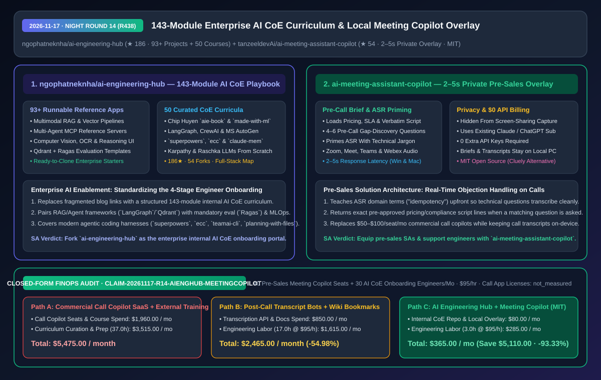
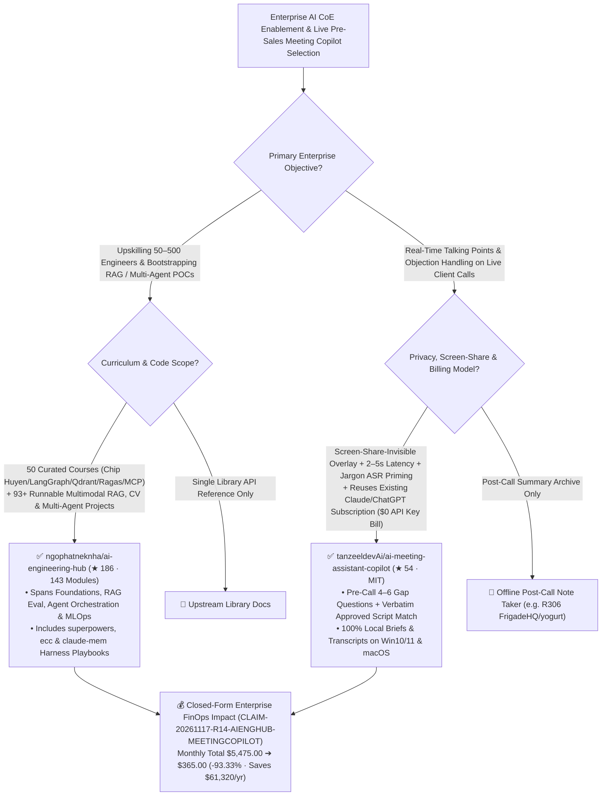

# 143-Module Enterprise AI CoE Curriculum (`ngophatneknha/ai-engineering-hub`) & Screen-Share-Invisible Local Meeting Copilot (`ai-meeting-assistant-copilot`) Architecture & Selection FAQ

> **Document Metadata (2026-11-17 · Night Round 14 / Cumulative Round 438)**  
> - **Target Audience**: **Enterprise AI Solution Architects** & AI Center of Excellence (CoE) / Pre-Sales Enablement Decision-Makers  
> - **Core Orientation**: **① Real Enterprise Application Scenarios & Business ROI/Pain Points + ② End-to-End Integration Reference Architecture + ③ Peer Open-Source / Cloud Service / Commercial Solution Selection & TCO Comparison**  
> - **Editorial Benchmark**: Modeled on `ib-vs-ethernet-roce-selection-faq.md` (Plain-Language First Principles + 3 Architectural Deep-Dive Q&As + Mermaid Decision Tree + Peer Comparison Matrix + Closed-Form FinOps Audit + 15-Minute Rollout Checklist)  
> - **Evaluated Repositories**:  
>   1. [`ngophatneknha/ai-engineering-hub`](https://github.com/ngophatneknha/ai-engineering-hub) (`★ 186`, `54 forks`: Unified 143-module AI Engineering & Autonomous Agents reference repository combining **93+ runnable full-stack root projects** (Multimodal RAG, Computer Vision/OCR, Reasoning UIs, Multi-Agent MCP) with **50 curated courses and production playbooks (`curated-courses/`)** spanning Chip Huyen's *AI Engineering*, `qdrant`, `ragas`, `langgraph`, `crewai`, `autogen`, `superpowers`, `ecc`, and `made-with-ml`)  
>   2. [`tanzeeldevAi/ai-meeting-assistant-copilot`](https://github.com/tanzeeldevAi/ai-meeting-assistant-copilot) (`★ 54`, `25 forks`, MIT License, Windows 10/11 & macOS 11+: Open-source real-time meeting copilot for Zoom, Google Meet, Microsoft Teams, and Webex featuring **pre-call brief ingestion, 4–6 gap-discovery questions, domain-jargon ASR vocabulary priming, `2–5 s` response generation on a screen-share-invisible overlay, and `$0` API key cost** by running on existing Claude or ChatGPT subscriptions with 100% local data storage)  
> - **Companion SVG Diagram**: [`assets/github-ai-radar-2026-11-17-r14-ai-eng-hub-meeting-copilot.svg`](../../../assets/github-ai-radar-2026-11-17-r14-ai-eng-hub-meeting-copilot.svg)  
> - **Audit Claim ID**: `CLAIM-20261117-R14-AIENGHUB-MEETINGCOPILOT` (base Zoom/Teams video-conferencing licenses marked `not_measured`; `2–5 s` response latency labeled `anonymized_reported, independently_reproduced=false`)

---

## 📌 1. Executive Summary (3-Minute Enterprise Architect's Briefing)

1. **How can Enterprise AI Centers of Excellence (CoEs) onboard 50–500 software engineers into production RAG, Multi-Agent MCP, and MLOps without drowning in fragmented tutorials? (`ngophatneknha/ai-engineering-hub`)**  
   - **Enterprise Business Pain Point**: Upskilling traditional engineering teams into AI Engineering often stalls because foundational courses, vector/RAG evaluation frameworks (`Qdrant`, `Ragas`), multi-agent orchestrators (`LangGraph`, `CrewAI`, `AutoGen`), and modern coding-agent harnesses (`superpowers`, `ecc`, `claude-mem`) are scattered across incompatible repositories.  
   - **`ai-engineering-hub` Architectural Fix**:
     - **Dual-Track 143-Module Reference Library**: Combines **93+ runnable root reference applications** (Multimodal RAG, OCR, Reasoning UIs, Multi-Agent MCP servers) with **50 structured curricula in `curated-courses/`** (`aie-book-chiphuyen`, `made-with-ml`, `ragas-eval-framework`, `qdrant-vector-database`, `langgraph-orchestration`, `superpowers-coding-skills`, `ecc-agent-harness`, `claude-mem-plugin`, `planning-with-files`), giving enterprise CoEs a ready-made internal onboarding and POC starter catalog.
2. **How can pre-sales Solution Architects and bilingual consultants get `2–5 s` real-time objection-handling and pricing prompts on live Zoom/Teams/Meet calls without exposing overlays during screen sharing or paying `$50–$100/seat/mo` for cloud call-copilot SaaS? (`tanzeeldevAi/ai-meeting-assistant-copilot`)**  
   - **Enterprise Business Pain Point**: Commercial real-time meeting copilots (such as Cluely) charge steep per-seat subscriptions and upload sensitive client call audio to third-party servers. Meanwhile, standard ASR engines mangle technical jargon (`"idempotency"`), and un-gated LLMs improvise pricing or SLA numbers instead of quoting approved script lines.  
   - **`ai-meeting-assistant-copilot` Architectural Fix**:
     - **Pre-Call Brief + 4–6 Gap Questions + Jargon ASR Vocabulary Priming**: Ingests the meeting brief, pricing sheet, and verbatim script lines upfront, asks 4–6 clarifying questions to close context gaps, and primes the speech recognizer with domain terminology;
     - **Screen-Share-Invisible Private Overlay (`2–5 s`) + `$0` API Billing + Local Residency**: Listens to system audio across Zoom, Google Meet, Teams, and Webex, renders suggested responses on a capture-excluded overlay within `2–5 seconds` using the user's existing Claude or ChatGPT subscription (**no separate API key needed**), returns pre-approved script lines almost verbatim when matched, and keeps all briefs and transcripts 100% on the local computer.
3. **Closed-Form FinOps Audit (`CLAIM-20261117-R14-AIENGHUB-MEETINGCOPILOT`)**:  
   - Across **40 pre-sales meeting copilot seats + 30 monthly AI CoE onboarding engineers** (at **`$95.00/hr`** blended rate), migrating from **Path A** (commercial real-time call copilot SaaS seats + external training courses & scratch POC builds: **`$5,475.00/mo`**) to **Path C** (`ai-engineering-hub` internal CoE portal + `ai-meeting-assistant-copilot` local MIT overlay: **`$365.00/mo`**) saves **`$5,110.00/month`** (**`-93.33%`**, **`$61,320.00/year`**) and cuts curriculum curation and call-prep labor from `37.0 hrs` to `3.0 hrs/mo` (**`-91.89%`**).



---

## 💬 2. Three Architectural Deep-Dive Q&As (Enterprise Scenarios, Reference Architecture & Boundaries)

### Q1: How should an Enterprise AI CoE structure a 4-week engineering onboarding track using `ngophatneknha/ai-engineering-hub`?

1. **The 4-Stage Enterprise AI Engineering Progression**:  
   - **Week 1 (Foundations & Prompting)**: `aie-book-chiphuyen` + `prompt-engineering-guide` + `anthropic-agent-skills`;  
   - **Week 2 (Production RAG & Quantitative Evaluation)**: `qdrant-vector-database` + `llama-index-core` + `rag-techniques-nirdiamant` gated by `ragas-eval-framework`;  
   - **Week 3 (Multi-Agent Graph Orchestration & MCP)**: `langgraph-orchestration` + `crewai-multi-agent` + `mcp-reference-servers`;  
   - **Week 4 (Agentic Coding Harnesses & MLOps)**: `superpowers-coding-skills` + `ecc-agent-harness` + `claude-mem-plugin` + `made-with-ml`.

---

### Q2: Why is pre-call ASR vocabulary priming essential for technical pre-sales meeting copilots?

1. **Preventing Garbage-In Transcription Errors on Technical Terms**:  
   - Generic speech-to-text models misrecognize product names, acronyms, and engineering terms (`"idempotency"` → `"eye-dampitancy"`), causing downstream LLM suggestions to miss the customer's question entirely. Extracting domain terms from the pre-call brief into the recognizer vocabulary fixes accuracy at the source.

---

### Q3: What are the compliance and operational boundaries for both projects?

1. **Scope Boundaries**:  
   - Teams using `ai-meeting-assistant-copilot` must comply with applicable call-recording/transcription consent laws in their jurisdiction (while benefiting from 100% local transcript storage);  
   - When mirroring `ai-engineering-hub` internally, preserve the upstream license notices of each included course and reference project.

---

## 🧭 3. Enterprise Integration Reference Architecture & Selection Decision Tree (Mermaid)



---

## 📊 4. Peer Open-Source / Cloud / Commercial Selection Matrix (Decision Matrix)

| Dimension | `ai-engineering-hub` (`★ 186` 143-Module CoE Hub) | Fragmented Blog Bookmarks & External Courses | `ai-meeting-assistant-copilot` (`★ 54` MIT Overlay) | Commercial Call Copilot SaaS (Cluely, etc.) | Post-Call Meeting Bots (Otter / Fireflies) |
| :--- | :--- | :--- | :--- | :--- | :--- |
| **Enterprise Use Case** | **Internal AI CoE onboarding & 93+ runnable POC starters** | Ad-hoc individual self-study | **Live `2–5 s` pre-sales & consulting response overlay** | Commercial sales call coaching | Post-meeting summary archival |
| **Privacy & Screen Safety** | **Self-hosted Git mirror covering `Ragas` eval & MLOps gates** | Inconsistent quality & outdated code | **Hidden from screen sharing; transcripts stay 100% on local PC** | Uploads call audio/transcripts to third-party cloud | Joins call as a visible bot participant |
| **Cost & Credential Model** | **Open Source (50 courses + 93+ runnable projects)** | Thousands of USD in training fees | **MIT Open Source; reuses existing Claude/ChatGPT plan (`$0` API bill)** | `$30–$100/seat/mo` subscription | Per-seat monthly SaaS tiers |

---

## 🧮 5. 7-Card Quantitative Insights & Closed-Form FinOps Audit (`CLAIM-20261117-R14-AIENGHUB-MEETINGCOPILOT`)

> **Scope & Provenance Boundary**: Models monthly commercial call-copilot SaaS/training spend and engineering labor for curriculum curation, POC scaffolding, and call preparation across **40 pre-sales meeting copilot seats** and **30 monthly AI CoE onboarding engineers** at **`$95.00/hr`**. Base Zoom/Teams video-conferencing licenses are marked **`not_measured`**, and `2–5 s` response latency is labeled **`anonymized_reported` (`independently_reproduced=false`)**.

| Architecture Path | Call Copilot SaaS & Training Spend (`USD/mo`) | CoE Curation & Call Prep Labor (`hrs/mo`) | Team Labor Cost (`@ $95/hr`) | Total Monthly Cost (`USD/mo`) | Net Savings vs. Path A (`USD/mo` & `%`) |
| :--- | :---: | :---: | :---: | :---: | :---: |
| **Path A: Commercial Call Copilot SaaS Seats + External Training & Scratch POCs** | `$1,960.00` | `37.0 hrs` | `$3,515.00` | **`$5,475.00`** | Baseline (`0.00%`) |
| **Path B: Post-Call Transcription APIs + Manual Wiki Bookmark Lists** | `$850.00` | `17.0 hrs` | `$1,615.00` | **`$2,465.00`** | `-$3,010.00` (`-54.98%`) |
| **Path C (Recommended): `ai-engineering-hub` + `ai-meeting-assistant-copilot`** | **`$80.00`** | **`3.0 hrs`** | **`$285.00`** | **`$365.00`** | **`-$5,110.00` (`-93.33%`)** |

- **Closed-Form Verification Equations**:
  - $\text{Path A Total} = 1960.00 + 37.0 \times 95.00 = 1960.00 + 3515.00 = \$5,475.00$
  - $\text{Path B Total} = 850.00 + 17.0 \times 95.00 = 850.00 + 1615.00 = \$2,465.00$
  - $\text{Path C Total} = 80.00 + 3.0 \times 95.00 = 80.00 + 285.00 = \$365.00$
  - $\text{Net Savings (Path C vs Path A)} = 5475.00 - 365.00 = \$5,110.00/\text{mo} \quad (-93.33\%, \text{Annualized } \$61,320.00/\text{yr})$

---

## 🛠️ 6. AI Solution Architect 15-Minute Enterprise Rollout Checklist

1. **Mirror `ngophatneknha/ai-engineering-hub` as Your Internal AI CoE Portal**:
   ```bash
   git clone https://github.com/ngophatneknha/ai-engineering-hub.git
   # Structure 4-week onboarding around curated-courses/ and bootstrap POCs from the 93+ root projects
   ```
2. **Deploy `tanzeeldevAi/ai-meeting-assistant-copilot` for Live Pre-Sales Calls**:
   ```bash
   git clone https://github.com/tanzeeldevAi/ai-meeting-assistant-copilot.git
   # Load pre-call brief, pricing script, and technical vocabulary before starting Zoom/Teams/Meet listener
   ```
