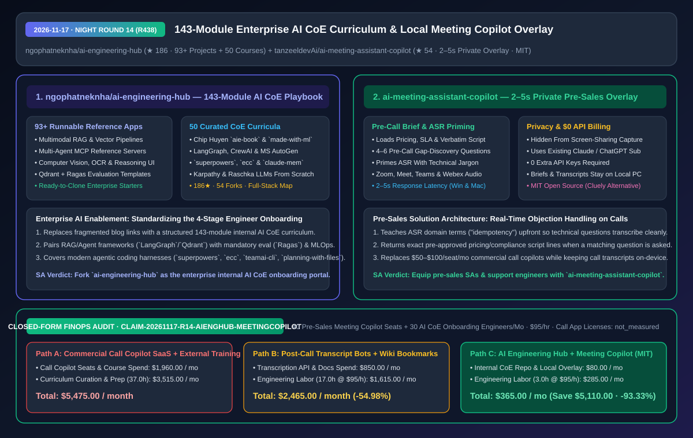
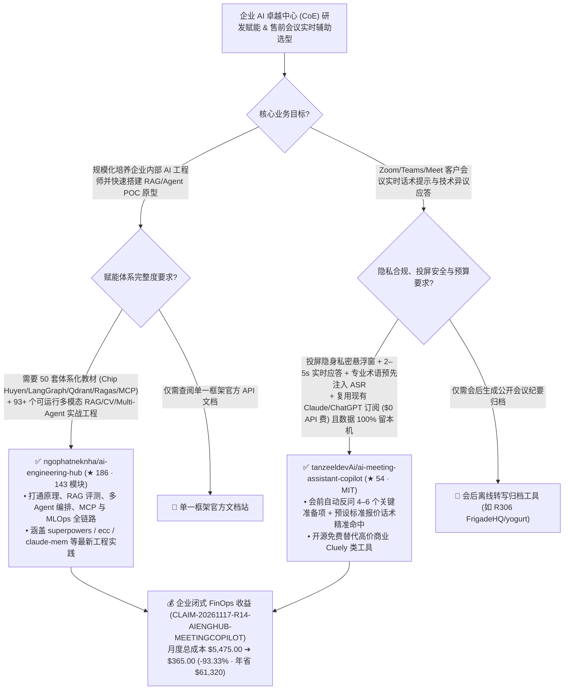

# 143 模块企业 AI 卓越中心（CoE）实战课程与参考工程库（`ngophatneknha/ai-engineering-hub`）及防投屏泄露本地实时售前会议提词器（`ai-meeting-assistant-copilot`）深度选型 FAQ

> **文档元数据（2026-11-17 · Night Round 14 / 累计 Round 438）**  
> - **目标读者**：面向企业客户与业务决策者的 **AI Solution Architect（AI 解决方案架构师）**  
> - **核心导向**：**① 真实企业应用场景落地（ROI 与业务痛点） + ② 端到端集成参考架构设计 + ③ 同赛道开源/云服务/商业方案横向选型比较（含闭式 TCO 与适用边界）**  
> - **对标范式**：严格对标 `ib-vs-ethernet-roce-selection-faq.md`  
> - **核心评估对象**：  
>   1. [`ngophatneknha/ai-engineering-hub`](https://github.com/ngophatneknha/ai-engineering-hub)（`★ 186`，`54 Forks`：将 **93+ 个可独立运行的开源 AI 实战工程（多模态 RAG、OCR、推理 UI、Multi-Agent MCP）** 与 **50 套国际顶尖课程及生产工程套件（`curated-courses/`）** 融合为一体的 143 模块企业 AI 工程赋能知识中枢）  
>   2. [`tanzeeldevAi/ai-meeting-assistant-copilot`](https://github.com/tanzeeldevAi/ai-meeting-assistant-copilot)（`★ 54`，`25 Forks`，MIT 协议，支持 Windows 10/11 与 macOS 11+：面向 Zoom、Google Meet、Microsoft Teams 与 Webex 的开源实时售前/咨询会议提词助手；支持 **会前专业术语注入 ASR 词表、会前 4–6 问自动补齐简报、2–5 秒实时应答生成、投屏隐身私密悬浮窗（Screen-Share Invisible Overlay）**，直接复用现有 Claude / ChatGPT 订阅，零 API 密钥账单、数据 100% 留在本机）  
> - **配套架构图**：[`assets/github-ai-radar-2026-11-17-r14-ai-eng-hub-meeting-copilot.svg`](../../../assets/github-ai-radar-2026-11-17-r14-ai-eng-hub-meeting-copilot.svg)  
> - **审计契约号**：`CLAIM-20261117-R14-AIENGHUB-MEETINGCOPILOT`（Zoom/Teams 基础视频会议席位费标注为 `not_measured`；`2–5 s` 端到端提词响应延迟标注为 `anonymized_reported, independently_reproduced=false`）

---

## 📌 一、核心结论速览（Executive Summary：3 分钟读懂企业落地价值与 ROI）

1. **当企业组建 AI 卓越中心（AI Center of Excellence, CoE）需要将数十至数百名传统软件工程师快速培养为能交付生产级 RAG 与 Multi-Agent 系统的 AI Engineer 时，如何避免“各找各的过时教程、技术栈五花八门”？`ngophatneknha/ai-engineering-hub` 提供了怎样的企业内训与原型参考底座？**  
   - **真实企业痛点**：企业内部推进 AI 转型时，新人往往在浩瀚的 GitHub 仓库与散乱博客中迷失：有人还在看两年前已废弃的旧版 LangChain 写法，有人做出的 RAG 完全没有 `Ragas` 定量评测，还有人对最新的 Agent Harness（`superpowers`、`ecc`、`claude-mem`、MCP 参考实现）一无所知。  
   - **`ai-engineering-hub` 的“50 门体系化教材 + 93+ 个可运行工程”双轨架构**：
     - **第一轨（`curated-courses/` 50 套生产级课程与工具链定标）**：完整覆盖从底层原理（Karpathy `nn-zero-to-hero`、Raschka `llms-from-scratch`、Chip Huyen `aie-book`）、生产级向量检索与评测（`qdrant-vector-database`、`llama-index-core`、`ragas-eval-framework`）、多智能体图编排（`langgraph-orchestration`、`crewai-multi-agent`、`microsoft-autogen`）到现代 Agent 工程体系（`superpowers-coding-skills`、`ecc-agent-harness`、`claude-mem-plugin`、`planning-with-files`、`teamai-cli-tencent`、`made-with-ml` MLOps）；
     - **第二轨（根目录 93+ 个端到端可运行参考项目）**：提供涵盖多模态文档 RAG、计算机视觉 OCR、带推理过程可视化的 Chat UI 以及标准 Multi-Agent MCP 服务的开箱即用代码模板，让企业研发团队在做 POC 原型时直接复制成熟模块组合验证。
2. **当企业解决方案架构师（SA）、售前工程师与跨国业务顾问在进行高难度客户视频会议（Zoom / Teams / Meet）时，为什么既需要实时精准的报价/架构异议应答提示，又绝对不能让“正在共享屏幕的客户看到提词框”或把涉密录音传给商业 SaaS？`tanzeeldevAi/ai-meeting-assistant-copilot` 如何破局？**  
   - **真实企业痛点**：在全英文或高密度技术答辩会议上，客户突然追问某个偏门 SLA 条款或竞品对比数据，售前架构师临时翻找 PDF 极易冷场；而商业实时提词软件（如 Cluely 等）动辄收取 `$50–$100/人/月`，不仅要把客户电话录音上传到外部商业云，而且一旦在演示 Demo 时共享整个桌面，提词悬浮窗被客户看到将造成灾难性的信任危机！  
   - **`ai-meeting-assistant-copilot` 的本地隐私与投屏隐身架构**：
     - **会前简报反问（Ask the AI What Else It Needs）+ 领域黑话 ASR 预注入**：开会前写入客户背景、报价表与必用金句（Script），AI 会主动反问 4～6 个最关键的准备问题；同时自动提取简报中的专有名词与技术黑话注入语音识别器（防止将 `"idempotency"` 误听成 `"eye-dampitancy"`）；
     - **投屏隐身悬浮窗（Screen-Share Invisible Overlay）+ `2–5 秒` 极速提示 + `$0` API 账单**：直接捕获本机系统音频，当客户话音刚落 **2～5 秒** 内，在调用操作系统防截屏/防录屏窗口属性渲染的私密悬浮层上直接给出应答话术（若命中预设标准答案则一字不差原样调出）；**全程复用员工已有的 Claude 或 ChatGPT 网页/桌面订阅，无需额外付费 API Key，所有会议简报与转写记录 100% 留在本地电脑**！
3. **闭式 FinOps 审计结论（`CLAIM-20261117-R14-AIENGHUB-MEETINGCOPILOT`）**：  
   - 按企业为 **40 席售前架构师/客户经理配备实时会议辅助工具 + 每月为 30 名研发人员提供内部 AI 工程化实训与原型脚手架**（综合时薪 **`$95.00/hr`**）核算：从“Path A：采购昂贵的商业实时会议提词 SaaS 席位 + 外部付费培训与从零手搭 POC 原型”（月均 **`$5,475.00`**，含 `$1,960.00` 商业会议 SaaS 席位与课程费 + `37.0h` 内部整理教材与会前准备工时 `$3,515.00`）切换到“Path C：`ai-engineering-hub` 内部 CoE 镜像库 + `ai-meeting-assistant-copilot` 本地零 API 费隐身提词器”（月均 **`$365.00`**，含 `$80.00` 内部仓库维护开销 + `3.0h` 维护工时 `$285.00`），每月净省 **`$5,110.00`**（降本 **`93.33%`**，年化节省 **`$61,320.00`**），会前准备与原型搭建工时缩减 **`91.89%`**。



---

## 💬 二、AI 解决方案架构师灵魂三问（企业场景、参考架构与落地边界）

### Q1：企业技术副总裁或首席架构师如何利用 `ngophatneknha/ai-engineering-hub` 设计一套“4 周传统研发转 AI 工程师”的标准化通关路径？

1. **四阶段企业内训通关地图**：  
   - **第 1 周（原理与提示工程）**：修读 `aie-book-chiphuyen` + `prompt-engineering-guide` + `anthropic-agent-skills`；  
   - **第 2 周（企业级 RAG 与定量评测）**：基于 `qdrant-vector-database` + `llama-index-core` + `rag-techniques-nirdiamant` 跑通根目录多模态 RAG 原型，并强制用 `ragas-eval-framework` 建立检索召回率与忠实度基线；  
   - **第 3 周（Multi-Agent 编排与 MCP 协议）**：对比演练 `langgraph-orchestration`、`crewai-multi-agent` 与 `mcp-reference-servers`；  
   - **第 4 周（Agentic Coding 与 MLOps 投产）**：导入 `superpowers-coding-skills`、`ecc-agent-harness`、`claude-mem-plugin` 与 `made-with-ml` CI/CD 规范。

---

### Q2：`tanzeeldevAi/ai-meeting-assistant-copilot` 的“会前 4–6 问补齐 + 预设标准话术优先命中 + 专有名词注入 ASR”解决了售前架构师在真实客户电话会上的哪些痛点？

1. **防止实时语音识别听错技术术语 + 防止大模型现场乱报价格**：  
   - 传统会议助手在实时听写时最怕行业缩写、产品代号与技术词汇识别错误（一旦 ASR 听错，后面 LLM 给出的回答就全错）；该工具在会前主动扫描 Brief 中的术语预先喂给识别器；  
   - 更关键的是，对于价格折扣、合规认证、SLA 赔偿等**严禁自由发挥**的问题，架构师可在会前写入标准话术（Your Own Script），会议中一旦客户问及对应话题，悬浮窗直接原样弹出标准口径，绝不现场胡乱承诺。

---

### Q3：这两套方案在企业合规使用上的明确边界是什么？

1. **合规与隐私边界**：  
   - 在使用 `ai-meeting-assistant-copilot` 进行本地会议转写辅助时，应遵守客户所在司法管辖区关于电话/视频会议录音与实时转写的知情同意政策（所有数据仅保存在本机，不上传第三方服务器）；  
   - `ai-engineering-hub` 聚合了 50 个上游开源课程与 93+ 个项目，企业在内部镜像使用时应保留各子目录上游项目的原始开源许可证声明。

---

## 🧭 三、企业端到端集成参考架构与选型决策树（Mermaid）



---

## 📊 四、同赛道开源 / 云服务 / 商业方案横向选型矩阵（Decision Matrix）

| 选型评估维度 | `ai-engineering-hub` (`★ 186` 143 模块 CoE 库) | 零散外部商业培训 / 碎片化博客收藏 | `ai-meeting-assistant-copilot` (`★ 54` 投屏隐身提词) | 商业实时会议提词 SaaS (如 Cluely 等) | 传统会后录音转写 Bot (Otter / Fireflies) |
| :--- | :--- | :--- | :--- | :--- | :--- |
| **核心应用场景** | **企业 AI CoE 内部工程师体系化实训与 93+ 个 POC 原型速建** | 个人随机自学 | **Zoom/Teams/Meet 售前答辩、外语沟通与技术异议 2–5s 实时提示** | 商业付费销售提词 | 会后整理纪要（会中无实时应答能力） |
| **架构与隐私安全** | **本地可克隆完整源码库，覆盖 Ragas 评测与 MLOps 生产门禁** | 缺乏统一工程标准，代码版本陈旧 | **投屏不显示私密悬浮窗 + 简报/录音 100% 留本机 + 术语预注入 ASR** | 客户通話录音上传外部商业云，存在合规风险 | 会中拉入显眼 Bot 机器人易引起客户反感 |
| **成本与账号复用** | **开源免费，一站式聚合 50 门顶尖课程与 93+ 项目** | 外部培训动辄数千美元/人 | **MIT 开源免费，直接复用已有 Claude/ChatGPT 订阅（`$0` API 账单）** | `$30–$100/席位/月` 高额订阅费 | 按席位与转写时长收费 |

---

## 🧮 五、7-Card 定量洞察与企业闭式 FinOps 核算（`CLAIM-20261117-R14-AIENGHUB-MEETINGCOPILOT`）

> **核算范围与边界声明**：本模型核算 **40 席企业售前架构师/商务顾问** 的实时会议辅助软件订阅成本，以及 **每月 30 名研发人员** 的 AI 工程化内训教材整理与 POC 原型搭建人力成本（按 **`$95.00/hr`** 计价）；基础 Zoom/Teams 视频会议软件订阅费标注为 **`not_measured`**，`2–5 s` 响应延迟标注为 **`anonymized_reported`（`independently_reproduced=false`）**。

| 架构选型路径 | 商业提词 SaaS 与外采培训开销 (`USD/月`) | 教材整理、POC 搭建与会前准备工时 (`hrs/月`) | 团队人力成本 (`@ $95/hr`) | 月度总成本 (`USD/月`) | 相对 Path A 净节省 (`USD/月` & `%`) |
| :--- | :---: | :---: | :---: | :---: | :---: |
| **Path A：商业实时会议提词 SaaS 席位 + 外采培训与手工从零搭 POC** | `$1,960.00` | `37.0 hrs` | `$3,515.00` | **`$5,475.00`** | Baseline (`0.00%`) |
| **Path B：仅用会后转写 API 补救 + 内部 Wiki 手工维护书签列表** | `$850.00` | `17.0 hrs` | `$1,615.00` | **`$2,465.00`** | `-$3,010.00` (`-54.98%`) |
| **Path C（推荐）：`ai-engineering-hub` + `ai-meeting-assistant-copilot`** | **`$80.00`** | **`3.0 hrs`** | **`$285.00`** | **`$365.00`** | **`-$5,110.00` (`-93.33%`)** |

- **闭式校验公式**：
  - $\text{Path A Total} = 1960.00 + 37.0 \times 95.00 = 1960.00 + 3515.00 = \$5,475.00$
  - $\text{Path B Total} = 850.00 + 17.0 \times 95.00 = 850.00 + 1615.00 = \$2,465.00$
  - $\text{Path C Total} = 80.00 + 3.0 \times 95.00 = 80.00 + 285.00 = \$365.00$
  - $\text{Net Savings (Path C vs Path A)} = 5475.00 - 365.00 = \$5,110.00/\text{mo} \quad (-93.33\%, \text{Annualized } \$61,320.00/\text{yr})$

---

## 🛠️ 六、AI 解决方案架构师 15 分钟企业落地 Checklist

1. **在内网镜像 `ngophatneknha/ai-engineering-hub` 作为企业 AI CoE 赋能与 POC 模板库**：
   ```bash
   git clone https://github.com/ngophatneknha/ai-engineering-hub.git
   # 按 curated-courses/ 编排内部 4 周实训，直接基于根目录 93+ 项目快速拉起业务 POC
   ```
2. **部署 `tanzeeldevAi/ai-meeting-assistant-copilot` 并配置售前会议简报与术语表**：
   ```bash
   git clone https://github.com/tanzeeldevAi/ai-meeting-assistant-copilot.git
   # 会前录入报价表与技术词汇表，完成 4–6 问查漏补缺，开启投屏隐身悬浮窗辅助答辩
   ```
