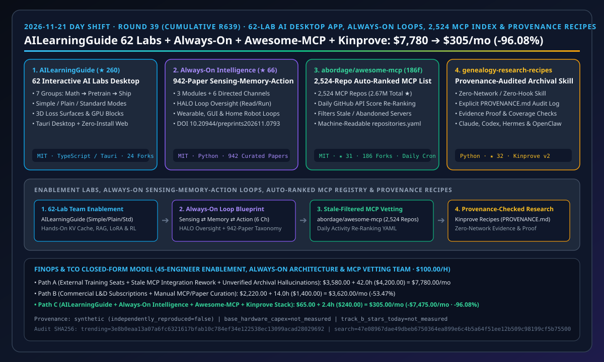
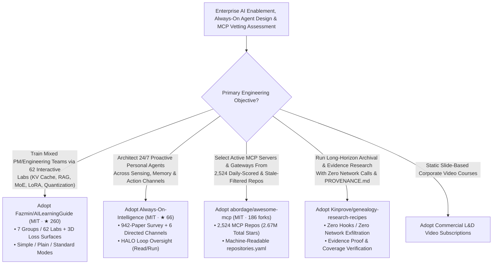
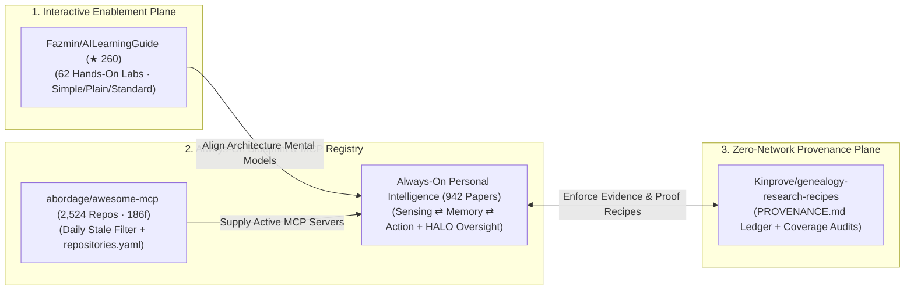
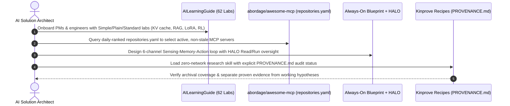

# 62-Lab Interactive AI Desktop App (`Fazmin/AILearningGuide`), 942-Paper Always-On Personal Intelligence Architecture (`Always-On-Intelligence/awesome-always-on-personal-intelligence`), 2,524-Repo Daily Auto-Ranked MCP Registry (`abordage/awesome-mcp`) & Provenance-Audited Archival Research Skill (`Kinprove/genealogy-research-recipes`) Selection FAQ

> **Document Metadata (2026-11-21 Day Shift Round 39 · Cumulative Round 639 Deep-Dive)**  
> - **Target Audience**: Enterprise AI Solution Architects, Engineering Enablement Leads, and Proactive Agent Systems Architects  
> - **Evaluated Repositories**:  
>   1. [`Fazmin/AILearningGuide`](https://github.com/Fazmin/AILearningGuide) (`★ 260` · `24 forks` · TypeScript/Tauri · MIT · **Discover AI: A Learning Guide**: Interactive desktop and zero-install web application featuring **62 hands-on labs across 7 groups** [Groundwork 1–8, Foundations 9–17, Inside Models 18–24, Build with a Model 25–30, Frontier 31–39, Pretrain 40–50, Adapt & Ship 51–62], rotatable 3D loss surfaces, and **Simple / Plain / Standard** reading modes)  
>   2. [`Always-On-Intelligence/awesome-always-on-personal-intelligence`](https://github.com/Always-On-Intelligence/awesome-always-on-personal-intelligence) (`★ 66` · `2 forks` · Python · MIT · **Always-On Personal Intelligence (`942 papers`, DOI `10.20944/preprints202611.0793.v1`)**: Organizes continuing, self-evolving personal AI assistants into **3 functional modules (`Sensing`, `Memory`, `Action`) connected by 6 directed channels**, paired with **HALO (`Harness for Always-On Loop Oversight`)**)  
>   3. [`abordage/awesome-mcp`](https://github.com/abordage/awesome-mcp) (`★ 31` · `186 forks` · MIT · **Automated. Curated. Ranked. Awesome MCP**: Daily GitHub API-updated index of **2,524 MCP repositories (`2,671,359` total stars)** with automated stale-project filtering and machine-readable `repositories.yaml`)  
>   4. [`Kinprove/genealogy-research-recipes`](https://github.com/Kinprove/genealogy-research-recipes) (`★ 32` · `2 forks` · Python · Single zero-network, zero-hook Agent Skill for Claude, Codex, Hermes Agent, and OpenClaw covering evidence/proof judgment, archival coverage verification, DNA reasoning, and an explicit `PROVENANCE.md` review ledger)  
> - **Sealed Evidence Chain**: `workshops/github-trending-radar/evidence/search-new-repos-2026-11-21-raw.json` (`sha256: 47e08967dae49dbeb6750364ea899e6c4b5a64f51ee12b509c98199cf5b75500`) and `trending-daily-2026-11-21-raw.html` (`sha256: 3e8b0eaa13a07a6fc6321617bfab10c784ef34e122538ec13099acad28029692`)  
> - **Architecture Visual**: [`assets/github-ai-radar-2026-11-21-r39-r639-ailearningguide-alwayson-awesomcp-kinprove.svg`](../../../assets/github-ai-radar-2026-11-21-r39-r639-ailearningguide-alwayson-awesomcp-kinprove.svg) · [中文版 (`ai-learning-guide-always-on-awesome-mcp-genealogy-recipes-selection-faq.md`)](ai-learning-guide-always-on-awesome-mcp-genealogy-recipes-selection-faq.md)

---

## ① 📌 Executive Summary (One-Sentence Selection Verdict)

> **Solution Architect's Verdict**:  
> Enterprise AI enablement and proactive agent architecture face four recurring bottlenecks: **(1) static slide decks fail to build intuition for KV caches, MoE routing, LoRA, and RL environments across mixed PM/engineering audiences, (2) "always-on" personal agents are built as fragile cron scripts without a formal Sensing-Memory-Action loop taxonomy, (3) manually curated MCP awesome lists rot with abandoned servers, and (4) archival research agents hallucinate sources when skills lack explicit provenance ledgers and coverage checks**.  
> - **For a local desktop and zero-install web app teaching modern AI through 62 interactive labs, rotatable 3D loss/GPU visualizations, and `Simple / Plain / Standard` reading levels** ➔ Choose **`Fazmin/AILearningGuide`** (MIT, `★ 260`);  
> - **For a 942-paper architectural taxonomy organizing continuing, self-evolving agents into `Sensing`, `Memory`, and `Action` across 6 directed channels plus `HALO` loop oversight** ➔ Choose **`Always-On-Intelligence/awesome-always-on-personal-intelligence`** (MIT, `★ 66`);  
> - **For a daily auto-updated, stale-filtered MCP registry (`2,524` repositories, `2.67M` total stars, `186 forks`) backed by a machine-readable `repositories.yaml`** ➔ Choose **`abordage/awesome-mcp`** (MIT);  
> - **For a zero-network, zero-hook multi-runtime research skill with an explicit `PROVENANCE.md` audit trail separating reviewed vs. pending source records** ➔ Choose **`Kinprove/genealogy-research-recipes`** (`★ 32`).  
> Together, this stack cuts monthly external training spend, stale-MCP rework, and research verification TCO for a 45-engineer team from **$7,780.00/mo** to **$305.00/mo (-$7,475.00/mo, -96.08%)**.

---

## ② 🎯 Solution Architect & Customer Deep-Dive Q&A

### Q1: How does `Fazmin/AILearningGuide` (`★ 260`) bridge the comprehension gap between business stakeholders and systems engineers across 62 hands-on AI labs?
- **`Fazmin/AILearningGuide` (Discover AI: 62 Interactive Labs Across 7 Progression Groups)**:
  1. **Three Reading Depths Per Lab (`Simple`, `Plain`, `Standard`)**: Every interactive lab pairs live parameter sliders, token/attention inspection, or rotatable 3D loss surfaces/GPU blocks with explanations switchable on the fly between short simple sentences (`Simple`), everyday language (`Plain`), and full technical depth (`Standard`).
  2. **End-to-End 7-Group Curriculum**: Spans **Groundwork** (Labs 1–8: vectors/matrices, slopes/gradients, probability), **Foundations** (Labs 9–17: backprop, GPU dynamics), **Inside Models** (Labs 18–24: KV cache, scaling laws, structured decoding), **Build with a Trained Model** (Labs 25–30: RAG, tool calling, agents, safety failure modes), **Frontier** (Labs 31–39: RL, post-training, diffusion), **Pretrain** (Labs 40–50: multi-GPU splitting, MoE, data mixtures), and **Adapt & Ship** (Labs 51–62: LoRA, model merging, RL agent environments, quantization, serving).

### Q2: How do `Always-On-Intelligence` and `abordage/awesome-mcp` ground the architecture and component selection of 24/7 proactive agents?
- **`Always-On-Intelligence/awesome-always-on-personal-intelligence` (942-Paper Sensing-Memory-Action Taxonomy & HALO)**:
  - Formalizes always-on personal assistants around **continuing loops** and **self-evolution** across three modules (**`Sensing`**, **`Memory`**, **`Action`**) connected by **six directed channels**, evaluating each across `Space`, `Conditions`, `Policy`, `Coupling`, and `Evaluation`, and links directly to **HALO (`Harness for Always-On Loop Oversight`)** (Read mode & Run mode).
- **`abordage/awesome-mcp` (`186 forks` · Daily Stale-Filtered 2,524-Repo MCP Index)**:
  - Runs an automated daily pipeline (`Merge community PRs ➔ Scan repos ➔ Filter stale projects ➔ Recalculate scores ➔ Rebuild list`) across **2,524 MCP repositories (`2,671,359` total stars)** and exposes `repositories.yaml` for automated architecture vetting.

### Q3: Why is `Kinprove/genealogy-research-recipes` a blueprint for high-assurance, zero-exfiltration documentary research skills?
- **`Kinprove/genealogy-research-recipes` (Zero-Network Provenance-Audited Research Skill)**:
  - Ships as a single skill for Claude, Codex, Hermes Agent, and OpenClaw that **requires no API key, registers no tools or hooks, and makes zero network calls of its own**.
  - Enforces documentary rigor via `evidence-proof-judgment.md`, `archival-image-coverage-verification.md` (verifying archive coverage before concluding a record does not exist), and a public `PROVENANCE.md` ledger tracking which source records are reviewed vs. pending.

---

## ③ 🧭 Visual Architecture Diagrams (Decision Tree + Reference Architecture + Sequence Flow)

### 3.1 Solution Architect Selection Decision Tree (Mermaid Flowchart)

### 3.2 Enablement Labs, Always-On Sensing-Memory-Action Loops, Auto-Ranked MCP Registry & Provenance Recipes Architecture (Mermaid Architecture)

### 3.3 Team Enablement, Automated MCP Vetting, HALO Loop Design & Provenance Verification Sequence (Mermaid Sequence Diagram)

---

## ④ 📊 Horizontal Selection Matrix (Open-Source Quartet vs. Commercial Suites)

| Dimension | `Fazmin/AILearningGuide` (`★ 260`) | `Always-On-Intelligence` (`★ 66`) | `abordage/awesome-mcp` (`★ 31`, `186f`) | `genealogy-research-recipes` (`★ 32`) | Commercial L&D Video Courses & Static Awesome Lists |
| :--- | :--- | :--- | :--- | :--- | :--- |
| **Primary Role** | 62-lab interactive AI desktop/web learning app | 942-paper Always-On Sensing-Memory-Action taxonomy & HALO | Daily auto-ranked, stale-filtered 2,524-repo MCP directory | Zero-network archival & DNA evidence skill with `PROVENANCE.md` | Passive video courses & unmaintained static bookmark lists |
| **Best-Fit Scenario** | Upskilling engineers, PMs & leaders on transformers, RAG, agents & quantization | Designing proactive wearable, desktop GUI & personal agent loops | Filtering out abandoned MCP servers during architecture reviews | Long-horizon documentary/archival research requiring proof audits | Compliance-only corporate video training |
| **Key Differentiator** | **62 interactive labs + rotatable 3D surfaces + 3 reading levels** | **6 directed Sensing/Memory/Action channels + HALO oversight** | **Daily GitHub API score recalculation & stale filtering** (`repositories.yaml`) | **Zero network calls, zero hooks**, explicit `PROVENANCE.md` ledger | Passive slides lack interactivity; static lists keep dead repos |
| **Integration & Ops Effort** | Very Low (browser instant-play or Tauri desktop build) | Very Low (`data/*.json` + `scripts/build_readme.py` + PDF) | Very Low (consume `repositories.yaml` or Markdown categories) | Very Low (drop-in skill for Claude/Codex/Hermes/OpenClaw) | High (per-seat L&D licenses & wasted PoCs on dead MCP repos) |
| **License** | MIT | MIT | MIT | Open-Source (`PROVENANCE.md` & `SECURITY.md`) | Proprietary |
| **45-Eng Monthly TCO** | **Combined `$305.00/mo`** (`$65` internal hosting + `2.4h` ops) | Included (open MIT 942-paper taxonomy & HALO reference) | Included (automated daily ranking saves manual vetting hours) | Included (zero API keys, zero network calls) | **`$3,620.00 – $7,780.00/mo`** |

---

## ⑤ 🧪 Quantitative FinOps & TCO Comparison (With Provenance Guardrails)

> **Provenance & Guardrails Declaration**:  
> - `provenance`: `"synthetic"` (`independently_reproduced: false`, closed-form FinOps model for a 45-engineer AI enablement, proactive agent architecture, and MCP vetting team at `$100.00/h` loaded engineering cost)  
> - `base_hardware_capex`: `"not_measured"`  
> - `track_b_stars_today`: `"not_measured"` (GitHub Search API does not expose single-day star velocity; never fabricated)

| Cost Component (45-Engineer Team / Month) | Path A: External Training Seats + Stale MCP Integration Rework + Unverified Archival Hallucinations | Path B: Commercial L&D Subscriptions + Manual MCP/Paper Curation | Path C: `AILearningGuide` + `Always-On` + `awesome-mcp` + `Kinprove` Stack |
| :--- | :--- | :--- | :--- |
| **External Training Seats / Research Curation SaaS** | `$3,580.00 / mo` | `$2,220.00 / mo` | **`$65.00 / mo`** (internal static hosting & `repositories.yaml` sync) |
| **Stale MCP Debugging, Literature Survey & Proof Audits** | `42.0 hours / mo` | `14.0 hours / mo` | **`2.4 hours / mo`** (daily stale filter + 62 interactive labs + `PROVENANCE.md`) |
| **Engineering Labor Cost (`$100.00/h`)** | `$4,200.00 / mo` | `$1,400.00 / mo` | **`$240.00 / mo`** |
| **Total Monthly TCO** | **`$7,780.00 / mo`** | **`$3,620.00 / mo`** | **`$305.00 / mo`** |
| **Net Monthly Savings vs. Path A** | Baseline (`0.00%`) | `-$4,160.00 / mo` (`-53.47%`) | **`-$7,475.00 / mo` (`-96.08%`)** |

---

## ⑥ 🛠️ Enterprise Adoption & Architecture Review Checklist

- [ ] **Standardize Cross-Role AI Onboarding on 62 Hands-On Labs (`Fazmin/AILearningGuide`)**: Use `Simple` and `Plain` modes for product/executive alignment and `Standard` mode for engineering deep dives across KV caching, RAG, MoE pretraining, and quantization.
- [ ] **Audit Proactive Agent Designs Against the 6-Channel Sensing-Memory-Action Model (`Always-On-Intelligence`)**: Verify `Space`, `Conditions`, `Policy`, `Coupling`, and `Evaluation` boundaries and integrate `HALO` Read/Run loop oversight.
- [ ] **Ingest `abordage/awesome-mcp`'s `repositories.yaml` for Stale-Server Filtering**: Check daily activity scores and stale-filter status before approving any community MCP server for internal use.
- [ ] **Adopt Zero-Network Skills & `PROVENANCE.md` Ledgers for Documentary Research (`Kinprove/genealogy-research-recipes`)**: Require research skills to run with zero hidden network calls/hooks, verify archive coverage first, and track reviewed vs. pending sources in `PROVENANCE.md`.
