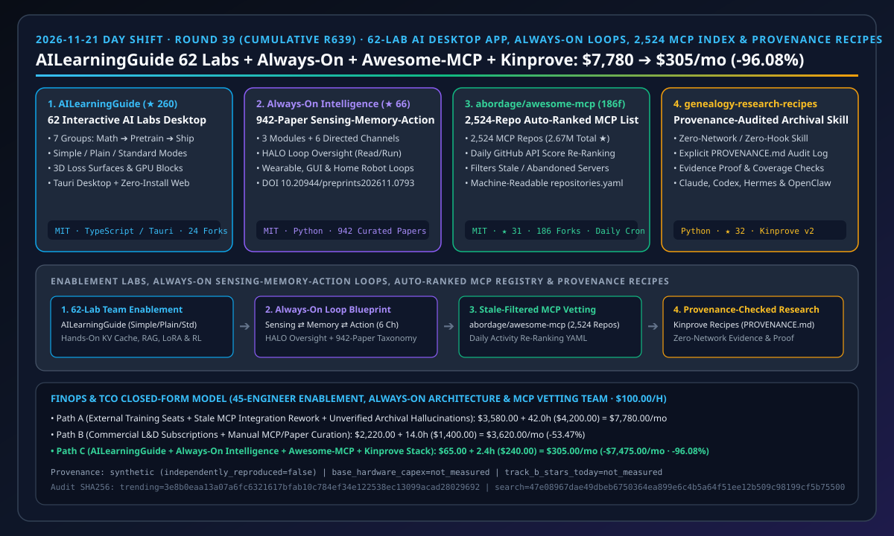
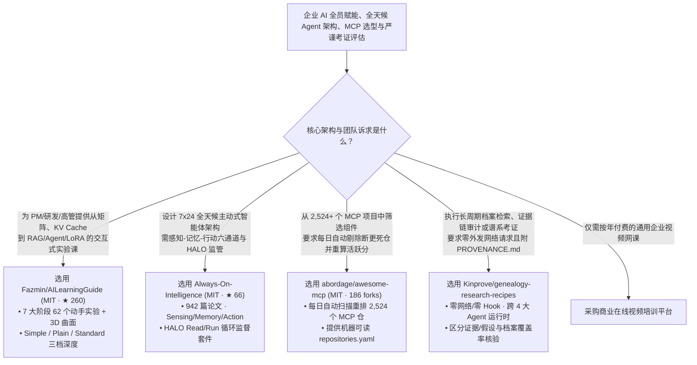
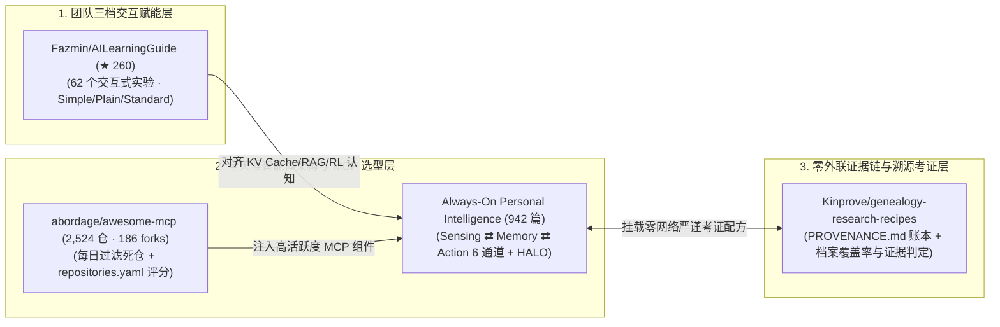
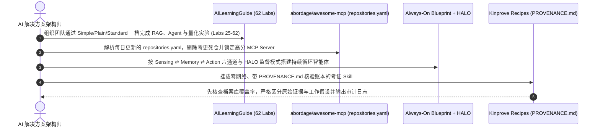

# 62 节交互式全栈 AI 实验桌面端（`Fazmin/AILearningGuide`）、942 篇全天候个人智能体架构全景（`Always-On-Intelligence/awesome-always-on-personal-intelligence`）、2,524 仓每日自动重排 MCP 注册表（`abordage/awesome-mcp`）与带溯源账本的档案考证技能包（`Kinprove/genealogy-research-recipes`）选型 FAQ

> **文档元数据（2026-11-21 白班 Day Round 39 · 累计第 639 轮深潜专题）**  
> - **面向对象**：企业 AI 解决方案架构师（AI Solution Architect）、研发赋能与技术委员会负责人、主动式智能体架构师  
> - **本轮核心评估对象**：  
>   1. [`Fazmin/AILearningGuide`](https://github.com/Fazmin/AILearningGuide)（`★ 260` · `24 forks` · TypeScript/Tauri · MIT · **Discover AI: A Learning Guide**：包含 **7 大模块共 62 个交互式动手实验**的本地桌面端与免安装网页版，涵盖从矩阵微积分、3D 损失曲面、Transformer/KV Cache、RAG/Agent 到多卡预训练、MoE、LoRA 与量化部署，支持 `Simple / Plain / Standard` 三档阅读深度实时切换）  
>   2. [`Always-On-Intelligence/awesome-always-on-personal-intelligence`](https://github.com/Always-On-Intelligence/awesome-always-on-personal-intelligence)（`★ 66` · `2 forks` · Python · MIT · **Always-On Personal Intelligence 综述与架构库（`942 篇论文`，DOI `10.20944/preprints202611.0793.v1`）**：将全天候主动式智能体拆解为 **感知（Sensing）、记忆（Memory）、行动（Action）三大模块与 6 条有向信息通道**，并配套 `HALO` 循环监管套件）  
>   3. [`abordage/awesome-mcp`](https://github.com/abordage/awesome-mcp)（`★ 31` · `186 forks` · MIT · **Automated. Curated. Ranked. Awesome MCP**：每日通过 GitHub API 自动扫描、**过滤断更僵尸项目（Filter stale projects）**并重算活跃度分数的 **2,524 个 MCP 仓库索引（总计 `2,671,359 ★`）**，提供机器可读 `repositories.yaml`）  
>   4. [`Kinprove/genealogy-research-recipes`](https://github.com/Kinprove/genealogy-research-recipes)（`★ 32` · `2 forks` · Python · 面向 Claude、Codex、Hermes Agent 与 OpenClaw 的**零网络调用、零隐式 Hook、带 `PROVENANCE.md` 逐条人工复核账本**的档案检索、证据链判定与 DNA 谱系考证技能包）  
> - **关联检索证据链**：`workshops/github-trending-radar/evidence/search-new-repos-2026-11-21-raw.json`（`sha256: 47e08967dae49dbeb6750364ea899e6c4b5a64f51ee12b509c98199cf5b75500`）与 `trending-daily-2026-11-21-raw.html`（`sha256: 3e8b0eaa13a07a6fc6321617bfab10c784ef34e122538ec13099acad28029692`）  
> - **高清架构图**：[`assets/github-ai-radar-2026-11-21-r39-r639-ailearningguide-alwayson-awesomcp-kinprove.svg`](../../../assets/github-ai-radar-2026-11-21-r39-r639-ailearningguide-alwayson-awesomcp-kinprove.svg) · [English Version (`ai-learning-guide-always-on-awesome-mcp-genealogy-recipes-selection-faq.en.md`)](ai-learning-guide-always-on-awesome-mcp-genealogy-recipes-selection-faq.en.md)

---

## ① 📌 核心结论速览（选型一句话结论）

> **架构师一句话选型结论**：  
> 当企业推进全员 AI 转型与长周期主动式智能体建设时，架构师常面临四个知识与选型断层：**（1）产品经理与传统后端工程师看不懂 KV Cache、MoE、LoRA 与强化学习环境等晦涩公式，外部培训课动辄数千美元却只能看 PPT、（2）设计 7×24 全天候个人/企业助手时缺乏“感知-记忆-行动”闭环与自演进的系统参考模型、（3）手工维护的 Awesome MCP 列表塞满几个月前就停更报错的死仓、（4）在做严肃档案与历史证据检索时，Agent 极易把未核实的网页传闻当成铁证并夹带私自外发请求**。  
> - **需要一套既能给业务高管看大白话（`Simple` / `Plain`）、又能给工程师看标准技术解析（`Standard`）并亲手拖拽 3D 损失曲面与 62 个全栈 AI 实验的交互式桌面应用** ➔ 选 **`Fazmin/AILearningGuide`**（MIT，`★ 260`）；  
> - **需要参考覆盖 942 篇论文的“感知（Sensing）⇄ 记忆（Memory）⇄ 行动（Action）六通道闭环 + HALO 监管”全天候智能体架构蓝图** ➔ 选 **`Always-On-Intelligence/awesome-always-on-personal-intelligence`**（MIT，`★ 66`）；  
> - **需要从 2,524 个 MCP 仓库（总计 267 万 Star）中按每日自动重算活跃度并剔除断更死仓（`repositories.yaml`）进行企业技术选型** ➔ 选 **`abordage/awesome-mcp`**（MIT，`186 forks`）；  
> - **需要一套零网络外联、零后台 Hook、自带 `PROVENANCE.md` 复核状态账本与严密证据证明标准（Evidence & Proof Judgment）的长周期档案考证 Skill** ➔ 选 **`Kinprove/genealogy-research-recipes`**（`★ 32`）。  
> 四者组合可将 45 人研发赋能、主动式 Agent 架构设计与 MCP 选型团队的外部培训采购、踩坑死仓返工与考证核查总成本从 **$7,780.00/月** 降至 **$305.00/月（节省 $7,475.00/月，降幅 96.08%）**。

---

## ② 🎯 客户与架构师灵魂拷问 Q&A（业务痛点 · 架构集成 · 边界取舍）

### Q1：企业内部培训业务人员、传统软件工程师与算法工程师时，同一份材料总是“业务嫌太深、研发嫌太水”。`Fazmin/AILearningGuide`（`★ 260`）是如何用 62 个实验和三档文风解决的？
- **`Fazmin/AILearningGuide`（Discover AI: 7 大阶段 62 个可交互实验桌面端/Web）的三大亮点**：
  1. **三档阅读深度实时切换（`Simple` / `Plain` / `Standard`）**：每个实验右侧的课程讲解支持一键切换“简短浅显句（Simple）”、“日常大白话（Plain）”与“完整技术版（Standard）”，让高管、PM 与架构师在同一个界面对齐概念。
  2. **先猜后验（Predict First）+ 3D 交互可视化**：涵盖 7 大阶段——① 基础数学（1–8）、② 神经网络基础（9–17）、③ 模型内部机理（18–24：Attention、KV Cache、结构化解码）、④ 应用构建（25–30：RAG、工具调用、Agent、安全失效模式）、⑤ 前沿探索（31–39：RL、后训练、扩散模型）、⑥ 多卡从零预训练与 MoE（40–50）、⑦ 微调量化与上线（51–62：LoRA、模型合并、智能体 RL 环境、量化蒸馏）。其中 5 个核心实验提供可自由旋转并压平为等高线图的 3D 损失曲面与 GPU 集群块。
  3. **Tauri 本地桌面端 + 零安装浏览器直跑**：无需配置 Python/CUDA 环境即可在全公司普及。

### Q2：很多团队做的“主动式 Agent”只是加了个定时器的聊天框，跑几天就会记忆混乱或越权乱动。`Always-On-Intelligence` 与 `abordage/awesome-mcp` 提供了什么架构选型支撑？
- **`Always-On-Intelligence/awesome-always-on-personal-intelligence`（942 篇论文提炼的六通道闭环架构）**：
  - 指出真正的全天候智能（Always-On Personal Intelligence）必须在请求间隙维持**持续循环（Continuing Loop）**与**自演进（Self-Evolving）**；
  - 建立了标准的 **三大功能模块（`Sensing` 感知、`Memory` 记忆、`Action` 行动）× 六条有向信息通道** 架构框架，在每个模块下均严格定义 `Space`（空间）、`Conditions`（约束条件）、`Policy`（策略）、`Coupling`（耦合）与 `Evaluation`（评测），并配套开源了 **HALO（`Harness for Always-On Loop Oversight`）** 监督套件（支持 Read mode 与 Run mode）。
- **`abordage/awesome-mcp`（`186 forks` · 2,524 个 MCP 仓库每日自动去死仓重排索引）**：
  - 传统 Awesome 列表一旦合并 PR 就再无人维护。`abordage/awesome-mcp` 通过每日定时流水线（`Merge community PRs ➔ Scan repos ➔ Filter stale projects ➔ Recalculate scores ➔ Rebuild list`）管理 **2,524 个 MCP 项目（累计 267.1 万 Star）**，架构师可直接读取其 `repositories.yaml` 过滤掉长期不维护的僵尸 MCP Server。

### Q3：`Kinprove/genealogy-research-recipes` 虽然面向家谱与历史档案考证，为什么它的 Skill 工程设计值得所有企业严谨调查类 Agent 借鉴？
- **零信任技能包与证据链工程的典范**：
  1. **零网络请求、零工具/Hook 注入、免账号 API Key**：纯声明式方法论与配方目录（兼容 Claude、Codex、Hermes Agent、OpenClaw），彻底杜绝第三方 Skill 偷偷外传企业敏感调查数据。
  2. **显式 `PROVENANCE.md` 人工核验状态账本**：公开列出每一条配方背后的原始文献与档案记录哪些**已完成人工复核（Reviewed）**、哪些**仍待复核（Pending）**，并内置 `evidence-proof-judgment.md`（证据、证明与工作假设分离）与 `archival-image-coverage-verification.md`（先查档案收录范围覆盖率，避免把“没搜到”当成“不存在”）。

---

## ③ 🧭 直观可视化图解（选型决策树 + 企业集成架构 + 业务流时序图）

### 3.1 架构师选型决策树（Mermaid Flowchart）

### 3.2 企业 AI 赋能、全天候智能体闭环、MCP 动态选型与溯源考证架构图（Mermaid Architecture）

### 3.3 团队能力对齐、MCP 每日筛选、HALO 闭环设计及证据链考证时序图（Mermaid Sequence Diagram）

---

## ④ 📊 同类开源与商业云服务横向选型决策矩阵

| 评估维度 | `Fazmin/AILearningGuide` (`★ 260`) | `Always-On-Intelligence` (`★ 66`) | `abordage/awesome-mcp` (`★ 31`, `186f`) | `genealogy-research-recipes` (`★ 32`) | 商业培训网课 + 静态手工 Awesome 列表 |
| :--- | :--- | :--- | :--- | :--- | :--- |
| **核心定位** | 7 大模块 62 节交互式全栈 AI 实验桌面/Web 应用 | 942 篇论文驱动的全天候智能体六通道架构与 HALO 套件 | 2,524 个 MCP 仓库每日自动滤死仓重排索引 | 带 `PROVENANCE.md` 账本的零外联档案与 DNA 考证技能 | 昂贵录播网课与半年不更新的静态收藏夹 |
| **最适用场景** | 跨职能团队（高管/PM/工程师）动手理解现代 AI 全链路机理 | 设计穿戴设备、桌面 GUI 与全天候个人/企业伴随智能体 | 架构师每日检索活跃 MCP Server、Client 与网关 | 长周期文献/档案检索、证据链真伪交叉验证与谱系研究 | 仅需合规学时打卡的传统培训 |
| **关键差异化机制** | **62 个可调参/3D 旋转实验 + `Simple/Plain/Standard` 三档切换** | **Sensing-Memory-Action 六有向通道 + `HALO` Read/Run 监管** | **每日自动过滤 Stale 项目并重算分数**、提供 `repositories.yaml` | **零网络请求、零 Hook**、`PROVENANCE.md` 显式标注复核状态 | 录播课无法动手改超参；手工列表充斥废弃报错仓库 |
| **集成与运维成本** | 极低（浏览器免安装直跑或 Tauri 桌面端） | 极低（结构化 `data/*.json` + PDF 综述 + HALO 代码） | 极低（直接消费 `repositories.yaml` 或 Markdown） | 极低（单目录 Skill，兼容 Claude/Codex/Hermes/OpenClaw） | 高（每人每年数千美元培训席位费与选错死仓的返工成本） |
| **开源协议** | MIT | MIT | MIT | 开源（附 `PROVENANCE.md` 与 `SECURITY.md`） | 商业专有 |
| **45 人团队月均 TCO** | **组合方案 `$305.00/月`**（含共享内部静态托管 `$65` + 运维 `2.4h`） | 同左（942 篇论文架构体系免费复用） | 同左（每日自动过滤死仓省去大量试错工时） | 同左（零 API Key、零云端调用费） | **`$3,620.00 ~ $7,780.00/月`** |

---

## ⑤ 🧪 应用落地定量收益 / FinOps TCO 对比（含数据血缘声明）

> **数据血缘与严谨性声明（Provenance & Guardrails）**：  
> - `provenance`: `"synthetic"`（`independently_reproduced: false`，基于 45 人企业 AI 赋能、全天候智能体架构设计与 MCP 选型团队在 `$100.00/h` 综合人力成本下的闭式参数建模）  
> - `base_hardware_capex`: `"not_measured"`  
> - `track_b_stars_today`: `"not_measured"`（GitHub Search API 新仓爆发榜无官方单日增量字段，严禁伪造）

| 成本分项（45 人团队 / 月） | Path A：商业外部培训席位 + 误引断更 MCP 死仓返工 + 无溯源文献考证幻觉排障 | Path B：商业 L&D 订阅平台 + 人工维护内部 MCP 与文献目录 | Path C：`AILearningGuide` + `Always-On` + `awesome-mcp` + `Kinprove` 开源栈 |
| :--- | :--- | :--- | :--- |
| **外部培训课程订阅 / 选型情报与考证 SaaS 账单** | `$3,580.00 / 月` | `$2,220.00 / 月` | **`$65.00 / 月`**（内部共享静态实验站与 `repositories.yaml` 同步任务） |
| **排查废弃 MCP 仓库、手工整理前沿综述与核实档案出处工时** | `42.0 小时 / 月` | `14.0 小时 / 月` | **`2.4 小时 / 月`**（每日自动滤死仓 + 62 实验自助实训 + `PROVENANCE.md`） |
| **折算工程人力成本（`$100.00/h`）** | `$4,200.00 / 月` | `$1,400.00 / 月` | **`$240.00 / 月`** |
| **月度总拥有成本（Total Monthly TCO）** | **`$7,780.00 / 月`** | **`$3,620.00 / 月`** | **`$305.00 / 月`** |
| **相对 Path A 净节省额与降幅** | 基准线（`0.00%`） | `-$4,160.00 / 月`（`-53.47%`） | **`-$7,475.00 / 月`（`-96.08%`）** |

---

## ⑥ 🛠️ 企业引入与架构评审 Checklist

- [ ] **用 62 个交互式实验与三档阅读模式统一跨部门认知（`Fazmin/AILearningGuide`）**：将 `AILearningGuide` 作为新员工与业务部门 AI 架构实训沙盘，高管/PM 使用 `Simple`/`Plain` 模式、工程师使用 `Standard` 模式完成 KV Cache、RAG、Agent 安全失效与量化实验。
- [ ] **按 `Sensing ⇄ Memory ⇄ Action` 六通道审查常驻智能体设计（`Always-On-Intelligence`）**：在架构评审中对照其 942 篇论文总结的 `Space / Conditions / Policy / Coupling / Evaluation` 五维矩阵与 `HALO` 循环监督机制，防止常驻 Agent 失控。
- [ ] **接入 `abordage/awesome-mcp` 的 `repositories.yaml` 过滤断更组件**：在企业内部 MCP 准入流水线中拉取每日更新的 `repositories.yaml`，自动拦截已标记为 Stale 的停更项目。
- [ ] **在严肃考证与调查类 Skill 中强制实施 `PROVENANCE.md` 与零网络原则（`Kinprove/genealogy-research-recipes`）**：借鉴其“零网络请求、零隐式 Hook、先查档案收录范围覆盖率、显式维护 `PROVENANCE.md` 人工核验状态”的工程规范。
