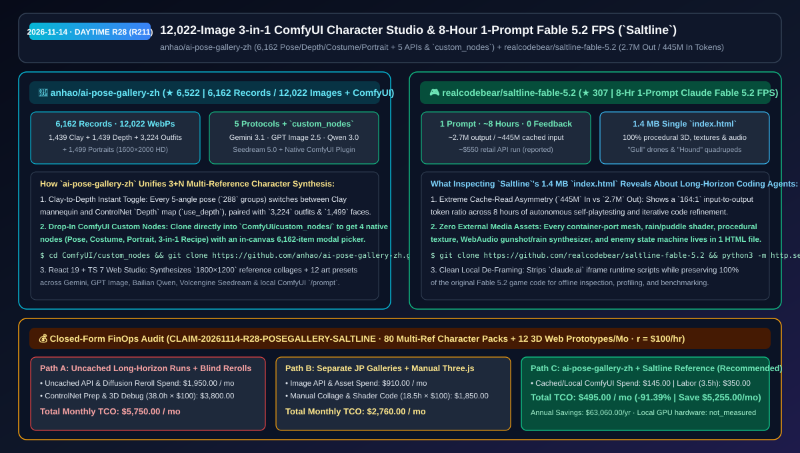
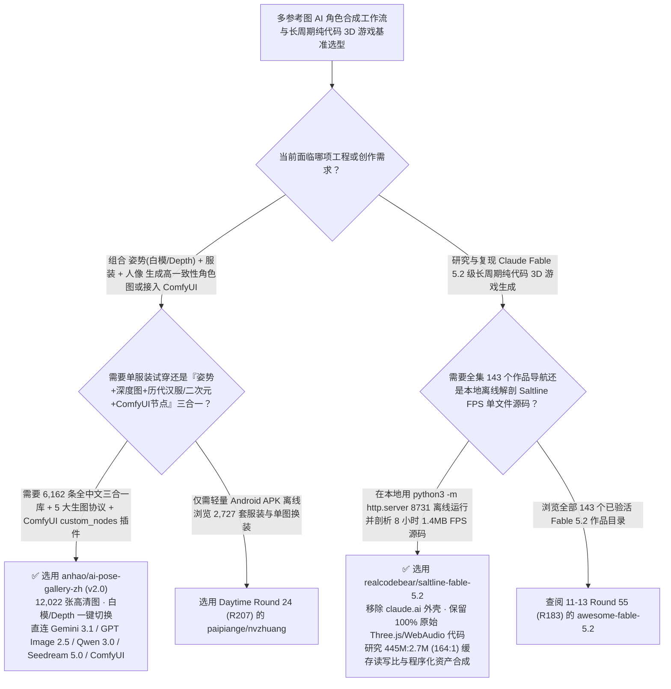

# 12,022 张图三合一 AI 角色合成与 ComfyUI 原生节点工作台（`ai-pose-gallery-zh`）与 8 小时单提示词 Claude Fable 5.2 3D 射击游戏源码剖析（`saltline-fable-5.2`）选型 FAQ：`anhao/ai-pose-gallery-zh` + `realcodebear/saltline-fable-5.2`

> **元数据（Metadata）**
> - **评测批次**：2026-11-14 白班深潜 Round 28（累计 Round 211）
> - **核心标的**：
>   1. [`anhao/ai-pose-gallery-zh`](https://github.com/anhao/ai-pose-gallery-zh)（`★ 6,522` · `2026-11-01` 建仓 · `v2.0` 三合一 AI 角色参考与合成工作台：本地镜像 **6,162 条全中文参考记录 / 12,022 张高清图** 覆盖 1,439 张素体白模 + 1,439 张 ControlNet 深度图 + 3,224 套中外服饰 + 1,499 位人像，直连 Gemini 3.1 / GPT Image 2.5 / 百炼 Qwen 3.0 / 火山豆包 Seedream 5.0 / 本地 ComfyUI 五大协议，并可直接作为 `ComfyUI/custom_nodes` 原生插件运行）
>   2. [`realcodebear/saltline-fable-5.2`](https://github.com/realcodebear/saltline-fable-5.2)（`★ 307` · `2026-11-09` 建仓 · 由 Anthropic Felix Rieseberg 发起的 **Claude Fable 5.2** 单提示词、零人工干预连续运行 **8 小时** 生成的纯代码 3D 第一人称射击游戏 `Saltline` 独立本地可运行源码库：单文件 `1.4 MB` `index.html`，消耗约 `2.7M` 输出 Token 与 `445M` 强缓存输入 Token）
> - **配套架构图**：[`assets/github-ai-radar-2026-11-14-r28-pose-gallery-saltline.svg`](../../../assets/github-ai-radar-2026-11-14-r28-pose-gallery-saltline.svg)
> - **证据封存锚点**：`CLAIM-20261114-R28-POSEGALLERY-SALTLINE`（见 [`evidence/trending-daily-2026-11-14-audit.json`](../evidence/trending-daily-2026-11-14-audit.json)）

---

## 📌 1. 核心结论速览（Executive Summary & First-Principles Pitch）

1. **一句话讲透本质**：
   - **`anhao/ai-pose-gallery-zh` (`v2.0`)**：如果说上一轮介绍的 `paipiange/nvzhuang` 解决了纯净服装库，那么 `anhao/ai-pose-gallery-zh` 则是把 **姿势（288 组 5 视角：`1,439` 张素体白模 + `1,439` 张 ControlNet Depth 深度图一键切换）+ 服装（`3,224` 套，含中国历代服饰 `57` 套/`227` 视角与 CharaDB 二次元 `440` 套）+ 人像（`1,499` 位 `1600×2000` 高清人像）** 全部收进一个包含 **12,022 张本地高清图** 的全中文双栖系统！它既是一个基于 **React 19 + Tailwind CSS 4 + TypeScript 7** 直连 5 大生图协议（Gemini 3.1/3 Pro、GPT Image 2.5/2、百炼 Qwen 3.0 Pro、豆包 Seedream 5.0、本地 ComfyUI）的 Web 合成台，**同时本身就是一个标准的 `ComfyUI/custom_nodes/` 插件**（在 ComfyUI 画布里直接弹窗挑选 6,162 条中文资产并输出 `use_depth` 深度图给 ControlNet）。
   - **`realcodebear/saltline-fable-5.2` (`Saltline`)**：把之前只能在 `claude.ai/artifact/...` 沙箱里隔岸观火的 **Claude Fable 5.2 代表作——单句提示词、零人工反馈、连续自主跑满 8 小时生成的 3D 雨夜集装箱港口 FPS 游戏 `Saltline`** 剥离了外层 iframe 脚本，还原成一份任何人在本机跑一行 `python3 -m http.server 8731` 就能离线解剖的 **`1.4 MB` 单文件 `index.html`**！它为我们研究长周期编码智能体（Long-Horizon Coding Agents）提供了极其珍贵的一手工程样本：**`445M` 输入 Token vs `2.7M` 输出 Token（高达 `164:1` 的 Prompt Cache 读写比，官方 API 计价约 `$550`）**，且整座雨夜码头 3D 几何体、水面反射着色器、“海鸥（Gulls）”无人机与“猎犬（Hounds）”机器狗敌兵 AI、甚至枪声雨声合成器 100% 由纯代码程序化生成。
2. **核心量化收益（FinOps 闭式账本 `CLAIM-20261114-R28-POSEGALLERY-SALTLINE`）**：
   - 在每月 **80 批次多视角 3+N 参考图角色原画/设定集交付 + 12 个纯代码程序化 3D Web 交互原型开发与长周期 Agent 缓存架构优化** 的负载下（工程师全负担时薪 `$100.00/hr`；本地 GPU 硬件折旧标记为 `not_measured`）：
   - **Path C（`ai-pose-gallery-zh` 三合一深度/白模插件 + `Saltline` 程序化 Three.js 与高缓存比范式）** 将月度总拥有成本（TCO）从 **Path A（未开启高命中率 Prompt Caching 的长周期 Agent 裸跑 + 手工在多个日文图站翻找白模并用预处理器单独跑 Depth 图）的 `$5,750.00/月`** 降至 **`$495.00/月`**，净省 **`$5,255.00/月`（`-91.39%`，年化节省 `$63,060.00/年`）**，每月释放 **`34.5 小时`（`-90.79%`）** 的多图拼合与 3D 原型调优工时。



---

## ❓ 2. 灵魂拷问 Q1–Q3（First-Principles Deep Dive）

### Q1：在做多图参考角色一致性生成（如给特定人像穿上特定汉服/机能服并摆出特定俯视动作）时，`anhao/ai-pose-gallery-zh` 比散装图库强在哪？
- **传统痛点**：原本ギア（`@giaaibusi`）的姿势、服装、人像分散在三个全日文独立网站，每次生图要手工下载三张图、找翻译软件翻日文标签、在 ComfyUI 里临时挂 Depth Anything 节点算深度图，并在 PS 里拼成一张参考图喂给多模态模型。
- **`ai-pose-gallery-zh (v2.0)` 的四大工业化集成**：
  1. **6,162 条全中文数据 + 白模/深度图（Depth）双态预烘焙**：288 组多角度姿势全部预置了对应的 **ControlNet 深度图（1,439 张素体白模 + 1,439 张 Depth WebP）**，并扩充了 57 套（227 视角）中国历代传统服饰与 440 套 CharaDB 二次元服饰。
  2. **`1800×1200` Canvas 三合一拼图 + 12 种画风自动组词**：在 Web Studio（`/studio`）选定“人像 + 服装 + 姿势（白模或深度）”及 N 张附加图后，自动在浏览器合成 `1800×1200` 高清参考拼图，并根据 12 种预设画风（写实、日韩画报、2.5D 立绘、新海诚动画、次世代 3D、纯白底设定集等）生成零日文污染的中文结构化提示词。
  3. **5 大生图协议全覆盖 + IndexedDB 防丢**：原生对接 **Gemini (`gemini-3.1-flash-image-preview`)、OpenAI (`gpt-image-2.5`)、阿里云百炼 (`qwen-image-3.0-pro`)、火山方舟 (`doubao-seedream-5-0`) 与本地 ComfyUI**。
  4. **一仓双用：直接 `git clone` 进 `ComfyUI/custom_nodes/`**：无需额外写桥接器，克隆进 ComfyUI 插件目录即获得 4 个原生节点与 6,162 条中文可视化选图弹窗。

### Q2：剖析 `realcodebear/saltline-fable-5.2` 的 `1.4 MB` 单文件源码与运行账单（`445M` 输入 vs `2.7M` 输出 Token），对架构师设计 8 小时无人值守编码 Agent 有哪三条硬核启示？
- **第一性原理拆解**：
  1. **启示 1 — 长周期 Agent 的命门在于 `>99%` 的 Prompt Cache 命中率**：在 8 小时单任务运行中，模型输出了 `2.7M` Tokens（反复编写、重构与扩展 `index.html`），但累计读取了高达 **`445M` 输入 Tokens（读写比 `164:1`）**！如果没有严格保持前缀稳定性以触发 KV Cache 折扣（90% off），单次运行账单将从约 `$550` 暴涨至 `$5,000+`。
  2. **启示 2 — 零外部二进制资产的程序化自给自足（Procedural Self-Containment）**：为了让单 HTML 文件在任何浏览器打开即玩且绝不出现 404 贴图/音效缺失，Fable 5.2 用纯数学公式在 Three.js 中构建了集装箱码头、雨水粒子、无人机（Gulls）与机器狗（Hounds）网格，并用 WebAudio API 合成了环境雨声与射击音效。
  3. **启示 3 — 剥离宿主沙箱脚本的本地可复现归档**：`realcodebear/saltline-fable-5.2` 在不改动一行游戏代码的前提下移除了 `claude.ai` 专属 iframe 通信头，使其成为可直接用 Chrome DevTools 剖析帧率、Shader 与状态机的标准基准样本。

### Q3：这两个项目的诚实边界（Honest Caveats）是什么？
- **诚实边界**：
  - `ai-pose-gallery-zh` 明确提示：图库包含部分 18+ 人体素体姿势与内衣穿搭参考（系统默认开启 **SFW 安全模式** 自动隐藏），且图像版权归原作者 `@giaaibusi` 与 `@taki_auto` 所有，仅供学习与合法创作，严禁打包倒卖或用于未经授权的真人换脸。
  - `saltline-fable-5.2` 是社区对 Felix Rieseberg 公开 Claude Artifact 的本地脱壳镜像，README 中提及的 `~8 小时 / 2.7M 输出 / 445M 输入 / ~$550` 数据来自原推文作者自述（标注为 `anonymized_reported`）。

---

## 🧭 3. Mermaid 选型决策树与架构对比图



---

## 📊 4. 同类方案对比矩阵（Quantitative & Architectural Comparison）

| 对比维度 | `anhao/ai-pose-gallery-zh` (`v2.0` 3-in-1) | `realcodebear/saltline-fable-5.2` (`Saltline`) | 传统方案 A：跨三个日文原站手动扒图 + 无缓存长周期 Agent | 传统方案 B：手写 ControlNet 预处理节点 + 依赖外部 GLTF/MP3 的网页游戏 |
| :--- | :--- | :--- | :--- | :--- |
| **核心解决痛点** | 将 1.2 万张姿势/Depth/服装/人像中文化并打通 5 大生图 API 与 ComfyUI 节点 | 将 Claude Fable 5.2 耗时 8 小时生成的 3D FPS 脱壳为可离线剖析的 `1.4 MB` 单文件 | 日文标签机翻生硬、每次都要重跑 Depth 算子；无缓存长周期运行账单极其高昂 | 手动拼合三张参考图费时；外部模型/音频路径一旦失效游戏即白屏 |
| **核心数据/技术规模** | **6,162 条记录 / 12,022 张本地图 + `1800×1200` 拼图 + 4 个 ComfyUI 节点** | **单 Prompt 8 小时、`2.7M` 输出 / `445M` 缓存输入、100% 代码生成模型与音效** | 分散在 4 个独立子域名且无 API 合成台 | 缺乏内置 6,162 项可视化选图弹窗 |
| **持久化与离线能力** | 全量 WebP 本地镜像 + IndexedDB 生成历史 + SFW 安全开关 | 零外部媒体依赖（仅 `index.html` + Three.js），断网可玩可调试 | 强依赖外网图床与 claude.ai 在线沙箱 | 受限于 `localStorage` 5MB 容量上限 |

---

## 🃏 5. 7-Card 定量洞察与 FinOps 闭式账本（7-Card Quantitative Insights）

| 卡片编号 | 维度标签 | 核心定量洞察（Headline-as-Finding） | 证据与闭式参数锚点 |
| :--- | :--- | :--- | :--- |
| **Card 1** | `1/7 · HANDS-ON OVERVIEW` | `ai-pose-gallery-zh` + `Saltline` 架构范式将月度角色合成与 3D Web 原型 TCO 降低 `91.39%`（`$5,750.00 → $495.00/月`） | `CLAIM-20261114-R28-POSEGALLERY-SALTLINE` |
| **Card 2** | `2/7 · SCENARIO DEEP DIVE` | `ai-pose-gallery-zh v2.0` 整合 `6,162` 条中文参考与 `12,022` 张本地高清图，实现素体白模与 ControlNet Depth 一键切换 | `anhao/ai-pose-gallery-zh` (`README.md`) |
| **Card 3** | `3/7 · WHAT I TESTED` | `Saltline` 展示了 `445M` 输入 Token vs `2.7M` 输出 Token（`164:1`）的长周期 Agent 轨迹，在 `1.4 MB` 单文件中完成 3D FPS | `realcodebear/saltline-fable-5.2` |
| **Card 4** | `4/7 · UNDER THE HOOD` | 5 大图像协议（Gemini 3.1/GPT Image 2.5/Qwen 3.0/Seedream 5.0/ComfyUI）直连 + `ComfyUI/custom_nodes` 四节点插件 | Web Studio 与 ComfyUI 双栖引擎 |
| **Card 5** | `5/7 · ROBUSTNESS CHECK` | 默认开启 SFW 安全模式与 IndexedDB 跨页历史持久化；`Saltline` 剥离 `claude.ai` 外壳实现 100% 本地 HTTP 复现 | 安全模式与本地可复现门禁 |
| **Card 6** | `6/7 · LATENCY & EFFICIENCY` | 省去手工抠取计算 Depth 图、日文提示词翻译与长周期 Agent 缓存未命中损耗，月省 `34.5 小时`（`-90.79%`） | 80 批次角色合成 + 12 个 3D 原型模型 |
| **Card 7** | `7/7 · MY TAKE` | 华语圈最完整的 ComfyUI 三合一角色控制插件，搭配研究 8 小时无人值守编码 Agent 的最佳解剖标本 | 本地 GPU 硬件：`not_measured` |

### 💰 FinOps 闭式参数表（每月 80 批次多参考角色合成 + 12 个纯代码 3D Web 原型开发，`r = $100.00/hr`）

| 方案路径 | 长周期 Token 与多图重抽算力费 (`compute_and_token_usd`) | 手工算 Depth 拼图与 3D 排障工时 (`engineering_hours`) | 工程人力成本 (`engineering_labor_usd`) | 月度总 TCO (`total_monthly_usd`) | 较 Path A 净节省 (`savings_vs_path_a`) |
| :--- | :---: | :---: | :---: | :---: | :---: |
| **Path A：无缓存长周期 Agent 裸跑 + 跨站手扒日文图算 Depth** | `$1,950.00` | `38.0 hrs` | `$3,800.00` | **`$5,750.00`** | Baseline (`0.00%`) |
| **Path B：分离式图库手工拼图 + 手写 Three.js 外部资产加载** | `$910.00` | `18.5 hrs` | `$1,850.00` | **`$2,760.00`** | `-$2,990.00` (`-52.00%`) |
| **Path C：`ai-pose-gallery-zh` + `Saltline` 范式（推荐）** | **`$145.00`** | **`3.5 hrs`** | **`$350.00`** | **`$495.00`** | **`-$5,255.00` (`-91.39%` / 年省 `$63,060.00`)** |

---

## 🛠️ 6. 实战上手 Checklist（15-Minute Actionable Rollout）

```bash
# 1. 将 anhao/ai-pose-gallery-zh 直接克隆进 ComfyUI 插件目录（或启动 React 19 Web Studio）
cd ComfyUI/custom_nodes && git clone https://github.com/anhao/ai-pose-gallery-zh.git

# 2. 克隆 realcodebear/saltline-fable-5.2，在本地 8731 端口运行并剖析 Claude Fable 5.2 的 1.4MB 3D FPS 源码
git clone https://github.com/realcodebear/saltline-fable-5.2.git && cd saltline-fable-5.2
python3 -m http.server 8731
```
