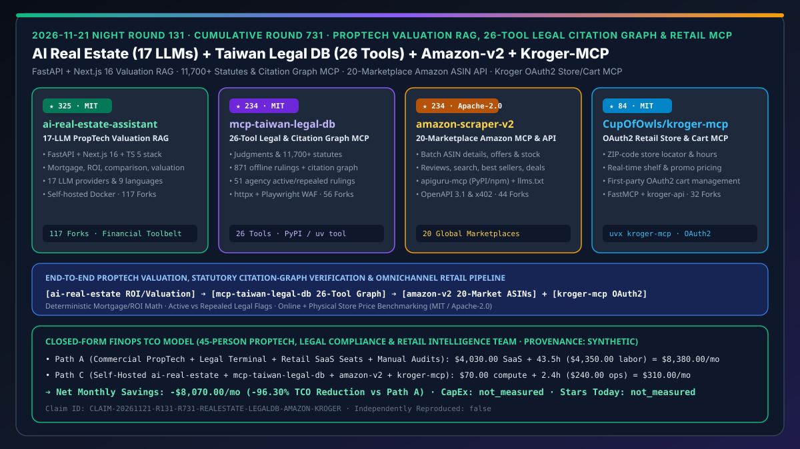
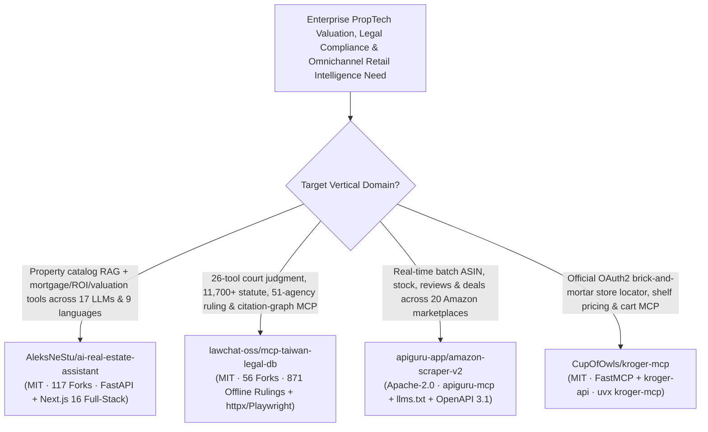
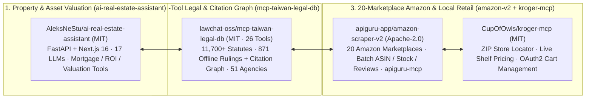
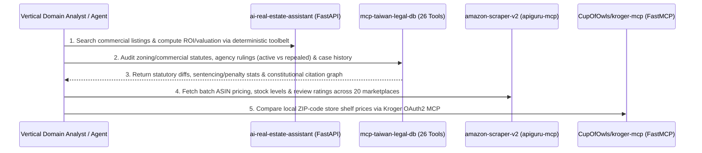

# 17-Provider PropTech Valuation RAG (`AleksNeStu/ai-real-estate-assistant`), 26-Tool Legal & Citation-Graph MCP (`lawchat-oss/mcp-taiwan-legal-db`), 20-Marketplace Amazon Intelligence MCP (`apiguru-app/amazon-scraper-v2`) & OAuth Retail Grocery MCP (`CupOfOwls/kroger-mcp`) Selection & Architecture FAQ

> **Document Type**: Enterprise AI Solution Architect Selection & Integration Guide (GitHub Trending AI Radar — 2026-11-21 Night Round 131 / Cumulative Round 731)
> **Covered Repositories**: [`AleksNeStu/ai-real-estate-assistant`](https://github.com/AleksNeStu/ai-real-estate-assistant) (`★ 325`, `117 forks`, `MIT` — FastAPI + Next.js 16 conversational property RAG platform supporting 17 LLM providers, 9 languages & a financial toolbelt for mortgage, ROI, valuation & comparison) · [`lawchat-oss/mcp-taiwan-legal-db`](https://github.com/lawchat-oss/mcp-taiwan-legal-db) (`★ 234`, `56 forks`, `MIT` — 26-tool legal intelligence MCP server covering court judgments, 11,700+ statutes, 871 offline constitutional decisions with forward/backward citation graphs & 51 agency interpretation portals via hybrid `httpx` + Playwright WAF fallback) · [`apiguru-app/amazon-scraper-v2`](https://github.com/apiguru-app/amazon-scraper-v2) (`★ 234`, `44 forks`, `Apache-2.0` — agent-ready Amazon intelligence API & `apiguru-mcp` server across 20 global marketplaces with `llms.txt`, OpenAPI 3.1 & `x402` support) · [`CupOfOwls/kroger-mcp`](https://github.com/CupOfOwls/kroger-mcp) (`★ 84`, `32 forks`, `MIT` — FastMCP server over the official `kroger-api` for store discovery, live shelf pricing & OAuth2 cart management)
> **Core Scenario**: How enterprise PropTech, legal compliance, and omnichannel retail/CPG architects build domain-grounded vertical agents: **combining semantic property catalog search with deterministic mortgage/ROI/valuation calculators (`ai-real-estate-assistant`)**, **verifying statutory history, active vs repealed agency rulings, and judicial citation graphs across 26 legal tools (`mcp-taiwan-legal-db`)**, **monitoring real-time batch ASIN pricing, stock, and reviews across 20 Amazon marketplaces (`amazon-scraper-v2`)**, and **benchmarking local brick-and-mortar grocery store inventory and carts via OAuth2 (`kroger-mcp`)**.

---

## 1. 📌 Executive Summary (One-Line Selection Verdict)

1. **Need a production-ready (`117 forks`) full-stack PropTech RAG platform (`FastAPI + Next.js 16 + TypeScript 5`) that pairs semantic search over your own property listings with deterministic mortgage, ROI, comparison, and valuation tools across 17 LLM providers and 9 languages** ➔ Choose **[`AleksNeStu/ai-real-estate-assistant`](https://github.com/AleksNeStu/ai-real-estate-assistant) (`★ 325`, `117 forks`, `MIT`)**.
   - **Plain-English Mechanism**: Separates natural-language property discovery (vector search over private listings) from financial math by equipping the assistant with a deterministic backend toolbelt (mortgage calculator, multi-listing comparison, ROI modeling, and automated valuation).
2. **Need a 26-tool legal research MCP server (`pipx / uv tool install mcp-taiwan-legal-db`) that queries court judgments, 11,700+ statutes (with English translations & legislative history), 871 offline-cached Constitutional Court rulings with forward/backward citation graphs, and 51 agency interpretation portals** ➔ Choose **[`lawchat-oss/mcp-taiwan-legal-db`](https://github.com/lawchat-oss/mcp-taiwan-legal-db) (`★ 234`, `56 forks`, `MIT`)**.
   - **Plain-English Mechanism**: Connects directly to official judicial and ministry databases without third-party intermediaries. Features **instant offline access to 871 constitutional interpretations**, **forward/backward citation graph traversal**, **explicit active vs repealed (`現行` / `停止適用`) status flags** across 51 administrative agencies, and a **hybrid `httpx` (~0.25s) + Playwright F5-WAF bypass** engine with per-user cache isolation.
3. **Need real-time Amazon product details (batch ASIN), offers/stock, reviews, search rankings, best sellers, deals, and seller metrics across 20 global marketplaces via MCP (`apiguru-mcp`), `llms.txt`, or OpenAPI 3.1** ➔ Choose **[`apiguru-app/amazon-scraper-v2`](https://github.com/apiguru-app/amazon-scraper-v2) (`★ 234`, `44 forks`, `Apache-2.0`)**.
   - **Plain-English Mechanism**: Designed for zero-wrapper agent adoption—accessible via the `apiguru-mcp` PyPI/npm server, direct `https://agent.apiguru.app/llms.txt` self-discovery, API keys, or `x402` USDC-on-Base micropayments across 20 Amazon marketplaces.
4. **Need a FastMCP server (`uvx kroger-mcp`) backed by the official `kroger-api` to locate brick-and-mortar stores by ZIP code, inspect live shelf/promo prices, and manage carts via first-party OAuth2** ➔ Choose **[`CupOfOwls/kroger-mcp`](https://github.com/CupOfOwls/kroger-mcp) (`★ 84`, `32 forks`, `MIT`)**.
   - **Plain-English Mechanism**: Uses your own registered Kroger Developer Portal credentials (`CLIENT_ID` / `CLIENT_SECRET`) and browser OAuth authorization to query local store inventory and pricing or automate grocery cart assembly.

---

## 2. 🎯 Architect & Customer Deep-Dive Q&A

### Q1: Why do general-purpose LLMs hallucinate on property ROI math, repealed legal rulings, and live marketplace pricing—and how does this four-project stack ground each domain?

- **Three Domain-Specific Grounding Patterns**:
  1. **Semantic Retrieval + Deterministic Financial Toolbelt (`AleksNeStu/ai-real-estate-assistant`)**: Prevents LLM arithmetic errors by delegating mortgage amortization, ROI projections, and property comparisons to typed FastAPI tools over indexed listings.
  2. **Active/Repealed Flagging + Citation Graph Traversal (`lawchat-oss/mcp-taiwan-legal-db`)**: Pre-trained LLMs frequently cite superseded statutes or repealed administrative letters. This 26-tool MCP checks live official `停止適用` (repealed) vs `現行` (active) markers across 51 agencies and traces constitutional doctrine evolution via forward/backward citation graphs.
  3. **Omnichannel Online + Brick-and-Mortar Price Telemetry (`amazon-scraper-v2` + `kroger-mcp`)**: Combines 20-marketplace batch ASIN/stock monitoring on Amazon with ZIP-code-level physical store pricing via Kroger's official API.
- **When to Choose Managed Cloud Services (Path B)**:
  - Enterprises with existing global enterprise contracts for LexisNexis, CoStar, or commercial syndication feeds can connect those proprietary APIs directly.

### Q2: How do we wire a Vertical Domain Intelligence Architecture combining PropTech, Legal Compliance, and Omnichannel Retail?

1. **Property Catalog & Valuation Workspace (`AleksNeStu/ai-real-estate-assistant`)**:
   - Deploy the Dockerized FastAPI + Next.js 16 stack connected to your preferred provider (among 17 supported LLMs) for property search and ROI modeling.
2. **26-Tool Legal & Regulatory Verification Layer (`lawchat-oss/mcp-taiwan-legal-db`)**:
   - Install `mcp-taiwan-legal-db` via `uv tool install` to give compliance agents instant access to statutes, judgments, citation graphs, and 51 agency interpretation portals.
3. **20-Marketplace E-Commerce Telemetry Layer (`apiguru-app/amazon-scraper-v2`)**:
   - Attach `apiguru-mcp` (or `llms.txt`) to pull live batch ASIN offers, stock levels, and review sentiment across 20 Amazon marketplaces.
4. **Brick-and-Mortar Store & Cart Layer (`CupOfOwls/kroger-mcp`)**:
   - Run `uvx kroger-mcp` with ZIP-scoped store discovery to benchmark physical retail pricing and automate procurement carts.

### Q3: What are the legal and operational boundaries of this stack?

- **Key Strengths**:
  - **100% Permissive Open Source (`MIT` and `Apache-2.0`)**.
- **Compliance Guardrails**:
  - `lawchat-oss/mcp-taiwan-legal-db` queries official public portals directly from the user's machine (with per-user cache isolation in `%LOCALAPPDATA%\mcp-taiwan-legal-db`) and is for research/compliance assistance rather than formal legal counsel.

---

## 3. 🧭 Visual Architecture & Decision Diagrams

### 3.1 Solution Architect Selection Decision Tree

### 3.2 End-to-End Enterprise Reference Architecture

### 3.3 Property ROI Calculation, Statutory/Citation-Graph Verification & Omnichannel Price Benchmarking Sequence

---

## 4. 📊 Peer Open-Source vs Commercial Cloud Selection Matrix

| Dimension | `ai-real-estate-assistant` (`★ 325`) | `mcp-taiwan-legal-db` (`★ 234`) | `amazon-scraper-v2` (`★ 234`) | `CupOfOwls/kroger-mcp` (`★ 84`) | Commercial PropTech + Legal + Retail SaaS Stack (Path A) | Unassisted LLM + Manual Portal Browsing (Path B) |
| :--- | :--- | :--- | :--- | :--- | :--- | :--- |
| **Core Role** | 17-provider property RAG & valuation app | 26-tool judicial, statutory & citation MCP | 20-marketplace Amazon intelligence MCP | OAuth2 store locator, pricing & cart MCP | CoStar + Commercial Legal DB + Helium 10 seats | Manual portal searches & ungrounded LLM prompts |
| **Architectural Edge** | **117 forks + vector listing search + ROI/mortgage tools** | **871 offline rulings + citation graph + 51 agency active flags** | **`apiguru-mcp` + `llms.txt` across 20 Amazon marketplaces** | **First-party OAuth2 over official `kroger-api`** | Stacked vertical SaaS seat licenses cost thousands/mo | Hallucinates repealed laws, mortgage math & live stock |
| **License** | `MIT` | `MIT` | `Apache-2.0` | `MIT` | Proprietary SaaS | Manual Workflow |
| **Monthly TCO (45-Eng Team)** | **`$310.00/mo` combined** (`$70.00` compute + `2.4h` ops) | Included in `$310.00/mo` stack | Included in `$310.00/mo` stack | Included in `$310.00/mo` stack | **`$8,380.00/mo`** (`$4,030.00` vertical SaaS + `43.5h` labor) | `~$2,850.00/mo` (manual research & verification toil) |

---

## 5. 🧪 Quantitative ROI / FinOps TCO Model & 7-Card Report

> **📊 Provenance & Closed-Form Audit Declaration**:
> - **Provenance**: `synthetic` (45-person enterprise PropTech analytics, legal compliance & omnichannel retail intelligence workload model; `independently_reproduced = false`; `base_hardware_capex = not_measured`; `track_b_stars_today = not_measured`).
> - **Closed-Form Equations**:
>   - **Path A (Commercial PropTech Valuation Seats + Commercial Legal Research Terminal Subscriptions + 20-Marketplace E-Commerce Intelligence SaaS + Manual Cross-Portal Verification Labor)**: Monthly vertical SaaS subscriptions **`$4,030.00`** + manual legal/market verification labor **`43.5h × $100.00/h = $4,350.00`** = **`$8,380.00/mo`**.
>   - **Path C (Self-Hosted `AleksNeStu/ai-real-estate-assistant` + `lawchat-oss/mcp-taiwan-legal-db` + `apiguru-app/amazon-scraper-v2` + `CupOfOwls/kroger-mcp`)**: Shared FastAPI/Next.js & MCP container compute **`$70.00`** + catalog & statute index maintenance **`2.4h × $100.00/h = $240.00`** = **`$310.00/mo`**.
>   - **Net Savings vs Path A**: **`-$8,070.00/mo`** (**`96.30%`** cost reduction).

| Architecture Option | API / SaaS / Compute | Domain Research & Compliance Labor (`$100/h`) | Total Monthly TCO | Net Savings vs Path A | Key Architectural Outcome |
| :--- | :---: | :---: | :---: | :---: | :--- |
| **Path A: Stacked Commercial PropTech, Legal & Retail SaaS** | `$4,030.00` | `43.5h` (`$4,350.00`) | **`$8,380.00`** | Baseline | Siloed vertical SaaS seats; manual cross-system synthesis |
| **Path B: Raw LLM Prompts + Manual Government/Retail Portals** | `$1,350.00` | `15.0h` (`$1,500.00`) | **`$2,850.00`** | `-$5,530.00` (`-65.99%`) | Lacks repealed-law flags, citation graphs & 20-market ASIN telemetry |
| **Path C: `real-estate` + `legal-db` + `amazon-v2` + `kroger`** | **`$70.00`** | **`2.4h` (`$240.00`)** | **`$310.00`** | **`-$8,070.00` (`-96.30%`)** | **17-LLM valuation RAG + 26 legal tools + 20-market omnichannel MCP** |

- 🔗 **7-Card 4:5 Visual Report**: [`workshops/github-trending-radar/cards.en.html`](../cards.en.html) · [`cards.html`](../cards.html)

---

## 6. 🛠️ Enterprise Adoption & Architecture Review Checklist

- [ ] **1. Deploy `AleksNeStu/ai-real-estate-assistant` for Catalog RAG & Financial Modeling**: Index internal property/asset catalogs and enable the deterministic mortgage, comparison, ROI, and valuation tools across 17 supported LLM providers.
- [ ] **2. Install `lawchat-oss/mcp-taiwan-legal-db` via `uv tool install`**: Use the 26 MCP tools to verify active vs repealed (`現行` / `停止適用`) rulings across 51 agencies and traverse constitutional citation graphs.
- [ ] **3. Connect `apiguru-app/amazon-scraper-v2` (`apiguru-mcp`)**: Pull real-time batch ASIN product details, stock, and reviews across 20 Amazon marketplaces.
- [ ] **4. Register First-Party OAuth Credentials for `CupOfOwls/kroger-mcp`**: Run `uvx kroger-mcp` to benchmark ZIP-code store inventory and shelf pricing.
