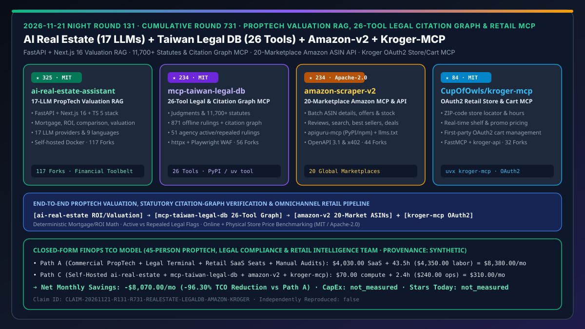
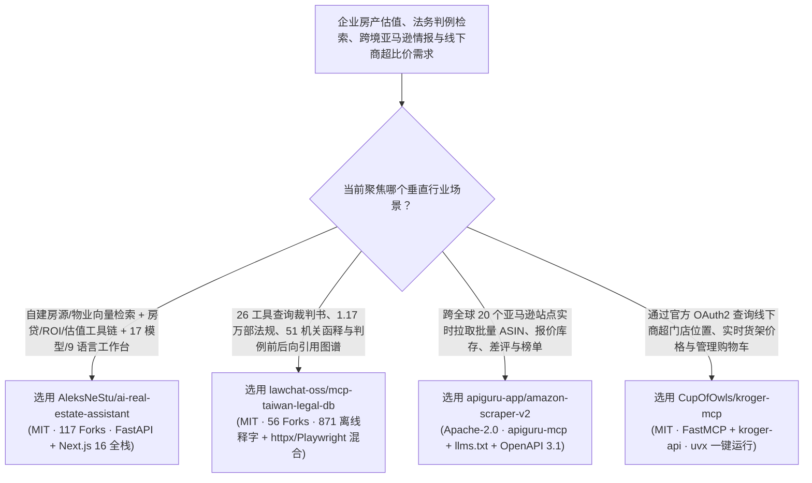
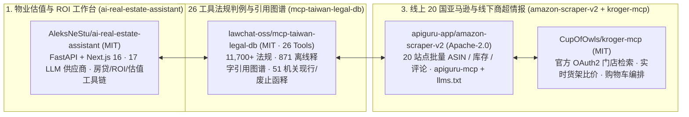
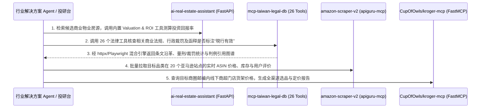

# 17 模型房产投研与估值 RAG 工作台（`AleksNeStu/ai-real-estate-assistant`）、26 工具判例/法规与引用图谱法律 MCP（`lawchat-oss/mcp-taiwan-legal-db`）、跨 20 国亚马逊实时情报 MCP（`apiguru-app/amazon-scraper-v2`）与商超门店/购物车 OAuth MCP（`CupOfOwls/kroger-mcp`）选型与集成架构 FAQ

> **文档类型**：企业 AI 解决方案架构师（AI Solution Architect）选型决策指南（GitHub Trending AI 雷达 2026-11-21 Night Round 131 / 累计第 731 轮）
> **覆盖项目**：[`AleksNeStu/ai-real-estate-assistant`](https://github.com/AleksNeStu/ai-real-estate-assistant)（`★ 325`、`117 forks`、`MIT`，基于 FastAPI + Next.js 16、支持 17 家大模型供应商与 9 种语言、内置房贷/ROI/估值/多房源对比工具链的房产智能顾问系统）· [`lawchat-oss/mcp-taiwan-legal-db`](https://github.com/lawchat-oss/mcp-taiwan-legal-db)（`★ 234`、`56 forks`、`MIT`，提供 **26 个 MCP 工具**、覆盖 11,700+ 法规、871 笔离线大法官解释与前后向引用关系图谱、51 个机关函释及 `httpx`+Playwright WAF 自动切换的法律检索服务）· [`apiguru-app/amazon-scraper-v2`](https://github.com/apiguru-app/amazon-scraper-v2)（`★ 234`、`44 forks`、`Apache-2.0`，支持 `apiguru-mcp`、`llms.txt` 与 `x402` 协议、跨全球 20 个亚马逊站点实时拉取批量 ASIN、库存报价、评论与卖家数据的电商情报接口）· [`CupOfOwls/kroger-mcp`](https://github.com/CupOfOwls/kroger-mcp)（`★ 84`、`32 forks`、`MIT`，基于官方 `kroger-api` 与 OAuth2 授权查询门店、实时货架价格并操作购物车的零售 FastMCP）
> **核心场景**：当商业地产投研、企业法务合规与跨境零售/快消（CPG）选品团队构建垂直行业智能体时，如何复用**“自建目录向量检索 + 按揭/ROI/估值金融工具箱（`ai-real-estate-assistant`）”+“26 工具法规/判例检索与前后向引用图谱追溯（`mcp-taiwan-legal-db`）”+“全球 20 国亚马逊批量 ASIN 与库存评价监控（`amazon-scraper-v2`）”+“线下连锁商超门店库存与 OAuth 购物车直连（`kroger-mcp`）”**四大行业样板？

---

## 一、📌 核心结论速览（选型一句话结论）

1. **想快速搭建一套面向房地产经纪、商业选址或资产管理团队的开源全栈 AI 顾问系统（支持自有房源库向量检索、17 家 LLM 供应商切换，并内置房贷计算、ROI 测算、自动估值与多房源横向对比工具）** ➔ 选 **[`AleksNeStu/ai-real-estate-assistant`](https://github.com/AleksNeStu/ai-real-estate-assistant)（`★ 325`，`117 forks`，`MIT`）**。
   - **通俗原理**：高达 `117 forks` 的垂直行业 RAG 全栈样板（Python 3.12 FastAPI 后端 + Next.js 16 / TypeScript 5 前端，支持 9 种语言）。它示范了如何把“语义房源检索”与“确定性金融计算工具链（Mortgage / Comparison / ROI / Valuation）”结合在同一个对话工作台内。
2. **想让法务与合规 Agent 直接通过 26 个结构化工具检索裁判书全文、11,700+ 部法规（含英译与修法历程）、51 个行政机关函释（自动标注“停止适用”与“現行”）、量刑统计，并做判例前后向引用关系图谱（Citation Graph）追溯** ➔ 选 **[`lawchat-oss/mcp-taiwan-legal-db`](https://github.com/lawchat-oss/mcp-taiwan-legal-db)（`★ 234`，`56 forks`，`MIT`）**。
   - **通俗原理**：法律垂直领域工程完成度极高的 MCP Server（`uv tool install mcp-taiwan-legal-db`）。其三大架构亮点极具借鉴意义：① **离线+在线混合架构**（871 笔大法官解释与理由书全文内置本地即时回传，裁判书与 51 个部会函释实时直连官方源）；② **前后向引用图谱抽取**（自动追踪某项判例引用了哪些前案、又被哪些后案引用）；③ **智能 WAF 降级策略**（默认用 `httpx` ~0.25s 极速直连，遇到 F5 WAF JS 挑战时自动无感切换 Playwright 获取 Cookie 后继续）。
3. **想让电商选品与竞品分析 Agent 跨全球 20 个亚马逊站点实时拉取批量 ASIN 详情、BuyBox 报价与库存、用户差评、Best Sellers 榜单与卖家信息（同时支持 `apiguru-mcp`、`llms.txt` 自发现与 `x402` 微支付）** ➔ 选 **[`apiguru-app/amazon-scraper-v2`](https://github.com/apiguru-app/amazon-scraper-v2)（`★ 234`，`44 forks`，`Apache-2.0`）**。
   - **通俗原理**：专为 AI Agent 设计的下一代 API 接口范式——支持 PyPI/npm 上的 `apiguru-mcp`、OpenAPI 3.1，或者直接在 Claude Code / Cursor 中粘贴一句读取 `https://agent.apiguru.app/llms.txt` 即可自动理解并调用跨 20 国亚马逊实时数据（含每日免 Key 试用额度）。
4. **想在北美快消零售（CPG）比价、生鲜采购自动化场景中，通过官方 OAuth2 接口查询线下商超（Kroger）周边门店、实时商品促销价并自动加购到购物车** ➔ 选 **[`CupOfOwls/kroger-mcp`](https://github.com/CupOfOwls/kroger-mcp)（`★ 84`，`32 forks`，`MIT`）**。
   - **通俗原理**：基于 `FastMCP` 与 `kroger-api` 构建（`uvx kroger-mcp`）。用户在自己注册的 Kroger Developer App 下完成首次浏览器 OAuth 授权后，Agent 即可按邮编（ZIP Code）检索门店、对比商超货架价格并管理购物车。

---

## 二、🎯 客户与架构师灵魂拷问 Q&A（深度架构拆解）

### Q1：为什么通用大模型直接回答“房产投资回报率”、“某条行政法规是否现行有效”或“某款商品在 20 国站点的实时库存”时必然产生严重幻觉？这四个项目提供了怎样的行业级架构解法？

- **三大垂直行业防幻觉工程模式**：
  1. **房源检索 + 确定性金融算子解耦（`AleksNeStu/ai-real-estate-assistant`）**：不让 LLM 口算月供和净现值，而是用向量库召回真实房源参数后，交由后端的 Mortgage / ROI / Valuation 确定性工具计算。
  2. **法规“停止适用”标记 + 引用图谱 + WAF 弹性抓取（`lawchat-oss/mcp-taiwan-legal-db`）**：大模型训练语料常把已废止的旧法当成现行法。该 MCP 实时核对 51 个官方函释源的“停止适用/現行”标签，并通过引用图谱追溯法理演变。
  3. **线上 20 国亚马逊 + 线下连锁商超实时价格双源对标（`amazon-scraper-v2` + `kroger-mcp`）**：通过 `apiguru-mcp` 批量拉取 20 国亚马逊 ASIN 实时售价，结合 `kroger-mcp` 获取线下商超按邮编定位的实时货架价，实现全渠道（Omnichannel）价格情报监控。
- **何时直接用云厂商托管方案（Path B）？**
  - 若企业已采购昂贵的 LexisNexis / Westlaw 法律商业终端或 Jungle Scout 企业版，直接调用其商业 API 即可。

### Q2：典型企业级“垂直行业资产估值、法务合规审查与全渠道零售情报工作台”架构怎么搭？

1. **商业地产选址与投资估值层（`AleksNeStu/ai-real-estate-assistant`）**：
   - 使用 FastAPI + Next.js 16 部署私有房源/门店物业 RAG 库，通过 17 家可选模型与内置 ROI/估值工具评估商业物业回报。
2. **法务合规与行政处罚/判例核查层（`lawchat-oss/mcp-taiwan-legal-db`）**：
   - 挂载 26 个法律 MCP 工具，对合同条款、公平会处分、劳动裁决、专利商标审查基准及修法理由进行零幻觉核验。
3. **跨 20 国线上电商情报层（`apiguru-app/amazon-scraper-v2`）**：
   - 通过 `apiguru-mcp` 或 `llms.txt` 实时监控全球 20 个亚马逊站点的批量 ASIN 价格、库存与用户评价。
4. **线下商超门店价格与采购层（`CupOfOwls/kroger-mcp`）**：
   - 通过 `uvx kroger-mcp` 结合 OAuth2 授权查询目标邮编商圈的线下商超商品价格与库存。

### Q3：这套架构的合规边界是什么？

- **核心优势**：
  - **100% 宽松开源协议（`MIT` 与 `Apache-2.0`）**，提供开箱即用的房产、法律与全渠道零售 MCP/RAG 架构范式。
- **合规注意事项**：
  - `lawchat-oss/mcp-taiwan-legal-db` 明确声明其检索结果仅供法学研究与合规参考，不构成正式法律意见，且在多用户 Windows/Linux 服务器部署时自动将缓存与 WAF Cookie 隔离在各用户独立目录（`%LOCALAPPDATA%\mcp-taiwan-legal-db`）。

---

## 三、🧭 直观可视化图解（Mermaid 决策树 + 集成架构 + 时序图）

### 3.1 架构师选型决策树

### 3.2 企业端到端生产集成参考架构图

### 3.3 商业物业 ROI 测算、法规/函释现行有效性核验与线上线下全渠道比价时序图

---

## 四、📊 同类开源与商业云服务横向选型决策矩阵

| 对比维度 | `ai-real-estate-assistant` (`★ 325`) | `mcp-taiwan-legal-db` (`★ 234`) | `amazon-scraper-v2` (`★ 234`) | `CupOfOwls/kroger-mcp` (`★ 84`) | 商业房产估值云 + 商业法学终端 + 商业选品 SaaS (Path A) | 通用大模型裸问 + 手工查网页 (Path B) |
| :--- | :--- | :--- | :--- | :--- | :--- | :--- |
| **核心能力定位** | 17 模型房产 RAG 与金融估值全栈平台 | 26 工具判例/法规/函释与引用图谱 MCP | 跨 20 国亚马逊实时 ASIN/库存/评论 MCP | 商超门店定位、价格与购物车 OAuth MCP | CoStar + 法源/LexisNexis + Helium 10 商业席位 | 人工刷政府法规网、电商前台与房产网 |
| **核心技术突破** | **117 Forks + 房源向量检索 + 按揭/ROI/估值工具链** | **871 离线释字 + 前后向引用图谱 + 51 机关现行/废止标记** | **`apiguru-mcp` + `llms.txt` 一句话接入 20 国站点** | **基于官方 `kroger-api` 个人/企业自建 App OAuth2** | 三类垂直商业 SaaS 叠加年费极高 | 通用模型常引用已废止旧法或编造虚假房价/库存 |
| **开源协议** | `MIT` | `MIT` | `Apache-2.0` | `MIT` | 闭源商业 SaaS | 人工操作 |
| **月度 TCO（45 人团队）** | **组合仅 `$310.00/月`**（`$70.00` 容器与向量算力 + `2.4h` 运维） | 同左（直连官方公开库零数据订阅费） | 同左（按需轻量调用） | 同左（官方免费开发者凭据） | **`$8,380.00/月`**（`$4,030.00` 垂直 SaaS 席位 + `43.5h` 人工） | 约 `$2,850.00/月`（大量人工检索与核对工时） |

---

## 五、🧪 应用落地定量收益/TCO 对比与 7-Card 报告

> **📊 数据来源与闭式核算声明（Provenance & Closed-Form Schema）**：
> - **provenance**: `synthetic`（基于 45 人企业商业地产投研、法务合规审查与跨境零售选品团队工作负载模型：`independently_reproduced = false`；硬件采购基线 `base_hardware_capex = not_measured`；Track B 单日增量 `track_b_stars_today = not_measured`）。
> - **核算公式**：
>   - **Path A（商业地产估值 SaaS 席位 + 商业法律数据库企业订阅 + 商业亚马逊 20 国选品软件席位 + 分析师手工核对法规废止状态、手工汇总跨国 ASIN 与线下商超价格）**：月度垂直商业 SaaS 订阅 **`$4,030.00`** + 跨源手工检索与核对人工 **`43.5h × $100.00/h = $4,350.00`** = **`$8,380.00/月`**。
>   - **Path C（自建 `AleksNeStu/ai-real-estate-assistant` + `lawchat-oss/mcp-taiwan-legal-db` + `apiguru-app/amazon-scraper-v2` + `CupOfOwls/kroger-mcp` 开源垂直行业栈）**：FastAPI/Next.js 容器与缓存算力 **`$70.00`** + 房源索引与法规代码表例行更新 **`2.4h × $100.00/h = $240.00`** = **`$310.00/月`**。
>   - **净节省（Net Savings vs Path A）**：**`-$8,070.00/月`**（成本降低 **`96.30%`**）。

| 评估方案 | API / SaaS / 算力成本 | 投研、法务与选品人工（`$100/h`） | 月度总 TCO | 相对 Path A 净节省 | 关键架构交付指标 |
| :--- | :---: | :---: | :---: | :---: | :--- |
| **Path A：商业地产 SaaS + 商业法学库 + 商业选品席位** | `$4,030.00` | `43.5h` (`$4,350.00`) | **`$8,380.00`** | Baseline | 垂直行业软件按席位收费高；跨系统数据难以在同一 Agent 内联动 |
| **Path B：通用大模型问答 + 人工网页核查** | `$1,350.00` | `15.0h` (`$1,500.00`) | **`$2,850.00`** | `-$5,530.00` (`-65.99%`) | 缺乏法规“停止适用”校验、判例引用图谱与 20 国 ASIN 实时库存 |
| **Path C：`real-estate` + `legal-db` + `amazon-v2` + `kroger`** | **`$70.00`** | **`2.4h` (`$240.00`)** | **`$310.00`** | **`-$8,070.00` (`-96.30%`)** | **17 模型房产估值 + 26 工具法律图谱 + 20 国亚马逊/商超直连** |

- 🔗 **关联 7-Card 4:5 视觉评测报告**：[`workshops/github-trending-radar/cards.html`](../cards.html) · [`cards.en.html`](../cards.en.html)

---

## 六、🛠️ 企业引入与架构评审 Checklist

- [ ] **1. 基于 `AleksNeStu/ai-real-estate-assistant` 构建资产检索与金融测算工作台**：将自有物业/资产目录导入语义索引，并启用内置的 Mortgage、ROI 与 Valuation 确定性计算工具。
- [ ] **2. 使用 `uv tool install mcp-taiwan-legal-db` 标准化法务合规检索**：利用 26 个 MCP 工具核查 11,700+ 法规、51 个机关函释的“現行/停止適用”状态及判例前后向引用图谱。
- [ ] **3. 接入 `apiguru-app/amazon-scraper-v2` 监控跨 20 国电商动态**：通过 `apiguru-mcp` 或 `llms.txt` 批量采集全球 20 个亚马逊站点的实时 ASIN 报价、库存与评价。
- [ ] **4. 配置 `CupOfOwls/kroger-mcp` 实现线下零售商圈对标**：在 Kroger Developer Portal 注册自有 OAuth 应用，通过 `uvx kroger-mcp` 按邮编获取门店实时货架价格。
