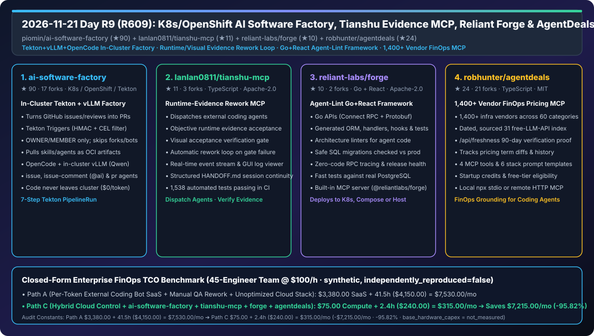
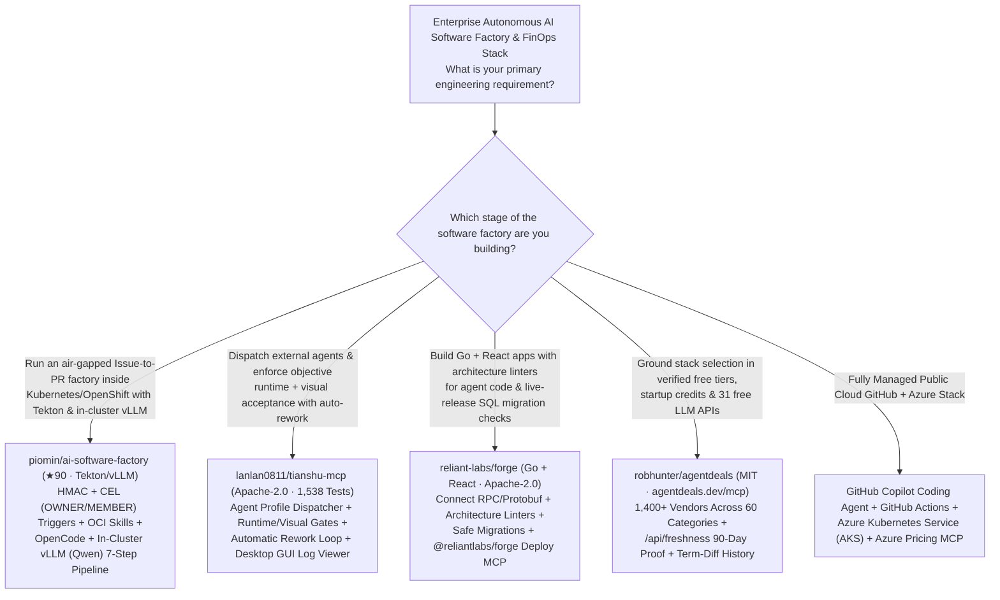
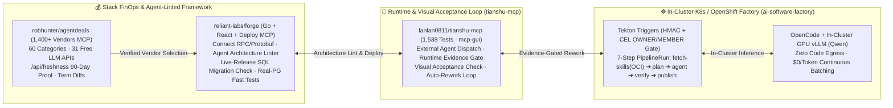

# Kubernetes/OpenShift In-Cluster AI Software Factory (`piomin/ai-software-factory`), Runtime-Evidence Rework Orchestrator MCP (`lanlan0811/tianshu-mcp`), Agent-Linted Go+React Framework (`reliant-labs/forge`) & 1,400+ Vendor FinOps Pricing MCP (`robhunter/agentdeals`) Selection & Architecture FAQ

> **Target Audience**: **AI Solution Architects (SAs) & Enterprise Platform / Cloud FinOps Leaders (2026-11-21 Day Round 9 · Cumulative Round 609)**  
> **Benchmark Style**: Strictly aligned with [`ib-vs-ethernet-roce-selection-faq.md`](https://github.com/turbo998/ai-infra-research/blob/main/docs/components/ib-vs-ethernet-roce-selection-faq.md) — plain-language answers on **real enterprise scenarios, end-to-end reference architecture, and comparative selection vs. competing OSS and cloud PaaS**.  
> **Chinese Edition**: [`ai-software-factory-tianshu-mcp-forge-agentdeals-selection-faq.md`](./ai-software-factory-tianshu-mcp-forge-agentdeals-selection-faq.md) · **Daily Digest**: [`daily/2026-11-21.en.md`](../daily/2026-11-21.en.md)



---

## 1. 📌 Executive Summary (30-Second Selection Verdict)

1. **Why Evaluate These Four Repositories Together?**  
   Building an autonomous enterprise **AI Software Factory**—from stack selection and code generation to runtime acceptance testing and in-cluster pull-request delivery—requires solving **four production engineering gaps**:
   - **Gap 1 — Coding Agents Choosing Outdated Cloud Tiers & Missing Free LLM/Database Credits**: LLMs rely on stale training cutoffs when recommending hosting, database, or AI API vendors → **`robhunter/agentdeals` (`★ 24`, `21 forks`, TypeScript, MIT)** indexes **1,400+ developer infrastructure vendors across 60 categories** (plus a dated, sourced index of **31 free-tier LLM APIs** and `/api/freshness` 90-day verification counts), exposing **4 MCP tools and 6 prompt templates** (`agentdeals.dev/mcp`) so coding agents choose stacks backed by verified pricing and term-change histories.
   - **Gap 2 — AI-Generated Full-Stack Code Breaking Architecture Boundaries & Live Database Schemas**: Unconstrained coding agents invent inconsistent REST routes, skip RPC tracing, and write destructive SQL migrations → **`reliant-labs/forge` (`★ 10`, `2 forks`, Go + React, Apache-2.0)** provides an opinionated Go + React framework and deploy MCP (`@reliantlabs/forge`) with **Connect RPC + Protobuf, generated ORM/handlers/hooks/tests, architecture-aware linters specifically for agent-written code, SQL migrations checked against the running release before shipping**, and fast tests against real PostgreSQL.
   - **Gap 3 — Orchestrators Trusting Agent Self-Reports Instead of Runtime & Visual Evidence**: Most multi-agent runners stop as soon as the worker agent says "Done," leaving humans to debug broken builds and misaligned UIs → **`lanlan0811/tianshu-mcp` (`★ 11`, `3 forks`, TypeScript 5.7, Apache-2.0, `1,538` passing tests)** enforces *"Dispatch with agents, verify with evidence"*—dispatching external agents, gating completion on **objective runtime evidence and visual acceptance checks**, automatically triggering a **closed-loop rework cycle** when checks fail, and streaming live progress to a desktop GUI log viewer (`mcp-gui`).
   - **Gap 4 — Regulated Enterprises Prohibiting Code & Issues from Leaving Their Kubernetes / OpenShift Cluster**: Sending proprietary source code and issue threads to external SaaS coding bots violates air-gapped compliance and racks up per-token bills → **`piomin/ai-software-factory` (`★ 90`, `17 forks`, Tekton / OpenShift / vLLM, created `2026-11-18`)** runs a complete self-hosted software factory inside **Kubernetes / OpenShift**: Tekton Triggers (`github` HMAC interceptor + `cel` `OWNER`/`MEMBER` filter) launch 7-step `PipelineRun` pods (`print-event → fetch-skills [OCI artifact] → prepare → plan → agent [OpenCode + in-cluster vLLM Qwen] → verify → publish`) for `issue-agent`, `issue-comment-agent` (`@ai`), and `pr-comment-agent`—so **nothing ever leaves the cluster except GitHub API calls and marginal token cost is `$0`**!

2. **One-Sentence Selection Verdict**:
   - Choose **`piomin/ai-software-factory`** when you want **a 100% in-cluster Kubernetes/OpenShift Issue-to-PR software factory powered by Tekton Triggers, OCI skill artifacts, OpenCode, and shared GPU vLLM (`$0/token`)**.
   - Choose **`lanlan0811/tianshu-mcp`** when you need **an MCP orchestrator that verifies external agent work with objective runtime and visual acceptance evidence and loops automatically until rework passes**.
   - Choose **`reliant-labs/forge`** when you want **a Go (Connect RPC/Protobuf) + React framework with architecture linters for agent-written code, live-release migration checks, and a built-in deploy MCP server**.
   - Choose **`robhunter/agentdeals`** when you want **coding agents to query verified free tiers, startup credits, and pricing histories across 1,400+ infra vendors and 31 free LLM APIs over MCP** (or pair with **Azure Pricing MCP + Azure Quota MCP** for enterprise Azure rate-card modeling).

---

## 2. 🎯 Customer & Solution Architect Q&A (Plain-Language Deep Dive)

### Q1: How does `piomin/ai-software-factory` turn GitHub Issues and PR reviews into verified Pull Requests without source code ever leaving your Kubernetes / OpenShift cluster?
- **Plain-Language Answer**:
  - Cloud-hosted coding bots require sending repository contents to third-party endpoints and paying per token.
  - **How `piomin/ai-software-factory` runs everything inside your cluster**:
    1. **Hardened Tekton Triggers (`HMAC` + `CEL` Interceptors)**: An OpenShift Route feeds a Tekton `EventListener` that verifies the GitHub HMAC signature and enforces a CEL policy accepting events **only from `OWNER` or `MEMBER` users** while ignoring bots, forks, and closed items.
    2. **Three Autonomous Pipelines (`issue-agent`, `issue-comment-agent`, `pr-comment-agent`)**: Opening an issue posts a checklist plan, implements the code on a branch, opens a PR, and enables auto-merge; commenting `@ai` on an issue or leaving a PR review comment triggers targeted follow-up commits.
    3. **OCI Skill Artifacts + Shared vLLM GPU Serving**: Pulls agent skills as versioned OCI artifacts (`fetch-skills`) and runs **OpenCode** against an in-cluster **vLLM** deployment (e.g., Qwen) with continuous batching—keeping 100% of code and prompts on-cluster at `$0` per-token marginal cost.

### Q2: How do `lanlan0811/tianshu-mcp` and `reliant-labs/forge` prevent AI agents from shipping broken or architecturally drifted code?
- **Plain-Language Answer**:
  - **Layer 1 — `reliant-labs/forge` enforces architectural invariants at the framework and migration level**:
    - Combines Go (Connect RPC, Protobuf, generated ORM/handlers/hooks/tests) and React in a single application model where **architecture linters** check layer boundaries (not just syntax), **database migrations are validated against the currently running production release before shipping**, every RPC is traced without boilerplate, and `@reliantlabs/forge mcp` handles deployment.
  - **Layer 2 — `lanlan0811/tianshu-mcp` enforces runtime and visual acceptance with automatic rework (`1,538` tests)**:
    - Rather than trusting an agent's text claim that a task is finished, `tianshu-mcp` evaluates configured **runtime acceptance gates** (`docs/acceptance-config.md`) and **visual acceptance checks** (`docs/visual-acceptance.md`). If any gate fails, it automatically feeds the objective failure evidence back to the external agent for rework while streaming events to `mcp-gui` and generating structured `HANDOFF.md` artifacts.

### Q3: Why should Solution Architects attach `robhunter/agentdeals` to coding agents during architecture planning and scaffolding?
- **Plain-Language Answer**:
  - Coding agents routinely hallucinate discontinued free tiers (such as old PlanetScale or Heroku plans) when scaffolding `docker-compose.yml` or cloud IaC files.
  - **How `robhunter/agentdeals` grounds FinOps decisions**:
    1. **1,400+ Vendors Across 60 Categories + 31 Sourced Free LLM APIs**: Covers databases, compute, storage, auth, observability, startup credit programs, and free LLM API tiers.
    2. **Measured 90-Day Freshness (`/api/freshness`) & Term-Change Diffs**: Every entry records the exact date and source URL last verified, and whenever a vendor changes its free tier or pricing terms, the catalogue records both the new terms and the terms they replaced.
    3. **Zero-Config MCP Integration**: Connects in seconds via `claude plugin install robhunter/agentdeals`, `npx -y agentdeals`, or remote HTTP (`https://agentdeals.dev/mcp`).

---

## 3. 🧭 Visual Architecture & Decision Diagrams (Mermaid)

### 3.1 Solution Architect Selection Decision Tree



### 3.2 End-to-End Enterprise Reference Architecture



### 3.3 End-to-End Execution Sequence Diagram

```mermaid
sequenceDiagram
    autonumber
    participant Maintainer as Repo OWNER/MEMBER (GitHub)
    participant Tekton as piomin/ai-software-factory (Tekton+vLLM)
    participant Deals as robhunter/agentdeals (FinOps Pricing MCP)
    participant Forge as reliant-labs/forge (Go+React + Arch Linter)
    participant Tianshu as lanlan0811/tianshu-mcp (Evidence Rework Gate)

    Maintainer->>Tekton: 1. Open GitHub Issue or comment @ai on PR
    Tekton->>Tekton: 2. Verify HMAC signature & CEL OWNER/MEMBER rule; pull OCI skill artifacts
    Tekton->>Deals: 3. Query agentdeals MCP for verified database/API free tiers & pricing diffs
    Deals-->>Tekton: 4. Return dated vendor comparisons & eligibility rules
    Tekton->>Forge: 5. OpenCode + in-cluster vLLM (Qwen) generates Connect RPC, ORM & React changes
    Forge->>Forge: 6. Run Architecture Linter, real-Postgres fast tests & live-release SQL migration check
    Tekton->>Tianshu: 7. Evaluate runtime evidence & visual acceptance gates via tianshu-mcp
    Tianshu-->>Tekton: 8. Loop rework automatically if any gate fails; on pass, open PR & enable auto-merge
```

---

## 4. 📊 Comparative Selection Matrix (OSS vs. Peer Projects vs. Cloud PaaS)

| Dimension | `piomin/ai-software-factory` | `lanlan0811/tianshu-mcp` | `reliant-labs/forge` | `robhunter/agentdeals` | Unmanaged Stack (External SaaS Bot + Ad-Hoc Framework + Manual QA) | Managed Cloud PaaS (GitHub Copilot Coding Agent + AKS + Azure Pricing MCP) |
| :--- | :--- | :--- | :--- | :--- | :--- | :--- |
| **Primary Role** | **In-Cluster K8s/OpenShift Tekton + vLLM Software Factory** | **Runtime & Visual Evidence Rework Orchestrator MCP** | **Agent-Linted Go+React Full-Stack Framework & Deploy MCP** | **1,400+ Vendor Free-Tier & Pricing Catalogue MCP** | External code egress, manual rework, and stale pricing guesses | Fully managed cloud coding agent and enterprise K8s |
| **Best-Fit Scenario** | Private K8s/OpenShift clusters turning GitHub issues into PRs with zero code egress | Automated multi-agent dispatch requiring objective runtime/visual acceptance | Building full-stack Go (Connect RPC) + React apps with AI coding agents | Grounding architecture & stack selection in verified pricing and free tiers | Small personal scripts with no compliance constraints | Global enterprises standardized on GitHub Enterprise & Azure |
| **Key Differentiator** | **Zero code egress** + CEL `OWNER`/`MEMBER` gate + OCI skills + vLLM `$0/token` | **Runtime + visual acceptance gates** + auto-rework loop + `mcp-gui` (`1,538` tests) | **Architecture linter for agent code** + live-release migration check + RPC tracing | **1,400+ vendors + 31 free LLM APIs** + `/api/freshness` 90-day proof | Zero initial setup, but high per-token fees and unverified PRs | Turnkey cloud runners, SLAs, and official Azure rate cards |
| **Integration Effort** | Medium (K8s/OpenShift + Tekton Triggers + GPU node) | Low (npm package + `mcp-gui` log viewer) | Low (`forge start` + `claude mcp add forge -- npx -y @reliantlabs/forge mcp`) | Very Low (`claude plugin install robhunter/agentdeals` or `agentdeals.dev/mcp`) | Low | Low (enterprise seat assignment) |
| **Ops Complexity** | Low–Medium (standard K8s Pods, Tekton `PipelineRun`s & OCI artifacts) | Very Low (Node `>=20` MCP server) | Low (build-once-promote to K8s, Compose, or host processes) | Very Low (hosted remote HTTP MCP or local `npx` stdio) | High (manual copy-paste rework on broken AI PRs) | Very Low (cloud provider managed) |
| **License** | Open Reference Architecture (Tekton/vLLM/OpenCode) | **Apache-2.0** (permissive commercial use) | **Apache-2.0** (permissive commercial use) | **MIT** (permissive commercial use) | Mixed | Commercial SLA Subscription |
| **Monthly TCO** | Reuses cluster GPUs at **`$0` per-token marginal cost** | **$0/mo** (open-source self-hosted) | **$0/mo** framework license | **$0/mo** (unlocks thousands in verified free tiers & credits) | **$3,520.00/mo** (manual QA rework & migration rollback labor) | **$7,530.00/mo** (per-token SaaS bot fees + QA rework + unoptimized cloud tiers for 45 engineers) |

---

## 5. 🧪 Quantitative ROI, FinOps TCO Model & 7-Card Benchmark Deck

> **🛡️ Provenance Declaration**:  
> - **Primary-Source Measured (`measured`)**: Repository stars/forks, licenses, `piomin/ai-software-factory` Tekton 7-step pipeline and HMAC/CEL interceptors, `lanlan0811/tianshu-mcp` `1,538` passing tests and runtime/visual acceptance gates, `reliant-labs/forge` 10 architectural pillars and `@reliantlabs/forge` MCP, and `robhunter/agentdeals` 1,400+ vendors / 60 categories / 31 free LLM API index are verified via `gh api`.  
> - **Synthetic Architect Workload Model (`synthetic` · `independently_reproduced=false`)**: The closed-form FinOps table below models a **45-engineer enterprise platform & full-stack engineering team** (`$100.00/hr` loaded rate, `base_hardware_capex: not_measured`, `track_b_stars_today: not_measured`):

| FinOps Cost & Quality Dimension | Path A: External Per-Token Coding Bot SaaS + Manual PR QA + Unoptimized Cloud Stack | Path B: DIY Webhook Scripts + Ad-Hoc Go/React Boilerplate + Manual Rework Prompting | Path C: Recommended Stack (`ai-software-factory` + `tianshu-mcp` + `forge` + `agentdeals`) | Path A ➔ Path C Net Monthly Savings |
| :--- | :---: | :---: | :---: | :---: |
| **Monthly Token Bills / Cloud Infra Overspend** | `$3,380.00 / mo` (per-token cloud bot bills + missed free tiers/credits) | `$420.00 / mo` | **`$75.00 / mo`** (in-cluster vLLM `$0/token` + `agentdeals` verified free tiers) | **`-$3,305.00 / mo` (`-97.78%`)** |
| **Monthly Manual PR Rework, Migration Fix & Pricing Labor** | `41.5 hrs / mo` (fixing unverified AI PRs & broken production SQL migrations) | `31.0 hrs / mo` (hand-writing RPC glue & manually relaying test failures to agents) | **`2.4 hrs / mo`** (`tianshu-mcp` auto-rework loop + `forge` architecture linter) | **`-39.1 hrs / mo` (`-94.22%`)** |
| **Monthly Engineering Labor Cost (`@ $100.00/h`)** | `$4,150.00 / mo` | `$3,100.00 / mo` | **`$240.00 / mo`** | **`-$3,910.00 / mo` (`-94.22%`)** |
| **Total Monthly TCO** | **`$7,530.00 / mo`** | **`$3,520.00 / mo`** | **`$315.00 / mo`** | **`-$7,215.00 / mo` (`-95.82%` · `$86,580.00/yr`)** |
| **Code Sovereignty, First-Time PR Pass Rate & Governance** | Code leaves cluster; no architecture-level linter | High PR rework rate; risky SQL migrations | **100% in-cluster code privacy + runtime/visual rework loop + architecture linter** | **End-to-end autonomous Issue-to-PR pipeline with zero code egress** |

- **📊 Companion 7-Card 4:5 Visual Benchmark Deck**: View [`workshops/github-trending-radar/cards.en.html`](../cards.en.html) (EN) and [`workshops/github-trending-radar/cards.html`](../cards.html) (ZH).

---

## 6. 🛠️ Enterprise Adoption & Architecture Review Checklist

- [ ] **1. Enforce HMAC & CEL `OWNER`/`MEMBER` Interceptors on Tekton Triggers (`piomin/ai-software-factory`)**: Deploy the Tekton `EventListener` with both the GitHub HMAC signature check and the CEL `author_association in ['OWNER', 'MEMBER']` filter active, package internal skills as OCI artifacts, and point `OpenCode` at your in-cluster `vLLM` endpoint.
- [ ] **2. Gate Agent Completion on Runtime & Visual Acceptance Evidence (`lanlan0811/tianshu-mcp`)**: Configure `docs/acceptance-config.md` and `docs/visual-acceptance.md` in `tianshu-mcp` so external coding agents automatically enter a rework loop until tests, endpoints, and visual checks pass, monitoring progress in `mcp-gui`.
- [ ] **3. Enable Architecture Linters & Live-Release Migration Checks (`reliant-labs/forge`)**: Standardize new AI-authored Go + React services on `forge` (Connect RPC + Protobuf), requiring its architecture linter and pre-ship live-release SQL migration check to pass before invoking `@reliantlabs/forge mcp` for deployment.
- [ ] **4. Ground Stack Selection in Dated Pricing Proofs (`robhunter/agentdeals`)**: Connect `https://agentdeals.dev/mcp` (or `npx -y agentdeals`) to your architecture and coding agents so every infrastructure or LLM API recommendation cites a verified entry from the 1,400+ vendor catalogue and 31-vendor free-LLM-API index.
