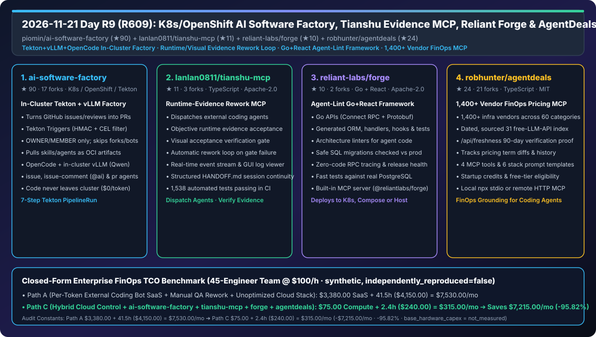
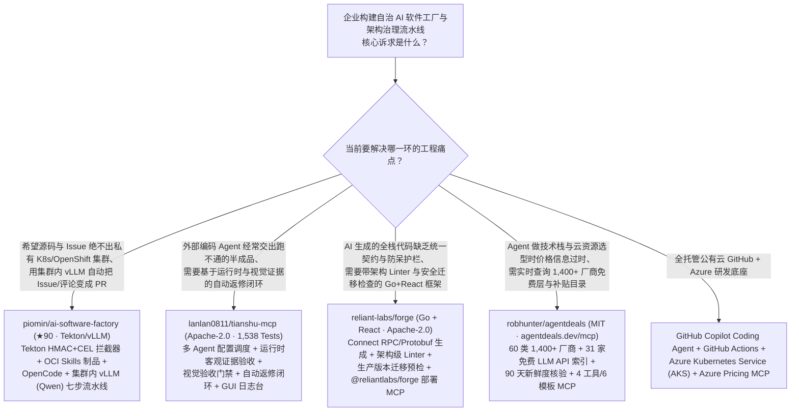
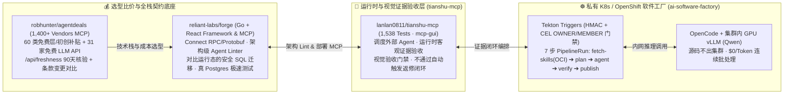
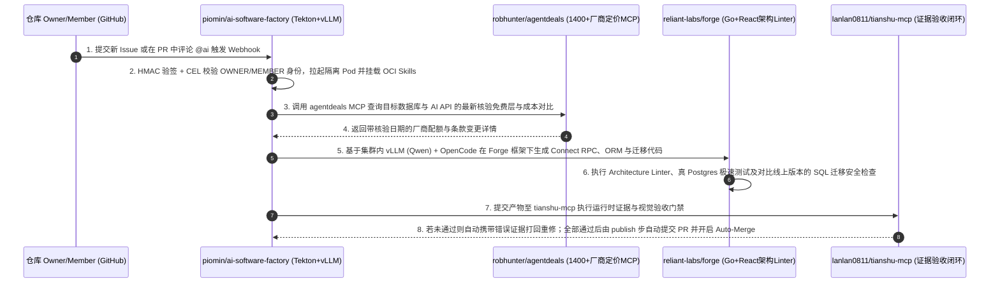

# Kubernetes/OpenShift 集群内 AI 软件工厂（`piomin/ai-software-factory`）、天枢运行时证据闭环验收 MCP（`lanlan0811/tianshu-mcp`）、自带架构 Linter 的 Go+React 智能体开发框架（`reliant-labs/forge`）与 1,400+ 云厂商免费层与定价选型 MCP（`robhunter/agentdeals`）应用场景、集成架构与同类方案选型比较 FAQ

> **文档定位**：面向企业客户与业务决策者的 **AI Solution Architect（解决方案架构师）实战选型指南（2026-11-21 Day Round 9 · 累计第 609 轮）**  
> **对标范式**：严格遵循 [`ib-vs-ethernet-roce-selection-faq.md`](https://github.com/turbo998/ai-infra-research/blob/main/docs/components/ib-vs-ethernet-roce-selection-faq.md) 通俗问答与决策矩阵风格——直接用大白话回答“**它是什么？帮企业解决什么业务痛点？怎么集成进现有生产架构？和同类开源及 Azure 云服务比怎么选？**”  
> **配套英文版**：[`ai-software-factory-tianshu-mcp-forge-agentdeals-selection-faq.en.md`](./ai-software-factory-tianshu-mcp-forge-agentdeals-selection-faq.en.md) · **今日日报**：[`daily/2026-11-21.md`](../daily/2026-11-21.md)

---

## 一、📌 核心结论速览（Executive Summary · 30 秒做出选型决定）

1. **为什么把这四个项目放在一起看？**  
   当企业想要搭建一条**“从 GitHub 提 Issue ➔ 自动做技术栈与成本选型 ➔ 按强架构规范生成全栈代码 ➔ 用真实运行时与视觉证据自动验收返修 ➔ 在私有 K8s 集群内零代码出域自动提 PR”**的端到端 AI 软件工厂时，这四个开源项目刚好拼成一条严丝合缝的工业流水线：
   - **第一环（云与 AI 基础设施选型缺实时真实价格与免费额度依据）**：让大模型凭预训练记忆推荐云数据库或 LLM API，它总会推荐早已涨价或取消免费层的过时方案 → **`robhunter/agentdeals`（`★ 24`，`21 forks`，TypeScript，MIT）** 索引了 **60 个类别、1,400+ 家开发者基础设施厂商**的免费层、初创补贴与定价数据（含附带核验日期与原网页链接的 **31 家免费 LLM API 清单**及 `/api/freshness` 90 天新鲜度证明），通过 **4 个 MCP 工具与 6 个提示词模板**让编码 Agent 在技术选型时基于最新真实价格做决策！
   - **第二环（AI 写出的全栈代码没有统一的 RPC 契约、迁移检查与架构级 Linter）**：Agent 在散装项目里随便乱建路由、写错 SQL 迁移，上线即崩 → **`reliant-labs/forge`（`★ 10`，`2 forks`，Go + React，Apache-2.0）** 是专为 AI 生成代码设计的全栈框架与部署 MCP（`@reliantlabs/forge`）：从第一次提交就内建 **Connect RPC + Protobuf、自动生成 ORM/Handler/Hooks/测试、针对正在运行版本做安全校验的数据库迁移、连真实 Postgres 依然飞快的测试层**，以及**懂架构规则（而非仅看语法）的 Agent 代码专用 Linter**！
   - **第三环（派活给外部 Agent 后缺乏基于真实运行时与视觉证据的客观验收与自动返修）**：传统编排器只看 Agent 返回的文字“已完成”，不看实际跑起来有没有报错或界面有没有歪 → **`lanlan0811/tianshu-mcp`（天枢编排 MCP，`★ 11`，`3 forks`，TypeScript 5.7，Apache-2.0，通过 `1,538` 项测试）** 践行“**把开发交给 AI-Agent，把验收交给运行时**”：统一调度外部编码 Agent，强制用**运行时客观证据（Runtime Evidence）与视觉验收（Visual Acceptance）**做门禁，验收不通过自动打回触发**返修闭环（Rework Loop）**，并自带桌面日志台 GUI（`mcp-gui`）。
   - **第四环（金融政企要求源码与 Issue 绝不出 Kubernetes/OpenShift 集群且零按 Token 账单）**：不能把核心源码发往公网商业大模型 API → **`piomin/ai-software-factory`（`★ 90`，`17 forks`，Tekton / OpenShift / vLLM，2026-11-18 新建爆发）** 在 Kubernetes / OpenShift 集群内部署完整的自托管软件工厂：通过 Tekton Triggers（带 HMAC 签名校验与仅限 `OWNER`/`MEMBER` 的 CEL 拦截器）接收 GitHub Webhook，从 OCI 制品库拉取 Skills，驱动 **OpenCode + 集群内 GPU 节点上的 vLLM（如 Qwen）** 跑完 `print-event -> fetch-skills -> prepare -> plan -> agent -> verify -> publish` 七步流水线，**代码与 Issue 全程不出集群，且边际 Token 成本为 `$0`**！

2. **一句话选型结论**：
   - 需要**在私有 Kubernetes / OpenShift 集群内用 Tekton + OpenCode + vLLM 构建源码零出域、按 Token 零费用的 Issue-to-PR 自动软件工厂** 👉 选 **`piomin/ai-software-factory`**。
   - 需要**调度外部 Agent 并强制用运行时客观证据 + 视觉验收驱动自动返修闭环的 MCP 编排器** 👉 选 **`lanlan0811/tianshu-mcp`**。
   - 需要**专为 AI 编码打造、内置 Connect RPC/Protobuf 代码生成、架构级 Linter 与生产迁移安全检查的 Go + React 全栈框架及部署 MCP** 👉 选 **`reliant-labs/forge`**。
   - 需要**让编码 Agent 通过 MCP 实时查询 1,400+ 云厂商与 31 家免费 LLM API 的最新核验价格、免费层与条款变更历史** 👉 选 **`robhunter/agentdeals`**（若专门查询微软云官方实时目录价与配额，可叠加 **Azure Pricing MCP + Azure Quota MCP**）。

---

## 二、🎯 客户与架构师灵魂拷问 Q&A（Plain-Language Deep Dive）

### Q1：很多企业已经有了 GitHub Actions，为什么 `piomin/ai-software-factory` 选择在 Kubernetes / OpenShift 上用 Tekton + OCI Skills + 集群内 vLLM 搭软件工厂？
- **大白话解答**：
  - 在强监管企业里，把私有仓库代码和内部架构讨论通过公网传给外部 SaaS 模型往往卡在安全合规审批上；而且当几十个 Issue 同时触发 Agent 时，按 Token 计费的商业 API 账单会迅速失控。
  - **`piomin/ai-software-factory` 的四大架构巧思**：
    1. **双拦截器安全准入（HMAC + CEL Interceptor）**：Tekton `EventListener` 先用 `github interceptor` 验签，再用 `cel interceptor` 严格过滤——**只接受仓库 `OWNER` 或 `MEMBER` 触发的事件**，自动忽略外部 Fork、已关闭 Issue 与机器人账号，彻底防住外部利用评论投毒。
    2. **三大流水线全覆盖（`issue-agent` / `issue-comment-agent` / `pr-comment-agent`）**：新开 Issue 自动回帖列 Checklist 计划、拉分支写代码并提 PR；Issue 里评论 `@ai` 自动按指令改代码；PR Review 评论自动读完整上下文并推送修复 Commit。
    3. **Skills 作为 OCI 镜像制品分发（`fetch-skills`）**：把团队的 `SKILL.md` 与 Agent 配置打包成标准 OCI Artifact 存在集群镜像库中，每个隔离 Pod 启动时按版本拉取。
    4. **OpenCode + 集群内 vLLM 连续批处理**：多个并发 Agent Pod 共享同一组 vLLM GPU 推理服务（跑 Qwen 等开源权重），**代码永远不离开集群内网，边际 Token 成本为 `$0`**。

### Q2：`lanlan0811/tianshu-mcp` 的“运行时证据客观验收 + 自动返修闭环”和 `reliant-labs/forge` 的“架构级 Linter + 迁移预检”是如何联手消灭“AI 豆腐渣工程”的？
- **大白话解答**：
  - **第一道防线（编译与架构层）：`reliant-labs/forge` 让 AI 在坚固的轨道上写代码**：
    - 普通框架里，AI 改了后端接口往往忘了改前端类型，或者写出破坏线上旧版实例的数据库迁移。
    - `forge` 把 Go（Connect RPC + Protobuf + 自动生成 ORM/Handlers/Hooks/Tests）与 React 放进同一个应用模型：**内置知晓架构分层的 Architecture Linter**（禁止跨层违规调用）、在发版前**自动拿 SQL 迁移脚本对比当前正在运行的生产版本做兼容性预检**、自带免埋点 RPC 链路追踪与连真 Postgres 的极速测试，并提供 `@reliantlabs/forge` MCP Server 一键部署。
  - **第二道防线（运行与视觉验收层）：`lanlan0811/tianshu-mcp` 不信 Agent 口头汇报，只认运行时证据**：
    - 当外部 Agent 宣称“开发完成”时，`tianshu-mcp`（内置 `1,538` 项单测保障）会自动采集**运行时证据（测试退出码、接口响应、事件流 `event-stream.md`）与视觉验收证据（`visual-acceptance.md`）**；一旦任一客观指标未达标，无需人类介入即刻将错误证据打回 Agent 启动下一轮自动返修，并在独立 GUI 日志台（`mcp-gui`）实时展示全过程。

### Q3：为什么在让 Agent 做架构设计或搭新项目时，应该先挂载 `robhunter/agentdeals`？
- **大白话解答**：
  - 大模型的训练数据通常滞后数月到一年，经常向架构师推荐“某云厂商提供免费 5GB Postgres”，结果点进去发现半年前就已经缩水或收费了。
  - **`robhunter/agentdeals` 的三大保真机制**：
    1. **覆盖 60 大类、1,400+ 基础设施与 AI 厂商**：涵盖云主机、Serverless 数据库（Neon、Supabase、MongoDB Atlas 等）、对象存储、初创公司 Credits 补贴以及 **31 家带免费额度的 LLM API 索引**。
    2. **可审计的 90 天新鲜度指标（`/api/freshness`）与条款变更历史**：每条记录都强制标注“最后一次读取厂商官方定价页的精确日期与 URL”，如果某家厂商修改或缩减了免费层条款，还会明确保留“变更前 vs 变更后”的对比记录。
    3. **4 个 MCP 工具 + 6 个选型提示词模板**：一行 `claude plugin install robhunter/agentdeals` 或 `.mcp.json` 指向 `https://agentdeals.dev/mcp` 即可让 Agent 边查实时比价表边写架构方案。

---

## 三、🧭 直观可视化图解（Mermaid 选型决策树 + 企业集成参考架构 + 端到端时序图）

### 3.1 选型决策树（Decision Tree）

### 3.2 企业端到端集成参考架构图（Reference Architecture）

### 3.3 业务流端到端时序图（Sequence Diagram）

---

## 四、📊 同类开源与商业云服务横向选型决策矩阵（Comparison Matrix）

| 评估维度 | `piomin/ai-software-factory` | `lanlan0811/tianshu-mcp` | `reliant-labs/forge` | `robhunter/agentdeals` | 传统方案（公网按量 SaaS Bot + 散装框架 + 人工肉眼验收） | 云厂商托管 PaaS（GitHub Copilot Coding Agent + AKS + Azure Pricing MCP） |
| :--- | :--- | :--- | :--- | :--- | :--- | :--- |
| **核心功能定位** | **K8s/OpenShift + Tekton + vLLM 私有软件工厂** | **运行时与视觉证据闭环验收 Agent 编排 MCP** | **带 Agent 架构 Linter 的 Go+React 全栈框架与 MCP** | **1,400+ 厂商免费层/初创补贴与 AI 定价目录 MCP** | 代码外发公网、缺客观证据自动返修与架构级约束 | 全托管云端编码 Agent 与企业级 K8s 服务 |
| **最适用业务场景** | 具有 GPU 节点的私有 K8s/OpenShift 集群内网自动化研发 | 需要对外部 Agent 产出做无人值守客观验收与自动返修 | 用 AI 从零快速构建高可靠 Go API + React 全栈生产系统 | Agent 或架构师在立项时自动比对云数据库/托管/LLM 价格 | 小型非敏感个人脚本项目 | 已全面采购 GitHub Enterprise 与 Azure 的跨国企业 |
| **核心差异化优势** | **代码不出集群** + CEL 权限门禁 + OCI 技能分发 + vLLM `$0/Token` | **运行时证据 + 视觉验收双门禁** + 自动返修闭环 + GUI 日志台 | **Architecture Linter** + 生产版本迁移兼容预检 + 免埋点 RPC 追踪 | **1,400+ 厂商 / 31 免费 LLM 索引** + 90 天新鲜度核验 + 条款变更对比 | 无需前期平台建设，但返工率高且存在代码出域顾虑 | 免运维、全球高可用，但需按商业席位与公有云算力付费 |
| **集成成本** | 中（需 K8s/OpenShift 集群、Tekton 与 GPU 节点） | 低（npm 包 + `mcp-gui` 桌面端即装即用） | 低（`forge start` 自解释引导 + `@reliantlabs/forge` MCP） | 极低（一行 `claude plugin install` 或直连 `agentdeals.dev/mcp`） | 低 | 低（企业级订阅直接开启） |
| **运维复杂度** | 低～中（全部收口于标准 K8s Pod、Tekton `PipelineRun` 与 OCI） | 极低（标准 Node >= 20 MCP 服务，`1,538` 项单测覆盖） | 低（单次构建跨环境晋升，支持 K8s/Compose/Host 部署） | 极低（可直接连远程托管 MCP 或本地 `npx` stdio） | 高（人工反复在 PR 里贴报错让 AI 重写） | 极低（云厂商全托管） |
| **开源协议许可** | 开源参考架构（Tekton/vLLM/OpenCode 组合） | **Apache-2.0**（商业友好） | **Apache-2.0**（商业友好） | **MIT**（商业闭源极其友好） | 混合 | 商业闭源 SLA 订阅 |
| **TCO 总体拥有成本** | 复用集群存量 GPU，**边际 Token 成本 `$0`** | **$0/月**（开源自托管） | **$0/月**（开源框架，内置 72h 免账号预览部署） | **$0/月**（直接帮团队找回数千美元免费额度与初创补贴） | 商业按 Token 账单 + 人工反复验收返工高达 **`$3,520/月`** | 按商业席位 + 托管 GPU 节点计费（45 人团队约 **`$7,530/月`**） |

---

## 五、🧪 应用落地定量收益与 FinOps TCO 对比（Closed-Form Evaluation & 7-Card Deck）

> **🛡️ 数据来源与严谨性分级（Provenance Declaration）**：  
> - **一手实测（`measured`）**：四个仓库的 Star/Fork、许可证、`piomin/ai-software-factory` Tekton 7 步流水线与 HMAC/CEL 拦截器、`lanlan0811/tianshu-mcp` `1,538` 项测试与运行时/视觉验收文档、`reliant-labs/forge` 10 大设计特性与 MCP 部署命令、`robhunter/agentdeals` 1,400+ 厂商 / 60 类别 / 31 免费 LLM 索引均经 `gh api` 一手核验。  
> - **合成架构算例（`synthetic` · `independently_reproduced=false`）**：以下 45 人企业平台工程与全栈研发团队（工时单价 `$100.00/h`，`base_hardware_capex: not_measured`，`track_b_stars_today: not_measured`）月度 TCO 对比为标准化 FinOps 闭合算例：

| 成本与效能维度 | Path A：全量外部商业按量 Token 编码机器人 + 人工肉眼验收 PR + 未优化云资源选型 | Path B：手写 Webhook 脚本 + 散装 Go/React 模板 + 人工复制报错让 AI 返修 | Path C：本轮推荐组合（`ai-software-factory` + `tianshu-mcp` + `forge` + `agentdeals`） | Path A ➔ Path C 净节省 / 收益提升 |
| :--- | :---: | :---: | :---: | :---: |
| **月度外部 Token 账单 / 冗余云数据库与 API 费** | `$3,380.00 / 月`（高频 Issue/PR 自动编码 Token 账单 + 漏用免费层/补贴导致的云账单） | `$420.00 / 月` | **`$75.00 / 月`**（集群内 vLLM `$0/Token` + `agentdeals` 自动匹配最优免费层与补贴） | **`-$3,305.00 / 月` (`-97.78%`)** |
| **月度 PR 人工验收返修、架构纠偏与比价工时** | `41.5 小时 / 月`（人工拉分支跑测试验收 AI PR、排查跨层破坏性 SQL 迁移） | `31.0 小时 / 月`（手写 RPC 样板代码、人工充当传话筒反复打回 AI 返修） | **`2.4 小时 / 月`**（`tianshu-mcp` 自动证据返修闭环 + `forge` 架构 Linter 与迁移预检） | **`-39.1 小时 / 月` (`-94.22%`)** |
| **月度工程人工成本（`@ $100.00/h`）** | `$4,150.00 / 月` | `$3,100.00 / 月` | **`$240.00 / 月`** | **`-$3,910.00 / 月` (`-94.22%`)** |
| **月度总拥有成本（Total Monthly TCO）** | **`$7,530.00 / 月`** | **`$3,520.00 / 月`** | **`$315.00 / 月`** | **`-$7,215.00 / 月` (`-95.82%` · 年省 `$86,580.00`)** |
| **源码主权、一次验收通过率与架构规整度** | 源码外发第三方云；缺乏架构级 Linter | 半成品 PR 多，SQL 迁移易搞挂线上服务 | **100% 源码不出集群 + 运行时/视觉双证据自动返修 + 架构级 Linter** | **实现从立项比价、规范生成到内网自动合入的全闭环** |

- **📊 配套 7-Card 4:5 视觉评测卡片**：请访问 [`workshops/github-trending-radar/cards.html`](../cards.html)（中文）与 [`workshops/github-trending-radar/cards.en.html`](../cards.en.html)（英文）。

---

## 六、🛠️ 企业引入与架构评审 Checklist（Actionable SA Checklist）

- [ ] **1. 锁死 Tekton Webhook 的 HMAC 验签与 `OWNER`/`MEMBER` CEL 门禁（`piomin/ai-software-factory`）**：在 Kubernetes / OpenShift 上部署 AI Software Factory 时，务必保留 `github interceptor`（HMAC 签名核验）与 `cel interceptor`（仅允许 `author_association` 为 `OWNER` 或 `MEMBER` 且跳过 Fork/Bot），并将团队专属 `SKILL.md` 打包为集群内部 OCI Artifact。
- [ ] **2. 配置客观运行时与视觉验收规则以激活自动返修（`lanlan0811/tianshu-mcp`）**：按照 `docs/acceptance-config.md` 与 `docs/visual-acceptance.md` 定义明确的退出码、接口断言与视觉截图基线，禁止 Agent 仅凭文本自述结单，并通过 `mcp-gui` 监控多次返修仍未收敛的异常任务。
- [ ] **3. 在 AI 生成的 Go + React 项目中强制开启架构 Linter 与迁移预检（`reliant-labs/forge`）**：使用 `forge` 初始化新微服务，将 Architecture Linter 与“对比运行中生产版本的 SQL 迁移安全检查”设为 CI 必过门禁，并通过 `@reliantlabs/forge` MCP 执行标准化晋升发布。
- [ ] **4. 在架构立项与选型阶段挂载 1,400+ 厂商定价目录（`robhunter/agentdeals`）**：为架构师与主力编码 Agent 安装 `robhunter/agentdeals` 插件（直连 `https://agentdeals.dev/mcp`），在引入任何新数据库、托管平台或 LLM API 前先核查 `/api/freshness` 确认的 90 天内最新免费层额度与条款变更记录。
