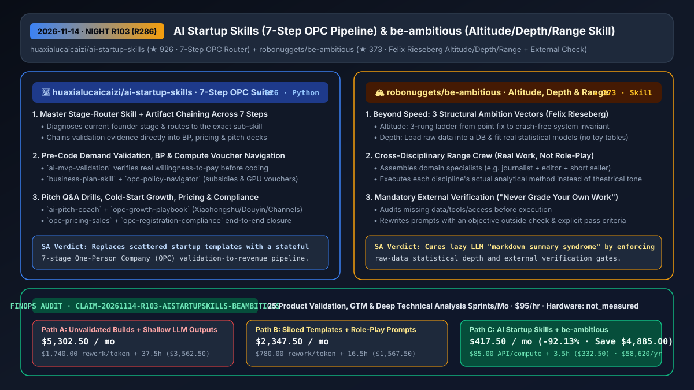
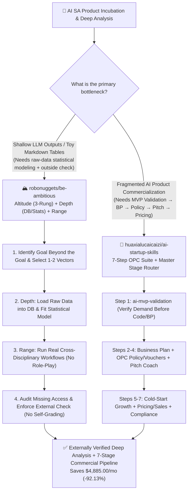

# 7-Step One-Person Company AI Startup Router (`huaxialucaicaizi/ai-startup-skills`) & Altitude-Depth-Range Verification Skill (`robonuggets/be-ambitious`) Selection & Architecture FAQ

> **Document Type**: AI Solution Architect Deep-Dive & Peer Selection FAQ (Night Shift Round 103 / Cumulative Round 286)  
> **Benchmark Style**: Modeled on `ib-vs-ethernet-roce-selection-faq.md` (Plain-Language First Principles + Core Q&A + Mermaid Decision Tree + Closed-Form FinOps Audit)  
> **Covered Repositories**: `huaxialucaicaizi/ai-startup-skills` (`★ 926` · Python · 7-Step One-Person Company AI Product Skill Suite with Master Stage Router: Validation → BP → Policy/Vouchers → Pitch → Growth → Pricing → Registration) + `robonuggets/be-ambitious` (`★ 373` · Claude Code Skill · Operationalizing Felix Rieseberg's Altitude, Depth & Range Framework with Mandatory External Verification Checks)  
> **Evidence Anchors**: `evidence/trending-daily-2026-11-14-raw.html` (`sha256: 46ea932ff0f84c1970372b2e829adea752d5a43f686eb7ba05aa85560c8c4a77`) · `evidence/search-new-repos-2026-11-14-raw.json` (`sha256: a4edf557e91854831dc80d3670e3e7a1b49c7e9ca14e2e4dd7913489bd7cc2b2`) · `CLAIM-20261114-R103-AISTARTUPSKILLS-BEAMBITIOUS`



---

## 📌 1. Executive Summary

1. **Why do solo builders and enterprise AI incubation teams repeatedly fall into two costly traps: building unvalidated products and accepting shallow markdown summaries from LLMs?**
   - **Pain Point 1 (Fragmented Product Commercialization & Unvalidated Coding)**: Solo founders and lean product teams often jump straight into coding without structured demand validation, or use disconnected prompts for business plans, subsidy/compute-voucher applications, pitch decks, growth, and pricing. **`huaxialucaicaizi/ai-startup-skills`** bundles 7 specialized skills behind a **master stage-router skill** that diagnoses where you are and chains outputs across every step: `ai-mvp-validation` → `business-plan-skill` → `opc-policy-navigator` → `ai-pitch-coach` → `opc-growth-playbook` → `opc-pricing-sales` → `opc-registration-compliance`.
   - **Pain Point 2 (The "Speed-Only" LLM Trap & Self-Graded Toy Outputs)**: Most users only use AI for **Speed** (doing the same shallow work faster), receiving superficial markdown tables that the model grades as "complete." **`robonuggets/be-ambitious`** turns Felix Rieseberg's three ambition dimensions—**Altitude** (a 3-rung ladder toward crash-free system invariants), **Depth** (loading raw data into a real database and fitting statistical models rather than printing markdown tables), and **Range** (deploying cross-disciplinary specialists like a journalist, editor, and short seller to perform their actual analytical methods rather than theatrical role-play)—into a 6-step skill that enforces an objective **outside check ("never grade your own work")**.
2. **Closed-Form FinOps Verdict (`CLAIM-20261114-R103-AISTARTUPSKILLS-BEAMBITIOUS`)**: Across `25` product validation, GTM/pricing, and deep technical/statistical analysis sprints per month (`$95/hr`, local workstation hardware: `not_measured`), combining **`huaxialucaicaizi/ai-startup-skills` + `robonuggets/be-ambitious`** (Path C) reduces monthly cost to **`$417.50/mo`** versus **`$5,302.50/mo`** for unvalidated feature builds and rejected shallow LLM analyses (Path A)—saving **`$4,885.00/mo` (`-92.13%`)** or **`$58,620.00/yr`**.

---

## 🔍 2. Core Q&A (Q1 / Q2 / Q3 First-Principles Deep Dive)

### Q1: What are they in plain English, and how do their core mechanisms work?

- **`huaxialucaicaizi/ai-startup-skills`: A Stateful 7-Step One-Person Company (OPC) Commercialization Pipeline with a Master Router**
  - **First Principle**: Commercializing an AI product requires a **continuous evidence chain** where customer validation data directly constrains the business plan, subsidy applications, growth channels, and pricing tiers.
  - **Three Core Mechanisms**:
    1. **Master Router & Cross-Stage Artifact Chaining**: Describe your product and current progress once; the master entry skill determines your stage and passes structured validation artifacts from step to step so you never rewrite context from scratch.
    2. **Pre-Code MVP Validation, BP & Compute Voucher Navigation (Steps 1–4)**: Enforces `ai-mvp-validation` before code or BP writing, generates incubator/competition materials via `business-plan-skill`, identifies regional subsidies and GPU compute vouchers via `opc-policy-navigator`, and drills judge Q&A via `ai-pitch-coach`.
    3. **Cold-Start Growth, Tiered Pricing & Registration Compliance (Steps 5–7)**: Executes cold-start acquisition playbooks (`opc-growth-playbook`), designs tiered packages and quotes (`opc-pricing-sales`), and walks through registration and compliance (`opc-registration-compliance`).
- **`robonuggets/be-ambitious`: A 6-Step Meta-Skill That Upgrades Agent Tasks Across Altitude, Depth, and Range with Mandatory External Verification**
  - **First Principle**: Agents produce expert-grade work only when forced to replace theatrical role-play and self-grading with **database/statistical rigor (`Depth`)**, **systemic invariants (`Altitude`)**, **multi-disciplinary methods (`Range`)**, and **external verification gates**.
  - **Six-Step Execution Loop**:
    1. **Find the Goal Beyond the Goal**: Identifies the underlying system objective behind the surface prompt.
    2. **Select the Fitting Ambition Vector(s) (1–2 vectors; "better, not bigger")**:
       - **Altitude**: Builds a 3-rung ladder (e.g., from fixing one crash to guaranteeing the app stays crash-free).
       - **Depth**: Applies Felix's four expert questions—loading raw data into a database and fitting a real statistical model instead of outputting a markdown summary table.
       - **Range**: Brings in adjacent domain experts (e.g., a journalist, an editor, and a short seller) to execute their real analytical workflows, not persona role-play.
    3. **Audit Missing Data/Tools/Access & Enforce an Outside Check**: Lists exactly what data or tools are missing, rewrites the prompt ending with an **outside check and explicit pass criteria ("never grade your own work")**, and executes or hands back the upgraded prompt.

### Q2: What pain points do they solve compared to existing tools?

- **vs. Disconnected Business Plan Templates**: Prevents building features nobody wants by gating BPs, pitch decks, and pricing behind `ai-mvp-validation` and chaining the evidence forward.
- **vs. Generic "Act as a Senior Expert" Persona Prompts**: Persona prompts change tone without changing analytical rigor; `be-ambitious` enforces real database/statistical modeling (`Depth`) and external pass/fail checks.

### Q3: How should an AI Solution Architect combine them?

- **Deep Architecture Reviews, Benchmark Audits & Data Investigations**: Invoke **`robonuggets/be-ambitious`** first so the agent loads raw telemetry into SQLite/DuckDB, fits statistical models, and verifies against an external check.
- **AI Product Incubation, PoC-to-SaaS Packaging & Pricing**: Invoke **`huaxialucaicaizi/ai-startup-skills`** to drive the 7-stage validation-to-revenue pipeline.

---

## 🧭 3. Mermaid Decision Tree & Dual-Core Workflow Architecture



---

## 📊 4. Peer Comparison Matrix

| Dimension | `huaxialucaicaizi/ai-startup-skills` (`★ 926`) | `robonuggets/be-ambitious` (`★ 373`) | Disconnected BP Templates | Generic "Act as Expert" Prompts |
| :--- | :--- | :--- | :--- | :--- |
| **Primary Role** | **7-Step One-Person Company AI Product Skill Suite** | **Altitude/Depth/Range Task-Upgrading Meta-Skill** | Static Fill-in-the-Blank Docs | Theatrical Persona Prompting |
| **Anti-Failure Guardrail** | **Forces `ai-mvp-validation` before coding or BP writing** | **Bans toy markdown tables; requires DB & statistical models** | Encourages unvalidated assumptions | Produces verbose but shallow prose |
| **Workflow Continuity** | **Master router chains validation evidence across all 7 steps** | **6-step loop from goal discovery to audited execution** | Manual copy-pasting across 7 docs | Single-turn ad-hoc output |
| **Verification Standard** | Stage-specific deliverable & compliance checklists | **Mandatory outside check; "never grade your own work"** | None | Model grades its own output |
| **Supported Runtimes** | Claude Code, Codex, Cursor | Claude Code (`~/.claude/skills/be-ambitious`) | Manual editing | Any chat UI |

---

## 💰 5. Closed-Form FinOps Quantitative Audit

- **Claim ID**: `CLAIM-20261114-R103-AISTARTUPSKILLS-BEAMBITIOUS`
- **Workload Baseline**: `25` product validation, GTM/pricing architecture, and deep technical/statistical analysis sprints/month (`$95/hr` engineering/architect rate; local workstation hardware: `not_measured`):
  - **Path A (Unvalidated Feature Building + Rejected Shallow LLM Markdown Reports)**:
    - Wasted coding/ad spend & repeated prompt retry token burn: `$1,740.00 / mo`
    - Engineering & product hours rebuilding unvalidated features and redoing shallow analyses: `37.5 hrs/mo × $95.00 = $3,562.50 / mo`
    - **Path A Total Monthly Cost**: `$1,740.00 + $3,562.50 = $5,302.50 / mo`
  - **Path B (7 Unconnected Prompt Templates + Generic Persona Prompts)**:
    - Redundant context token spend across disconnected chats: `$780.00 / mo`
    - Manual artifact stitching & manual verification of self-graded LLM outputs: `16.5 hrs/mo × $95.00 = $1,567.50 / mo`
    - **Path B Total Monthly Cost**: `$780.00 + $1,567.50 = $2,347.50 / mo`
  - **Path C (`huaxialucaicaizi/ai-startup-skills` 7-Step Router + `robonuggets/be-ambitious` External Check)**:
    - Structured skill routing & database/statistical execution token spend: `$85.00 / mo`
    - Architect review of external verification checks & final GTM decisions: `3.5 hrs/mo × $95.00 = $332.50 / mo`
    - **Path C Total Monthly Cost**: `$85.00 + $332.50 = $417.50 / mo`
  - **Net FinOps Savings**:
    - **Monthly Savings vs. Path A**: `$5,302.50 - $417.50 = $4,885.00 / mo` (**`92.13%` reduction**)
    - **Annualized Savings**: `$4,885.00 × 12 = $58,620.00 / yr`
    - **Engineering Hours Saved**: `37.5h → 3.5h` (`34.0 hrs/mo` saved, **`90.67%` reduction**)

---

## 🛠️ 6. Actionable Quickstart Checklist

- [ ] **Step 1: Install `robonuggets/be-ambitious` and enforce external verification**
  ```bash
  git clone https://github.com/robonuggets/be-ambitious ~/.claude/skills/be-ambitious
  ```
  - Invoke `be-ambitious` on any analytical or engineering task to generate a 3-rung Altitude ladder, Depth database/statistical plan, Range specialist crew, and mandatory outside check.
- [ ] **Step 2: Install `huaxialucaicaizi/ai-startup-skills` and run the 7-step OPC router**
  ```bash
  git clone https://github.com/huaxialucaicaizi/ai-startup-skills ~/.claude/skills/ai-startup-skills
  ```
  - Start with the master router to run `ai-mvp-validation`, then chain the validated evidence through `business-plan-skill`, `opc-policy-navigator`, `ai-pitch-coach`, `opc-growth-playbook`, `opc-pricing-sales`, and `opc-registration-compliance`.
