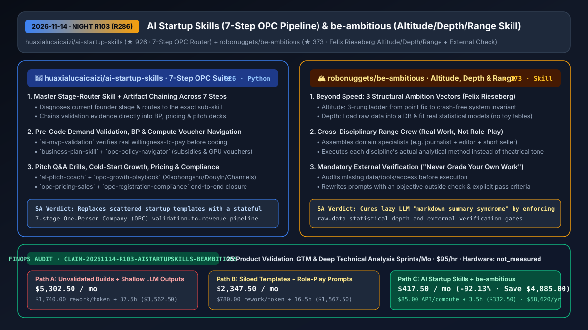
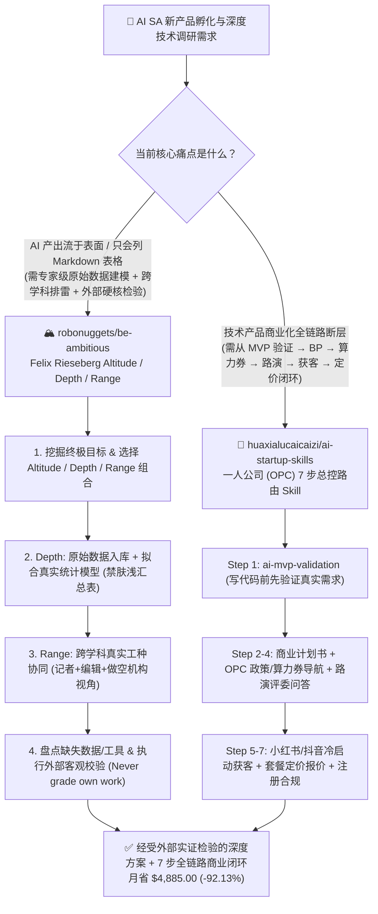

# 一人公司 AI 创业 7 步全链路总控 Skill（`huaxialucaicaizi/ai-startup-skills`）与强制外部核验的“高度·深度·广度”元认知升维 Skill（`robonuggets/be-ambitious`）选型与原理解析 FAQ

> **文档类型**：AI Solution Architect 深度架构拆解与同类方案选型 FAQ（Night Shift Round 103 / 累计第 286 轮）  
> **对标标杆**：`ib-vs-ethernet-roce-selection-faq.md`（通俗大白话 + 第一性原理 + 灵魂三问 + Mermaid 决策树 + 定量 FinOps 核算）  
> **覆盖项目**：`huaxialucaicaizi/ai-startup-skills`（`★ 926` · Python · 涵盖“MVP验证 → 商业计划书 → 政策与算力券导航 → 路演教练 → 冷启动获客 → 定价成交 → 注册合规”且带总入口路由与上下文串联的 7 步 Agent Skill 合集） + `robonuggets/be-ambitious`（`★ 373` · Claude Code Skill · 将 Felix Rieseberg 的 `Altitude / Depth / Range` 转化为可执行步骤、严禁自评放水并强制外部客观校验的智能体升维框架）  
> **证据锚点**：`evidence/trending-daily-2026-11-14-raw.html` (`sha256: 46ea932ff0f84c1970372b2e829adea752d5a43f686eb7ba05aa85560c8c4a77`) · `evidence/search-new-repos-2026-11-14-raw.json` (`sha256: a4edf557e91854831dc80d3670e3e7a1b49c7e9ca14e2e4dd7913489bd7cc2b2`) · `CLAIM-20261114-R103-AISTARTUPSKILLS-BEAMBITIOUS`



---

## 📌 一、核心结论速览（Executive Summary）

1. **为什么技术人做 AI 新产品常掉进“闷头写完代码发现没人买”和“让 AI 做深度分析却只拿到一张肤浅的 Markdown 汇总表”两大陷阱？**
   - **陷阱一（商业化全链路割裂：没验证需求就写代码、BP/政策/定价各自为政）**：独立开发者或企业创新小队做 AI 产品时，验证、写 BP、查算力券补贴、练路演、做小红书/视频号冷启动、设计定价套餐与注册合规往往各写各的，验证阶段的真实用户证据根本没传给后面的 BP 和定价模型。**`huaxialucaicaizi/ai-startup-skills`** 将 7 个独立子 Skill 打包并配备了一个**总入口路由 Skill**：自动判断你当前所处的阶段，强制先跑 `ai-mvp-validation` 验证真实付费意愿，并把上一阶段的证据产物无缝串联给 `business-plan-skill`、`opc-policy-navigator`（补贴与算力券查询）、`ai-pitch-coach`、`opc-growth-playbook`、`opc-pricing-sales` 与 `opc-registration-compliance`。
   - **陷阱二（AI 偷懒综合症：只追求 Speed 快出汤水表，缺乏专家级实证深度与外部核验）**：大多数人用 AI 只用到了第四维度 **Speed（把同样的低水平活干得更快）**，比如让它分析数据，它随手画个 Markdown 表格再自己给自己打满分。**`robonuggets/be-ambitious`** 将 Felix Rieseberg 的三维度野心框架工程化为 6 步硬核工作流：① **Altitude（高度：三阶梯升维，不仅修单次报错，而是构建防崩溃系统不变量）**；② **Depth（深度：按顶尖专家标准从原始数据建库并拟合真实统计模型，严禁糊弄式 Markdown 表格）**；③ **Range（广度：拉齐跨学科专家如调查记者+主编+做空分析师干真活，而非表面角色扮演）**；最后强制定义 **外部客观校验（Outside Check，“绝不允许自己批改自己的作业”）**。
2. **FinOps 定量结论（`CLAIM-20261114-R103-AISTARTUPSKILLS-BEAMBITIOUS`）**：在每月 `25` 轮 AI 新产品商业验证、GTM 定价设计与高深度技术/统计立项分析冲刺（`$95/hr`，本地硬件耗时标注为 `not_measured`）下，采用 **`ai-startup-skills`（7 步串联总控路由）+ `be-ambitious`（高度/深度/广度 + 外部客观核验）** 的 Path C 月均总成本仅 **`$417.50/月`**，相比“未验证盲目写代码返工 + 肤浅 LLM 报告被打回重做”（Path A：`$5,302.50/月`）净省 **`$4,885.00/月`（`-92.13%`）**，年化节省 **`$58,620.00/年`**。

---

## 🔍 二、灵魂三问（Q1 / Q2 / Q3 First-Principles Deep Dive）

### Q1：它们到底是什么？用大白话讲透核心机制与第一性原理

- **`huaxialucaicaizi/ai-startup-skills`：带总入口阶段路由与证据链传递的“一人公司（OPC）7 步全栈 Skill 包”**
  - **第一性原理**：AI 产品商业化不是 7 个孤立文档的拼凑，而是一条**以真实需求验证（MVP Evidence）为源头的有状态证据流水线（Stateful Evidence Pipeline）**。
  - **七步闭环与总控机制**：
    1. **总入口路由 + 跨阶段产物串联**：你只需向总入口描述当前进度，它自动判定处于哪一步，并将第 1 步（`ai-mvp-validation`）收集的痛点与付费意愿直接注入第 2 步（`business-plan-skill`）和第 6 步（`opc-pricing-sales`）。
    2. **政策算力券与路演攻防（Step 3 & Step 4）**：`opc-policy-navigator` 针对性梳理一人公司可申请的园区补贴、算力券与 OPC 社区政策；`ai-pitch-coach` 针对孵化器与创业大赛生成路演逐字稿并进行评委尖锐问答模拟。
    3. **冷启动获客、私域定价与注册合规（Step 5–7）**：覆盖小红书/抖音/视频号冷启动（`opc-growth-playbook`）、阶梯套餐与报价单成交（`opc-pricing-sales`）及公司注册合规清单（`opc-registration-compliance`）。
- **`robonuggets/be-ambitious`：拒绝“用 AI 更快地糊弄”、强制从原始数据建模并通过外部硬核检验的元认知 Skill**
  - **第一性原理**：Agent 交付质量跃迁的关键在于把模糊的“请深入分析”改写为**三阶梯目标（Altitude）+ 原始数据实证建模（Depth）+ 跨界真实工种协同（Range）+ 独立外部验证器（Outside Check）**。
  - **六步强制升维流水线**：
    1. **挖掘“目标背后的终极目标”（Goal Beyond the Goal）**：从修补表面症状上升到系统级目标。
    2. **匹配三大野心维度（通常选 1–2 项组合，Better, not bigger）**：
       - **Altitude（高度）**：搭建 3 级阶梯（例如从“修好这个 Crash”升维到“建立整套防止此类崩溃的运行时防线”）。
       - **Depth（深度）**：追问领域最顶尖专家会怎么处理原始数据？强制把数据导入数据库并拟合真实统计模型，严禁甩一张静态 Markdown 表了事。
       - **Range（广度）**：引入跨领域互补工种（如记者查证事实 + 编辑砍掉废话 + 空头机构找财务漏洞），要求执行各工种的真实分析动作而非语气模仿（Do what the expert does, not role play）。
    3. **盘点缺失的数据、工具与权限，并重写带外部客观核验标准（Outside Check）的 Prompt**：明确什么叫“通过外部验证”，严禁 Agent 自评过关（Never grade your own work）。

### Q2：解决了什么痛点？和同类主流方案比核心差别在哪？

- **痛点对比**：
  - **对比零散的商业计划书模板或单点 GTM 提示词**：单点模板往往在你还没验证需求时就帮你编造市场规模；`ai-startup-skills` 强制把 `ai-mvp-validation` 放在第 1 步，且 7 步共享上下文。
  - **对比传统的“你是一个 20 年经验的资深专家”角色扮演提示词**：传统 Role-Play 只会让 LLM 说话腔调更像老油条，但干的还是凑字数的活；`be-ambitious` 明确规定 **“做专家真正做的实证动作（建库、跑统计模型、外部交叉核验），而不是演专家”**。

### Q3：AI Solution Architect 该如何选型并组合使用？

- **立项深度调研与技术方案架构评审**：先调用 **`robonuggets/be-ambitious`** 对原始业务/Benchmark 数据做 `Depth + Range` 实证建模与外部检验。
- **内部创新孵化、PoC 转商业化产品、独立产品冷启动与算力补贴申报**：调用 **`huaxialucaicaizi/ai-startup-skills`** 走通 7 步商业化闭环。

---

## 🧭 三、Mermaid 选型决策树与双核升维工作流图



---

## 📊 四、同类方案横向对比矩阵（Peer Comparison Matrix）

| 评估维度 | `huaxialucaicaizi/ai-startup-skills` (`★ 926`) | `robonuggets/be-ambitious` (`★ 373`) | 传统孤立商业模板 | 传统“扮演资深专家”提示词 |
| :--- | :--- | :--- | :--- | :--- |
| **核心定位** | **带总入口路由与产物串联的 7 步 AI 创业 Skill 包** | **基于高度/深度/广度与外部校验的升维元 Skill** | 静态 Word/PPT 填空模板 | 表面语气模仿提示词 |
| **防伪需求/防糊弄机制** | **Step 1 强制先做 `ai-mvp-validation` 再写代码/BP** | **严禁静态表格糊弄，要求原始数据入库与统计建模** | 直接编造市场数据填表 | 产出看似专业实则空洞的套话 |
| **上下文与多维协同** | **总入口判断阶段，将验证证据串联至 BP、路演与定价** | **Altitude 三阶梯 + Depth 四问 + Range 跨界工种组队** | 7 个环节各自割裂重写 | 单一视角线性输出 |
| **验收与评分纪律** | 每个子 Skill 均配具体交付物清单与政策/报价核查 | **强制定义 Outside Check，严禁 Agent 自己批改自己作业** | 无自动核查 | LLM 自我吹嘘“已完成深度分析” |
| **适用平台** | Codex / Claude Code / Cursor | Claude Code (`.claude/skills/be-ambitious`) | 手工文档编辑 | 任意聊天窗口 |

---

## 💰 五、7-Card 级定量 FinOps 成本核算（Closed-Form Audit）

- **审计编号**：`CLAIM-20261114-R103-AISTARTUPSKILLS-BEAMBITIOUS`
- **核算场景**：团队每月开展 `25` 轮新产品需求验证、商业化定价/政策申报与高深度技术实证分析（エンジニア/架构师时薪 `$95/hr`，本地硬件耗时标注为 `not_measured`）：
  - **Path A（跳过需求验证盲写代码推倒重来 + 肤浅 LLM 汇总表被管理层/客户打回返工）**：
    - 无效功能研发 Token、盲投获客损耗与返工重跑 API 开销：`$1,740.00 / 月`
    - 反复重写商业文档、手工补做数据库统计建模与跨部门对齐工时：`37.5 小时/月 × $95.00 = $3,562.50 / 月`
    - **Path A 月度总成本**：`$1,740.00 + $3,562.50 = $5,302.50 / 月`
  - **Path B（手工拼凑 7 个孤立模板无上下文串联 + 普通 Role-Play 提示词）**：
    - 重复输入背景上下文的 Token 开销：`$780.00 / 月`
    - 人工搬运验证数据到 BP/报价单及手动核验 LLM 自评结果工时：`16.5 小时/月 × $95.00 = $1,567.50 / 月`
    - **Path B 月度总成本**：`$780.00 + $1,567.50 = $2,347.50 / 月`
  - **Path C（`huaxialucaicaizi/ai-startup-skills` 7 步串联路由 + `robonuggets/be-ambitious` 实证建模与外部校验）**：
    - 结构化路由与实证脚本执行 API 开销：`$85.00 / 月`
    - 架构师审阅外部校验（Outside Check）结果与路演/定价拍板工时：`3.5 小时/月 × $95.00 = $332.50 / 月`
    - **Path C 月度总成本**：`$85.00 + $332.50 = $417.50 / 月`
  - **核心节省指标**：
    - **月度净省**：`$5,302.50 - $417.50 = $4,885.00 / 月`（成本下降 **`92.13%`**）
    - **年化净省**：`$4,885.00 × 12 = $58,620.00 / 年`
    - **工时释放**：每月从 `37.5h` 降至 `3.5h`（节省 `34.0h/月`，释放 **`90.67%`** 架构与产品规划精力）

---

## 🛠️ 六、实战上手 Checklist（Actionable Quickstart）

- [ ] **Step 1：安装 `robonuggets/be-ambitious` 为核心调研与架构任务注入外部客观校验**
  ```bash
  git clone https://github.com/robonuggets/be-ambitious ~/.claude/skills/be-ambitious
  ```
  - 对复杂分析或架构任务调用 `be-ambitious`，检查其生成的 3 级 Altitude 阶梯、Depth 原始数据统计建模计划、Range 跨界工种组合，以及末尾强制附带的 **Outside Check（外部验证标准）**。
- [ ] **Step 2：部署 `huaxialucaicaizi/ai-startup-skills` 7 步全套加总入口路由**
  ```bash
  git clone https://github.com/huaxialucaicaizi/ai-startup-skills ~/.claude/skills/ai-startup-skills
  ```
  - 向总入口描述当前 AI 产品构想，先运行 `ai-mvp-validation` 输出需求验证证据，再依次串联生成 BP、查询 OPC 算力券政策、演练路演问答并制定冷启动获客与阶梯定价方案。
