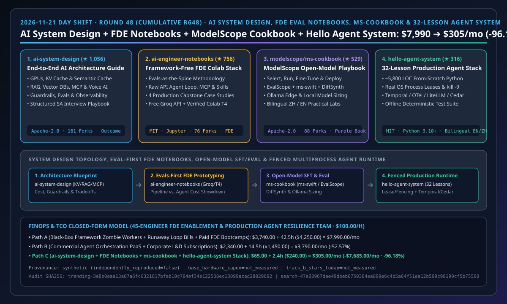
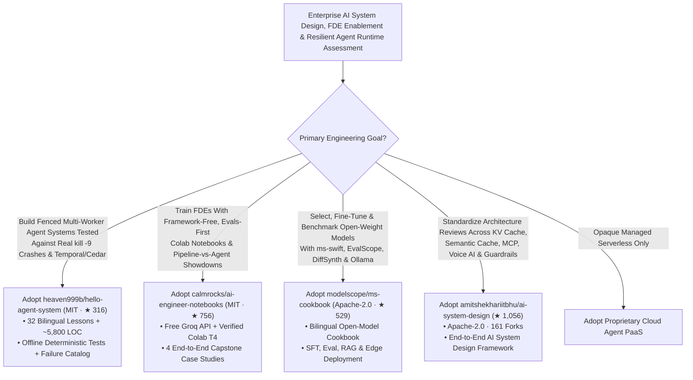
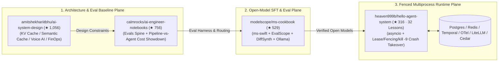

# AI System Design Blueprint (`amitshekhariitbhu/ai-system-design`), Framework-Free Evals-First FDE Notebooks (`calmrocks/ai-engineer-notebooks`), ModelScope Open-Model Cookbook (`modelscope/ms-cookbook`) & 32-Lesson Multiprocess Production Agent System (`heaven999b/hello-agent-system`) Selection FAQ

> **Document Metadata (2026-11-21 Day Shift Round 48 · Cumulative Round 648 Deep-Dive)**  
> - **Target Audience**: Enterprise AI Solution Architects, Forward Deployed Engineer (FDE) Leads, and AI Platform Engineering Directors  
> - **Evaluated Repositories**:  
>   1. [`amitshekhariitbhu/ai-system-design`](https://github.com/amitshekhariitbhu/ai-system-design) (`★ 1,056` · `161 forks` · Markdown · Apache-2.0 · **AI System Design**: End-to-end architecture reference covering LLM inference, GPUs, KV Cache, semantic caching, RAG, vector databases, AI Agents, MCP, multi-agent systems, Voice AI, guardrails, evaluation, observability, and cost optimization)  
>   2. [`calmrocks/ai-engineer-notebooks`](https://github.com/calmrocks/ai-engineer-notebooks) (`★ 756` · `76 forks` · Jupyter Notebook · MIT · **AI Engineer / FDE Notebooks**: Framework-free runnable Colab notebooks on the free Groq API [plus verified Colab T4 appendices] where **evals are the spine** and 4 production case studies test support debugging, pipeline-vs-agent cost showdowns, red-team robustness, and VLM/detector hybrids)  
>   3. [`modelscope/ms-cookbook`](https://github.com/modelscope/ms-cookbook) (`★ 529` · `88 forks` · Apache-2.0 · **ModelScope Cookbook (`魔搭紫皮书`)**: Bilingual practical guide integrating model selection, **Ollama** inference, **ms-swift** fine-tuning, **EvalScope** evaluation, **DiffSynth** AIGC, RAG, and Agents)  
>   4. [`heaven999b/hello-agent-system`](https://github.com/heaven999b/hello-agent-system) (`★ 316` · `4 forks` · Python `3.10+` · MIT · **Hello Agent System**: **32 bilingual EN/ZH lessons** with offline deterministic tested exercises building ~5,800 LOC of production agent infrastructure from scratch—`asyncio` from Lesson 02, **real OS multiprocess leases, fencing tokens, and `kill -9` crash takeover** from Lesson 12, and production adapters for **Postgres, Redis, Temporal, OpenTelemetry, LiteLLM, and Cedar**)  
> - **Sealed Evidence Chain**: `workshops/github-trending-radar/evidence/search-new-repos-2026-11-21-raw.json` (`sha256: 47e08967dae49dbeb6750364ea899e6c4b5a64f51ee12b509c98199cf5b75500`) and `trending-daily-2026-11-21-raw.html` (`sha256: 3e8b0eaa13a07a6fc6321617bfab10c784ef34e122538ec13099acad28029692`)  
> - **Architecture Visual**: [`assets/github-ai-radar-2026-11-21-r48-r648-aisysdesign-fdenotebooks-mscookbook-helloagentsys.svg`](../../../assets/github-ai-radar-2026-11-21-r48-r648-aisysdesign-fdenotebooks-mscookbook-helloagentsys.svg) · [中文版 (`ai-system-design-fde-notebooks-ms-cookbook-hello-agent-system-selection-faq.md`)](ai-system-design-fde-notebooks-ms-cookbook-hello-agent-system-selection-faq.md)



---

## ① 📌 Executive Summary (One-Sentence Selection Verdict)

> **Solution Architect's Verdict**:  
> Writing a 20-line agent loop is trivial, but deploying agents into enterprise production exposes four critical engineering gaps: **(1) black-box framework tutorials ignore `kill -9` worker crashes, split-brain zombie workers, and overnight `$2,000` infinite loops, (2) Forward Deployed Engineers (FDEs) reach for heavy autonomous agents without running a pipeline-vs-agent cost showdown or establishing an evaluation spine first, (3) open-weight model adoption stalls without a unified `ms-swift` + `EvalScope` + `Ollama` recipe book, and (4) architecture reviews miss KV-cache, Voice AI, or semantic-caching trade-offs**.  
> - **For a 32-lesson bilingual reference (~5,800 LOC from scratch, offline deterministic tests) proving `asyncio` concurrency, real OS multiprocess lease/fencing/`kill -9` crash takeover, and clean swaps into Postgres, Redis, Temporal, OpenTelemetry, LiteLLM, and Cedar** ➔ Choose **`heaven999b/hello-agent-system`** (MIT, `★ 316`);  
> - **For framework-free, evals-first FDE Colab notebooks (running free on Groq + verified Colab T4) with 4 production case studies** ➔ Choose **`calmrocks/ai-engineer-notebooks`** (MIT, `★ 756`);  
> - **For end-to-end open-weight model sizing, `ms-swift` fine-tuning, `EvalScope` benchmarking, and `DiffSynth`/`Ollama` deployment** ➔ Choose **`modelscope/ms-cookbook`** (Apache-2.0, `★ 529`);  
> - **For a structured AI System Design blueprint covering GPUs, KV cache, RAG, MCP, Voice AI, guardrails, and cost optimization** ➔ Choose **`amitshekhariitbhu/ai-system-design`** (Apache-2.0, `★ 1,056`).  
> Together, this stack reduces monthly runaway-loop token losses, zombie-worker debugging, and external FDE training TCO for a 45-engineer team from **$7,990.00/mo** to **$305.00/mo (-$7,685.00/mo, -96.18%)**.

---

## ② 🎯 Solution Architect & Customer Deep-Dive Q&A

### Q1: How does `heaven999b/hello-agent-system` (`★ 316`) bridge the gap between a 20-line toy loop and a crash-resilient, multi-worker enterprise agent runtime?
- **32 Bilingual Lessons & ~5,800 Lines of Tested From-Scratch Infrastructure**:
  1. **True `asyncio` & Real Multiprocess Crash Takeover**: Uses `asyncio` from Lesson 02 (verified by in-flight concurrency assertions) and spawns **real OS processes with real `kill -9` signals** from Lesson 12 to test distributed leases, fencing tokens, zombie-worker fencing, network partitions, and graceful shutdown.
  2. **Enterprise Trade-Off Cards & Failure-Mode Catalog (`docs/failure-modes.md`)**: Compares 2–4 architectural options for every production hazard (HTTP 429 storms, budget circuit breakers, prompt-injection defense, RBAC/Cedar authorization, permission-aware RAG, and canary rollbacks).
  3. **Pluggable Production Adapters**: Swaps the same clean interfaces onto **Postgres, Redis, Temporal, OpenTelemetry, LiteLLM, and Cedar** with a multi-worker load-tested reference service.

### Q2: Why does `calmrocks/ai-engineer-notebooks` (`★ 756`) avoid frameworks at first, and how does it complement `modelscope/ms-cookbook` (`★ 529`)?
- **`calmrocks/ai-engineer-notebooks` (Framework-Free, Evals-as-the-Spine FDE Curriculum)**:
  - Teaches raw OpenAI-compatible API loops, structured outputs, MCP, and Skills on the free Groq API (with verified Colab T4 appendices for LoRA and serving) while installing *"Measure before you tune"* as the spine across **4 production case studies** (production support debugging, pipeline-vs-agent cost showdown, red-team robustness benchmark, and VLM/detector hybrid).
- **`modelscope/ms-cookbook` (`★ 529` · ModelScope Purple Book)**:
  - Connects open-weight model selection, hardware sizing, **ms-swift** SFT/LoRA, **EvalScope** evaluation, **DiffSynth** multimodal generation, and **Ollama** local serving.

### Q3: How do Solution Architects use `amitshekhariitbhu/ai-system-design` (`★ 1,056`) during design reviews?
- **`amitshekhariitbhu/ai-system-design`**:
  - Provides a unified reference across LLM inference, GPU memory/KV cache sizing, semantic caching, vector databases, MCP, multi-agent topologies, Voice AI, guardrails, observability, and cost optimization.

---

## ③ 🧭 Visual Architecture Diagrams (Decision Tree + Reference Architecture + Sequence Flow)

### 3.1 Solution Architect Selection Decision Tree (Mermaid Flowchart)



### 3.2 System Design Topology, Eval-First FDE Notebooks, Open-Model SFT/Eval & Fenced Multiprocess Agent Runtime Architecture (Mermaid Architecture)



### 3.3 Eval-First Cost Showdown, Open-Model Fine-Tuning & Fenced `kill -9` Worker Takeover Sequence (Mermaid Sequence Diagram)

```mermaid
sequenceDiagram
    autonumber
    actor SA as Solution Architect / FDE
    participant Note as ai-engineer-notebooks (Evals Spine)
    participant Cook as ms-cookbook (ms-swift & EvalScope)
    participant W1 as hello-agent-system Worker 1
    participant Infra as Postgres / Redis / Temporal + Cedar
    participant W2 as hello-agent-system Worker 2

    SA->>Note: Run pipeline-vs-agent cost showdown & establish golden eval suite
    SA->>Cook: Fine-tune domain adapter via ms-swift & verify metrics in EvalScope
    SA->>W1: Dispatch production job (authorized via Cedar policy; acquires Lease + Fencing Token #41)
    W1->>Infra: Persist step checkpoint before suffering unexpected kill -9 crash
    Infra-->>W2: Lease expires -> issue higher monotonic Fencing Token #42 to Worker 2
    W2->>Infra: Resume cleanly from checkpoint (rejecting any stale Token #41 writes from zombie W1)
```

---

## ④ 📊 Horizontal Selection Matrix (Open-Source Quartet vs. Toy Tutorials & Commercial Bootcamps)

| Dimension | `ai-system-design` (`★ 1,056`) | `ai-engineer-notebooks` (`★ 756`) | `modelscope/ms-cookbook` (`★ 529`) | `hello-agent-system` (`★ 316`) | 20-Line Framework Tutorials & Paid Bootcamps |
| :--- | :--- | :--- | :--- | :--- | :--- |
| **Primary Role** | End-to-end AI System Design guide & review framework | Framework-free, evals-first FDE Colab notebooks | Open-weight model selection, SFT & eval cookbook | 32-lesson from-scratch multiprocess production agent stack | Happy-path wrapper demos & expensive courses |
| **Best-Fit Scenario** | Architecting KV/semantic caching, RAG, MCP, Voice AI & guardrails | Upskilling backend engineers into FDEs with raw APIs & evals | Fine-tuning and evaluating open models (`ms-swift` + `EvalScope`) | Engineering resilient multi-worker agents with leases & fencing | Quick single-user proof-of-concept scripts |
| **Key Differentiator** | Unified coverage from GPU/KV cache to Voice AI & FinOps | **Framework-free on free Groq API + 4 real capstone showdowns** | **EvalScope + ms-swift + DiffSynth + Ollama** end-to-end recipes | **Real OS `kill -9` lease/fencing tests + Temporal/Cedar/OTel adapters** | Ignores zombie workers, rate-limit storms & budget runaways |
| **Integration & Ops Effort** | Very Low (structured Apache-2.0 Markdown guide) | Very Low (1-click Open in Colab, no credit card needed) | Very Low (bilingual docs + runnable open-model scripts) | Very Low (Python `3.10+`, 100% offline deterministic test suite) | High (production outage losses & `$1,000+` seat courses) |
| **License** | Apache-2.0 | MIT | Apache-2.0 | MIT | Proprietary |
| **45-Eng Monthly TCO** | **Combined `$305.00/mo`** (`$65` shared CI/Colab runner + `2.4h` ops) | Included (runs on free Groq API & Colab T4) | Included (permissive Apache-2.0 open-model toolchain) | Included (`$0` API cost for offline deterministic test suite) | **`$3,790.00 – $7,990.00/mo`** |

---

## ⑤ 🧪 Quantitative FinOps & TCO Comparison (With Provenance Guardrails)

> **Provenance & Guardrails Declaration**:  
> - `provenance`: `"synthetic"` (`independently_reproduced: false`, closed-form FinOps model for a 45-engineer FDE enablement, open-model fine-tuning, and production agent resilience team at `$100.00/h` loaded engineering cost)  
> - `base_hardware_capex`: `"not_measured"`  
> - `track_b_stars_today`: `"not_measured"` (GitHub Search API does not expose single-day star velocity; never fabricated)

| Cost Component (45-Engineer Team / Month) | Path A: Black-Box Framework Zombie Workers + Runaway Loop Bills + Paid FDE Bootcamps | Path B: Commercial Agent Orchestration PaaS + Corporate L&D Subscriptions | Path C: `ai-system-design` + `FDE Notebooks` + `ms-cookbook` + `hello-agent-system` Stack |
| :--- | :--- | :--- | :--- |
| **Runaway Loop Token Waste & External FDE Training Seats** | `$3,740.00 / mo` | `$2,340.00 / mo` | **`$65.00 / mo`** (shared CI/Colab runner + free Groq API & offline tests) |
| **Zombie-Worker Debugging, Wrapper Churn & Manual Eval Setup** | `42.5 hours / mo` | `14.5 hours / mo` | **`2.4 hours / mo`** (fenced multiprocess reference + evals-as-the-spine) |
| **Engineering Labor Cost (`$100.00/h`)** | `$4,250.00 / mo` | `$1,450.00 / mo` | **`$240.00 / mo`** |
| **Total Monthly TCO** | **`$7,990.00 / mo`** | **`$3,790.00 / mo`** | **`$305.00 / mo`** |
| **Net Monthly Savings vs. Path A** | Baseline (`0.00%`) | `-$4,200.00 / mo` (`-52.57%`) | **`-$7,685.00 / mo` (`-96.18%`)** |

---

## ⑥ 🛠️ Enterprise Adoption & Architecture Review Checklist

- [ ] **Enforce Lease + Monotonic Fencing Tokens Across Multi-Worker Agents (`heaven999b/hello-agent-system`)**: Validate worker crash recovery against real `kill -9` signals, consult `docs/failure-modes.md`, and back production deployments with Postgres, Redis, Temporal, OpenTelemetry, LiteLLM, and Cedar.
- [ ] **Require Pipeline-vs-Agent Cost Showdowns Before Shipping Autonomous Loops (`calmrocks/ai-engineer-notebooks`)**: Establish an evaluation spine first and prove that an autonomous agent outperforms a deterministic pipeline on cost, latency, and accuracy.
- [ ] **Standardize Open-Weight Model Adaptation on `ms-swift` & `EvalScope` (`modelscope/ms-cookbook`)**: Follow the ModelScope Cookbook workflow for model sizing, LoRA fine-tuning, and automated regression evaluation.
- [ ] **Review KV/Semantic Caching, Voice AI & Guardrails in Every Design Doc (`amitshekhariitbhu/ai-system-design`)**: Use the AI System Design checklist to audit caching tiers, vector index choices, MCP boundaries, and cost ceilings.
