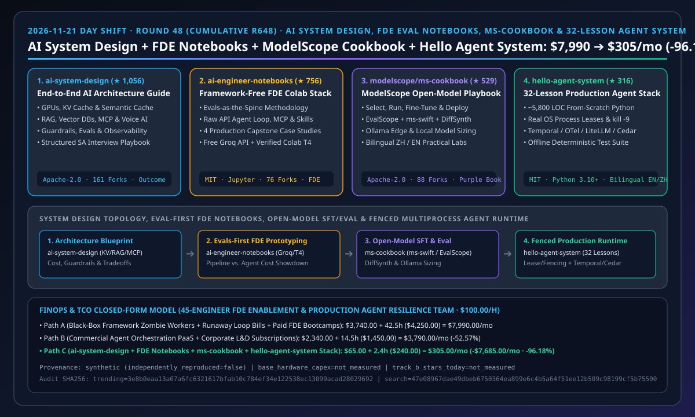
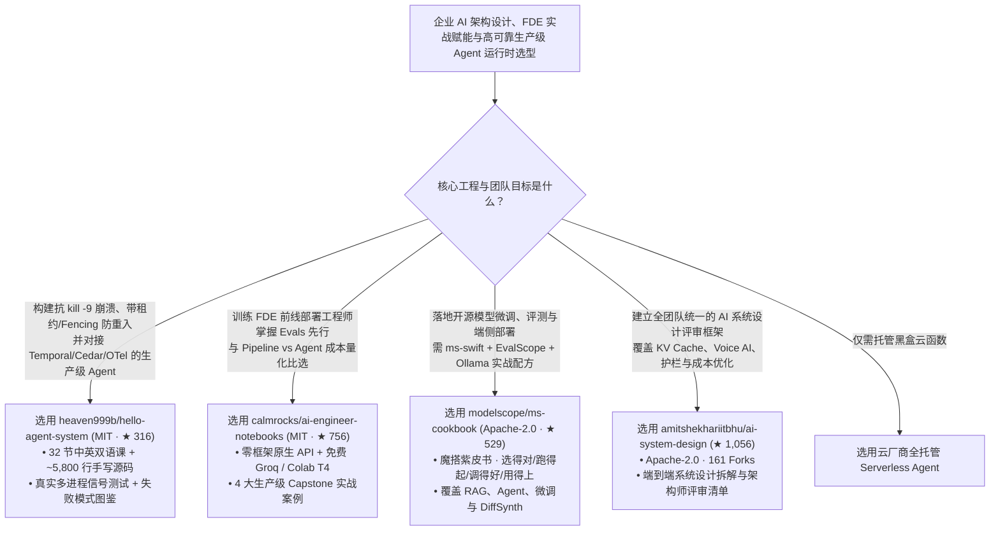
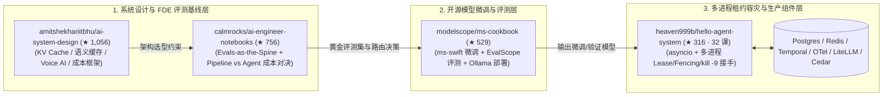

# AI 系统设计全栈蓝图（`amitshekhariitbhu/ai-system-design`）、零框架评测驱动 FDE 实战手册（`calmrocks/ai-engineer-notebooks`）、魔搭紫皮书开源模型实战指南（`modelscope/ms-cookbook`）与 32 课真多进程生产级 Agent 系统工程（`heaven999b/hello-agent-system`）选型 FAQ

> **文档元数据（2026-11-21 白班 Day Round 48 · 累计第 648 轮深潜专题）**  
> - **面向对象**：企业 AI 解决方案架构师（AI Solution Architect）、前线部署工程师（Forward Deployed Engineer, FDE）团队主管、AI 平台工程负责人  
> - **本轮核心评估对象**：  
>   1. [`amitshekhariitbhu/ai-system-design`](https://github.com/amitshekhariitbhu/ai-system-design)（`★ 1,056` · `161 forks` · Markdown · Apache-2.0 · **AI System Design**：由 Outcome School 创始人维护的端到端 AI 系统设计指南，覆盖 LLM 推理、GPU、KV Cache、语义缓存、RAG、向量库、AI Agents、MCP、多智能体、语音 AI、安全护栏、评测、可观测与成本优化）  
>   2. [`calmrocks/ai-engineer-notebooks`](https://github.com/calmrocks/ai-engineer-notebooks)（`★ 756` · `76 forks` · Jupyter Notebook · MIT · **面向 AI Engineer / FDE 的零框架可运行 Colab 手册**：全流程基于免费 Groq API 与实测 Colab T4，将 **Evals（先测量再调优）作为贯穿全书的脊梁**，内置 4 个生产级 Capstone 实战案例[含固定流水线 vs 自治 Agent 成本对决、红队鲁棒性评测等]）  
>   3. [`modelscope/ms-cookbook`](https://github.com/modelscope/ms-cookbook)（`★ 529` · `88 forks` · Apache-2.0 · **ModelScope Cookbook 魔搭紫皮书**：围绕“选得对、跑得起、调得好、用得上”，打通 **EvalScope 评测、ms-swift 微调、DiffSynth 多模态与 Ollama 端侧部署**的中英双语实战指南）  
>   4. [`heaven999b/hello-agent-system`](https://github.com/heaven999b/hello-agent-system)（`★ 316` · `4 forks` · Python `3.10+` · MIT · **Hello Agent System 企业级 Agent 系统设计训练营**：32 节中英双语课 + 离线确定性测试，零黑盒框架手写 ~5,800 行生产级代码——从第 02 课起全异步 `asyncio`，从第 12 课起验证**真实多进程租约（Lease）、Fencing 令牌、`kill -9` 崩溃接手与网络分区**，并无缝切换至 **Postgres / Redis / Temporal / OpenTelemetry / LiteLLM / Cedar**）  
> - **关联检索证据链**：`workshops/github-trending-radar/evidence/search-new-repos-2026-11-21-raw.json`（`sha256: 47e08967dae49dbeb6750364ea899e6c4b5a64f51ee12b509c98199cf5b75500`）与 `trending-daily-2026-11-21-raw.html`（`sha256: 3e8b0eaa13a07a6fc6321617bfab10c784ef34e122538ec13099acad28029692`）  
> - **高清架构图**：[`assets/github-ai-radar-2026-11-21-r48-r648-aisysdesign-fdenotebooks-mscookbook-helloagentsys.svg`](../../../assets/github-ai-radar-2026-11-21-r48-r648-aisysdesign-fdenotebooks-mscookbook-helloagentsys.svg) · [English Version (`ai-system-design-fde-notebooks-ms-cookbook-hello-agent-system-selection-faq.en.md`)](ai-system-design-fde-notebooks-ms-cookbook-hello-agent-system-selection-faq.en.md)



---

## ① 📌 核心结论速览（选型一句话结论）

> **架构师一句话选型结论**：  
> 写一个能跑通 Demo 的 Agent 只要 20 行代码，但当传统后端工程师转型为 **AI Solution Architect / Forward Deployed Engineer（FDE，前线部署工程师）** 并把系统推向几千人并发生产时，决定生死的不是那 20 行循环，而是：**“Worker 进程在执行到一半被 `kill -9` 杀掉后谁来接手且不重复扣款（Fencing）？什么场景该用确定性 Pipeline 而不是昂贵的自主 Agent？开源模型怎么用 `ms-swift` 微调并用 `EvalScope` 量化验收？”**  
> - **需要一套从零手写 ~5,800 行代码、用真实 OS 多进程与信号验证租约（Lease）/Fencing/`kill -9` 崩溃接手，并最终平滑替换为 Temporal、Cedar、OpenTelemetry 与 Postgres 的 32 课中英双语生产级训练营** ➔ 选 **`heaven999b/hello-agent-system`**（MIT，`★ 316`）；  
> - **需要培养 FDE（前线部署工程师）养成“先建 Evals 再调优”的肌肉记忆，脱离黑盒框架在免费 Groq API 与 Colab T4 上跑通四大真实生产案例（含 Pipeline vs Agent 成本对决）** ➔ 选 **`calmrocks/ai-engineer-notebooks`**（MIT，`★ 756`）；  
> - **需要围绕国产与主流开源模型打通“模型选型 ➔ Ollama 推理 ➔ ms-swift 微调 ➔ EvalScope 评测 ➔ DiffSynth 多模态应用”全链路实战** ➔ 选 **`modelscope/ms-cookbook`**（魔搭紫皮书，Apache-2.0，`★ 529`）；  
> - **需要一份系统梳理 KV Cache、语义缓存、RAG、MCP、语音 AI、护栏与架构师系统设计面试框架的全景案头手册** ➔ 选 **`amitshekhariitbhu/ai-system-design`**（Apache-2.0，`★ 1,056`）。  
> 四者组合可将 45 人研发与 FDE 团队因黑盒框架排障、僵尸 Worker 重复执行/死循环烧钱事故及外部高价实训采购总成本从 **$7,990.00/月** 降至 **$305.00/月（节省 $7,685.00/月，降幅 96.18%）**。

---

## ② 🎯 客户与架构师灵魂拷问 Q&A（业务痛点 · 架构集成 · 边界取舍）

### Q1：为什么只学了“20 行代码调框架 API”的工程师一上生产就会酿成“半夜死循环烧掉 $2,000”或“进程重启导致工具重复执行”的事故？`heaven999b/hello-agent-system`（`★ 316`）是如何补齐这 5,800 行生产级底座的？
- **`heaven999b/hello-agent-system`（32 课中英双语 · 离线确定性测试验证的生产级 Agent 架构）的四大硬核设计**：
  1. **拒绝伪并发与玩具Mock**：从第 02 课起全面采用 `asyncio`（单进程支撑成百上千并发会话）并用真实在途峰值（In-Flight Peak）断言验证；从第 12 课起启动**真实操作系统多进程并发送真实 `kill -9` 信号**，验证分布式租约（Lease）、脑裂防护令牌（Fencing Token）、崩溃接手、僵尸 Worker 清理与优雅停机！
  2. **企业问题卡片式对比（每题 2–4 种方案选型）**：针对模型 429 限流、死循环预算熔断、间接提示词注入、跨租户数据串味、权限感知 RAG 与灰度回滚，逐一对比多种工程方案的取舍边界，并附带完整的《失败模式图鉴（`docs/failure-modes.md`）》。
  3. **从手写白盒内核平滑换装成熟工业组件**：先用约 3,800 行核心代码 + 2,000 行多进程代码让你彻底看懂每一层原理，最后在保持同一套抽象接口的前提下，替换为 **Postgres、Redis、Temporal（持久化工作流）、OpenTelemetry（追踪）、LiteLLM（网关）与 Cedar（AWS 开源策略权限引擎）**。

### Q2：企业在客户现场派驻 FDE（前线部署工程师）时，如何判断一个需求该用固定工作流（Pipeline）还是自主 Agent？`calmrocks/ai-engineer-notebooks`（`★ 756`）与 `modelscope/ms-cookbook`（`★ 529`）提供了什么实战抓手？
- **`calmrocks/ai-engineer-notebooks`（`★ 756` · 刻意不用框架 + Evals 为脊梁的 FDE 实战手册）**：
  1. **Framework-Free on Purpose（先写原生 API，再评判框架）**：包装器（Wrappers）每半年就换一茬，而底层模式是持久的。通过原生 OpenAI 兼容接口（默认零成本跑在免费 Groq API 上，LoRA 与自建推理附录在真实 Colab T4 上验证）手写 Agent 循环、工具设计与 MCP。
  2. **四大真实约束 Capstone 案例**：包含① 生产环境客服助手排障、② **Pipeline vs Agent 成本与延迟正面交锋（Cost Showdown）**、③ 红队鲁棒性基准评测、④ 深度伪造合规测试系统（对比专用检测器、VLM 与混合架构）。
- **`modelscope/ms-cookbook`（`★ 529` · 魔搭紫皮书）**：
  - 聚焦开源模型落地四步法（“选得对、跑得起、调得好、用得上”），将魔搭社区开源模型与 **`ms-swift`（微调）、`EvalScope`（评测）、`DiffSynth`（AIGC）、`Ollama`（端侧推理）** 串成闭环。

### Q3：在做客户架构评审或招聘高级 AI 解决方案架构师时，如何快速对齐系统设计颗粒度？
- **`amitshekhariitbhu/ai-system-design`（`★ 1,056`，`161 forks`）**：
  - 将分散在各处的 GPU 显存与带宽计算、KV Cache 与语义缓存（Semantic Caching）分层、向量数据库索引选型、MCP 与多智能体协同、Voice AI 低延迟管线、护栏与可观测性整合为一套结构化的 AI 系统设计评审框架。

---

## ③ 🧭 直观可视化图解（选型决策树 + 企业集成架构 + 业务流时序图）

### 3.1 架构师选型决策树（Mermaid Flowchart）



### 3.2 企业“系统设计蓝图 + FDE 评测先行 + 魔搭微调评测 + Temporal/Cedar 生产运行时”架构图（Mermaid Architecture）



### 3.3 FDE 评测建基线、`ms-swift`/`EvalScope` 调优与多进程租约 Fencing 崩溃接手时序图（Mermaid Sequence Diagram）

```mermaid
sequenceDiagram
    autonumber
    actor FDE as AI 解决方案架构师 / FDE
    participant Note as ai-engineer-notebooks (Evals Spine)
    participant Cook as ms-cookbook (ms-swift & EvalScope)
    participant W1 as hello-agent-system Worker 1
    participant Store as Postgres / Redis / Temporal + Cedar
    participant W2 as hello-agent-system Worker 2

    FDE->>Note: 建立黄金评测集，量化对比确定性 Pipeline 与自治 Agent 的成本/准确率边界
    FDE->>Cook: 用 ms-swift 微调领域 LoRA 并通过 EvalScope 跑通离线回归门禁
    FDE->>W1: 部署生产级多进程 Agent 服务，经 Cedar 策略引擎鉴权后认领长任务 (获取 Lease + Fencing Token #41)
    W1->>Store: 写入步骤检查点 (Checkpoint)，随后遭遇节点故障 (模拟 kill -9)
    Store-->>W2: 租约到期触发故障转移，签发更高递增令牌 (Fencing Token #42)
    W2->>Store: 携带 Token #42 从检查点无损恢复执行（若僵尸 W1 苏醒持旧 Token #41 写回将被直接拒绝）
```

---

## ④ 📊 同类开源与商业云服务横向选型决策矩阵

| 评估维度 | `ai-system-design` (`★ 1,056`) | `ai-engineer-notebooks` (`★ 756`) | `modelscope/ms-cookbook` (`★ 529`) | `hello-agent-system` (`★ 316`) | 20 行黑盒框架教程 + 商业训练营 |
| :--- | :--- | :--- | :--- | :--- | :--- |
| **核心定位** | 端到端 AI 系统设计指南与架构评审框架 | 面向 FDE 的零框架、评测驱动可运行 Colab 手册 | 魔搭开源模型选型、微调、评测与应用紫皮书 | 32 课手写 ~5,800 行真多进程生产级 Agent 系统工程 | 仅演示 Happy Path 的玩具教程与高价培训 |
| **最适用场景** | 架构师准备客户方案评审、容量规划与技术面试规范 | 后端工程师转型 FDE/AI Engineer，建立“先评测后调优”习惯 | 企业使用开源模型落地微调（`ms-swift`）与系统评测（`EvalScope`） | 构建抗崩溃、防死循环、带 Cedar 权限与 Temporal 编排的生产系统 | 一次性 Hackathon 演示 |
| **关键差异化机制** | 覆盖推理/KV Cache/RAG/MCP/Voice AI/护栏/FinOps 全栈 | **零框架原生 API + 免费 Groq 直跑 + 4 大真实生产案例** | 打通 **EvalScope + ms-swift + DiffSynth + Ollama** 全工具链 | **真进程 `kill -9` 租约/Fencing 接手测试 + 对接 Temporal/Cedar/OTel** | 忽略 429 限流、死循环烧钱、多进程脑裂与权限串味 |
| **集成与运维成本** | 极低（结构化 Markdown 架构文档） | 极低（浏览器一键 Open in Colab 免信用卡运行） | 极低（中英双语在线阅读与可复现脚本） | 极低（Python `3.10+`，全部测试离线确定性零 API 费运行） | 高（线上事故资损与每人上千美元商业课程费） |
| **开源协议** | Apache-2.0 | MIT | Apache-2.0 | MIT | 商业专有 |
| **45 人团队月均 TCO** | **组合方案 `$305.00/月`**（内部共享 CI/Colab 实训环境 `$65` + 运维 `2.4h`） | 同左（利用免费 Groq API 与 Colab T4 完成实训） | 同左（开源工具链零许可证费用） | 同左（离线确定性测试套件 `$0` Token 账单） | **`$3,790.00 ~ $7,990.00/月`** |

---

## ⑤ 🧪 应用落地定量收益 / FinOps TCO 对比（含数据血缘声明）

> **数据血缘与严谨性声明（Provenance & Guardrails）**：  
> - `provenance`: `"synthetic"`（`independently_reproduced: false`，基于 45 人 FDE 前线部署赋能、开源模型微调评测与生产级 Agent 可靠性工程团队在 `$100.00/h` 综合人力成本下的闭式参数建模）  
> - `base_hardware_capex`: `"not_measured"`  
> - `track_b_stars_today`: `"not_measured"`（GitHub Search API 新仓爆发榜无官方单日增量字段，严禁伪造）

| 成本分项（45 人团队 / 月） | Path A：黑盒框架死循环烧钱事故 + 僵尸 Worker 重复执行排障 + 商业 FDE 培训采购 | Path B：商业 Agent 编排云平台 + 企业外部网课订阅 | Path C：`ai-system-design` + `FDE Notebooks` + `ms-cookbook` + `hello-agent-system` 栈 |
| :--- | :--- | :--- | :--- |
| **死循环/重试风暴 Token 资损与外部 FDE 实训席位费** | `$3,740.00 / 月` | `$2,340.00 / 月` | **`$65.00 / 月`**（内部共享实训与离线确定性 CI 节点 + Groq 免费 API） |
| **排查多进程脑裂重复写库、剥离重型黑盒框架与调优工时** | `42.5 小时 / 月` | `14.5 小时 / 月` | **`2.4 小时 / 月`**（Lease/Fencing 崩溃接手参考实现 + Evals 先行） |
| **折算工程人力成本（`$100.00/h`）** | `$4,250.00 / 月` | `$1,450.00 / 月` | **`$240.00 / 月`** |
| **月度总拥有成本（Total Monthly TCO）** | **`$7,990.00 / 月`** | **`$3,790.00 / 月`** | **`$305.00 / 月`** |
| **相对 Path A 净节省额与降幅** | 基准线（`0.00%`） | `-$4,200.00 / 月`（`-52.57%`） | **`-$7,685.00 / 月`（`-96.18%`）** |

---

## ⑥ 🛠️ 企业引入与架构评审 Checklist

- [ ] **在生产级多 Worker Agent 中强制引入租约（Lease）与递增 Fencing Token（`heaven999b/hello-agent-system`）**：参考其第 12 课起的真实多进程模块与《失败模式图鉴（`docs/failure-modes.md`）》，通过真实 `kill -9` 信号测试崩溃接手与防脑裂写回，生产落地对接 Postgres/Redis/Temporal/OpenTelemetry/LiteLLM/Cedar。
- [ ] **确立“无 Evals 不调优”与“Pipeline vs Agent 成本比选”纪律（`calmrocks/ai-engineer-notebooks`）**：要求 FDE 在引入自主 Agent 循环前，必须按 Capstone 案例方法定量对比固定 Pipeline 与 Agent 的延迟、成本与准确率。
- [ ] **采用 `ms-swift` + `EvalScope` 标准化开源模型微调与验收（`modelscope/ms-cookbook`）**：按照魔搭紫皮书规范模型选型、显存测算、LoRA 微调与自动化基准回归。
- [ ] **对照 `ai-system-design` 核查每次架构评审的 10 大生产要素（`amitshekhariitbhu/ai-system-design`）**：逐项核验 KV Cache/语义缓存、混合检索、MCP 边界、安全护栏、可观测性与单会话成本硬顶。
